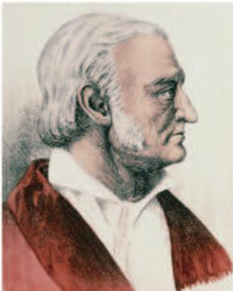
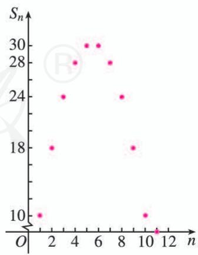
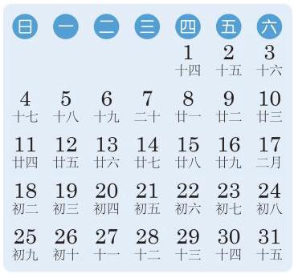
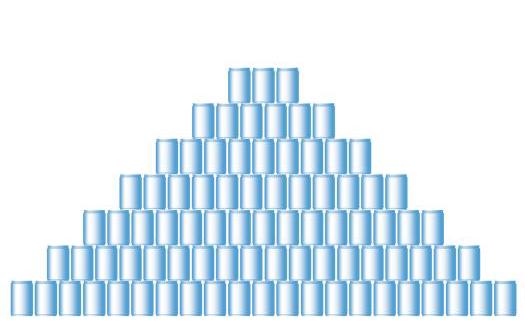
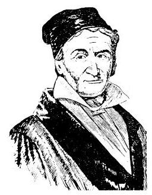
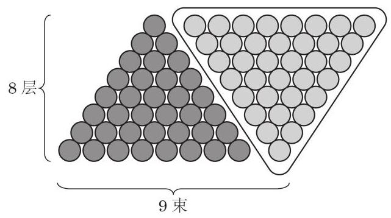

# 等差数列前n项和｜双教材原文摘录

本文件保留相关章节的讲解、例题与随堂练习，按版本分段。较宽章节含相邻知识和混合习题，尚未逐题筛选、配答或审校。原文为转写稿，请对照教材原件。

## 人教A版：4.2.2 等差数列的前n项和公式

来源：01_第四章_数列.md（本地转写稿），转写稿第 748—1139 行；截至下一指定标题前。

## 4.2.2 等差数列的前n项和公式

前面我们学习了等差数列的概念和通项公式，下面我们将利用这些知识解决等差数列的求和问题

据说，二百多年前，高斯的算术老师提出了下面的问题：

$$
1 + 2 + 3 + \cdots + 1 0 0 = ?
$$

当其他同学忙于把100个数逐项相加时，10岁的高斯却用下面的方法迅速算出了正确答案：

$$
( 1 + 1 0 0 ) + ( 2 + 9 9 ) + \cdots + ( 5 0 + 5 1 ) = 1 0 1 \times 5 0 = 5 0 5 0 .
$$

高斯的算法实际上解决了求等差数列

$$
1 , \ 2 , \ 3 , \ \cdots , \ n , \ \cdots\tag{①}
$$

前100项的和的问题.

高斯(Gauss,1777—1855)，德国数学家，近代数学的奠基者之一.他在天文学、大地测量学、磁学、光学等领域都作出了杰出贡献.

## 思考

你能说说高斯在求和过程中利用了数列①的什么性质吗？你能从中得到求数列①的前 n 项和的方法吗？

对于数列①，设 $a _ { n } = n$ ，那么高斯的计算方法可以表示为

$$
( a _ { 1 } + a _ { 1 0 0 } ) + ( a _ { 2 } + a _ { 9 9 } ) + \cdots + ( a _ { 5 0 } + a _ { 5 1 } ) = 1 0 1 \times 5 0 = 5 0 5 0 .
$$

可以发现，高斯在计算中利用了

$$
a _ { 1 } + a _ { 1 0 0 } = a _ { 2 } + a _ { 9 9 } = \cdots = a _ { 5 0 } + a _ { 5 1 }
$$

这一特殊关系，这就是上一小节例5中性质的应用，它使不同数的求和问题转化成了相同数（即101）的求和，从而简化了运算。

你能用高斯的方法求1+2+…+100+101吗?

将上述方法推广到一般，可以得到：

当n是偶数时，有

$$
a _ { 1 } + a _ { n } = a _ { 2 } + a _ { n - 1 } = \cdots = a _ { \frac { n } { 2 } } + a _ { \frac { n } { 2 } + 1 } ,
$$

于是有

$$
\begin{aligned} S_n&=1+2+3+\cdots+n \\ &= (1+n)+[2+(n-1)]+\cdots+\left[\frac n2+\left(\frac n2+1\right)\right] \\ &=\underbrace{(1+n)+(1+n)+\cdots+(1+n)}_{\frac n2\text{个}} \\ &=\frac{n(1+n)}2. \end{aligned}
$$

当n为奇数时，有

$$
\begin{aligned}
S_n&=1+2+3+\cdots+n \\
&=(1+n)+[2+(n-1)]+\cdots+\left[\left(\frac{n+1}{2}-1\right)+\left(\frac{n+1}{2}+1\right)\right]+\frac{n+1}{2} \\
&=\underbrace{(1+n)+(1+n)+\cdots+(1+n)}_{\frac{n-1}{2}\text{个}}+\frac{n+1}{2} \\
&=\frac{n-1}{2}(1+n)+\frac{n+1}{2}=\frac{n(1+n)}{2}.
\end{aligned}
$$

所以，对任意正整数n，都有

$$
S _ { n } = 1 + 2 + 3 + \cdots + n = { \frac { n \left( 1 + n \right) } { 2 } } .
$$

## 思考

我们发现，在求前n个正整数的和时，要对n分奇数、偶数进行讨论，比较麻烦． 能否设法避免分类讨论？

如果对公式 $S _ { n } = 1 + 2 + 3 + \cdots + n = { \frac { n \left( n + 1 \right) } { 2 } }$ 作变形，可得

$$
2 S _ { n } = 2 ( 1 + 2 + 3 + \cdots + n ) = n \left( n + 1 \right) ,
$$

它相当于两个 $S _ { n }$ 相加，而结果变成n个（n+1）相加.

受此启发，我们得到下面的方法：

$$
\begin{array} { l c r } { { S _ { n } = 1 + \begin{array} { c c c } { { 2 } } & { { + } } & { { 3 } } \end{array} + \dots + n , } } \\ { { S _ { n } = n + ( n - 1 ) + ( n - 2 ) + \dots + 1 , } } \end{array}
$$

将上述两式相加，可得

$$
\begin{array} { r l } & { 2 S _ { n } = ( n + 1 ) + [ ( n - 1 ) + 2 ] + [ ( n - 2 ) + 3 ] + \dots + ( 1 + n ) } \\ & { \qquad = \underbrace { ( 1 + n ) + ( 1 + n ) + \dots + ( 1 + n ) } _ { n\text{个} } } \\ & { \qquad = n \left( n + 1 \right) , } \end{array}
$$

所以

$$
S _ { n } = 1 + 2 + 3 + \cdots + n = \frac { n \left( n + 1 \right) } { 2 } .
$$

## 探究

上述方法的妙处在哪里？这种方法能够推广到求等差数列 $\{ a _ { n } \}$ 的前 n 项和吗？

可以发现，上述方法的妙处在于将 $1 + 2 + 3 + \cdots + n$ “倒序”为 $n + ( n - 1 ) + ( n - 2 ) + \cdots + 1$，再将两式相加，得到n个相同的数（即n+1）相加，从而把不同数的求和转化为n个相同的数求和.

对于等差数列 $\left\{ a _ { n } \right\}$ ，因为 $a _ { 1 } + a _ { n } = a _ { 2 } + a _ { n - 1 } = \cdots = a _ { n } + a _ { 1 }$ ，由上述方法得到启示，我们用两种方式表示 $S _ { n }$

$$
S _ { n } = a _ { 1 } + \textit { a } _ { 2 } \ + \cdots + a _ { n } ,\tag{②}
$$

$$
S _ { n } { = } a _ { n } { + } a _ { n - 1 } { + } { \cdots } { + } a _ { 1 } { . }\tag{③}
$$

②+③，得

$$
\begin{array} { r l } & { 2 S _ { n } { = } ( a _ { 1 } { + } a _ { n } ) + ( a _ { 2 } { + } a _ { n - 1 } ) { + } \dotsb { + } ( a _ { n } { + } a _ { 1 } ) } \\ & { \quad ~ { = } \underbrace { ( a _ { 1 } { + } a _ { n } ) + ( a _ { 1 } { + } a _ { n } ) + \dotsb { + } ( a _ { 1 } { + } a _ { n } ) } _ { n\text{个} } } \\ & { ~ { = } n ( a _ { 1 } { + } a _ { n } ) . } \end{array}
$$

由此得到等差数列 $\{ a _ { n } \}$ 的前n项和公式

$$
\boxed { S _ { n } = \frac { n \left( a _ { 1 } + a _ { n } \right) } { 2 } . }\tag{1}
$$

将（1）变形可得

$$
{ \frac { a _ { 1 } + a _ { n } } { 2 } } = { \frac { a _ { 1 } + a _ { 2 } + \cdots + a _ { n } } { n } } ,
$$

所以 $\frac { a _ { 1 } + a _ { n } } { 2 }$ 就是等差数列$\{ a _ { n } \}$ 前n项的平均数. 实际上，我们就是利用等差数列的这一重要特性来推导它的前n项和的. 你还能发现这一特性的一些应用吗？

对于等差数列 $\{ a _ { n } \}$ ，利用公式（1），只要已知等差数列 $\{ a _ { n } \}$ 的首项 $a _ { 1 }$ 和末项 $a _ { n }$ ，就可以求得前n项和 $S _ { n }$ .另外，如果已知首项 $a _ { 1 }$ 和公差 $d$ ，那么这个等差数列就完全确定了，所以我们也可以用 $a _ { 1 }$ 和 $d$ 来表示 $S _ { n }$ .

把等差数列的通项公式 $a _ { n } = a _ { 1 } + ( n - 1 ) d$ 代入公式(1)，可得

$$
\overline { { S _ { n } = n a _ { 1 } + \frac { n \left( n - 1 \right) } { 2 } d . } }\tag{2}
$$

## 思考

不从公式（1）出发，你能用其他方法得到公式（2）吗？

例6 已知数列 $\{ a _ { n } \}$ 是等差数列.

(1) 若 $a _ { 1 } = 7 , ~ a _ { 5 0 } = 1 0 1$ ，求 $S _ { 5 0 }$

(2) 若 $a _ { 1 } = 2 , ~ a _ { 2 } = \frac { 5 } { 2 }$ ，求 $S _ { 1 0 }$

(3) 若 $a _ { 1 } = \frac { 1 } { 2 } , \ d = - \frac { 1 } { 6 } , \ S _ { n } = - 5$ ，求n.

对于等差数列 $\{a_n\}$ 的相关量 $a_1$，$a_n$，$d$，$n$，$S_n$，已知几个量就可以确定其他量？

分析：对于（1），可以直接利用公式 $S _ { n } { = } \frac { n \left( a _ { 1 } { + } a _ { n } \right) } { 2 }$ 求和；在（2）中，可以先利用 $a _ { 1 }$ 和 $a _ { 2 }$ 的值求出d，再利用公式 $S _ { n } { = } n a _ { 1 } { + } \frac { n \left( n { - } 1 \right) } { 2 } d$ 求和；（3）已知公式 $S _ { n } = n a _ { 1 } +$ ${ \frac { n ( n - 1 ) } { 2 } } d$ 中的 $a _ { 1 } , \ d$ 和 $S _ { n }$ ，解方程即可求得n.

解：（1）因为 $a_1=7,\ a_{50}=101$，根据公式 $S_n=\frac{n(a_1+a_n)}{2}$，可得

$$
S _ { 5 0 } = \frac { 5 0 \times ( 7 + 1 0 1 ) } { 2 } = 2 7 0 0 .
$$

(2) 因为 $a_1=2,\ a_2=\frac52$，所以 $d=\frac12$。根据公式 $S_n=na_1+\frac{n(n-1)}{2}d$，可得

$$
S _ { 1 0 } = 1 0 \times 2 + \frac { 1 0 \times ( 1 0 - 1 ) } { 2 } \times \frac { 1 } { 2 } = \frac { 8 5 } { 2 } .
$$

(3)把 $a _ { 1 } = \frac { 1 } { 2 }$ $d = - { \frac { 1 } { 6 } }$ $S _ { n } = - 5$ 代入 $S _ { n } { = } ~ n a _ { 1 } { + } \frac { n \left( n { - } 1 \right) } 2 d$ ，得

$$
- 5 = { \frac { 1 } { 2 } } n + { \frac { n \left( n - 1 \right) } { 2 } } \times \left( - { \frac { 1 } { 6 } } \right) .
$$

整理，得

$$
n ^ { 2 } - 7 n - 6 0 = 0 .
$$

解得

n=12，或n=-5（舍去）.

所以

$$
n { = } 1 2 .
$$

例7 已知一个等差数列 $\left\{ a _ { n } \right\}$ 前10项的和是310，前20项的和是1220.由这些条件能确定这个等差数列的首项和公差吗？

分析：把已知条件代入等差数列前n项和的公式（2）后，可得到两个关于 $a _ { 1 }$ 与 d的二元一次方程.解这两个二元一次方程所组成的方程组，就可以求得 $a _ { 1 }$ 和 $d .$

解：由题意，知

$$
\begin{array} { r } { S _ { 1 0 } = 3 1 0 , \ S _ { 2 0 } = 1 2 2 0 . } \end{array}
$$

把它们代入公式

$$
S _ { n } = n a _ { 1 } + \frac { n \left( n - 1 \right) } { 2 } d ,
$$

得

$$
\left\{ { \begin{array} { l } { { 1 0 a _ { 1 } + 4 5 d = 3 1 0 , } } \\ { { 2 0 a _ { 1 } + 1 9 0 d = 1 2 2 0 . } } \end{array} } \right.
$$

解方程组，得

$$
\left\{ \begin{array} { l l } { a _ { 1 } = 4 , } \\ { ~ } \\ { d = 6 . } \end{array} \right.
$$

所以，由所给的条件可以确定等差数列的首项和公差.

一般地，对于等差数列，只要给定两个相互独立的条件，这个数列就完全确定.

## 探究

已知数列 $\{ a _ { n } \}$ 的前n 项和为 $S _ { n } = p n ^ { 2 } + q n + r$ ，其中p，q，r为常数，且 $p \neq 0 .$ 任取若干组p，q，r，在电子表格中计算 $a _ { 1 } , ~ a _ { 2 } , ~ a _ { 3 } , ~ a _ { 4 } , ~ a _ { 5 }$ 的值（图 4.2-3 给出p=1，q=2，r=0的情况），观察数列 $\{ a _ { n } \}$ 的特点，研究它是一个怎样的数列，并证明你的结论.

<table><tr><td rowspan=1 colspan=1></td><td rowspan=1 colspan=1>A</td><td rowspan=1 colspan=1>B</td><td rowspan=1 colspan=1>C</td><td rowspan=1 colspan=1>D</td></tr><tr><td rowspan=1 colspan=1>1</td><td rowspan=1 colspan=1>1</td><td rowspan=1 colspan=1>3</td><td rowspan=1 colspan=1>3</td><td rowspan=1 colspan=1></td></tr><tr><td rowspan=1 colspan=1>2</td><td rowspan=1 colspan=1>2</td><td rowspan=1 colspan=1>8</td><td rowspan=1 colspan=1>5</td><td rowspan=1 colspan=1></td></tr><tr><td rowspan=1 colspan=1>3</td><td rowspan=1 colspan=1>0</td><td rowspan=1 colspan=1>15</td><td rowspan=1 colspan=1>7</td><td rowspan=2 colspan=1></td></tr><tr><td rowspan=1 colspan=1>4</td><td rowspan=1 colspan=1></td><td rowspan=1 colspan=1>24</td><td rowspan=1 colspan=1>9</td></tr><tr><td rowspan=1 colspan=1>5</td><td rowspan=1 colspan=1></td><td rowspan=1 colspan=1>35</td><td rowspan=1 colspan=1>11</td><td rowspan=1 colspan=1></td></tr></table>

图4.2-3

图 4.2-3中的电子表格 A列中 A1，A2，A3分别表示p，q，r的值，B列、C列中分别是相应的 $S _ { n }$ 和 $\boldsymbol { a } _ { n }$ 的值.

## 练习

1. 根据下列各题中的条件，求相应等差数列 $\left\{ a _ { n } \right\}$ 的前n项和 $S _ { n }$

(1) $a _ { 1 } = 5 , a _ { n } = 9 5 , n = 1 0 ;$ (2) $a _ { 1 } = 1 0 0 , \ d = - 2 , \ n = 5 0$

(3) $a _ { 1 } = - 4 , \ a _ { 8 } = - 1 8 , \ n = 1 0 ;$ (4) $a _ { 1 } = 1 4 . 5 , ~ d = 0 . 7 , ~ a _ { n } = 3 2 .$

2. 等差数列—1，-3，-5，…的前多少项的和是—100?

3. 在等差数列 $\{ a _ { n } \}$ 中， $S _ { n }$ 为其前n项的和，若 $S _ { 4 } { = } 6 , \ S _ { 8 } { = } 2 0$ ，求 $S _ { 1 6 }$

4. 在等差数列 $\{ a _ { n } \}$ 中，若 $S _ { 1 5 } = 5 ( a _ { 2 } + a _ { 6 } + a _ { k } )$ ，求k.

5.已知一个等差数列的项数为奇数，其中所有奇数项的和为290，所有偶数项的和为261.求此数列中间一项的值以及项数

例8某校新建一个报告厅，要求容纳800个座位，报告厅共有20排座位，从第2排起后一排都比前一排多2个座位.问第1排应安排多少个座位.

分析：将第1排到第20排的座位数依次排成一列，构成数列 $\{ a _ { n } \}$ .设数列 $\{ a _ { n } \}$ 的前n项和为 $S _ { n }$ .由题意可知， $\{ a _ { n } \}$ 是等差数列，且公差及前20项的和已知，所以可利用等差数列的前n项和公式求首项.

解：设报告厅的座位从第1排到第20排，各排的座位数依次排成一列，构成数列$\{ a _ { n } \}$ ，其前n项和为 $S _ { n }$ ．根据题意，数列 $\left\{ a _ { n } \right\}$ 是一个公差为2的等差数列，且 $S _ { 2 0 } { = } 8 0 0$

由 $S _ { 2 0 } = 2 0 a _ { 1 } + \frac { 2 0 \times ( 2 0 - 1 ) } { 2 } \times 2 = 8 0 0$ ，可得

$$
a _ { 1 } = 2 1 .
$$

因此，第1排应安排21个座位.

例9已知等差数列 $\{ a _ { n } \}$ 的前n项和为 $S _ { n }$ ，若 $a _ { 1 } = 1 0$ ，公差 $d = - 2$ ，则 $S _ { n }$ 是否存在最大值？若存在，求 $S _ { n }$ 的最大值及取得最大值时n的值；若不存在，请说明理由.

分析：由 $a _ { 1 } > 0$ 和 $d { < } 0$ ，可以证明 $\{ a _ { n } \}$ 是递减数列，且存在正整数k，使得当 $n { \geqslant } k$ 时， $a _ { n } { < } 0 , \ S _ { n }$ 递减.这样，就把求 $S _ { n }$ 的最大值转化为求 $\{ a _ { n } \}$ 的所有正数项的和.

另一方面，等差数列的前 $n$ 项和公式可写成 $S_n=\frac{d}{2}n^2+\left(a_1-\frac{d}{2}\right)n$，所以当 $d\neq 0$ 时，$S_n$ 可以看成二次函数 $y=\frac{d}{2}x^2+\left(a_1-\frac{d}{2}\right)x\ (x\in\mathbf R)$ 当 $x=n$ 时的函数值。如图4.2-4，当 $d<0$ 时，$S_n$ 关于 $n$ 的图象是一条开口向下的抛物线上的一些点。因此，可以利用二次函数求相应的 $n$，$S_n$ 的值。

解法1：由 $a _ { n + 1 } - a _ { n } = - 2 < 0$ ，得 $a _ { n + 1 } < a _ { n }$ ，所以 $\{ a _ { n } \}$ 是递减数列.

又由 $\ a _ { n } = 1 0 + ( n - 1 ) \times ( - 2 ) = - 2 n + 1 2$ ，可知：

图4.2-4

当 $n { < } 6$ 时， $a _ { n } > 0$ 当 $n = 6$ 时， ${ { a } _ { n } } = 0$ 当 $n > 6$ 时， $a _ { n } < 0 .$

所以

$$
S _ { 1 } { < } S _ { 2 } { < } \cdots { < } S _ { 5 } { = } S _ { 6 } { > } S _ { 7 } { > } \cdots .
$$

也就是说，当n=5或6时， $S _ { n }$ 最大.

因为 $S _ { 5 } = \frac { 5 } { 2 } \times [ 2 \times 1 0 + ( 5 - 1 ) \times ( - 2 ) ] = 3 0$ ，所以 $S _ { n }$ 的最大值为30.

解法2：因为 $\begin{array} { l } { { S _ { n } = \displaystyle \frac { d } { 2 } n ^ { 2 } + \bigl ( a _ { 1 } { - } \frac { d } { 2 } \bigr ) n } } \\ { { \mathrm { ~ } = - n ^ { 2 } + 1 1 n } } \\ { { \mathrm { ~ } = - \bigl ( n { - } \frac { 1 1 } { 2 } \bigr ) ^ { 2 } + \frac { 1 2 1 } { 4 } , } } \end{array}$

想一想，这是为什么？

所以，当n取与 $\frac { 1 1 } { 2 }$ 最接近的整数即5或6时， $S _ { n }$ 最大，最大值为30.

## 思考

在例 9 中，当d=—3.5 时， $S _ { n }$ 有最大值吗？结合例9考虑更一般的等差数列前n 项和的最大值问题.

## 练习

1.某市一家商场的新年最高促销奖设立了两种领奖方式：第一种，获奖者可以选择2000元的奖金；第二种，从12月20日到第二年的1月1日，每天到该商场领取奖品，第1天领取的奖品价值为100元，第2天为110元，以后逐天增加10元.你认为哪种领奖方式获奖者受益更多？

2. 已知数列 $\{ a _ { n } \}$ 的前n项和 $S _ { n } = \frac { 1 } { 4 } n ^ { 2 } + \frac { 2 } { 3 } n + 3$ 求这个数列的通项公式

3.已知等差数列—4.2，-3.7，—3.2，…的前n项和为 $S _ { n } , S _ { n }$ 是否存在最大（小）值？如果存在，求出取得最值时n的值.

4. 求集合 $M=\{m\mid m=2n-1,\ n\in\mathbf N^*,\ \text{且 }m<60\}$ 中元素的个数，并求这些元素的和.

\*5.已知数列 $\{ a _ { n } \}$ 的通项公式为 $a _ { n } = \frac { n - 2 } { 2 n - 1 5 }$ ，前n项和为 $S _ { n }$ 求 $S _ { n }$ 取得最小值时n的值.

## 习题4.2

## 复习巩固

1. 根据下列等差数列 $\left\{ a _ { n } \right\}$ 中的已知量，求相应的未知量：

(1) $a _ { 1 } = 2 0 , \ a _ { n } = 5 4 , \ S _ { n } = 9 9 9$ ，求d及n; (2) $d = { \frac { 1 } { 3 } } , \ n = 3 7 , \ S _ { n } = 6 2 9$ ，求 $a _ { 1 }$ 及 $a _ { n } ;$

(3) $a _ { 1 } = \frac { 5 } { 6 } , \ d = - \frac { 1 } { 6 } , \ S _ { n } = - 5$ ，求n及 $a _ { n }$ (4) $d = 2 , \ n = 1 5 , \ a _ { n } = - 1 0$ ，求 $a _ { 1 }$ 及 $S _ { n } .$

2. 已知 $\{ a _ { n } \}$ 为等差数列， $a _ { 1 } + a _ { 3 } + a _ { 5 } = 1 0 5 , ~ a _ { 2 } + a _ { 4 } + a _ { 6 } = 9 9$ 求 $a _ { 2 0 }$

3. （1）求从小到大排列的前n个正偶数的和

(2)求从小到大排列的前n个正奇数的和.

(3)在三位正整数的集合中有多少个数是5的倍数？求这些数的和.

(4)在小于100的正整数中，有多少个数被7除余2?这些数的和是多少?

4.1682年，英国天文学家哈雷发现一颗大彗星的运行曲线和1531年、1607年的彗星惊人地相似.他大胆断定，这是同一天体的三次出现，并预言它将于76年后再度回归这就是著名的哈雷彗星，它的回归周期大约是76年。请你查找资料，列出哈雷彗星的回归时间表，并预测它在本世纪回归的年份.

## 综合运用

5.已知一个多边形的周长等于158cm，所有各边的长成等差数列，最大的边长为44cm，公差为3 cm. 求这个多边形的边数.

6. 数列 $\{ a _ { n } \} \ , \quad \{ b _ { n } \}$ 都是等差数列，且 $a _ { 1 } = 5 , ~ b _ { 1 } = 1 5 , ~ a _ { 1 0 0 } + b _ { 1 0 0 } = 1 0 0$ 求数列 $\{ a _ { n } + b _ { n } \}$ 的前 100项的和.

7. 已知 $S _ { n }$ 是等差数列 $\left\{ a _ { n } \right\}$ 的前 n项和.

(1) 证明 $\left\{ { \frac { S _ { n } } { n } } \right\}$ 是等差数列；

(2) 设 $T _ { n }$ 为数列 $\left\{ { \frac { S _ { n } } { n } } \right\}$ 的前n项和，若 $S _ { 4 } { = } 1 2 , \ S _ { 8 } { = } 4 0$ ，求 $T _ { n }$ 。

8.已知两个等差数列2，6，10，…，190及2，8，14，…，200，将这两个等差数列的公共项按从小到大的顺序组成一个新数列.求这个新数列的各项之和.

9. 一支车队有15辆车，某天下午依次出发执行运输任务.第一辆车于14时出发，以后每间隔10min发出一辆车.假设所有的司机都连续开车，并都在18时停下来休息.

(1)截止到18时，最后一辆车行驶了多长时间?

(2)如果每辆车行驶的速度都是60km/h，这个车队当天一共行驶了多少千米?

## 拓广探索

10.已知等差数列 $\left\{ a _ { n } \right\}$ 的公差为d，求证 $\frac{a_m-a_n}{m-n}=d$。你能从直线的斜率角度来解释这个结果吗？

11.虎甲虫以爬行速度快闻名，下表记录了一只虎甲虫连续爬行 $n\ \mathrm{s}$（$n=1,2,\ldots,10$）时爬行的距离.

<table><tr><td rowspan=1 colspan=1>时间/s</td><td rowspan=1 colspan=1>1</td><td rowspan=1 colspan=1>2</td><td rowspan=1 colspan=1>3</td><td rowspan=1 colspan=1>4</td><td rowspan=1 colspan=1>5</td><td rowspan=1 colspan=1>6</td><td rowspan=1 colspan=1>7</td><td rowspan=1 colspan=1>8</td><td rowspan=1 colspan=1>9</td><td rowspan=1 colspan=1>10</td></tr><tr><td rowspan=1 colspan=1>距离/m</td><td rowspan=1 colspan=1>2.50</td><td rowspan=1 colspan=1>5.03</td><td rowspan=1 colspan=1>7.55</td><td rowspan=1 colspan=1>10.05</td><td rowspan=1 colspan=1>12.45</td><td rowspan=1 colspan=1>15.01</td><td rowspan=1 colspan=1>17.28</td><td rowspan=1 colspan=1>19.90</td><td rowspan=1 colspan=1>22.48</td><td rowspan=1 colspan=1>25.07</td></tr></table>

(1）你能建立一个数列模型，近似地表示这只虎甲虫连续爬行的距离与时间之间的关系吗？

(2)利用建立的模型计算，这只虎甲虫连续爬行1min能爬多远（精确到0.01m)?它连续爬行10 m需要多长时间（精确到0.1s)？

12.如图的形状出现在南宋数学家杨辉所著的《详解九章算法·商功》中，后人称为“三角垛”.“三角垛”的最上层有1个球，第二层有3个球，第三层有6个球…设各层球数构成一个数列 $\left\{ a _ { n } \right\}$

(1) 写出数列 $\left\{ a _ { n } \right\}$ 的一个递推公式；

\*(2）根据（1）中的递推公式，写出数列 $\left\{ a _ { n } \right\}$ 的一个通项公式.

  
(第12 题)

## 沪教版2026：4.1 等差数列

来源：沪教版选择性必修第一册2026-dollar-polished-fixed.md（本地转写稿），转写稿第 5044—5490 行；截至下一指定标题前。

## 4.1 等差数列

### 1 等差数列及其通项公式

在现实生活中, 我们经常见到按一定顺序排列起来的一列数, 称之为数列. 我们将数列中的每一个数叫做这个数列的项. 排在第一位的数称为这个数列的第 1 项 (通常叫做首项), 排在第二位的数称为这个数列的第 2 项, $\cdots \cdots$ ,排在第 $n$ 位的数称为这个数列的第 $n$ 项,等等.

数列的一般形式可以记成

$$
{a}_{1},{a}_{2},{a}_{3},\cdots ,{a}_{n},\cdots ,
$$

其中 ${a}_{n}$ 是数列的第 $n$ 项,下标 $n$ 是 ${a}_{n}$ 的序数. 上面的数列常简记为 $\left\{  {a}_{n}\right\}$ .

观察以下数列, 看它们有什么共同的特点.

(1)月历(图 4-1-1)最后一列数依次为:

3, 10, 17, 24, 31.①

图 4-1-1

图 4-1-2

(2)按一定规律堆放在一起的食品罐头(图 4-1-2)，共堆放 7 层, 从下到上各层的罐头数依次为:

$$
{21},{18},{15},{12},9,6,3.
$$

②

(3)全国统一的鞋号中，常见的成年女鞋的尺寸(单位:cm) 由小至大依次为:

$$
{22.5},{23},{23.5},{24},{24.5},{25},{25.5},{26}.
$$

③

可以看到, 对于数列①, 从第 2 项起, 每一项与其前一项的差都等于 7; 对于数列②, 从第 2 项起, 每一项与其前一项的差都等于 -3 ; 对于数列③，从第 2 项起，每一项与其前一项的差都等于 0.5 .

这些数列有一个共同特点: 从第 2 项起, 每一项与其前一项的差都等于同一个常数.

定义 如果一个数列从第 2 项起, 每一项与其前一项的差都等于同一个常数, 这个数列就叫做等差数列 (arithmetic sequence), 而这个常数叫做等差数列的公差 (common difference). 公差通常用小写字母 $d$ 表示.

给定一个数列 $a, A, b$ . 若 $a, A, b$ 是等差数列,由定义可得 $A - a = b - A$ ,从而 $A = \frac{a + b}{2}$ . 反之,若 $A = \frac{a + b}{2}$ ,则 ${2A} = a + b$ ,即 $A - a = b - A$ ,从而 $a, A, b$ 成等差数列.

这时, $A$ 叫做 $a$ 与 $b$ 的等差中项.

如果等差数列 $\left\{  {a}_{n}\right\}$ 的首项为 ${a}_{1}$ ,公差为 $d$ ,由定义可得

$$
{a}_{n} - {a}_{n - 1} = d\left( {n \geq  2}\right) ,
$$

从而

$$
{a}_{2} - {a}_{1} = d,
$$

$$
{a}_{3} - {a}_{2} = d,
$$

$$
{a}_{4} - {a}_{3} = d,
$$

...

$$
{a}_{n} - {a}_{n - 1} = d\left( {n \geq  2}\right) .
$$

把这 $\left( {n - 1}\right)$ 个等式相加得

$$
{a}_{n} - {a}_{1} = \left( {n - 1}\right) d,
$$

由此

$$
{a}_{n} = {a}_{1} + \left( {n - 1}\right) d\left( {n \geq  2}\right) .
$$

当 $n = 1$ 时,容易验证上面的等式也成立. 因此,当 $n$ 为正整数时,等差数列 $\left\{  {a}_{n}\right\}$ 的第 $n$ 项可以用如下公式表示:

$$
{a}_{n} = {a}_{1} + \left( {n - 1}\right) d.
$$

像这种用数列的序数 $n$ 表示相应项 ${a}_{n}$ 的公式称为数列 $\left\{  {a}_{n}\right\}$ 的通项公式. 而上式就是等差数列 $\left\{  {a}_{n}\right\}$ 的通项公式.

---

由三个数组成的等差数列可以看成最简单的等差数列.

---

例 1 已知等差数列 $- 5, - 9, - {13},\cdots$ .

(1)求该等差数列的第 20 项；

(2)一401 是不是该等差数列的项？如果是，指明是第几项; 如果不是,请说明理由.

解 设该等差数列为 $\left\{  {a}_{n}\right\}$ ,由 ${a}_{1} =  - 5,{a}_{2} =  - 9$ ,得该等差数列的公差 $d =  - 9 - \left( {-5}\right)  =  - 4$ . 由等差数列的通项公式,得

$$
{a}_{n} =  - 5 - 4\left( {n - 1}\right)  =  - {4n} - 1.
$$

(1)由上述通项公式可得, 该等差数列的第 20 项为

$$
{a}_{20} =  - 4 \times  {20} - 1 =  - {81}.
$$

(2)假设 -401 是这个等差数列中的第 $n$ 项，则有

$$
- {401} =  - {4n} - 1,
$$

解得

$$
n = {100}\text{ . }
$$

所以, -401 是这个等差数列的第 100 项.

例 2 假设体育场一角看台的座位从第 2 排起每一排都比前一排多相等数目的座位. 若第 3 排有 10 个座位, 第 9 排有 28 个座位, 则第 12 排有多少个座位?

解 由题意可知,体育场该角看台每排的座位数成等差数列,设该数列为 $\left\{  {a}_{n}\right\}$ ,其公差为 $d$ ,则 ${a}_{3} = {10},{a}_{9} = {28}$ . 由等差数列的通项公式, 得

$$
\left\{  \begin{array}{l} {a}_{1} + {2d} = {10}, \\  {a}_{1} + {8d} = {28}, \end{array}\right.
$$

解得

$$
\left\{  \begin{array}{l} {a}_{1} = 4, \\  d = 3. \end{array}\right.
$$

所以, ${a}_{12} = 4 + \left( {{12} - 1}\right)  \times  3 = {37}$ .

答: 体育场该角看台的第 12 排有 37 个座位.

例 3 已知 ${a}_{n} = {pn} + q$ 是数列 $\left\{  {a}_{n}\right\}$ 的通项公式,其中 $p$ 和 $q$ 均为常数. 试判断数列 $\left\{  {a}_{n}\right\}$ 是否为等差数列,并证明你的结论.

分析 为了判断 $\left\{  {a}_{n}\right\}$ 是否为等差数列,可以利用等差数列的定义,只要判断 ${a}_{n} - {a}_{n - 1}\left( {n \geq  2}\right)$ 的值是否为一个与 $n$ 无关的常数即可.

解 任取数列 $\left\{  {a}_{n}\right\}$ 中的相邻两项 ${a}_{n}$ 与 ${a}_{n - 1}\left( {n \geq  2}\right)$ ,求差得

$$
{a}_{n} - {a}_{n - 1} = \left( {{pn} + q}\right)  - \left[  {p\left( {n - 1}\right)  + q}\right]   = p\left( {n \geq  2}\right) .
$$

因为 $p$ 是一个与 $n$ 无关的常数,所以 $\left\{  {a}_{n}\right\}$ 是一个等差数列.

#### 练习 4.1(1)

1. 下列数列中成等差数列的是 ( )

A.0,1,3,5,7;

B. $1,\frac{1}{3},\frac{1}{5},\frac{1}{7},\frac{1}{9}$ ;

C. $1,\sqrt{2},\sqrt{3},2,\sqrt{5}$ ;

D. $1,\frac{1}{3}, - \frac{1}{3}, - 1, - \frac{5}{3}$ .

2. 设数列 $\left\{  {a}_{n}\right\}$ 为等差数列,其公差为 $d$ .

(1)已知 ${a}_{1} =  - 1, d = 4$ ，求 ${a}_{8}$ ；

(2)已知 ${a}_{7} = 8, d =  - \frac{1}{3}$ ，求 ${a}_{1}$ ；

(3)已知 ${a}_{1} = 9, d =  - 2,{a}_{n} =  - {15}$ ，求 $n$ .

3. 已知数列 $\left\{  {a}_{n}\right\}$ 是等差数列,正整数 $m,n,p,q$ 满足 $m + n = p + q$ . 求证: ${a}_{m} + {a}_{n} = \; {a}_{p} + {a}_{q}.$

### 2 等差数列的前 $n$ 项和

---

高斯 (C. F. Gauss, 1777—1855) 德国数学家. 研究的内容涉及数学的诸多领域, 并对天文学和大地测量学的研究有突出贡献. 他在世界上享有崇高的声望，被誉为 “数学王子”.

---

据说 200 多年前, 著名数学家高斯的算术老师在课堂上曾经提出了下面的问题:

求 $1 + 2 + 3 + \cdots  + {100}$ 的值.

少年高斯用下面的方法迅速算出了正确的答案:

$$
1 + 2 + 3 + \cdots  + {100} = ?
$$

$$
{100} + {99} + {98} + \cdots  + 1 = ?
$$

上述两式相加得: ${101} + {101} + {101} + \cdots  + {101} = 2 \times$ ?

所以，结果为 $\frac{{101} \times  {100}}{2} = {5050}$ .

高斯的计算方法实际上解决了求等差数列 $1,2,3,\cdots$ , $n,\cdots$ 前 100 项和的问题.

事实上, 古代的中国人和希腊人也是这么求等差数列之和的. 例如, 宋朝数学家杨辉提出了一个问题: “今有圭垛草一堆, 顶上一束，底阔八束. 问共几束？答:36 束. ”他的计算方法可以用图 4-1-3 表示.

图 4-1-3

一般地,将数列 $\left\{  {a}_{n}\right\}$ 的前 $n$ 项和记作 ${S}_{n}$ ,即

$$
{S}_{n} = {a}_{1} + {a}_{2} + \cdots  + {a}_{n} = \mathop{\sum }\limits_{{i = 1}}^{n}{a}_{i}.
$$

根据等差数列的通项公式, 上式可以写为

$$
{S}_{n} = {a}_{1} + \left( {{a}_{1} + d}\right)  + \cdots  + \left[  {{a}_{1} + \left( {n - 2}\right) d}\right]   + \left[  {{a}_{1} + \left( {n - 1}\right) d}\right]  \text{ . ① }
$$

受高斯算法的启示,我们又可将 ${S}_{n}$ 表示为

$$
{S}_{n} = {a}_{n} + {a}_{n - 1} + \cdots  + {a}_{2} + {a}_{1}
$$

$$
= {a}_{n} + \left( {{a}_{n} - d}\right)  + \cdots  + \left[  {{a}_{n} - \left( {n - 2}\right) d}\right]   + \left[  {{a}_{n} - \left( {n - 1}\right) d}\right]  \text{ . ② }
$$

②

由①+②, 得

$$
2{S}_{n} = \underset{n \uparrow  }{\underbrace{\left( {{a}_{1} + {a}_{n}}\right)  + \left( {{a}_{1} + {a}_{n}}\right)  + \cdots  + \left( {{a}_{1} + {a}_{n}}\right)  + \left( {{a}_{1} + {a}_{n}}\right) }}
$$

$$
= n\left( {{a}_{1} + {a}_{n}}\right) \text{ . }
$$

于是就可得到等差数列 $\left\{  {a}_{n}\right\}$ 的前 $n$ 项和公式

$$
{S}_{n} = \frac{n\left( {{a}_{1} + {a}_{n}}\right) }{2}.
$$

由于 ${a}_{n} = {a}_{1} + \left( {n - 1}\right) d$ ,上述公式又可以写作

$$
{S}_{n} = n{a}_{1} + \frac{n\left( {n - 1}\right) }{2}d.
$$

例 4 设数列 $\left\{  {a}_{n}\right\}$ 为等差数列,其前 $n$ 项和为 ${S}_{n}$ .

(1)已知 ${a}_{1} = {50},{a}_{8} = {15}$ ，求 ${S}_{8}$ ；

(2)已知 ${a}_{1} = {0.7},{a}_{2} = {1.5}$ ，求 ${S}_{7}$ ；

(3)已知 ${a}_{4} = 7$ ，求 ${S}_{7}$ .

解(1)由等差数列的前 $n$ 项和公式，得

$$
{S}_{8} = \frac{8 \times  \left( {{50} + {15}}\right) }{2} = {260}.
$$

---

特别地 $1 + 2 + 3 + \cdots  + n = \frac{n\left( {n + 1}\right) }{2}.$

---

(2)设公差为 $d$ ，则 $d = {a}_{2} - {a}_{1} = {0.8}$ ，于是由等差数列的前 $n$ 项和公式,有

$$
{S}_{7} = 7 \times  {0.7} + \frac{7 \times  6}{2} \times  {0.8} = {21.7}.
$$

(3)设公差为 $d$ ，则 ${a}_{1} = {a}_{4} - {3d},{a}_{7} = {a}_{4} + {3d}$ . 从而

$$
{S}_{7} = \frac{7\left( {{a}_{1} + {a}_{7}}\right) }{2} = \frac{7\left[  {\left( {{a}_{4} - {3d}}\right)  + \left( {{a}_{4} + {3d}}\right) }\right]  }{2} = 7{a}_{4} = {49}.
$$

例 5 已知等差数列 $\left\{  {a}_{n}\right\}$ 的前 10 项和 ${S}_{10} = {310}$ ,前 20 项和 ${S}_{20} = {1220}$ ,由此可以确定数列 $\left\{  {a}_{n}\right\}$ 前 30 项和 ${S}_{30}$ 吗?

解 设该等差数列 $\left\{  {a}_{n}\right\}$ 的公差为 $d$ . 由等差数列的前 $n$ 项和公式 ${S}_{n} = n{a}_{1} + \frac{n\left( {n - 1}\right) }{2}d$ ,可得

$$
\left\{  \begin{array}{l} {10}{a}_{1} + {45d} = {310}, \\  {20}{a}_{1} + {190d} = {1220}, \end{array}\right.
$$

解得

$$
\left\{  \begin{array}{l} {a}_{1} = 4, \\  d = 6. \end{array}\right.
$$

所以, ${S}_{30} = {30} \times  4 + \frac{{30} \times  \left( {{30} - 1}\right) }{2} \times  6 = {2730}$ .

例 6 已知数列 $\left\{  {a}_{n}\right\}$ 的前 $n$ 项和为 ${S}_{n} = {n}^{2} + {2n}$ .

(1)求数列 $\left\{  {a}_{n}\right\}$ 的通项公式；

(2)求证:数列 $\left\{  {a}_{n}\right\}$ 是等差数列.

解(1)当 $n \geq  2$ 时,

$$
{S}_{n - 1} = {\left( n - 1\right) }^{2} + 2\left( {n - 1}\right) ,
$$

从而

$$
{a}_{n} = {S}_{n} - {S}_{n - 1} = {n}^{2} + {2n} - \left[  {{\left( n - 1\right) }^{2} + 2\left( {n - 1}\right) }\right]   = {2n} + 1.
$$

而当 $n = 1$ 时, ${a}_{1} = {S}_{1} = {1}^{2} + 2 \times  1 = 3$ 亦满足上式.

所以,数列 $\left\{  {a}_{n}\right\}$ 的通项公式为 ${a}_{n} = {2n} + 1$ .

(2)证明:由(1)中的结果，当 $n \geq  2$ 时，

$$
{a}_{n - 1} = 2\left( {n - 1}\right)  + 1 = {2n} - 1,
$$

从而

$$
{a}_{n} - {a}_{n - 1} = \left( {{2n} + 1}\right)  - \left( {{2n} - 1}\right)  = 2.
$$

所以，数列 $\left\{  {a}_{n}\right\}$ 是一个等差数列.

---

如果一个数列 $\left\{  {a}_{n}\right\}$ 的前 $n$ 项和为 ${S}_{n} = p{n}^{2} + {qn} + r,$ 其中 $p,q,r$ 均为常数, 这个数列是等差数列吗?

---

#### 练习 4.1(2)

1. 计算 $\mathop{\sum }\limits_{{i = 1}}^{n}{2i}$ .
2. 设数列 $\left\{  {a}_{n}\right\}$ 为等差数列,其前 $n$ 项和为 ${S}_{n}$ .

(1)已知 ${a}_{1} =  - 4,{a}_{8} =  - {18}$ ,求 ${S}_{8}$ ;

(2)已知 ${a}_{1} =  - 4,{a}_{12} = {18}$ ，求 ${S}_{15}$ .

3. 已知数列 $\left\{  {a}_{n}\right\}$ 的前 $n$ 项和 ${S}_{n} = {n}^{2} - {3n}$ ，求证:数列 $\left\{  {a}_{n}\right\}$ 是等差数列.

#### 习题 4.1

##### A 组

1. 分别求下列两数的等差中项:

(1) $\frac{8 - \sqrt{2}}{2}$ 与 $\frac{8 + \sqrt{2}}{2}$ ；___

(2) ${\left( a + b\right) }^{2}$ 与 ${\left( a - b\right) }^{2}$ .

2. 设数列 $\left\{  {a}_{n}\right\}$ 为等差数列,其公差为 $d$ .

(1)已知 ${a}_{1} = 2, d = 3$ ,求 ${a}_{10}$ ;

(2)已知 ${a}_{1} = 3,{a}_{n} = {21}, d = 2$ ，求 $n$ ；

(3)已知 ${a}_{1} = {12},{a}_{6} = {27}$ ，求 $d$ ；

(4)已知 ${a}_{6} = 9, d =  - \frac{1}{2}$ ，求 ${a}_{1}$ .

3. 已知数列 $\left\{  {a}_{n}\right\}$ 为等差数列,其公差为 $d$ . 求证: 对任意给定的正整数 $m,n$ ,都有 ${a}_{n} = {a}_{m} + \left( {n - m}\right) d.$
4. 设数列 $\left\{  {a}_{n}\right\}$ 为等差数列,其公差为 $d$ .

(1)已知 ${a}_{2} = {31},{a}_{7} = {76}$ ,求 ${a}_{1}$ 及 $d$ ;

(2)已知 ${a}_{1} + {a}_{6} = {12},{a}_{4} = 7$ ，求 ${a}_{9}$ .

5. 设数列 $\left\{  {a}_{n}\right\}$ 为等差数列,其公差为 $d$ ,前 $n$ 项和为 ${S}_{n}$ .

(1)已知 ${a}_{1} = {20},{a}_{n} = {54},{S}_{n} = {999}$ ,求 $d$ 及 $n$ ;

(2)已知 $d = \frac{1}{3},{S}_{37} = {629}$ ,求 ${a}_{1}$ 及 ${a}_{37}$ ;

(3)已知 ${a}_{1} = \frac{5}{6}, d =  - \frac{1}{6},{S}_{n} =  - 5$ ，求 $n$ 及 ${a}_{n}$ ；

(4)已知 $d = 2,{a}_{15} =  - {10}$ ，求 ${a}_{1}$ 及 ${S}_{15}$ .

6. 设数列 $\left\{  {a}_{n}\right\}$ 为等差数列,其前 $n$ 项和为 ${S}_{n}$ .

(1)已知 ${a}_{6} = {10},{S}_{5} = 5$ ,求 ${S}_{8}$ ;

(2)已知 ${S}_{4} = 2,{S}_{9} =  - 6$ ，求 ${S}_{12}$ .

7. 设数列 $\left\{  {a}_{n}\right\}$ 为等差数列,其前 $n$ 项和为 ${S}_{n}$ .

(1)已知 ${a}_{4} + {a}_{14} = 1$ ，求 ${S}_{17}$ ；

(2)已知 ${S}_{21} = {420}$ ，求 ${a}_{11}$ ；

(3)已知 ${a}_{1} + {a}_{2} + {a}_{3} =  - 3,{a}_{18} + {a}_{19} + {a}_{20} = 6$ ，求 ${S}_{20}$ ；

(4)已知 ${S}_{4} = 2,{S}_{8} = 6$ ，求 ${S}_{16}$ .

8. 求证: “ $\bigtriangleup  {ABC}$ 三个内角的度数可以构成等差数列” 是 “ $\bigtriangleup  {ABC}$ 中有一个内角为 ${60}^{ \circ  }$ ”的充要条件.

9.《九章算术》中的“竹九节”问题: 现有一根 9 节的竹子, 自上而下各节的容积成等差数列. 若最上面 4 节的容积共 3 升, 最下面 3 节的容积共 4 升, 则第 5 节的容积为多少升?

##### B 组

1.(1)在等差数列 $\left\{  {a}_{n}\right\}$ 中，等式 ${a}_{n} = \frac{{a}_{n - 1} + {a}_{n + 1}}{2}\left( {n \geq  2}\right)$ 是否都成立？

(2)在数列 $\left\{  {a}_{n}\right\}$ 中，如果对于任意的正整数 $n\left( {n \geq  2}\right)$ ，都有 ${a}_{n} = \frac{{a}_{n - 1} + {a}_{n + 1}}{2}$ ，那么数列 $\left\{  {a}_{n}\right\}$ 一定是等差数列吗?

2. 在等差数列 $\left\{  {a}_{n}\right\}$ 中,其前 $n$ 项和为 ${S}_{n}$ . 已知公差 $d = 2,{S}_{20} = {400}$ .

(1)写出 $\mathop{\sum }\limits_{{i = 1}}^{{10}}{a}_{{2i} - 1}$ 的具体展开式，并求其值；

(2)用求和符号表示 ${a}_{2} + {a}_{4} + {a}_{6} + \cdots  + {a}_{20}$ ，并求其值.

3. 在等差数列 $\left\{  {a}_{n}\right\}$ 中,已知 ${a}_{1} =  - 3,{11}{a}_{5} = 5{a}_{8}$ . 求数列 $\left\{  {a}_{n}\right\}$ 的前 $n$ 项和 ${S}_{n}$ 的最小值.
4. 已知等差数列 $\left\{  {a}_{n}\right\}$ ,其前 $n$ 项和为 ${S}_{n}$ . 若存在两个不相等的正整数 $p$ 和 $q$ ,满足 ${S}_{p} = q,{S}_{q} = p$ ,求 ${S}_{p + q}$ .
5. 已知一个凸多边形各个内角的度数可以排列成一个公差为 5 的等差数列, 且最小角为 ${120}^{ \circ  }$ ,该多边形是几边形?
6. 某产品按质量分成 10 个档次, 生产最低档次产品的利润是 8 元/件. 每提高一个档次, 每件产品的利润增加 2 元, 但产量每天减少 3 件. 如果在某段时间内, 最低档次 (记作第 1 档次) 的产品每天可生产 60 件, 那么在该段时间内, 生产第几档次的产品可获得最大利润?
