# 导数与函数单调性｜双教材原文摘录

本文件保留相关章节的讲解、例题与随堂练习，按版本分段。较宽章节含相邻知识和混合习题，尚未逐题筛选、配答或审校。原文为转写稿，请对照教材原件。

## 人教A版：5.3.1 函数的单调性

来源：02_第五章_一元函数的导数及其应用.md（本地转写稿），转写稿第 975—1208 行；截至下一指定标题前。

## 5.3.1 函数的单调性

我们先来研究前面学习过的跳水问题

## 思考

图 5.3-1(1)是某跳水运动员的重心相对于水面的高度h随时间t 变化的函数$h \left( t \right) = - 4 . 9 t ^ { 2 } + 4 . 8 t + 1 1$ 的图象，图5.3-1(2)是跳水运动员的速度υ随时间t 变化的函数 $v ( t ) = h ^ { \prime } ( t ) = - 9 . 8 t + 4 . 8$ 的图象. $a = \frac { 2 4 } { 4 9 }$ ，b 是函数 h(t)的零点.

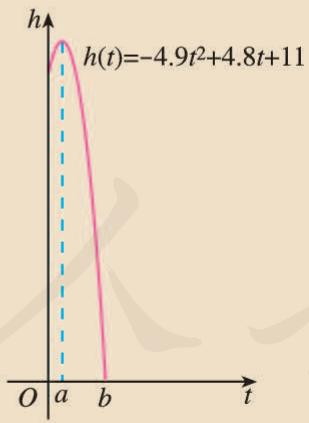  
(1)

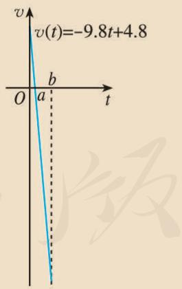  
(2)  
图 5.3-1

运动员从起跳到最高点，以及从最高点到入水这两段时间的运动状态有什么区别？如何从数学上刻画这种区别？

观察图象可以发现：

(1）从起跳到最高点，运动员的重心处于上升状态，离水面的高度h随时间t的增加

而增加，即h(t)单调递增.相应地， $v ( t ) = h ^ { \prime } ( t ) > 0 .$

(2)从最高点到入水，运动员的重心处于下降状态，离水面的高度h随时间t的增加而减小，即h(t)单调递减.相应地， $v ( t ) = h ^ { \prime } ( t ) < 0$

## 思考

我们看到，函数 h(t)的单调性与 $\textit { h } ^ { \prime } \left( t \right)$ 的正负有内在联系．那么，我们能否由$h ^ { \prime } ( t )$ 的正负来判断函数h(t)的单调性呢?

对于上述跳水问题，可以发现：

当 $t \in ( 0 , \ a )$ 时， $h ^ { \prime } ( t ) > 0$ ，函数h(t)的图象是“上升”的，函数h(t)在（0，a)内单调递增；

当 $t \in ( a , \ b )$ 时， $h ^ { \prime } \left( t \right) < 0$ ，函数h(t)的图象是“下降”的，函数h(t)在(a，b)内单调递减.

这种情况是否具有一般性呢？

## 观察

观察下面一些函数的图象（图5.3-2)，探讨函数的单调性与导数的正负的关系.

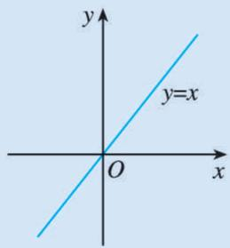  
(1)

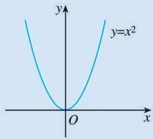  
(2)

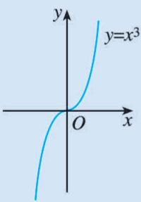  
(3)  
图 5.3-2

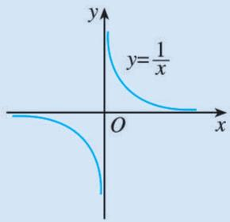  
(4)

如图5.3-3，导数 $f ^ { \prime } ( x _ { 0 } )$ 表示函数 $y = f ( x )$ 的图象在点$( x _ { 0 } , \ f ( x _ { 0 } ) )$ 处的切线的斜率.可以发现：

在 ${ \boldsymbol { x } } = { \boldsymbol { x } } _ { 0 }$ 处， $f ^ { \prime } ( x _ { 0 } ) > 0$ ，切线是“左下右上”的上升式，函数f(x)的图象也是上升的，函数f(x)在 ${ \mathcal { x } } = { \mathcal { x } } _ { 0 }$ 附近单调递增；

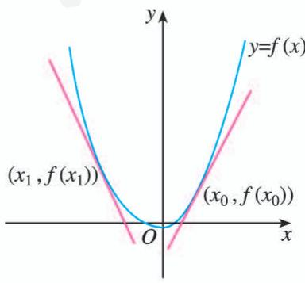

在 ${ \boldsymbol { x } } = { \boldsymbol { x } } _ { 1 }$ 处， $f ^ { \prime } ( x _ { 1 } ) { < } 0$ ，切线是“左上右下”的下降式，函数 $f ( x )$ 的图象也是下降的，函数 $f ( x )$ 在 $x = x _ { 1 }$ 附近单调递减.

图5.3-3

一般地，函数 $f ( x )$ 的单调性与导函数 $f ^ { \prime } ( x )$ 的正负之间具有如下的关系：

在某个区间 $( a , b )$ 内，如果 $f ^ { \prime } \left( x \right) > 0$ ，那么函数$y = f ( x )$ 在区间（a，b）内单调递增；

在某个区间（a，b）内，如果 $f ^ { \prime } \left( x \right) < 0$ ，那么函数$y = f ( x )$ 在区间（a，b）内单调递减.

如果在某个区间上恒有 $f ^ { \prime } \left( x \right) = 0$ ，那么函数$f ( x )$ 有什么特性？

例1 利用导数判断下列函数的单调性：

(1) $f ( x ) = x ^ { 3 } + 3 x$ (2) $f ( x ) = \sin x - x , \ x \in ( 0 , \ \pi )$

(3) $f ( x ) { = } \frac { x - 1 } { x }$

解：（1）因为 $f ( x ) = x ^ { 3 } + 3 x$ ，所以

$$
f ^ { \prime } ( x ) { = } 3 x ^ { 2 } + 3 { = } 3 ( x ^ { 2 } + 1 ) > 0 .
$$

所以，函数 $f ( x ) = x ^ { 3 } + 3 x$ 在R上单调递增，如图5.3-4（1）所示.

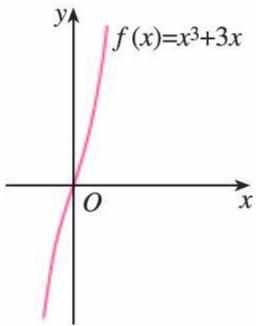  
(1)

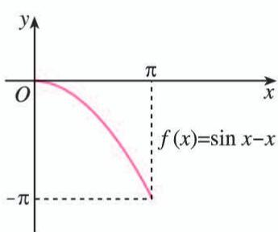  
(2)

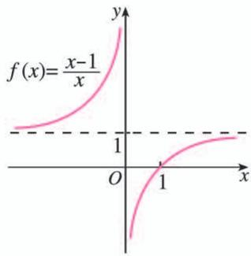  
图5.3-4  
(3)

(2) 因为 $f ( x ) { = } { \sin { x } { - } { x } } , { \ x } { \in } ( 0 , \ \pi )$ ，所以

$$
f ^ { \prime } ( x ) = \cos x - 1 < 0 .
$$

所以，函数 $f ( x ) = \sin x - x$ 在 $( 0 , \ \pi )$ 内单调递减，如图5.3-4(2)所示.

(3) 因为 $f ( x ) = 1 - \frac { 1 } { x } , \ x \in ( - \infty , \ 0 ) \bigcup ( 0 , \ + \infty )$ ，所以

$$
f ^ { \prime } ( x ) { = } \frac { 1 } { x ^ { 2 } } { > } 0 .
$$

所以，函数 $f ( x ) { = } 1 { - } { \frac { 1 } { x } }$ 在区间 $( - \infty ,$ 0)和 $( 0 , + \infty )$ 上单调递增，如图5.3-4（3）所示.

例2 已知导函数 $f ^ { \prime } ( x )$ 的下列信息：

当 $1 { < x < } 4$ 时， $f ^ { \prime } ( x ) { > } 0$

当 $x { < } 1$ ，或 $x { > } 4$ 时， $f ^ { \prime } ( x ) { < } 0$

当 $x = 1$ ，或 $x = 4$ 时， $f ^ { \prime } ( x ) { = } 0$

试画出函数f(x)图象的大致形状.

解：当 $1 { < x < } 4$ 时， $f ^ { \prime } ( x ) { > } 0$ ，可知 $f ( x )$ 在区间(1，4）内单调递增；

当 $x < 1$ ，或 $x > 4$ 时， $f ^ { \prime } \left( x \right) < 0$ ，可知 $f \left( x \right)$ 在区间$( - \infty , 1 )$ 和 $( 4 , + \infty )$ 上都单调递减；

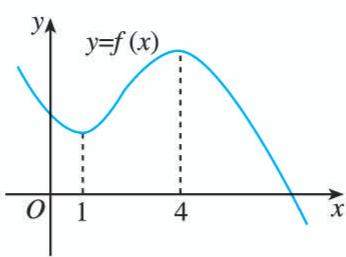

当 $x = 1$ ，或 $x = 4$ 时， $f ^ { \prime } ( x ) = 0$ ，这两点比较特殊，我们称它们为“稳定点”.

图5.3-5

综上，函数 $f ( x )$ 图象的大致形状如图5.3-5所示.

## 3 思考

请同学们回顾一下函数单调性的定义，并思考在某个区间上单调的函数 $y { = } f ( x )$ 的平均变化率的几何意义与 $f ^ { \prime } ( x )$ 的正负的关系.

## 练习

1. 判断下列函数的单调性：(1) $f ( x ) = x ^ { 2 } - 2 x + 4 ;$ (2) $f ( x ) = \mathrm { e } ^ { x } - x .$

2. 利用导数讨论二次函数 $f ( x ) = a x ^ { 2 } + b x + c$ 的单调区间.

3. 函数 $y = f ( x )$ 的图象如图所示，试画出函数 $y = f ^ { \prime } ( x )$ 在区间（O，b）内图象的大致形状.

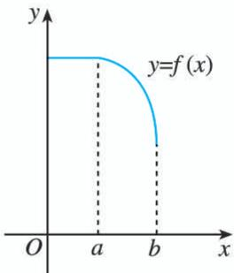  
(第3题)

形如 $f ( x ) = a x ^ { 3 } + b x ^ { 2 } + c x + d ( a \neq 0 )$ 的函数应用广泛，下面我们利用导数来研究这类函数的单调性

例3 求函数 $f ( x ) = { \frac { 1 } { 3 } } x ^ { 3 } - { \frac { 1 } { 2 } } x ^ { 2 } - 2 x + 1$ 的单调区间.

解：函数 $f ( x ) = { \frac { 1 } { 3 } } x ^ { 3 } - { \frac { 1 } { 2 } } x ^ { 2 } - 2 x + 1$ 的定义域为R. 对 $f ( x )$ 求导数，得

$$
f ^ { \prime } ( x ) = x ^ { 2 } - x - 2 = ( x + 1 ) ( x - 2 ) .
$$

令f $f ^ { \prime } ( x ) { = } 0$ ，解得

$$
x = - 1 , ~ \sharp \xi \ = x = 2 .
$$

$x = - 1$ 和 $x = 2$ 把函数定义域划分成三个区间， $f ^ { \prime } ( x )$ 在各区间上的正负，以及$f ( x )$ 的单调性如表5.3-1所示

表5.3-1
<table><tr><td rowspan=1 colspan=1>x</td><td rowspan=1 colspan=1> $( - \infty , - 1 )$ </td><td rowspan=1 colspan=1>-1</td><td rowspan=1 colspan=1>(-1,2)</td><td rowspan=1 colspan=1>2</td><td rowspan=1 colspan=1> $( 2 , + \infty )$ </td></tr><tr><td rowspan=1 colspan=1> $f ^ { \prime } ( x )$ </td><td rowspan=1 colspan=1>+</td><td rowspan=1 colspan=1>0</td><td rowspan=1 colspan=1>一</td><td rowspan=1 colspan=1>0</td><td rowspan=1 colspan=1>十</td></tr><tr><td rowspan=1 colspan=1> $f ( x )$ </td><td rowspan=1 colspan=1>单调递增</td><td rowspan=1 colspan=1> $f ( - 1 ) = \frac { 1 3 } { 6 }$ </td><td rowspan=1 colspan=1>单调递减</td><td rowspan=1 colspan=1> $f ( 2 ) = - { \frac { 7 } { 3 } }$ </td><td rowspan=1 colspan=1>单调递增</td></tr></table>

所以， $f ( x )$ 在(一∞，-1)和 $( 2 , \ + \infty )$ 上单调递增，在(一1，2)内单调递减，如图5.3-6所示.

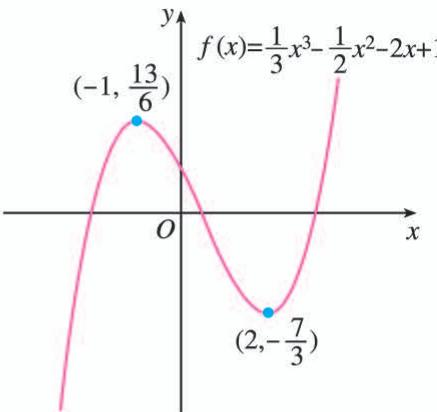  
图5.3-6

如果不用导数的方法，直接运用单调性的定义，你如何求解本题？运算过程麻烦吗？你有什么体会？

一般情况下，我们可以通过如下步骤判断函数 $y = f ( x )$ 的单调性：

第1步，确定函数的定义域；

第2步，求出导数 $f ^ { \prime } ( x )$ 的零点；

第3步，用 $f ^ { \prime } ( x )$ 的零点将 $f ( x )$ 的定义域划分为若干个区间，列表给出 $f ^ { \prime } ( x )$ 在各区间上的正负，由此得出函数 $y = f ( x )$ 在定义域内的单调性.

## 探究

研究对数函数 $y = \ln x$ 与幂函数 $y = x ^ { 3 }$ 在区间 $( 0 , + \infty )$ 上增长快慢的情况.

对数函数 $y { = } \ln x$ 的导数为 $y ^ { \prime } { = } \frac { 1 } { x } { > } 0 \ ( x { \in } ( 0 , \ + \infty ) )$ ，所以 $y = \ln x$ 在区间 $( 0 , \ + \infty )$ 上单调递增.当x越来越大时， $y ^ { \prime } { = } \frac { 1 } { x }$ 越来越小，所以函数 $y = \ln x$ 递增得越来越慢，图象上升得越来越“平缓”（如图5.3-7（1)).

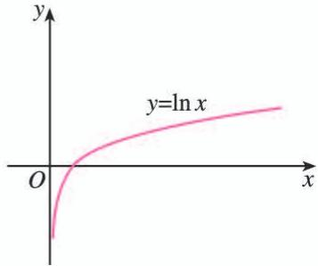  
(1)

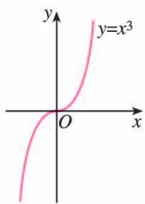  
(2)  
图5.3-7

幂函数 $y = x ^ { 3 }$ 的导数为 $y ^ { \prime } { = } 3 x ^ { 2 } { > } 0 ( x { \in } ( 0 , \ + \infty ) )$ ，所以 $y = x ^ { 3 }$ 在区间 $( 0 , \ + \infty )$ 上单调递增.当x越来越大时， $y ^ { \prime } { = } 3 x ^ { 2 }$ 越来越大，函数 $y = x ^ { 3 }$ 递增得越来越快，图象上升得越来越“陡峭”(如图5.3-7(2)).

一般地，如果一个函数在某一范围内导数的绝对值较大，那么函数在这个范围内变化得较快，这时函数的图象就比较“陡峭”(向上或向下)；反之，函数在这个范围内变化得较慢，函数的图象就比较“平缓”.

例4设 $x { > } 0$ の $f ( x ) = \ln x , g ( x ) = 1 - { \frac { 1 } { x } }$ ，两个函数的图象如图5.3-8所示.判断$f ( x ) , g ( x )$ 的图象与 $C _ { 1 } , C _ { 2 }$ 之间的对应关系.

解：因为 $f ( x ) = \ln x , g ( x ) = 1 - { \frac { 1 } { x } }$ ，所以

$$
f ^ { \prime } ( x ) ~ { = } \frac { 1 } { x } , ~ g ^ { \prime } ( x ) ~ { = } \frac { 1 } { x ^ { 2 } } .
$$

当x=1时， $f ^ { \prime } ( x ) { = } g ^ { \prime } ( x ) { = } 1$ i

当 $0 { < } x { < } 1$ 时， $g ^ { \prime } ( x ) > f ^ { \prime } ( x ) > 1$

当 $x { > } 1$ 时， $0 { < } g ^ { \prime } ( x ) { < } f ^ { \prime } ( x ) { < } 1$

所以， $f ( x ) , g ( x )$ 在 $( 0 , \ + \infty )$ 上都是增函数.在区间（0，1）内，g(x）的图象比f(x)的图象要“陡峭”；在区间 $( 1 , \ + \infty )$ 上，g(x)的图象比f(x)的图象要“平缓”.

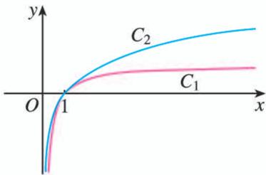  
图5.3-8

所以，f(x)，g(x)的图象依次是图5.3-8中的 $C _ { 2 } , C _ { 1 }$

## 练习

1. 判断下列函数的单调性，并求出单调区间：Q(1) $f ( x ) = 3 x - x ^ { 3 }$ (2) $f ( x ) = x ^ { 3 } - x ^ { 2 } - x$

2.证明函数 $f ( x ) { = } 2 x ^ { 3 } { - } 6 x ^ { 2 } + 7$ 在区间（0，2）内单调递减.

3. 函数 $y = f ^ { \prime } ( x )$ 的图象如图所示，试画出函数 $y = f ( x )$ 图象的大致形状.

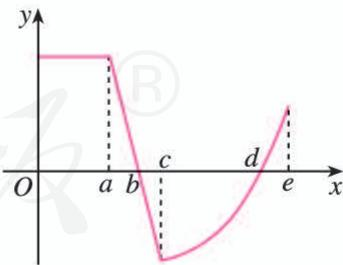  
(第3题)

## 沪教版2026：5.3 导数的应用

来源：沪教版选择性必修第二册2026-dollar-polished.md（本地转写稿），转写稿第 892—1323 行；截至下一指定标题前。

## 5.3 导数的应用

在对函数的研究中, 单调性与极大 (小) 值、最大 (小) 值是重要的主题之一. 但限于初等数学所能提供的工具, 在很多常见函数面前，我们往往束手无策，而导数则为我们研究函数的这些性质提供了通用和便捷的手段.

本章引入的定理大多需要高等数学的知识才能严格证明，但同学们可以借助一些熟悉的函数(如二次函数)来验证这些结论的合理性.

### 1 利用导数研究函数的单调性

函数的单调性研究的是在一个区间内函数是否严格增或严格减, 即函数值是否随着自变量的增大而增大, 或随着自变量的增大而减小. 导数是函数的瞬时变化率, 反映了在自变量发生变化的瞬间, 函数值随之发生的增减变化, 因此, 导数是研究函数单调性的最佳工具. 特别地, 从导数的正负就可以直接判断函数的单调性:

定理 在区间 $I$ 上,若 ${f}^{\prime }\left( x\right)  > 0$ ,则函数 $y = f\left( x\right)$ 在该区间严格增; 若 ${f}^{\prime }\left( x\right)  < 0$ ,则函数 $y = f\left( x\right)$ 在该区间严格减.

在导数值都存在的情况下，导数值由正变负或由负变正的过程中会出现导数等于零的点, 即函数的驻点. 因此, 要把函数的单调增区间和单调减区间划分出来, 就要先找到函数的驻点. 找到驻点后, 再看驻点两侧导数值的正负是否发生变化, 如果发生变化了, 此驻点就成为单调增区间与单调减区间的分界点.

例 1 已知 $f\left( x\right)  = {x}^{2} - {4x} + 2$ ,求函数 $y = f\left( x\right)$ 的单调区间.

解 先求函数的驻点: ${f}^{\prime }\left( x\right)  = {2x} - 4$ . 令 ${f}^{\prime }\left( x\right)  = 0$ ,解得

---

对一些你熟悉的函数, 借助信息技术工具，从数值和图像两个角度进行尝试， 获得的结论一致吗?

---

$x = 2$ . 此函数只有一个驻点.

当 $x > 2$ 时, ${f}^{\prime }\left( x\right)  > 0$ ,函数 $y = f\left( x\right)$ 严格增;

当 $x < 2$ 时， ${f}^{\prime }\left( x\right)  < 0$ ，函数 $y = f\left( x\right)$ 严格减.

?

因此，函数 $y = f\left( x\right)$ 的单调增区间为 $\left( {2, + \infty }\right)$ ,单调减区间为 $\left( {-\infty ,2}\right)$ .

例 2 已知 $f\left( x\right)  = {x}^{3} + {x}^{2} - x - 1$ ,求函数 $y = f\left( x\right)$ 的单调区间.

解 对函数求导,得 ${f}^{\prime }\left( x\right)  = 3{x}^{2} + {2x} - 1$ . 令 ${f}^{\prime }\left( x\right)  = 0$ , 解得 ${x}_{1} =  - 1,{x}_{2} = \frac{1}{3}$ . 此函数有两个驻点.

?

当 $x <  - 1$ 或 $x > \frac{1}{3}$ 时, ${f}^{\prime }\left( x\right)  > 0$ ,函数 $y = f\left( x\right)$ 严格增;

当 $- 1 < x < \frac{1}{3}$ 时, ${f}^{\prime }\left( x\right)  < 0$ ,函数 $y = f\left( x\right)$ 严格减.

因此，函数 $y = f\left( x\right)$ 的单调增区间为 $\left( {-\infty , - 1}\right)$ 及 $\left( {\frac{1}{3}, + \infty }\right)$ , 单调减区间为 $\left( {-1,\frac{1}{3}}\right)$ .

注意, 有时驻点并不是单调增区间与单调减区间的分界点.

例 3 已知 $f\left( x\right)  = {x}^{3}$ ,求函数 $y = f\left( x\right)$ 的单调区间.

解 对函数求导,得 ${f}^{\prime }\left( x\right)  = 3{x}^{2}$ . 令 ${f}^{\prime }\left( x\right)  = 0$ ,解得 $x = 0$ ,所以此函数在 $x = 0$ 时有唯一的驻点. 但是,由于永远成立 ${f}^{\prime }\left( x\right)  \geq  0$ ,驻点两侧导数值的正负没有发生变化,因此该驻点不是单调区间的分界点. 此函数的单调增区间为 $\left( {-\infty , + \infty }\right)$ .

在讨论中, 我们也要注意函数没有定义的点. 这样的点也可能成为单调增区间与单调减区间的分界点.

例 4 已知 $f\left( x\right)  = {x}^{-2}$ ,求函数 $y = f\left( x\right)$ 的单调区间.

解 该函数在 $x = 0$ 处没有定义. 当 $x \neq  0$ 时, ${f}^{\prime }\left( x\right)  = \; - 2{x}^{-3}$ ,因为方程 ${f}^{\prime }\left( x\right)  = 0$ 无解,所以函数 $y = f\left( x\right)$ 没有驻点. 但当 $x > 0$ 时, ${f}^{\prime }\left( x\right)  < 0, f\left( x\right)$ 严格减; 当 $x < 0$ 时, ${f}^{\prime }\left( x\right)  > 0$ , $f\left( x\right)$ 严格增. 可见,函数 $y = f\left( x\right)$ 的单调增区间为 $\left( {-\infty ,0}\right)$ ,单调减区间为 $\left( {0, + \infty }\right)$ ,而其分界点恰是该函数没有定义的点.

上面我们用导数值的正负来判断函数在某区间上的单调性.

---

在学习了更多相关知识后, 还可以进一步讨论单调区间是否包含端点.

用已经学过的二次函数知识验证这个结果.

利用信息技术工具绘制这个函数的图像以验证结果.

此例表明, ${f}^{\prime }\left( x\right)$ >0 并不是函数在一个区间上严格增的必要条件.

---

除此之外,导数值还可用以判断函数变化速度的快慢: 导数 ${f}^{\prime }\left( {x}_{0}\right)$ 是曲线 $y = f\left( x\right)$ 在点 $\left( {{x}_{0}, f\left( {x}_{0}\right) }\right)$ 处的切线的斜率,它描述了曲线 $y = f\left( x\right)$ 在点 $\left( {{x}_{0}, f\left( {x}_{0}\right) }\right)$ 附近相对于 $x$ 轴的倾斜程度: 当 ${f}^{\prime }\left( {x}_{0}\right)  > 0$ 时, ${f}^{\prime }\left( {x}_{0}\right)$ 越大,曲线 $y = f\left( x\right)$ 在点 $\left( {{x}_{0}, f\left( {x}_{0}\right) }\right)$ 附近相对于 $x$ 轴倾斜程度越大,函数值 $y = f\left( x\right)$ 递增得越快; 而当 ${f}^{\prime }\left( {x}_{0}\right)  < 0$ 时, ${f}^{\prime }\left( {x}_{0}\right)$ 越小,曲线 $y = f\left( x\right)$ 在点 $\left( {{x}_{0}, f\left( {x}_{0}\right) }\right)$ 附近相对于 $x$ 轴倾斜程度越大,函数值 $y = f\left( x\right)$ 递减得越快. 总之,导数的绝对值越大, 函数图像就越“陡峭”，也就是函数值的变化速度越快.

例 5 已知在区间 $\left( {0,1}\right)$ 上 ${f}^{\prime }\left( x\right)  > 1$ . 在图 5-3-1 所示的图像中,哪些有可能表示函数 $y = f\left( x\right)$ ? 为什么?

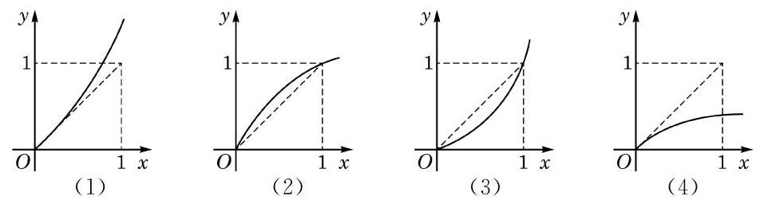

图 5-3-1

解 在区间 $\left( {0,1}\right)$ 上,因为 ${f}^{\prime }\left( x\right)  > 1$ ,所以函数图像中每一点处切线的斜率都应大于 1 . 在图 5-3-1 中，由观察可知:

图(1)中的曲线越来越“陡峭”，在区间 $\left( {0,1}\right)$ 上各点处的切线斜率始终大于 1 ;

图(2)中的曲线由“陡峭”变得“平缓”，在区间 $\left( {0,1}\right)$ 的右半段的切线斜率小于 1 ;

图(3)中的曲线由 “平缓” 变得 “陡峭”，在区间 $\left( {0,1}\right)$ 的左半段的切线斜率小于 1 ;

图(4)中的曲线越来越“平缓”，在区间 $\left( {0,1}\right)$ 上各点处的切线斜率始终小于 1 .

因此,只有图 5-3-1(1) 中的图像有可能表示函数 $y = f\left( x\right)$ .

#### 练习 5.3(1)

1. 利用导数研究下列函数的单调性, 并说明所得结果与你之前的认识是否一致:

(1) $y = {\mathrm{e}}^{x}$ ； (2) $y = \ln x$ ；

(3) $y = a{x}^{2} + {bx} + c$ ，其中 $a \neq  0$ .

2. 确定下列函数的单调区间:

(1) $y = x{\mathrm{e}}^{x}$ ； (2) $y = 4{x}^{3} - 9{x}^{2} + {6x} + 7$ .

### 2 利用导数研究函数的极值

观察图 5-3-2 中函数 $y = f\left( x\right)$ 的图像,其中有一些特殊的点, 在这些特殊点的左右两侧附近, 函数的单调性发生了改变. 例如,函数在点 $\left( {{x}_{1}, f\left( {x}_{1}\right) }\right)$ 的左侧附近严格增,右侧附近严格减，此处出现了一个“山峰”；又如，函数在点 $\left( {{x}_{2}, f\left( {x}_{2}\right) }\right)$ 的左侧附近严格减，右侧附近严格增，此处出现了一个“山谷”.

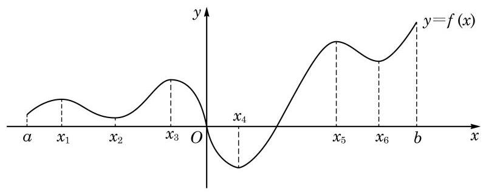

图 5-3-2

换句话说,存在含有 ${x}_{1}$ 的一个开区间,该区间内其他自变量所对应的函数值都不大于 $f\left( {x}_{1}\right)$ ,此时,就说函数 $y = f\left( x\right)$ 在 $x = {x}_{1}$ 处取得极大值 $f\left( {x}_{1}\right)$ ,而点 ${x}_{1}$ 称为函数 $y = f\left( x\right)$ 的极大值点. 类似地, 存在含有 ${x}_{2}$ 的一个开区间,该区间内其他自变量所对应的函数值都不小于 $f\left( {x}_{2}\right)$ ,此时,就说函数 $y = f\left( x\right)$ 在 $x = {x}_{2}$ 处取得极小值 $f\left( {x}_{2}\right)$ ,而点 ${x}_{2}$ 称为函数 $y = f\left( x\right)$ 的极小值点.

因此,图 5-3-2 所示的函数有三个极大值点 ${x}_{1}\text{ 、 }{x}_{3}\text{ 、 }{x}_{5}$ , 还有三个极小值点 ${x}_{2}\text{ 、 }{x}_{4}\text{ 、 }{x}_{6}$ .

极大值和极小值统称为极值, 而极大值点和极小值点则统称为极值点.

在导数存在的前提下，极值点一定是函数的驻点，函数曲线在该点的切线是水平的. 但反过来, 我们却不能说一个函数的驻点一定是其极值点. 例如,在函数 $y = {x}^{3}$ 中,点 $x = 0$ 虽是其驻点,但不是极值点,因为这个函数在整个区间 $\left( {-\infty , + \infty }\right)$ 上是严格增的. 因此,要找到函数 $y = f\left( x\right)$ 的极值点,通过 ${f}^{\prime }\left( {x}_{0}\right)  = 0$ 找到驻点 $x = {x}_{0}$ 只是第一步,还要根据驻点附近 ${f}^{\prime }\left( x\right)$ 的符号才能断定 ${x}_{0}$ 是否为 $f\left( x\right)$ 的极值点.

具体地说,我们有如下定理:

定理 设点 $x = {x}_{0}$ 是函数 $y = f\left( x\right)$ 的驻点.

(1)若在点 ${x}_{0}$ 的左侧附近有 ${f}^{\prime }\left( x\right)  > 0$ ，而在 ${x}_{0}$ 的右侧附近有 ${f}^{\prime }\left( x\right)  < 0$ ,则函数 $y = f\left( x\right)$ 在 ${x}_{0}$ 处取得极大值;

(2)若在点 ${x}_{0}$ 的左侧附近有 ${f}^{\prime }\left( x\right)  < 0$ ，而在 ${x}_{0}$ 的右侧附近有 ${f}^{\prime }\left( x\right)  > 0$ ,则函数 $y = f\left( x\right)$ 在 ${x}_{0}$ 处取得极小值.

例 6 已知 $f\left( x\right)  =  - {x}^{2} + {6x} - 1$ ,求函数 $y = f\left( x\right)$ 的单调区间和极值.

解 对函数求导,得 ${f}^{\prime }\left( x\right)  =  - {2x} + 6$ . 令 ${f}^{\prime }\left( x\right)  = 0$ ,解得 $x = 3$ ,从而 $x = 3$ 为函数 $y = f\left( x\right)$ 的唯一驻点. 把该驻点与其两侧的区间列表如下: O

表 5-3

<table><tr><td>$x$</td><td>(−∞,3)</td><td>3</td><td>(3,十)</td></tr><tr><td>${f}^{\prime }\left( x\right)$</td><td>+</td><td>0</td><td>-</td></tr><tr><td>$f\left( x\right)$</td><td>↗</td><td>极大值 8</td><td>↘</td></tr></table>

因此, $y = f\left( x\right)$ 在区间 $\left( {-\infty ,3}\right)$ 内严格增,在区间 $\left( {3, + \infty }\right)$ 内严格减，在 $x = 3$ 处取得极大值 $f\left( 3\right)  = 8$ .

例 7 求正弦函数 $y = \sin x$ 的单调区间和极值.

解 这是一个周期为 ${2\pi }$ 的周期函数. 记 $f\left( x\right)  = \sin x$ ,求导可得 ${f}^{\prime }\left( x\right)  = \cos x$ . 令 ${f}^{\prime }\left( x\right)  = 0$ ,解得 $x = {2k\pi } \pm  \frac{\pi }{2}, k \in  \mathbf{Z}$ . 将不同驻点及其所划分出的区间在一个周期上的情况列表如下:

表 5-4

<table><tr><td>$x$</td><td>${2k\pi } - \frac{\pi }{2}$</td><td>$\left( {{2k\pi } - \frac{\pi }{2},}\right.$   ${2k\pi } + \frac{\pi }{2})$</td><td>${2k\pi } + \frac{\pi }{2}$</td><td>$\left( {{2k\pi } + \frac{\pi }{2}}\right.$   $\left. {2\left( {k + 1}\right) \pi  - \frac{\pi }{2}}\right)$</td><td>$2\left( {k + 1}\right) \pi  - \frac{\pi }{2}$</td></tr><tr><td>${f}^{\prime }\left( x\right)$</td><td>0</td><td>+</td><td>0</td><td>-</td><td>0</td></tr><tr><td>$f\left( x\right)$</td><td>极小值 -1</td><td>↗</td><td>极大值 1</td><td>↘</td><td>极小值 -1</td></tr></table>

因此,对任意给定的 $k \in  \mathbf{Z}$ ,正弦函数 $y = \sin x$ 在区间 $\left( {{2k\pi } - \frac{\pi }{2},{2k\pi } + \frac{\pi }{2}}\right)$ 内严格增，在区间 $\left( {{2k\pi } + \frac{\pi }{2},2\left( {k + 1}\right) \pi  - \frac{\pi }{2}}\right)$ 内严格减，在 $x = {2k\pi } - \frac{\pi }{2}$ 时取得极小值 -1，在 $x = {2k\pi } + \frac{\pi }{2}$ 时取得极大值 1 .

---

把驻点与驻点所划分的区间列表, 可以简明清晰地呈现函数的增减情况和极值点.

---

例 8 已知 $f\left( x\right)  = \frac{1}{3}{x}^{3} - x + 2$ ,求函数 $y = f\left( x\right)$ 的单调区间和极值.

解 对函数求导,得 ${f}^{\prime }\left( x\right)  = {x}^{2} - 1$ . 令 ${f}^{\prime }\left( x\right)  = 0$ ,解得两个驻点 ${x}_{1} =  - 1,{x}_{2} = 1$ . 列表如下:

表 5-5

<table><tr><td>$x$</td><td>$\left( {-\infty , - 1}\right)$</td><td>-1</td><td>(-1,1)</td><td>1</td><td>(1,十〜)</td></tr><tr><td>${f}^{\prime }\left( x\right)$</td><td>+</td><td>0</td><td>-</td><td>0</td><td>+</td></tr><tr><td>$f\left( x\right)$</td><td>↗</td><td>极大值 $\frac{8}{3}$</td><td>↘</td><td>极小值 $\frac{4}{3}$</td><td>↗</td></tr></table>

因此,函数 $y = f\left( x\right)$ 的单调增区间为 $\left( {-\infty , - 1}\right)$ 及 $\left( {1, + \infty }\right)$ , 单调减区间为 $\left( {-1,1}\right) .y = f\left( x\right)$ 在 $x =  - 1$ 处取得极大值 $f\left( {-1}\right)  = \; \frac{8}{3}$ ,在 $x = 1$ 处取得极小值 $f\left( 1\right)  = \frac{4}{3}$ .

#### 练习 5.3(2)

1. 求余弦函数 $y = \cos x$ 的单调区间和极值.
2. 求函数 $y = {x}^{3} - {3x}$ 的单调区间和极值.

### 3 利用导数研究函数的最值

在许多理论和现实的问题中, 常常需要求函数的最大值或者最小值(统称为最值). 最值反映了函数在定义域上整体的情况， 而极值则仅考虑函数在某点附近的局部特征. 有时最值和极值是一致的,如函数 $y = \sin x$ ; 但有时却不一致,如图 5-3-2 所示的函数. 当然, 一个函数的极值与最值可能都不存在, 如函数 $y = {x}^{3}$ . 但是,如果考虑一个在闭区间上的连续函数,函数的最大值与最小值一定存在.

上面所说的一个区间 $I$ 上的连续函数,可以直观地理解为在

区间 $I$ 上图像为一条连绵不断的曲线的函数. 更精确及普适的连续函数的定义, 要用到严格的极限语言, 在高等数学中才能给出.

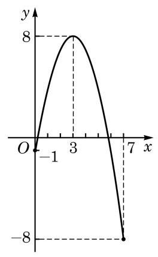

图 5-3-3

例 9 已知 $f\left( x\right)  =  - {x}^{2} + {6x} - 1$ ,求函数 $y = f\left( x\right)$ 在区间 $\left\lbrack  {0,7}\right\rbrack$ 上的最大值与最小值.

解 由本节例 6 可知,函数 $y =  - {x}^{2} + {6x} - 1$ 的驻点为 $x = 3$ , 比较 $f\left( 3\right)  = 8, f\left( 0\right)  =  - 1, f\left( 7\right)  =  - 8$ ,可知该函数在 $\left\lbrack  {0,7}\right\rbrack$ 上的最大值是 8 , 最小值是 -8 , 如图 5-3-3 所示.

---

为什么只要比较这几个点的函数值(甚至不必分析驻点是不是极值点), 就可以求出最值?

---

在例 9 中, 我们对驻点处与区间两端点处的函数值进行比较, 其中最大的就是最大值, 最小的就是最小值. 在导数存在的前提下, 闭区间上的连续函数的最值原则上都可以按照这样的方法求出.

?

例 10 已知 $f\left( x\right)  = \frac{1}{3}{x}^{3} - x + 2$ ,求函数 $y = f\left( x\right)$ 在 [0,3]上的最大值与最小值.

解 由本节例 8 可知,函数 $y = \frac{1}{3}{x}^{3} - x + 2$ 的两个驻点为 ${x}_{1} =  - 1,{x}_{2} = 1$ .

由于驻点 ${x}_{1} =  - 1$ 不在区间 $\left\lbrack  {0,3}\right\rbrack$ 内,因此只需比较 $f\left( 1\right)  = \frac{4}{3}, f\left( 0\right)  = 2, f\left( 3\right)  = 8$ ,可知函数 $y = \frac{1}{3}{x}^{3} - x + 2$ 在 $\left\lbrack  {0,3}\right\rbrack$ 上的最大值是 8,最小值是 $\frac{4}{3}$ .

### 4 利用导数研究二次函数

导数为研究函数的单调性、极值与最值提供了有力的工具. 利用这一工具,我们可以对熟悉的二次函数 $y = a{x}^{2} + {bx} + c \; \left( {a \neq  0}\right)$ 进行回顾和再认识. 以下仅讨论 $a > 0$ 的情况, $a < 0$ 的情况也可以用类似的方法获得相应的结果.

首先,可以利用导数的正负来判断函数 $y = a{x}^{2} + {bx} + c\left( {a > 0}\right)$ 的单调性, 同时求出它的极值.

记 $f\left( x\right)  = a{x}^{2} + {bx} + c$ . 对该函数求导,可得 ${f}^{\prime }\left( x\right)  = {2ax} + b$ , 令 ${f}^{\prime }\left( x\right)  = 0$ ,解得函数有唯一驻点 ${x}_{0} =  - \frac{b}{2a}$ . 可以列表如下:

表 5-6

<table><tr><td>$x$</td><td>$\left( {-\infty , - \frac{b}{2a}}\right)$</td><td>$- \frac{b}{2a}$</td><td>$\left( {-\frac{b}{2a}, + \infty }\right)$</td></tr><tr><td>${f}^{\prime }\left( x\right)$</td><td>-</td><td>0</td><td>+</td></tr><tr><td>$f\left( x\right)$</td><td>↘</td><td>极小值 $\frac{{4ac} - {b}^{2}}{4a}$</td><td>↗</td></tr></table>

因此,函数 $y = f\left( x\right)$ 的单调减区间为 $\left( {-\infty , - \frac{b}{2a}}\right)$ ,单调增区间为 $\left( {-\frac{b}{2a}, + \infty }\right) .y = f\left( x\right)$ 在 ${x}_{0} =  - \frac{b}{2a}$ 处取得极小值 $f\left( {-\frac{b}{2a}}\right)  = \frac{{4ac} - {b}^{2}}{4a}$ . 这个极小值也是该函数在区间 $\left( {-\infty , + \infty }\right)$ 上的最小值.

知道了该函数的单调区间之后，结合函数的零点，就可以解决相应的不等式问题.

我们已经知道,求二次函数 $y = a{x}^{2} + {bx} + c\left( {a > 0}\right)$ 的零点, 就是求一元二次方程 $a{x}^{2} + {bx} + c = 0\left( {a > 0}\right)$ 的实根.

令 $\Delta  = {b}^{2} - {4ac}$ ,我们已知: 当 $\Delta  > 0$ 时,方程有两个不相等的实根 ${x}_{1} = \frac{-b - \sqrt{{b}^{2} - {4ac}}}{2a},{x}_{2} = \frac{-b + \sqrt{{b}^{2} - {4ac}}}{2a}$ ; 当 $\Delta  = 0$ 时,方程有两个相等的实根 ${x}_{1} = {x}_{2} =  - \frac{b}{2a}$ ; 当 $\Delta  < 0$ 时,方程无实根.

上述方程 $a{x}^{2} + {bx} + c = 0$ 的实根就是函数 $y = a{x}^{2} + {bx} + c$ 的零点; 再结合函数 $y = f\left( x\right)$ 的单调性,我们就可以求得使 $f\left( x\right)  \geq  0$ (或 $f\left( x\right)  \leq  0$ )的 $x$ 的取值范围,也就是不等式 $a{x}^{2} + {bx} + c \geq  0$ (或 $a{x}^{2} + {bx} + c \leq  0$ ) 的解集.

记 $f\left( x\right)  = a{x}^{2} + {bx} + c$ . 为了解不等式 $a{x}^{2} + {bx} + c \geq  0\left( {a > 0}\right)$ , 可以分以下三种情况讨论:

(1)当 $\Delta  > 0$ 时,比较函数零点与驻点的大小关系,有

$$
{x}_{1} = \frac{-b - \sqrt{{b}^{2} - {4ac}}}{2a} < {x}_{0} < {x}_{2} = \frac{-b + \sqrt{{b}^{2} - {4ac}}}{2a}.
$$

因为 $y = f\left( x\right)$ 在区间 $\left( {-\infty ,{x}_{0}}\right)$ 上严格减,所以

---

此处所得结果与你之前的认识是否一致? 方法是不是更简便?

---

当 $x \in  \left( {-\infty ,{x}_{1}}\right)$ 时, $f\left( x\right)  > f\left( {x}_{1}\right)  = 0$ ;

当 $x \in  \left( {{x}_{1},{x}_{0}}\right)$ 时, $f\left( x\right)  < f\left( {x}_{1}\right)  = 0$ .

同样地,因为 $y = f\left( x\right)$ 在区间 $\left( {{x}_{0}, + \infty }\right)$ 上严格增,所以

当 $x \in  \left( {{x}_{0},{x}_{2}}\right)$ 时, $f\left( x\right)  < f\left( {x}_{2}\right)  = 0$ ;

当 $x \in  \left( {{x}_{2}, + \infty }\right)$ 时, $f\left( x\right)  > f\left( {x}_{2}\right)  = 0$ .

此外, $f\left( {x}_{1}\right)  = f\left( {x}_{2}\right)  = 0, f\left( {x}_{0}\right)  = \frac{{4ac} - {b}^{2}}{4a} < 0$ .

因此，该不等式的解集为 $\left( {-\infty ,{x}_{1}}\right\rbrack   \cup  \left\lbrack  {{x}_{2}, + \infty }\right)$ , 即 $\left( {-\infty ,\frac{-b - \sqrt{{b}^{2} - {4ac}}}{2a}}\right\rbrack   \cup  \left\lbrack  {\frac{-b + \sqrt{{b}^{2} - {4ac}}}{2a}, + \infty }\right)$ .

(2)当 $\Delta  = 0$ 时,有 ${x}_{1} = {x}_{2} = {x}_{0} =  - \frac{b}{2a}$ ，由函数单调性可知,当 $x \in  \left( {-\infty , + \infty }\right)$ 时,均有 $f\left( x\right)  \geq  f\left( {x}_{0}\right)  = f\left( {x}_{1}\right)  = \; f\left( {x}_{2}\right)  = 0$ . 因此,该不等式的解集为 $\mathbf{R}$ .

(3)当 $\Delta  < 0$ 时，由函数单调性可知，当 $x \in  \left( {-\infty , + \infty }\right)$ 时,均有 $f\left( x\right)  \geq  f\left( {x}_{0}\right)  = f\left( {-\frac{b}{2a}}\right)  = \frac{{4ac} - {b}^{2}}{4a} > 0$ . 因此,该不等式的解集为 $\mathbf{R}$ .

综合以上分析可得: 当 $\Delta  > 0$ 时,不等式 $a{x}^{2} + {bx} + c \geq  0 \; \left( {a > 0}\right)$ 的解集为 $\left( {-\infty ,\frac{-b - \sqrt{{b}^{2} - {4ac}}}{2a}}\right\rbrack   \cup  \left\lbrack  {\frac{-b + \sqrt{{b}^{2} - {4ac}}}{2a}, + \infty }\right)$ ; 当 $\Delta  \leq  0$ 时,该不等式的解集为 $\mathbf{R}$ . 这就很方便地得到必修课程第 2 章中的相应结论.

#### 练习 5.3(3)

1. 判断下列说法是否正确，并说明理由:

(1)函数在某区间上的极大值不会小于它的极小值；

(2)函数在某区间上的最大值不会小于它的最小值；

(3)函数在某区间上的极大值就是它在该区间上的最大值；

(4)函数在某区间上的最大值就是它在该区间上的极大值.

2. 求函数 $y = {x}^{2} - {6x} + 5, x \in  \left\lbrack  {1,4}\right\rbrack$ 的值域.
3. 求函数 $y = {x}^{3} - {3x}$ 在区间 $\left\lbrack  {-\frac{3}{2},0}\right\rbrack$ 上的最大值与最小值.

---

知道了函数的单调性和零点, 相应的不等式问题就迎刃而解了.

---

### 5 利用导数解决实际问题

前面已经看到, 导数可用来研究函数在某区间上的最大 (小)值, 从而对解决何时利润最大、何时用料最省等优化问题发挥着重要作用.

例 11 图 5-3-4 是一张边长为 3 的正方形硬纸板, 先在它的四个角上裁去边长为 $x$ 的四个小正方形,再折叠成无盖纸盒. 当裁去的小正方形边长 $x$ 发生变化时,纸盒的容积 $V$ 会随之发生变化. 当 $x$ 在什么范围内变化时,容积 $V$ 随着 $x$ 的增大而增大? 当 $x$ 在什么范围内变化时,容积 $V$ 随着 $x$ 的增大而减小? 当 $x$ 取何值时,容积 $V$ 最大? 最大值是多少? (纸板厚度忽略不计)

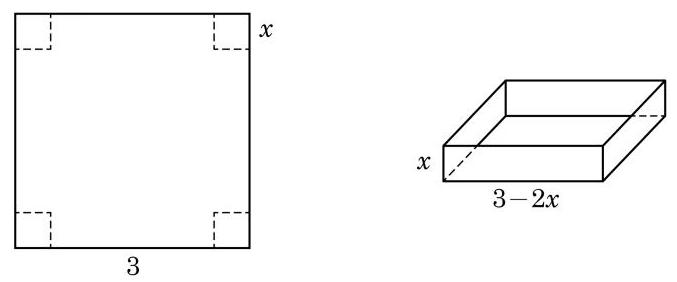

图 5-3-4

解 由题意, 得

$$
V\left( x\right)  = x{\left( 3 - 2x\right) }^{2}, x \in  \left( {0,\frac{3}{2}}\right) .
$$

求导可得

$$
{V}^{\prime }\left( x\right)  = {12}{x}^{2} - {24x} + 9.
$$

为求驻点,令 ${12}{x}^{2} - {24x} + 9 = 0$ ,得 ${x}_{1} = \frac{1}{2}$ 与 ${x}_{2} = \frac{3}{2}$ ,后者不在定义域内,舍去.

容易算出,当 $x \in  \left( {0,\frac{1}{2}}\right)$ 时, ${V}^{\prime }\left( x\right)  > 0$ ; 当 $x \in  \left( {\frac{1}{2},\frac{3}{2}}\right)$ 时, ${V}^{\prime }\left( x\right)  < 0$ . 因此,当 $x$ 在 0 到 $\frac{1}{2}$ 之间变化时,容积 $V$ 随着 $x$ 的增大而增大; 当 $x$ 在 $\frac{1}{2}$ 到 $\frac{3}{2}$ 之间变化时,容积 $V$ 随着 $x$ 的增大而

减小; 而当 $x = \frac{1}{2}$ 时,容积 $V\left( \frac{1}{2}\right)  = 2$ 是极大值,也是最大值.

例 12 已知某商品的成本 $C$ 与产量 $q$ 满足函数关系 $C = \; C\left( q\right)$ ,其中 $C\left( q\right)  = {100} + \frac{1}{4}{q}^{2}$ ,并定义平均成本为 $\bar{C} = \bar{C}\left( q\right)$ , 其中 $\bar{C}\left( q\right)  = \frac{C\left( q\right) }{q}$ .

---

经济学中通常将 ${C}^{\prime }\left( q\right)$ 称为边际成本, 它代表产量为 $q$ 时, 增加单位产量需付出的成本增加量.

---

(1)比较 ${C}^{\prime }\left( {10}\right)$ 和 ${C}^{\prime }\left( {20}\right)$ ，解释两者的大小代表了怎样的实际意义;

(2)当产量为多少时, 平均成本最少？

解 (1) 因为 ${C}^{\prime }\left( q\right)  = \frac{1}{2}q$ ,所以 ${C}^{\prime }\left( {10}\right)  = 5,{C}^{\prime }\left( {20}\right)  = {10}$ , 有 ${C}^{\prime }\left( {10}\right)  < {C}^{\prime }\left( {20}\right)$ .

${C}^{\prime }\left( {10}\right)  = 5$ 代表当产量为 $q = {10}$ 时,增加单位产量需付出的成本增加量为 5 ; 而 ${C}^{\prime }\left( {20}\right)  = {10}$ 代表当产量为 $q = {20}$ 时,增加单位产量需付出的成本增加量为 10 .

(2)平均成本 $\bar{C}\left( q\right)  = \frac{C\left( q\right) }{q} = \frac{100}{q} + \frac{q}{4},{\bar{C}}^{\prime }\left( q\right)  =  - \frac{100}{{q}^{2}} + \frac{1}{4}$ .

令 ${\bar{C}}^{\prime }\left( q\right)  = 0$ ,得 ${q}^{2} = {400}$ ,根据实际意义,可知 $q > 0$ ,因此, $q = {20}$ 是其驻点.

当 $0 < q < {20}$ 时, ${\bar{C}}^{\prime }\left( q\right)  < 0$ ,函数 $\bar{C} = \bar{C}\left( q\right)$ 严格减; 而当 $q >$ 20 时, ${\bar{C}}^{\prime }\left( q\right)  > 0$ ,函数 $\bar{C} = \bar{C}\left( q\right)$ 严格增. 因此,当产量 $q = {20}$ 时, 平均成本最少.

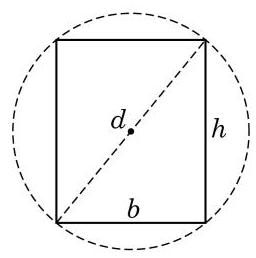

图 5-3-5

例 13 如图 5-3-5,将一根直径为 $d$ 的圆木锯成截面为矩形的梁. 问: 矩形的高 $h$ 和宽 $b$ 应如何选择,才能使梁的抗弯强度 $W = \frac{1}{6}b{h}^{2}$ 最大?

解 根据题意,可知 ${h}^{2} = {d}^{2} - {b}^{2}$ ,所以 $W\left( b\right)  = \frac{1}{6}b\left( {{d}^{2} - {b}^{2}}\right)$ , $0 < b < d$ .

求导,得 ${W}^{\prime }\left( b\right)  = \frac{1}{6}{d}^{2} - \frac{1}{2}{b}^{2}$ . 令 ${W}^{\prime }\left( b\right)  = 0$ ,得到驻点 $b = \frac{\sqrt{3}}{3}d$ .

由问题的实际意义,当 $b = \frac{\sqrt{3}}{3}d$ 时,梁的抗弯强度最大,此时, ${h}^{2} = {d}^{2} - {b}^{2} = \frac{2}{3}{d}^{2}$ ,即 $h = \frac{\sqrt{6}}{3}d$ .

在很多情形下(如例 11 与例 13)，由实际问题本身的意义， 可知函数在区间内部必定存在最大值(或最小值)，而区间内部只有一个驻点，由此即可断定:该函数在区间内部的唯一驻点处取得最大值(或最小值).

例 14 一艘船航行所需的燃料费与船速的平方成正比. 如果船速是 ${10}\mathrm{\;{km}}/\mathrm{h}$ ,那么每小时的燃料费是 80 元. 已知该船航行的其他费用为每小时 480 元,在 ${100}\mathrm{\;{km}}$ 的航程中,保持怎样的船速可使航行总费用最少? (结果精确到 $1\mathrm{\;{km}}/\mathrm{h}$ )

解 设当船速为 $x\left( {\mathrm{\;{km}}/\mathrm{h}}\right)$ 时,每小时所需燃料费为 $k{x}^{2}$ 元.

根据题意,当 $x = {10}$ 时, $k{x}^{2} = {100k} = {80}$ ,从而解得 $k = \frac{4}{5}$ . 因此，船在 ${100}\mathrm{\;{km}}$ 航程中的总费用为

$$
y = f\left( x\right)  = \frac{100}{x}\left( {\frac{4}{5}{x}^{2} + {480}}\right)  = {80x} + \frac{48000}{x}, x > 0.
$$

求导,得 ${f}^{\prime }\left( x\right)  = {80} - \frac{48000}{{x}^{2}}$ ,令 ${f}^{\prime }\left( x\right)  = 0$ ,得 $x = {10}\sqrt{6}$ 是唯一驻点. 当 $0 < x < {10}\sqrt{6}$ 时, ${f}^{\prime }\left( x\right)  < 0$ ,函数 $y = f\left( x\right)$ 严格减; 而当 $x > {10}\sqrt{6}$ 时, ${f}^{\prime }\left( x\right)  > 0$ ,函数 $y = f\left( x\right)$ 严格增. 因此,函数 $y = f\left( x\right)$ 在 $x = {10}\sqrt{6} \approx  {24}\left( {\mathrm{\;{km}}/\mathrm{h}}\right)$ 处取得最小值.

所以,在 ${100}\mathrm{\;{km}}$ 的航程中,保持约 ${24}\mathrm{\;{km}}/\mathrm{h}$ 的船速可使航行总费用最少.

#### 练习 5.3(4)

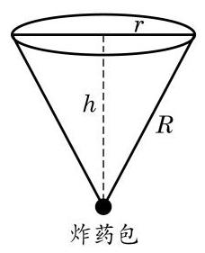

(第 2 题)

1. 某商品的成本 $C$ 和产量 $q$ 满足函数关系 $C = {50000} + {200q}$ ,该商品的销售单价 $p$ 和产量 $q$ 满足函数关系 $p = {24200} - \frac{1}{5}{q}^{2}$ . 问: 要使利润最大, 应如何确定产量?
2. 采矿、采石或取土时，常用炸药包进行爆破，部分爆破呈圆锥漏斗形状 (如图),已知圆锥的母线长是炸药包的爆破半径 $R$ ,它的值是固定的. 问:炸药包埋多深可使爆破体积最大？

#### 习题 5.3

##### A 组

1. 利用导数研究下列函数的单调性, 并说明结果与你之前的认识是否一致:

(1) $y = {\left( \frac{1}{\mathrm{e}}\right) }^{x}$ ; (2) $y = {\log }_{\frac{1}{\mathrm{e}}}x$ .

2. 利用导数判断函数 $y = \frac{1}{\cos x}, x \in  \left( {-\frac{\pi }{2},\frac{\pi }{2}}\right)$ 的单调性,并求出极值.
3. 某函数图像如图所示,它在 $\left\lbrack  {a, b}\right\rbrack$ 上哪一点处取得最大值? 它是极大值点吗? 在哪一点处取得最小值? 它是极小值点吗?

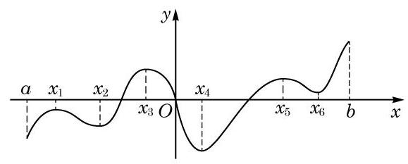

(第 3 题)

4. 求下列函数的单调区间、极值点和极值:

(1) $y = {x}^{2} + {2x} + {3;}$

(2) $y = x + \frac{1}{x}$ ；

(3) $y = {3x} - {x}^{3}$ ； (4) $y = {x}^{2}{\mathrm{e}}^{x}$ .

5. 证明: 函数 $y = {x}^{3} + {4x}$ 在 $\left( {-\infty , + \infty }\right)$ 上严格增.
6. 求函数 $y =  - {x}^{3} + {12x} - 1$ 的单调减区间.
7. 证明: 函数 $y = x - \frac{1}{x}$ 没有极值点.
8. 求函数 $y =  - {x}^{3} + {12x} - 1, x \in  \left\lbrack  {0,3}\right\rbrack$ 的值域.

##### B 组

1. 判断下列函数在 $\left( {-\infty , + \infty }\right)$ 上是否存在驻点,是否存在极值点,并说明理由:

(1) $y = {x}^{n}$ ， $n$ 为正奇数；

(2) $y = {x}^{n}$ ， $n$ 为正偶数.

2. 已知函数 $y = {x}^{3} + {2m}{x}^{2} - {nx} + m$ 在 $x = 1$ 处有极值 0,求 $m + n$ 的值.
3. 用长为 ${18}\mathrm{\;m}$ 的钢条制作一个如图所示的长方体框架. 已知长方体的长宽比为2÷1，间:该长方体的长、宽、高各为多少时，其体积最大? 最大体积是多少?

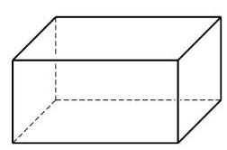

(第 3 题)

4. 某分公司经销一品牌产品, 每件产品的成本为 4 元, 且每件产品需向总公司交 3 元的管理费，预计当每件产品的售价为 $x$ 元( $8 \leq  x \leq  {11}$ ) 时,一年的销售量为 ${\left( {12} - x\right) }^{2}$ 万件. 问: 当每件产品的售价为多少元时,该分公司一年的利润 $L$ 最大?(结果精确到 1 元)

课后阅读

微积分简史

17 世纪，两位科学巨匠伽利略(G. Galilei)和开普勒(J. Kepler)的一系列发现导致了数学从古典数学向现代数学的转折. 自然科学, 特别是天文学和力学等学科的发展都需要一种新的数学工具来研究运动和变化的过程, 这促成了微积分的发明和发展.

朴素的积分学思想其实可以追溯到古希腊时代，在中国古代的数学中也有其踪迹，但直到 17 世纪，微积分才出现重大突破. 微积分主要来源于对四类问题的研究:面积、体积、弧长问题; 位移、速度、加速度关系问题; 切线问题; 最值问题. 许多数学家对此作出了贡献，这其中有卡瓦列利(F. Cavalieri)、费马(P. de Fermat)、沃利斯(J. Wallis)、笛卡儿(R. Descartes)和巴罗(I. Barrow)等. 在经过了半个世纪的酝酿后，牛顿(I. Newton) 和莱布尼茨(G. Leibniz)分别独立地完成了微积分创立过程中最后也是最关键的一步. 牛顿和莱布尼茨的杰出贡献，不在于发现求切线和求面积的方法，而是给出了一般的无穷小算法, 同时又找出了微分学和积分学的互逆关系, 现称为微积分基本定理, 这一深刻的思想已成为人类文明中的瑰宝.

牛顿对微积分问题的研究始于 1664 年秋, 当时他正在剑桥大学读书. 他因对笛卡儿圆法产生兴趣而开始寻找更好的求切线方法. 1665 年 11 月，牛顿发明了“正流数术”(微分法)，次年5月又建立了“反流数术”(积分法). 1666 年 10 月，牛顿将前两年的研究成果整理成一篇总结性论文，现以《流数简论》著称. 这是历史上第一篇系统的微积分文献. 在这篇论文中，牛顿通过揭示微分和积分的互逆关系而将两者统一为一个整体. 尽管如此，这一论文在许多方面还是不成熟的. 在其后的大约四分之一世纪的时间里，牛顿不断地完善自己的微积分学说，先后著成了三篇微积分论文:《分析学》(1669)、《流数法》(1671)和 《求积术》(1691). 它们真实地再现了牛顿创建微积分的思想历程.

与牛顿发明微积分的运动学背景不同, 莱布尼茨创立微积分首先是出于对几何学问题的思考. 1673 年, 他因在帕斯卡 (B. Pascal) 的有关论文中获得启迪, 而提出自己的“微分

三角形”理论. 在对微分三角形的研究中, 莱布尼茨逐渐认识到什么是求曲线的切线和求曲线下的面积的实质, 并发现了这两类问题的互逆关系. 由此他建立起一种更一般的算法, 并将以往解决这两类问题的各种结果和技巧加以统一.

刚刚诞生的微积分以其神奇的效果赢得了普遍的关注, 但在理论上却是粗糙和不完美的, 后世的许多数学家为其理论的建立和完善作出了不懈的努力, 特别是欧拉(L. Euler)、 达朗贝尔(J. d'Alembert)、波尔查诺(B. Bolzano)、柯西(A. L. Cauchy)和维尔斯特拉斯 (K. Weierstrass)等人作出了重要的贡献. 直到 19 世纪后半叶，现代意义的严密的微积分与数学分析理论才真正成形. 特别值得一提的是, 1859 年, 我国历史上首部微积分中文教科书《代微积拾级》在上海出版，标志着高等数学的传入. 此书的原作者为美国数学家罗密士(E. Loomis)，译者为中国数学家李善兰和英国人伟烈亚力(A. Wylie).

微积分的创立具有划时代的意义, 它开辟了数学的新时代, 使数学获得了极大的发展, 取得了空前的繁荣, 诸如微分方程、复变函数、微分几何等数学分支都应运而生. 微积分给出了一整套的科学方法，开创了科学的新纪元，并因此加强和加深了数学的巨大作用与应用. 有了微积分，人类才有能力把握运动和变化，进而推动了工业革命，促进了大工业生产, 最终有了现代化的社会. 微积分不仅极大地促进了天文学、力学、物理学等基础学科的发展，还在现代化学、生物学、工程学、地理学、经济学等自然科学、社会科学及应用科学各个分支获得了极其广泛的应用. 几乎所有现代技术领域, 如机械、仪器仪表、建筑、航海、航空航天、信息与通讯等，其技术的发展和产品的设计也都以微积分为基本数学工具.

纵观微积分的历史之旅，有着说不完的数学故事. 请同学们课后查阅有关书籍和资料, 认真地进行回顾和小结.
