# 函数奇偶性｜双教材原文摘录

本文件保留相关章节的讲解、例题与随堂练习，按版本分段。较宽章节含相邻知识和混合习题，尚未逐题筛选、配答或审校。原文为转写稿，请对照教材原件。

## 人教A版：3.2.2 奇偶性

来源：03_第三章_函数的概念与性质.md（本地转写稿），转写稿第 829—1075 行；截至下一指定标题前。

## 3.2.2 奇偶性

前面我们用符号语言精确地描述了函数图象在定义域的某个区间上“上升”(或“下降”）的性质。下面继续研究函数的其他性质

画出并观察函数 $f ( x ) = x ^ { 2 }$ 和 $g \left( x \right) = 2 - \left| x \right|$ 的图象（图3.2-6)，你能发现这两个函数图象有什么共同特征吗？

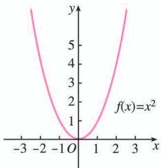

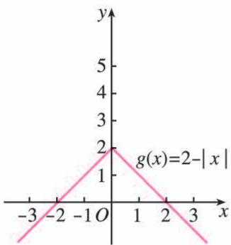  
图3.2-6

可以发现，这两个函数的图象都关于y轴对称

## 探究

类比函数單調性，你能用符號語言精确地描述“函数图象關於y轴對稱”這一特征吗？

不妨取自变量的一些特殊值，观察相应函数值的情况，如表3.2-1.

表3.2-1
<table><tr><td rowspan=1 colspan=1>x</td><td rowspan=1 colspan=1>…</td><td rowspan=1 colspan=1>-3</td><td rowspan=1 colspan=1>-2</td><td rowspan=1 colspan=1>-1</td><td rowspan=1 colspan=1>0</td><td rowspan=1 colspan=1>1</td><td rowspan=1 colspan=1>2</td><td rowspan=1 colspan=1>3</td><td rowspan=1 colspan=1></td></tr><tr><td rowspan=1 colspan=1> $f ( x ) = x ^ { 2 }$ </td><td rowspan=1 colspan=1>…</td><td rowspan=1 colspan=1>9</td><td rowspan=1 colspan=1>4</td><td rowspan=1 colspan=1>1</td><td rowspan=1 colspan=1>0</td><td rowspan=1 colspan=1>1</td><td rowspan=1 colspan=1>4</td><td rowspan=1 colspan=1>9</td><td rowspan=1 colspan=1>…</td></tr><tr><td rowspan=1 colspan=1> $g \left( x \right) = 2 - \left| x \right|$ </td><td rowspan=1 colspan=1>...</td><td rowspan=1 colspan=1>-1</td><td rowspan=1 colspan=1>0</td><td rowspan=1 colspan=1>1</td><td rowspan=1 colspan=1>2</td><td rowspan=1 colspan=1>1</td><td rowspan=1 colspan=1>0</td><td rowspan=1 colspan=1>—1</td><td rowspan=1 colspan=1>…</td></tr></table>

可以发现，当自变量取一对相反数时，相应的两个函数值相等

例如，对于函数 $f ( x ) = x ^ { 2 }$ ，有

$$
\begin{array} { r } { f \left( - 3 \right) = 9 = f \left( 3 \right) ; } \\ { f \left( - 2 \right) = 4 = f \left( 2 \right) ; } \\ { f \left( - 1 \right) = 1 = f \left( 1 \right) . } \end{array}
$$

实际上， $\forall \mathcal { x } \in \mathbf { R }$ ，都有 $f ( - x ) = ( - x ) ^ { 2 } = x ^ { 2 } = f ( x )$ ,这时称函数 $f ( x ) = x ^ { 2 }$ 为偶函数.

请你仿照这个过程，说明函数 $g \left( x \right) = 2 - \mid x \mid$ 也是偶函数.

一般地，设函数f(x)的定义域为D，如果 $\forall x \in D$ ，都有 $- x \in D$ ，且 $f ( - x ) =$ $f ( x )$ ，那么函数 f(x)就叫做偶函数(even function).

例如，函数 $f ( x ) = x ^ { 2 } + 1$ $g \left( x \right) = \frac { 2 } { x ^ { 2 } + 1 1 }$ 都是偶函数，它们的图象分别如图3.2-7(1)(2) 所示.

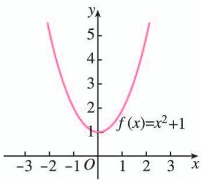  
(1)

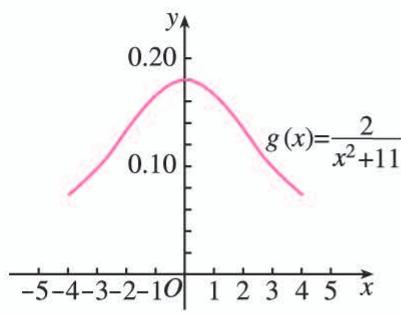  
(2)  
图3.2-7

## 探究

观察函数 f(x)=x 和 $g ^ { \mathbf { \alpha } } ( x ) = \frac { 1 } { x }$ 的图象（图3.2-8)，你能发现这两个函数图象有什么共同特征吗？你能用符号语言精确地描述这一特征吗？

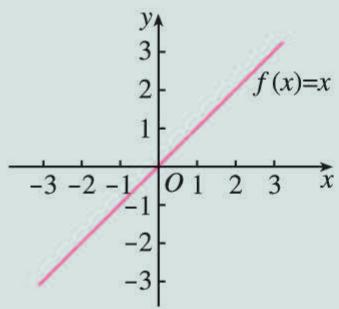

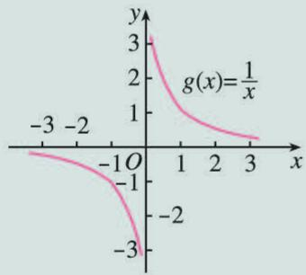  
图 3.2-8

可以发现，两个函数的图象都关于原点成中心对称图形.为了用符号语言描述这一特征，不妨取自变量的一些特殊值，看相应函数值的情况，请完成表3.2-2.

表3.2-2
<table><tr><td rowspan=1 colspan=1>x</td><td rowspan=1 colspan=1>…</td><td rowspan=1 colspan=1>-3</td><td rowspan=1 colspan=1>-2</td><td rowspan=1 colspan=1>-1</td><td rowspan=1 colspan=1>0</td><td rowspan=1 colspan=1>1</td><td rowspan=1 colspan=1>2</td><td rowspan=1 colspan=1>3</td><td rowspan=1 colspan=1></td></tr><tr><td rowspan=1 colspan=1> $f ( x ) = x$ </td><td rowspan=1 colspan=1>…</td><td rowspan=1 colspan=1></td><td rowspan=1 colspan=1></td><td rowspan=1 colspan=1></td><td rowspan=1 colspan=1></td><td rowspan=1 colspan=1></td><td rowspan=1 colspan=1></td><td rowspan=1 colspan=1></td><td rowspan=1 colspan=1>…</td></tr><tr><td rowspan=1 colspan=1> $g ( x ) = \frac { 1 } { x }$ </td><td rowspan=1 colspan=1>...</td><td rowspan=1 colspan=1></td><td rowspan=1 colspan=1></td><td rowspan=1 colspan=1></td><td rowspan=1 colspan=1></td><td rowspan=1 colspan=1></td><td rowspan=1 colspan=1></td><td rowspan=1 colspan=1></td><td rowspan=1 colspan=1>...</td></tr></table>

可以发现，当自变量x取一对相反数时，相应的函数值f(x)也是一对相反数.

例如，对于函数 $f ( x ) = x$ ，有

$$
f ( - 3 ) = - 3 = - f ( 3 ) { \mathrm { ; } }
$$

$$
f ( - 2 ) = - 2 = - f ( 2 ) ;
$$

$$
f ( - 1 ) = - 1 = - f ( 1 ) .
$$

实际上， $\forall \boldsymbol { x } \in \mathbf { R }$ ，都有 $f ( - x ) { = } { - } x { = } { - } f ( x )$ . 这时称函数 $f ( x ) = x$ 为奇函数.

一般地，设函数 $f ( x )$ 的定义域为D，如果 $\forall x \in D$ ，都有一 $\mathbf { \nabla } _ { \cdot \mathcal { X } } \in D$ ，且 $f ( - x ) { = } { - } f ( x )$ ，那么函数 $f ( x )$ 就叫做奇函数(odd function).

例6 判断下列函数的奇偶性：

(1) $f ( x ) = x ^ { 4 } ;$ (2) $f ( x ) = x ^ { 5 }$

(3) $f ( x ) = x + { \frac { 1 } { x } } ;$ (4) $f ( x ) = { \frac { 1 } { x ^ { 2 } } } .$

解：（1）函数 $f ( x ) = x ^ { 4 }$ 的定义域为R.

因为 $\forall \boldsymbol { x } \in \mathbf { R }$ ，都有 $- x \in \mathbf { R }$ ，且

$$
f ( - x ) { = } ( - x ) ^ { 4 } { = } x ^ { 4 } { = } f ( x ) ,
$$

所以，函数 $f ( x ) = x ^ { 4 }$ 为偶函数.

(2) 函数 $f ( x ) = x ^ { 5 }$ 的定义域为R.

因为 $\forall \mathcal { x } \in \mathbf { R }$ ，都有 $- x \in \mathbf { R }$ ，且

$$
f ( - x ) { = } ( - x ) ^ { 5 } { = } { - } x ^ { 5 } { = } { - } f ( x ) ,
$$

所以，函数 $f ( x ) = x ^ { 5 }$ 为奇函数.

(3) 函数 $f ( x ) = x + \frac { 1 } { x }$ 的定义域为 $\{ x | x \neq 0 \}$

因为 $\forall x \in \{ x \mid x \neq 0 \}$ ，都有 $- x \in \{ x \mid x \neq 0 \}$ ，且

$$
f ( - x ) = - x + \frac { 1 } { - x } = - \big ( x + \frac { 1 } { x } \big ) = - f ( x ) ,
$$

所以，函数 $f ( x ) = x + { \frac { 1 } { x } }$ 为奇函数.

(4) 函数 $f ( x ) = \frac { 1 } { x ^ { 2 } }$ 的定义域为 $\{ x | x \neq 0 \}$

因为 $\forall x \in \{ x \mid x \neq 0 \}$ ，都有 $- x \in \{ x \mid x \neq 0 \}$ ，且

$$
f ( - x ) { = } \frac { 1 } { ( - x ) ^ { 2 } } { = } \frac { 1 } { x ^ { 2 } } { = } f ( x ) ,
$$

所以，函数 $f ( x ) = \frac { 1 } { x ^ { 2 } }$ 为偶函数.

请你仿照这个过程，说明函数 $g ( x ) = \frac { 1 } { x }$ 也是奇函数.

奇偶性是函数在它的定义域上的整体性质，所以判断函数的奇偶性应先明确它的定义域.

## 思考

(1）判断函数 $f ( x ) = x ^ { 3 } + x$ 的奇偶性.

(2)图3.2-9是函数 $f ( x ) = x ^ { 3 } + x$ 图象的一部分，你能根据 f(x) 的奇偶性画出它在 y 轴左边的图象吗？

(3) 一般地，如果知道 $y = f ( x )$ 为偶（奇）函数，那么我们可以怎样简化对它的研究？

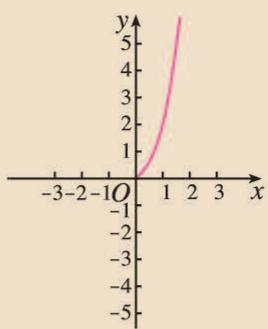  
图3.2-9

## 练习

1. 已知f(x) 是偶函数， $g ( x )$ 是奇函数，试将下图补充完整

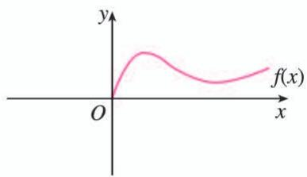

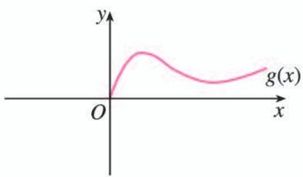  
(第1题)

2. 判断下列函数的奇偶性：

(1) $f ( x ) = 2 x ^ { 4 } + 3 x ^ { 2 }$ (2) $f ( x ) = x ^ { 3 } - 2 x .$

3.（1）从偶函数的定义出发，证明函数 $y { = } f ( x )$ 是偶函数的充要条件是它的图象关于y轴对称；

(2)从奇函数的定义出发，证明函数 $y { = } f ( x )$ 是奇函数的充要条件是它的图象关于原点对称.

## 习题3.2

## 复习巩固

1. 根据下图说出函数的单调区间及在每一单调区间上的单调性

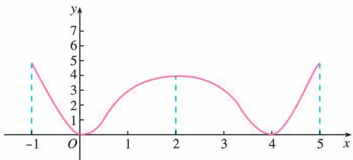  
(第1题)

2. 画出下列函数的图象，并根据图象说出函数 $y { = } f ( x )$ 的单调区间及在每一单调区间上的单调性(1) $y = x ^ { 2 } - 5 x - 6 ;$ (2) $y = 9 - x ^ { 2 } .$

3. 证明：

(1) 函数 $f ( x ) = - 2 x + 1$ 是减函数；

(2) 函数 $f ( x ) = x ^ { 2 } + 1$ 在 $( 0 , \ + \infty )$ 上单调递增；

(3) 函数 $f ( x ) = 1 - \frac { 1 } { x }$ 在(一∞，0)上单调递增.

4. 某汽车租赁公司的月收益y(单位：元)与每辆车的月租金x(单位：元)间的关系为 $y = - \frac { x ^ { 2 } } { 5 0 } +$   
162x一21000，那么，每辆车的月租金为多少元时，租赁公司的月收益最大？最大月收益是多少？

5. 判断下列函数的奇偶性：(1) $f ( x ) = x ^ { 2 } + 1$ (2) $f ( x ) = { \frac { x } { x ^ { 2 } + 1 } } .$

## 综合运用

6.一名心率过速患者服用某种药物后心率立刻明显减慢，之后随着药力的减退，心率再次慢慢升高.画出自服药那一刻起，心率关于时间的一个可能的图象（示意图).

7. 已知函数 $f ( x ) = x ^ { 2 } - 2 x , g ( x ) = x ^ { 2 } - 2 x ( x \in [ 2 , \ 4 ] )$ 2

(1) 求 $f ( x ) , \ g ( x )$ 的单调区间；

(2) 求 $f ( x ) , g ( x )$ 的最小值.

8. （1）根据函数单调性的定义证明函数 $\scriptstyle { y = x + { \frac { 9 } { x } } }$ 在区间[3，十∞)上单调递增(2)讨论函数 $\scriptstyle y = x + { \frac { 9 } { x } }$ 在区间(0，+∞)上的单调性.(3) 讨论函数 $y = x + \frac { k } { x } ( k > 0 )$ 在区间(0，+∞)上的单调性.

9. 设函数 y=f(x）的定义域为 D，区间 $I { \subseteq } D$ ，记 $\Delta x = x _ { 1 } - x _ { 2 } , \Delta y = f ( x _ { 1 } ) - f ( x _ { 2 } )$ .证明：(1) 函数y=f(x) 在区间I上单调递增的充要条件是： $\forall x _ { 1 } , x _ { 2 } \in I , x _ { 1 } \neq x _ { 2 }$ ，都有 $\frac { \Delta y } { \Delta x } > 0 ;$ (2) 函数 $y { = } f ( x )$ 在区间I上单调递减的充要条件是： $\forall x _ { 1 } , x _ { 2 } \in I , x _ { 1 } \neq x _ { 2 }$ ，都有 $\frac { . \Delta y } { \Delta x } < 0 .$

10.如图所示，动物园要建造一面靠墙的两间面积相同的矩形熊猫居室，如果可供建造围墙的材料总长是30m，那么宽x(单位：m)为多少时才能使所建造的每间熊猫居室面积最大？每间熊猫居室的最大面积是多少?

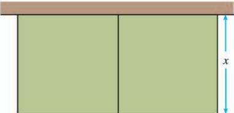

11. 已知函数f(x)是定义域为R的奇函数，当 $x \geqslant 0$ 时，$f ( x ) = x \left( 1 + x \right)$ .画出函数f(x)的图象，并求出函数的解析式.

(第10题)

## 拓广探索

12.已知函数f(x)是偶函数，而且在 $( 0 , \ + \infty )$ 上单调递减，判断f(x)在(一∞，0)上单调递增还是单调递减，并证明你的判断

13. 我们知道，函数 $y = f ( x )$ 的图象关于坐标原点成中心对称图形的充要条件是函数 $y = f ( x )$ 为奇函数，有同学发现可以将其推广为：函数 $y = f ( x )$ 的图象关于点 $P \left( a , b \right)$ 成中心对称图形的充要条件是函数 $y = f ( x + a ) - b$ 为奇函数.

(1) 求函数 $f ( x ) = x ^ { 3 } - 3 x ^ { 2 }$ 图象的对称中心；

(2)类比上述推广结论，写出“函数 $y = f ( x )$ 的图象关于y轴成轴对称图形的充要条件是函数 $y = f ( x )$ 为偶函数”的一个推广结论

## 信息技术应用

## 用计算机绘制函数图象

利用计算机软件可以便捷、迅速地绘制各种函数图象.不同的计算机软件绘制函数图象的具体操作不尽相同，但都是基于我们熟悉的描点作图，即给自变量赋值，用计算法则算出相应的函数值，再由这些对应值生成一系列的点，最后连接这些点描绘出函数图象.下面以软件《GeoGebra》为例，介绍用计算机软件绘制函数图象的方法.

## 一、直接输入函数绘制函数 $y = x ^ { 3 }$ 的图象

打开软件《GeoGebra》，在下方的输入框内直接输入 $\mathbf { \bar { \Psi } } ^ { 6 6 } y = x \mathbf { \hat { \Psi } } 3 ^ { 9 9 }$ ，回车，在代数区就会显示该函数的解析式 ${ } ^ { 6 6 } f ( x ) = x ^ { 3 3 }$ ，而在绘图区就会自动显示相应函数$y = x ^ { 3 }$ 的图象（如图1).

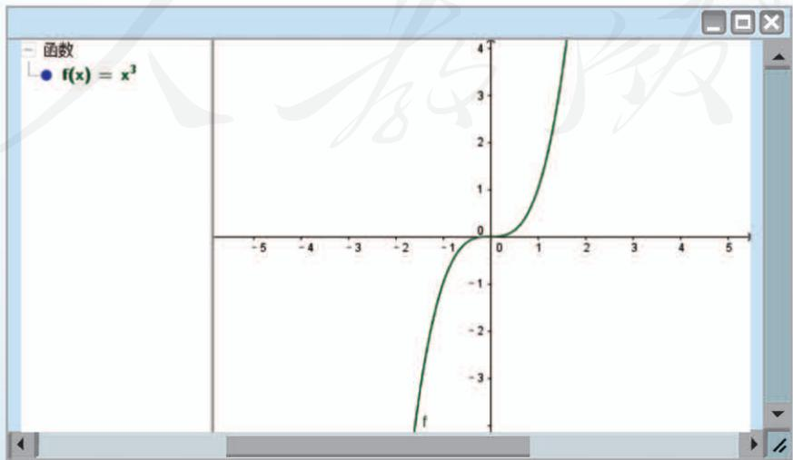  
图1

## 二、绘制含参数b的函数 $y = b x ^ { 2 } ( b \neq 0 )$ 的图象

(1)打开软件《GeoGebra》，在输入框内输入参数“b”，回车，创建滑动条b，选择b的“属性”，依图2提示可自由设置其最小值、最大值、增量等后关闭.

(2) 在输入框内直接输入函数 $^ { 6 6 } y = b \ast x \cdot 2 ^ { 5 9 }$ ，回车，在绘图区直接显示出当时参数b的值对应的函数 $y = b x ^ { 2 }$ 的图象（图2).

当你左右移动滑动条中点b的位置时，函数 $y = b x ^ { 2 }$ 的图象就会“动”起来，如图 2.

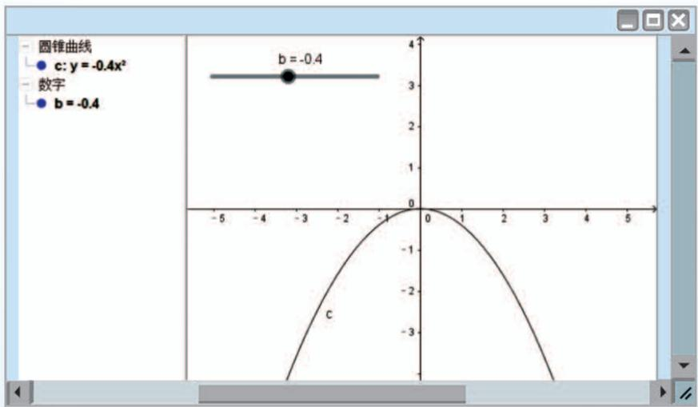  
图 2

如果有条件，请你绘制函数 $y = a x ^ { 2 } + b x + c ( a \neq 0 )$ 的图象，并探究系数a，b，c 对函数图象的影响.

## 沪教版2026：5.2 函数的基本性质

来源：沪教版必修第一册2026-dollar-polished.md（本地转写稿），转写稿第 4985—5558 行；截至下一指定标题前。

## 5.2 函数的基本性质

函数是描述客观世界中变量关系和规律的最为基本的数学语言和工具. 了解了函数, 就把握了相应事物的变化规律. 为了深入了解函数，有必要研究其有关的性质，因此，学习函数的性质非常重要.

函数的性质是多种多样的, 且不同的函数有不同的性质.

关于一次函数、二次函数、幂函数、指数函数和对数函数, 我们已经接触过很多研究其性质的方法, 且已经知道了不少结论. 本节将以此为出发点, 概括函数的一些常见的性质.

### 3 函数的奇偶性

在生活中，我们经常遇到对称的图形. 拱桥的桥面形成的弧, 就可以视为是轴对称的. 如果把桥面抽象成一条曲线, 以曲线的最高点为原点,过原点作一水平直线为 $x$ 轴,再过原点作一竖直直线为 $y$ 轴,那么这条由拱桥桥面抽象出的曲线就成为一个函数的图像, 并且该图像的一个特点是关于 $y$ 轴成轴对称,如图 5-2-1 所示.

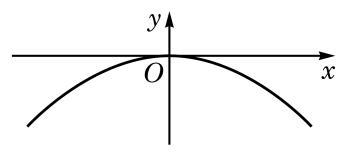

图 5-2-1

在学习二次函数和幂函数时,我们知道,形如 $y = a{x}^{2} + c \; \left( {a \neq  0}\right)$ 的二次函数和幂函数 $y = {x}^{-\frac{2}{3}}$ 的图像都是关于 $y$ 轴成轴对称的, 如图 5-2-2 所示.

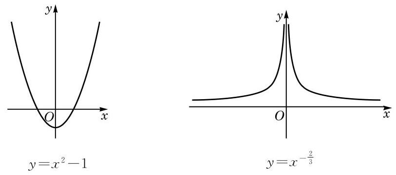

图 5-2-2

?

---

图 5-2-2 中的这两个函数的图像都具有关于 $y$ 轴成轴对称的共同特征, 其相应的自变量与函数值的对应关系是如何体现这个特征的?

---

一个图形关于某条直线 $l$ 成轴对称,是指该图形上的任意一

点关于直线 $l$ 的对称点也在此图形上.

现在，我们来探究 “函数的图像关于 $y$ 轴成轴对称” 这一条件的等价表达形式.

在函数 $y = f\left( x\right) , x \in  D$ 的图像 $G$ 上任取一点 $P\left( {{x}_{1},{y}_{1}}\right)$ ,就有

$$
{x}_{1} \in  D\text{ ,并且 }{y}_{1} = f\left( {x}_{1}\right) \text{ . }
$$

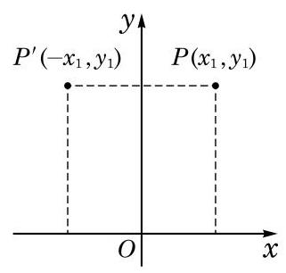

图 5-2-3

点 $P\left( {{x}_{1},{y}_{1}}\right)$ 关于 $y$ 轴的对称点为 ${P}^{\prime }\left( {-{x}_{1},{y}_{1}}\right)$ (图 5-2-3). 如果函数 $y = f\left( x\right) , x \in  D$ 的图像关于 $y$ 轴成轴对称,那么 ${P}^{\prime }\left( {-{x}_{1},{y}_{1}}\right)$ 也在图像 $G$ 上,即

$$
- {x}_{1} \in  D\text{ ,并且 }{y}_{1} = f\left( {-{x}_{1}}\right) \text{ . }
$$

这说明,如果函数 $y = f\left( x\right) , x \in  D$ 的图像关于 $y$ 轴成轴对称,那么对于任意给定的 $x \in  D$ ,均有

$$
- x \in  D\text{ ,并且 }f\left( x\right)  = f\left( {-x}\right) \text{ . }
$$

反之,如果对于任意给定的 $x \in  D$ ,均有 $- x \in  D$ ,并且 $f\left( x\right)  = f\left( {-x}\right)$ ,那么对于函数 $y = f\left( x\right) , x \in  D$ 的图像上的任一点 $Q\left( {{x}_{2},{y}_{2}}\right)$ ,它关于 $y$ 轴的对称点 ${Q}^{\prime }\left( {-{x}_{2},{y}_{2}}\right)$ ,由于满足 $- {x}_{2} \in  D$ ,并且 ${y}_{2} = f\left( {-{x}_{2}}\right)$ ,也必在此函数的图像上. 因此,该函数的图像关于 $y$ 轴成轴对称.

总结一下, 就得到下述关于偶函数的定义:

定义 对于函数 $y = f\left( x\right)$ ,如果对于其定义域 $D$ 中任意给定的实数 $x$ ,都有 $- x \in  D$ ,并且

$$
f\left( {-x}\right)  = f\left( x\right) ,
$$

就称函数 $y = f\left( x\right)$ 为偶函数 (even function).

根据上述推导及定义, 从图形的角度来看, 偶函数就是其图像关于 $y$ 轴成轴对称的函数.

根据上述性质,如果要得到偶函数 $y = f\left( x\right)$ 的图像,只需要获得其在定义域中 $x \geq  0$ (或 $x \leq  0$ ) 部分的图像就可以了. 同理, 如果要研究偶函数的性质,也只要研究其在定义域中 $x \geq  0$ (或 $x \leq  0$ )部分的性质就可以了.

例 1 证明: 函数 $y = 2{x}^{4} - 3{x}^{2}$ 是一个偶函数.

证明 函数 $y = 2{x}^{4} - 3{x}^{2}$ 的定义域为 $\mathbf{R}$ .

记 $f\left( x\right)  = 2{x}^{4} - 3{x}^{2}$ . 在 $\mathbf{R}$ 中任取一个实数 $x$ ,都有 $- x \in  \mathbf{R}$ , 并且

$$
f\left( {-x}\right)  = 2{\left( -x\right) }^{4} - 3{\left( -x\right) }^{2} = 2{x}^{4} - 3{x}^{2} = f\left( x\right) .
$$

因此, $y = 2{x}^{4} - 3{x}^{2}$ 是一个偶函数.

除了轴对称外, 中心对称也是平面上非常重要的一类对称关系. 一个图形关于某个点 $P$ 成中心对称,是指该图形上的任意一点关于点 $P$ 的对称点也在此图形上.

函数 $y = {x}^{3}$ 的图像就关于原点成中心对称. 相应地，类似于偶函数, 我们把满足以下条件的函数称为奇函数.

定义 对于函数 $y = f\left( x\right)$ ,如果对于其定义域 $D$ 中的任意给定的实数 $x$ ,都有 $- x \in  D$ ,并且

$$
f\left( {-x}\right)  =  - f\left( x\right) ,
$$

就称函数 $y = f\left( x\right)$ 为奇函数 (odd function).

?

类似于偶函数图像性质的推导, 可以知道, 奇函数就是图像关于原点成中心对称的函数. 并且, 已知奇函数在其定义域中 $x \geq  0$ (或 $x \leq  0$ )部分的图像 (或性质),可以推导出其另一部分的图像(或性质).

例 2 证明: $y = {x}^{3} - \frac{1}{x}$ 是一个奇函数.

证明 函数 $y = {x}^{3} - \frac{1}{x}$ 的定义域为 $D = \{ x \mid  x \neq  0\}$ .

记 $f\left( x\right)  = {x}^{3} - \frac{1}{x}$ . 在 $D$ 中任取一个实数 $x$ ,都有 $- x \neq  0$ , 因此 $- x \in  D$ ,并且

$$
f\left( {-x}\right)  = {\left( -x\right) }^{3} - \frac{1}{-x} =  - \left( {{x}^{3} - \frac{1}{x}}\right)  =  - f\left( x\right) .
$$

因此, $y = {x}^{3} - \frac{1}{x}$ 是一个奇函数.

例 3 是否存在定义在 $\mathbf{R}$ 上的,且既是奇函数又是偶函数的函数? 若存在, 求出所有满足此条件的函数; 若不存在, 说明理由.

解 这样的函数是存在的,函数 $y = 0, x \in  \mathbf{R}$ 就是一个满足这些条件的函数.

设满足这些条件的函数为 $y = f\left( x\right)$ . 对任一给定的实数 ${x}_{0}$ , 因该函数是奇函数,故 $f\left( {-{x}_{0}}\right)  =  - f\left( {x}_{0}\right)$ ; 另一方面,因该函数是偶函数,故 $f\left( {-{x}_{0}}\right)  = f\left( {x}_{0}\right)$ . 因此 $f\left( {x}_{0}\right)  =  - f\left( {x}_{0}\right)$ ,即 $f\left( {x}_{0}\right)  = 0$ . 所以这样的函数只有一个,即 $y = 0, x \in  \mathbf{R}$ .

---

根据奇函数的图像特征, 你能从已学的函数 (如一次函数、 幂函数) 中举出几个奇函数的例子吗?

---

#### 练习 5.2(1)

1. 奇函数的图像是不是一定通过原点? 偶函数的图像是不是一定与 $y$ 轴相交? 请说明理由.
2. 如图,已知偶函数 $y = f\left( x\right)$ 在 $y$ 轴及 $y$ 轴一侧的部分图像,作出 $y = f\left( x\right)$ 的大致图像.

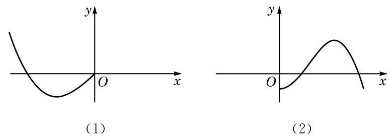

(第 2 题)

3. 证明下列函数是奇函数:

(1) $y = {2}^{x} - {2}^{-x}$ ; (2) $y = {\log }_{2}\left( {1 + x}\right)  - {\log }_{2}\left( {1 - x}\right)$ .

---

可以从函数值的角度来猜测，也可以借助函数图像的几何直观.

---

在判断一个比较复杂的函数的奇偶性的时候, 往往采取 “先猜后证”的方法.

例 4 判断下列函数的奇偶性, 并说明理由:

(1) $y = {\left( x - 1\right) }^{2}, x \in  \mathbf{R}$ ;

(2) $y = \left\{  \begin{array}{ll} x\left( {x + 1}\right) , & x > 0, \\  x\left( {1 - x}\right) , & x < 0. \end{array}\right.$

解 (1) 因为当 $x = 1$ 时, $y = 0$ ; 而当 $x =  - 1$ 时, $y = 4$ , 两者不相等,所以 $y = {\left( x - 1\right) }^{2}$ 不是偶函数;

又因为 $0 \neq   - 4$ ,所以 $y = {\left( x - 1\right) }^{2}$ 亦不是奇函数.

综上所述，函数 $y = {\left( x - 1\right) }^{2}$ 既不是奇函数，又不是偶函数.

(2)经试验,发现当 $x = 1$ 时, $y = 2$ ，而当 $x =  - 1$ 时, $y =  - 2$ ; 又当 $x = {10}$ 时, $y = {110}$ ,而当 $x =  - {10}$ 时, $y =  - {110}$ ; 等等. 猜测该函数可能是奇函数.

该函数的定义域为 $\{ x \mid  x \neq  0\}$ . 记 $g\left( x\right)  = \left\{  \begin{array}{l} x\left( {x + 1}\right) , x > 0, \\  x\left( {1 - x}\right) , x < 0. \end{array}\right.$

---

也可以将 $y = g\left( x\right)$ 表示为 $y = x\left( {1 + \left| x\right| }\right)$ , $x \neq  0$ . 以此证明该函数是奇函数.

---

对任意给定的 $x > 0, g\left( x\right)  = x\left( {x + 1}\right)$ . 因 $- x < 0$ ,故

$$
g\left( {-x}\right)  = \left( {-x}\right) \left\lbrack  {1 - \left( {-x}\right) }\right\rbrack   =  - x\left( {1 + x}\right)  =  - g\left( x\right) .
$$

而对任意给定的 $x < 0, g\left( x\right)  = x\left( {1 - x}\right)$ . 因 $- x > 0$ ,故

$$
g\left( {-x}\right)  = \left( {-x}\right) \left\lbrack  {1 + \left( {-x}\right) }\right\rbrack   =  - x\left( {1 - x}\right)  =  - g\left( x\right) .
$$

综上所述, $y = g\left( x\right)$ 确实是奇函数.

例 5 是否存在正数 $a$ ,使函数 $y = \frac{{a}^{x} + 1}{{2}^{x}}$ 是偶函数?

解 记 $f\left( x\right)  = \frac{{a}^{x} + 1}{{2}^{x}}$ . 由 $f\left( 1\right)  = \frac{1 + a}{2}, f\left( {-1}\right)  = \frac{2}{a} + 2$ ,若 $y = f\left( x\right)$ 是偶函数,就应有 $\frac{1 + a}{2} = \frac{2}{a} + 2$ . 解这个方程,得 $a =  - 1$ (舍去) 或 $a = 4$ . Q

---

为了表明存在性, 寻找必要条件的过程不是必须表达出来的.

---

因此, $y = f\left( x\right)$ 是偶函数的一个必要条件是 $a = 4$ .

另一方面,当 $a = 4$ 时, $f\left( x\right)  = \frac{{4}^{x} + 1}{{2}^{x}} = {2}^{x} + {2}^{-x}$ ,其定义域为 $\mathbf{R}$ . 对任意给定的 $x \in  \mathbf{R}$ ,都有 $- x \in  \mathbf{R}$ ,并且

$$
f\left( {-x}\right)  = {2}^{-x} + {2}^{-\left( {-x}\right) } = {2}^{-x} + {2}^{x} = f\left( x\right) .
$$

因此,当 $a = 4$ 时, $y = f\left( x\right)$ 是偶函数.

综上所述,满足条件的正数 $a$ 存在.

例 6 已知函数 $y = f\left( x\right) , x \in  \mathbf{R}$ ,且当 $x \geq  0$ 时,

$$
f\left( x\right)  = 2{x}^{3} + {2}^{x} - 1.
$$

(1)若函数 $y = f\left( x\right)$ 是偶函数，求 $f\left( {-2}\right)$ ；

(2) $y = f\left( x\right)$ 是否可能是奇函数？若可能，求 $f\left( x\right)$ 的表达式; 若不可能, 说明理由.

解 (1) 若 $y = f\left( x\right)$ 是偶函数,应有 $f\left( {-2}\right)  = f\left( 2\right)$ . 而 $f\left( 2\right)  = 2 \times  {2}^{3} + {2}^{2} - 1 = {19}$ ,因此 $f\left( {-2}\right)  = {19}$ .

(2)若 $y = f\left( x\right)$ 是奇函数，当 $x < 0$ 时，应有

$$
f\left( x\right)  =  - f\left( {-x}\right)  =  - \left\lbrack  {2{\left( -x\right) }^{3} + {2}^{-x} - 1}\right\rbrack   = 2{x}^{3} - {2}^{-x} + 1.
$$

---

在例 6 (2) 的解答中我们并没有验证 “当 $x > 0$ 时, $f\left( x\right) \; =  - f\left( {-x}\right)$ ”. 事实上，这是由“当 $x < 0$ 时, $f\left( {-x}\right)  =  - f\left( x\right)$ ” 所蕴涵的.

---

此外,当 $x = 0$ 时,

$$
f\left( x\right)  = 2 \times  {0}^{3} + {2}^{0} - 1 = 0 =  - f\left( {-x}\right) .
$$

因此, $y = f\left( x\right)$ 可能是奇函数,此时

$$
f\left( x\right)  = \left\{  \begin{array}{ll} 2{x}^{3} + {2}^{x} - 1, & x \geq  0, \\  2{x}^{3} - {2}^{-x} + 1, & x < 0. \end{array}\right.
$$

#### 练习 5.2(2)

1. 判断下列函数的奇偶性, 并说明理由:

(1) $y = \left| x\right|$ ；

(2) $y = \frac{1}{1 + x} - \frac{1}{1 - x}$ ；

(3) $y = {x}^{3} - x, x \in  \lbrack  - 3,3)$ ； (4) $y = 0, x \in  \left\lbrack  {-1,1}\right\rbrack  .$

2. 已知 $a$ 是实数,而定义在 $\mathbf{R}$ 上的函数 $y = f\left( x\right)$ 的表达式为 $f\left( x\right)  = \left| {x - a}\right|$ .

(1)是否存在实数 $a$ ，使得 $y = f\left( x\right)$ 是奇函数？说明理由；

(2)是否存在实数 $a$ ,使得 $y = f\left( x\right)$ 是偶函数? 说明理由.

### 2 函数的单调性

在现实生活中, 有不少在一定范围内随着时间的增加而增加 (或减少) 的量,如自由落体运动的位移 $s = \frac{1}{2}g{t}^{2}, t \in  \left\lbrack  {0, T}\right\rbrack$ 就是如此. 作出位移 $s$ 关于时间 $t$ 的函数图像,如图 5-2-4 所示. 从图像上看, 随着时间的增大, 位移的确随之增大. 这就是一种单调现象. 此外, 通过一个电阻的电流随其两端电压的增大而增大；许多物质在水中的溶解度随温度的升高而增加；山区的气温随海拔高度的升高而降低等, 都是单调现象.

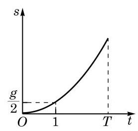

图 5-2-4

在学习指数函数及对数函数时, 我们已经了解到如下的事实:

当 $a > 1$ 时,函数 $y = {a}^{x}$ 与函数 $y = {\log }_{a}x$ 的图像都表现出 “ $y$ 随 $x$ 的增大而增大” 的趋势; 而当 $0 < a < 1$ 时,函数 $y = {a}^{x}$ 与函数 $y = {\log }_{a}x$ 的图像却都表现出 “ $y$ 随 $x$ 的增大而减小” 的趋势.

图像上这样的趋势在函数性质的研究中被称为单调性, 它是函数重要的性质之一. 借助于单调性, 就能够更好地掌握函数值的变化规律.

借助指数和对数运算的性质, 必修课程第 4 章中已经证明了, 若 ${x}_{1} > {x}_{2}$ ,当 $a > 1$ 时, ${a}^{{x}_{1}} > {a}^{{x}_{2}}$ 及 ${\log }_{a}{x}_{1} > {\log }_{a}{x}_{2}$ ; 而当 $0 < a < 1$ 时, ${a}^{{x}_{1}} < {a}^{{x}_{2}}$ 及 ${\log }_{a}{x}_{1} < {\log }_{a}{x}_{2}$ . 这样,我们就解释了为何这些函数的图像会表现出相应的单调性趋势. 概括起来, 可对一般函数给出其单调性的定义.

定义 对于定义在 $D$ 上的函数 $y = f\left( x\right)$ ,设区间 $I$ 是 $D$ 的一个子集. 对于区间 $I$ 上的任意给定的两个自变量的值 ${x}_{1}\text{ 、 }{x}_{2}$ , 当 ${x}_{1} < {x}_{2}$ 时,如果总有

$$
f\left( {x}_{1}\right)  \leq  f\left( {x}_{2}\right) ,
$$

就称函数 $y = f\left( x\right)$ 在区间 $I$ 上是增函数 (increasing function); 而

如果总有

$$
f\left( {x}_{1}\right)  \geq  f\left( {x}_{2}\right) ,
$$

就称函数 $y = f\left( x\right)$ 在区间 $I$ 上是减函数 (decreasing function).

Q

特别地, 如果总有

$$
f\left( {x}_{1}\right)  < f\left( {x}_{2}\right) ,
$$

就称函数 $y = f\left( x\right)$ 在区间 $I$ 上是严格增函数 (strictly increasing function); 而如果总有

$$
f\left( {x}_{1}\right)  > f\left( {x}_{2}\right) ,
$$

就称函数 $y = f\left( x\right)$ 在区间 $I$ 上是严格减函数 (strictly decreasing function).

“严格增”“严格减”“增”及“减”统称为函数的单调性.

?

例如, $y = {2x}$ 在区间 $\left( {-\infty , + \infty }\right)$ 上是严格增函数; $y = {x}^{2}$ 在区间 $( - \infty ,0\rbrack$ 上是严格减函数,在区间 $\lbrack 0, + \infty )$ 上是严格增函数; $y = {\log }_{2}x$ 在区间 $\left( {0, + \infty }\right)$ 上是严格增函数; 等等.

根据已经学习过的实数幂的性质,对于幂函数 $y = {x}^{r}$ ,当 $r > 0$ 时,该函数在区间 $\left( {0, + \infty }\right)$ 上是严格增函数; 而当 $r < 0$ 时,该函数在区间 $\left( {0, + \infty }\right)$ 上是严格减函数.

根据指数及对数的运算性质,当 $a > 1$ 时, $y = {a}^{x}$ 在区间 $\left( {-\infty , + \infty }\right)$ 上是严格增函数, $y = {\log }_{a}x$ 在区间 $\left( {0, + \infty }\right)$ 上是严格增函数; 而当 $0 < a < 1$ 时, $y = {a}^{x}$ 在区间 $\left( {-\infty , + \infty }\right)$ 上是严格减函数, $y = {\log }_{a}x$ 在区间 $\left( {0, + \infty }\right)$ 上是严格减函数.

例 7 证明: 函数 $y = {x}^{2} - {2x}$ 在区间 $( - \infty ,1\rbrack$ 上是严格减函数.

证明 记 $f\left( x\right)  = {x}^{2} - {2x}$ . 设 ${x}_{1}\text{ 、 }{x}_{2}$ 是区间 $( - \infty ,1\rbrack$ 上任意给定的两个实数,且 ${x}_{1} < {x}_{2}$ ,我们有

$$
f\left( {x}_{1}\right)  = {x}_{1}^{2} - 2{x}_{1}, f\left( {x}_{2}\right)  = {x}_{2}^{2} - 2{x}_{2}.
$$

由于

$$
f\left( {x}_{1}\right)  - f\left( {x}_{2}\right)  = \left( {{x}_{1}^{2} - 2{x}_{1}}\right)  - \left( {{x}_{2}^{2} - 2{x}_{2}}\right)
$$

$$
= \left( {{x}_{1}^{2} - {x}_{2}^{2}}\right)  - 2\left( {{x}_{1} - {x}_{2}}\right)
$$

$$
= \left( {{x}_{1} - {x}_{2}}\right) \left( {{x}_{1} + {x}_{2} - 2}\right) \text{ , }
$$

又 ${x}_{1} - {x}_{2} < 0$ ，且 ${x}_{1} + {x}_{2} - 2 < 1 + 1 - 2 = 0$ ，故

$$
f\left( {x}_{1}\right)  - f\left( {x}_{2}\right)  > 0,
$$

即 $f\left( {x}_{1}\right)  > f\left( {x}_{2}\right)$ .

因此,函数 $y = {x}^{2} - {2x}$ 在区间 $( - \infty ,1\rbrack$ 上是严格减函数.

---

根据定义, 严格增函数是增函数, 严格减函数是减函数.

你能用定义证明初中学过的一次函数和反比例函数的单调性吗?

---

对于一般的二次函数 $y = f\left( x\right)$ ,其中 $f\left( x\right)  = a{x}^{2} + {bx} + c \; \left( {a \neq  0}\right)$ ,通过配方法,得到

$$
f\left( x\right)  = a{\left( x + \frac{b}{2a}\right) }^{2} + \frac{{4ac} - {b}^{2}}{4a}.
$$

因此，点 $\left( {-\frac{b}{2a},\frac{{4ac} - {b}^{2}}{4a}}\right)$ 被称为该二次函数的图像的顶点，它是相应曲线(抛物线)的最高点或最低点.

先考察 $a > 0$ 的情形. 设 ${x}_{1}\text{ 、 }{x}_{2}$ 是任意给定的两个实数,且 ${x}_{1} < {x}_{2}$ ,我们有 $f\left( {x}_{1}\right)  - f\left( {x}_{2}\right)  = a\left( {{x}_{1} - {x}_{2}}\right) \left\lbrack  {\left( {{x}_{1} + {x}_{2}}\right)  + \frac{b}{a}}\right\rbrack$ . 当 ${x}_{1} < {x}_{2} \leq   - \frac{b}{2a}$ 时,由 ${x}_{1} - {x}_{2} < 0$ 以及 ${x}_{1} + {x}_{2} + \frac{b}{a} < 0$ ,可得 $f\left( {x}_{1}\right)  > f\left( {x}_{2}\right)$ ; 而当 $- \frac{b}{2a} \leq  {x}_{1} < {x}_{2}$ 时,由 ${x}_{1} - {x}_{2} < 0$ 以及 ${x}_{1} + {x}_{2} + \frac{b}{a} > 0$ ,可得 $f\left( {x}_{1}\right)  < f\left( {x}_{2}\right)$ .

因此,当 $a > 0$ 时,函数 $y = a{x}^{2} + {bx} + c$ 在区间 $( - \infty , - \frac{b}{2a}\rbrack$ 上是严格减函数,在区间 $\left\lbrack  {-\frac{b}{2a}, + \infty }\right)$ 上是严格增函数.

类似地,当 $a < 0$ 时,函数 $y = a{x}^{2} + {bx} + c$ 在区间 $\left( {-\infty , - \frac{b}{2a}}\right\rbrack$ 上是严格增函数,在区间 $\left\lbrack  {-\frac{b}{2a}, + \infty }\right)$ 上是严格减函数.

由上述二次函数的单调性可知, 二次函数图像的上升与下降的趋势恰好以它对应的抛物线的顶点为分界点.

例 8 判断函数 $y = {\log }_{2}\left( {{3x} + 2}\right)$ 在其定义域上的单调性, 并说明理由.

解 设 ${x}_{1}\text{ 、 }{x}_{2}$ 是定义域 $D = \{ x \mid  {3x} + 2 > 0\}$ 上任意给定的两个实数,且 ${x}_{1} < {x}_{2}$ ,易知 $0 < 3{x}_{1} + 2 < 3{x}_{2} + 2$ . 因为函数 $y = {\log }_{2}x$ 在区间 $\left( {0, + \infty }\right)$ 上是严格增函数,所以 ${\log }_{2}\left( {3{x}_{1} + 2}\right)  < \; {\log }_{2}\left( {3{x}_{2} + 2}\right)$ .

因此, $y = {\log }_{2}\left( {{3x} + 2}\right)$ 在其定义域上是严格增函数.

#### 练习 5.2(3)

1. 小明说:“如果当 $x > 0$ 时,总有 $f\left( x\right)  > f\left( 0\right)$ ,那么函数 $y = f\left( x\right)$ 在区间 $\lbrack 0, + \infty )$ 上是严格增函数. ”他的说法是否正确？说明理由.
2. 证明: 函数 $y = \frac{2}{{x}^{3}}$ 在区间 $\left( {-\infty ,0}\right)$ 上是严格减函数.
3. 构造一个二次函数,使得它在区间 $\left\lbrack  {-1,1}\right\rbrack$ 上是严格减函数,并说明理由.

需要注意的是, 函数的单调性是针对包含于定义域中的某个区间而言的. 有些函数虽然在整个定义域上不是单调函数, 但是在包含于定义域中的某些区间上却可以是单调函数.

---

一般来说，所讨论的单调区间总是指满足这一要求的“最大”的单调区间.

---

定义 如果函数 $y = f\left( x\right)$ 在某个区间 $I$ 上是增 (减) 函数, 那么就称函数 $y = f\left( x\right)$ 在区间 $I$ 上是单调函数 (monotonic function),并称区间 $I$ 是函数 $y = f\left( x\right)$ 的一个单调区间.

?

例 9 判断函数 $y = {x}^{2} - {2x}, x \in  \left\lbrack  {-2,2}\right\rbrack$ 的单调性,并求出它的单调区间.

---

你能用上一节课学习的一般二次函数的单调性结论来求这个函数的单调区间吗?

---

解 记 $f\left( x\right)  = {x}^{2} - {2x}.f\left( 0\right)  = f\left( 2\right)  = 0$ ,而 $f\left( 1\right)  =  - 1$ ,因此 $y = {x}^{2} - {2x}$ 在区间 $\left\lbrack  {-2,2}\right\rbrack$ 上既不是增函数,也不是减函数.

对区间 $I$ 上任意给定的两个实数 ${x}_{1}\text{ 、 }{x}_{2}$ ,总有

$$
f\left( {x}_{1}\right)  - f\left( {x}_{2}\right)  = \left( {{x}_{1} - {x}_{2}}\right) \left( {{x}_{1} + {x}_{2} - 2}\right) .
$$

当 ${x}_{1} < {x}_{2}$ ,且 ${x}_{1}\text{ 、 }{x}_{2} \in  \left\lbrack  {-2,1}\right\rbrack$ 时,总有 ${x}_{1} + {x}_{2} - 2 < 0$ 及 ${x}_{1} - {x}_{2} < 0$ ,故 $f\left( {x}_{1}\right)  - f\left( {x}_{2}\right)  > 0$ ,从而函数 $y = {x}^{2} - {2x}$ , $x \in  \left\lbrack  {-2,2}\right\rbrack$ 在区间 $\left\lbrack  {-2,1}\right\rbrack$ 上是严格减函数.

类似地,当 ${x}_{1} < {x}_{2}$ ,且 ${x}_{1}\text{ 、 }{x}_{2} \in  \left\lbrack  {1,2}\right\rbrack$ 时,总有 ${x}_{1} + {x}_{2} - \; 2 > 0$ 及 ${x}_{1} - {x}_{2} < 0$ ,故 $f\left( {x}_{1}\right)  - f\left( {x}_{2}\right)  < 0$ ,从而函数 $y = {x}^{2} - {2x}$ , $x \in  \left\lbrack  {-2,2}\right\rbrack$ 在区间 $\left\lbrack  {1,2}\right\rbrack$ 上是严格增函数.

因此，函数 $y = {x}^{2} - {2x}, x \in  \left\lbrack  {-2,2}\right\rbrack$ 的单调区间有 $\left\lbrack  {-2,1}\right\rbrack$ 和 $\left\lbrack  {1,2}\right\rbrack$ .

例 10 设 $y = f\left( x\right)$ 是偶函数,且它在区间 $\left\lbrack  {-2, - 1}\right\rbrack$ 上是严格减函数，判断它在区间 $\left\lbrack  {1,2}\right\rbrack$ 上的单调性，并说明理由.

解 设 ${x}_{1}\text{ 、 }{x}_{2}$ 是区间 $\left\lbrack  {1,2}\right\rbrack$ 上任意给定的两个实数,且 ${x}_{1} < {x}_{2}$ ,则 $- {x}_{1}\text{ 、 } - {x}_{2} \in  \left\lbrack  {-2, - 1}\right\rbrack$ ,且 $- {x}_{2} <  - {x}_{1}$ .

因为函数 $y = f\left( x\right)$ 在区间 $\left\lbrack  {-2, - 1}\right\rbrack$ 上是严格减函数,所以 $f\left( {-{x}_{2}}\right)  > f\left( {-{x}_{1}}\right)$ . 又因为 $y = f\left( x\right)$ 是偶函数,所以 $f\left( {x}_{2}\right)  = f\left( {-{x}_{2}}\right)  > f\left( {-{x}_{1}}\right)  = f\left( {x}_{1}\right) .$

因此, $y = f\left( x\right)$ 在区间 $\left\lbrack  {1,2}\right\rbrack$ 上是严格增函数.

例 10 展示了如何利用函数的奇偶性来研究函数的其他性质.

#### 练习 5.2(4)

1. 根据下列函数 $y = f\left( x\right)$ 的图像 (包括端点),分别指出这两个函数的单调区间,以及在每一个单调区间上函数的单调性.

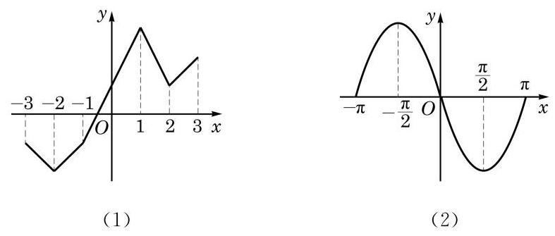

(第 1 题)

2. 判断函数 $y = \left| {x + 1}\right| , x \in  \left\lbrack  {-2,2}\right\rbrack$ 的单调性,并求出其单调区间.
3. 设 $y = f\left( x\right)$ 是奇函数,且它在区间 $( - 3,0\rbrack$ 上是严格增函数.

(1)求证:它在区间 $\lbrack 0,3)$ 上是严格增函数；

(2) $y = f\left( x\right)$ 是否在区间 $\left( {-3,3}\right)$ 上是严格增函数？说明理由.

### 3 函数的最值

在必修课程第 2 章中, 我们已经利用不等式的性质及基本不等式求解了一些代数式的最大值和最小值. 对于只有一个未知数的代数式,如 $x + \frac{1}{x},{x}^{2} - {2x}$ 等,当 $x$ 的值改变时,相应代数式的值也随之改变,从而都可以将它们看成是自变量 $x$ 的函数. 函数值的大小变化趋势是函数的单调性研究所关心的内容. 而在生产和生活中, 除了函数值的大小变化趋势之外, 往往也关心函数何时取到最大值(最小值)，以及最大值(最小值)为多少等问题.

---

最大值与最小值统称为最值.

---

定义 函数 $y = f\left( x\right)$ 在定义域内的 ${x}_{0}$ 处的函数值是 $f\left( {x}_{0}\right)$ ,对于定义域内任意给定的 $x$ ,如果

$$
f\left( x\right)  \geq  f\left( {x}_{0}\right)
$$

都成立,那么 $f\left( {x}_{0}\right)$ 就叫做函数 $y = f\left( x\right)$ 的最小值 (minimum);

相反, 如果

$$
f\left( x\right)  \leq  f\left( {x}_{0}\right)
$$

都成立,那么 $f\left( {x}_{0}\right)$ 就叫做函数 $y = f\left( x\right)$ 的最大值 (maximum).

例 11 求函数 $y = 2{x}^{2} - {3x} + 1, x \in  \mathbf{R}$ 的最大值与最小值.

解 由于 $y = 2{x}^{2} - {3x} + 1 = 2{\left( x - \frac{3}{4}\right) }^{2} - \frac{1}{8} \geq   - \frac{1}{8}$ ,且当 $x = \frac{3}{4}$ 时上述不等式中的等号可以取到,因此该函数的最小值为 $- \frac{1}{8}$ .

由二次函数的单调性可知, 该函数无最大值.

对于定义在闭区间 $\left\lbrack  {a, b}\right\rbrack$ 上的单调函数 $y = f\left( x\right)$ ,它的最大值和最小值一定能在区间的端点 $a$ 和 $b$ 处取到. 因此,对于具有单调性的函数, 可以借助其单调性来求得其最值.

例 12 求函数 $y = \frac{2}{x}, x \in  \left\lbrack  {1,2}\right\rbrack$ 的最大值与最小值.

解 由于函数 $y = \frac{2}{x}$ 在区间 $\left\lbrack  {1,2}\right\rbrack$ 上是严格减函数,因此, 其最大值在左端点 $x = 1$ 处取到,其值为 2 ; 而最小值在右端点 $x = 2$ 处取到，其值为 1 .

例 13 已知 $a < 2$ ,求函数 $y = \left| {x - 1}\right| , x \in  \left\lbrack  {a,2}\right\rbrack$ 的最大值.

解 对于函数 $y = \left| {x - 1}\right|$ ,当 $x \geq  1$ 时, $y = x - 1$ ; 而当 $x \leq  1$ 时, $y =  - x + 1$ . 因此, $y = \left| {x - 1}\right|$ 在区间 $\lbrack 1, + \infty )$ 上是严格增函数,在区间 $( - \infty ,1\rbrack$ 上是严格减函数.

情形一: 当 $1 \leq  a < 2$ 时, $y = \left| {x - 1}\right|$ 在区间 $\left\lbrack  {a,2}\right\rbrack$ 上是严格增函数,如图 5-2-5(1)所示. 此时函数的最大值为 1 .

情形二: 当 $a < 1$ 时, $y = \left| {x - 1}\right|$ 在区间 $\left\lbrack  {a,1}\right\rbrack$ 上是严格减函数,而在区间 $\left\lbrack  {1,2}\right\rbrack$ 上是严格增函数,如图 5-2-5(2)所示. 从而此时函数的最大值为 $\left| {2 - 1}\right|$ 与 $\left| {a - 1}\right|$ 中的较大者. 因此,当 $a < 0$ 时,该函数的最大值为 $\left| {a - 1}\right|  = 1 - a$ ; 而当 $0 \leq  a < 1$ 时,该函数的最大值为 1 .

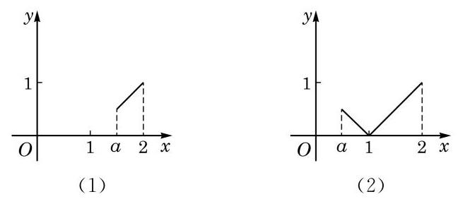

图 5-2-5

综上所述,当 $a < 0$ 时,该函数的最大值为 $1 - a$ ; 当 $0 \leq  a < 2$ 时,该函数的最大值为 1 .

#### 练习 5.2(5)

1. 求函数 $y = {\left( \frac{1}{2}\right) }^{x}, x \in  \left\lbrack  {1,3}\right\rbrack$ 的最大值与最小值.
2. 求下列函数的最大值与最小值:

(1) $y = 1 - {x}^{2}$ ； (2) $y = 1 - {x}^{2}, x \in  \left\lbrack  {-1,2}\right\rbrack$ ；

(3) $y = {2{x}^{2}} - {8x}$ ； (4) $y = 2{x}^{2} - {8x}, x \in  \left\lbrack  {0,1}\right\rbrack  .$

3. 已知 $a >  - 2$ ,求函数 $y = {x}^{2} + 1, x \in  \left\lbrack  {-2, a}\right\rbrack$ 的最大值.

#### 习题 5.2

##### A 组

1. 若函数 $y = f\left( x\right)$ 的定义域为 $\mathbf{R}$ ,则 $y = f\left( x\right)$ 为奇函数的充要条件为 ( )

A. $f\left( 0\right)  = 0$ ;

B. 对任意 $x \in  \mathbf{R}, f\left( x\right)  = 0$ 都成立;

C. 存在某个 ${x}_{0} \in  \mathbf{R}$ ,使得 $f\left( {x}_{0}\right)  + f\left( {-{x}_{0}}\right)  = 0$ ;

D. 对任意给定的 $x \in  \mathbf{R}, f\left( x\right)  + f\left( {-x}\right)  = 0$ 都成立.

2. 证明下列函数 $y = f\left( x\right)$ 为偶函数:

(1) $f\left( x\right)  = {x}^{2} + {x}^{-2}$ ；

(2) $f\left( x\right)  = \frac{x\left( {{2}^{x} - 1}\right) }{{2}^{x} + 1}$ .

3. 证明下列函数 $y = f\left( x\right)$ 为奇函数:

(1) $f\left( x\right)  = {x}^{-3}$ ； (2) $f\left( x\right)  = \frac{{\mathrm{e}}^{x} - {\mathrm{e}}^{-x}}{2}$ .

4. 判断下列函数 $y = f\left( x\right)$ 的奇偶性,并说明理由:

(1) $f\left( x\right)  = {2x} + \sqrt[3]{x}$ ； (2) $f\left( x\right)  = 2{x}^{4} - {x}^{2}$ ；

(3) $f\left( x\right)  = {x}^{2} - x$ ;

(4) $f\left( x\right)  = \frac{1 - x}{1 + x}$ ；

(5) $f\left( x\right)  = \lg \frac{1 - x}{1 + x}$ .

5. 证明: 函数 $y = x - \frac{1}{x}, x \in  \left( {-\infty ,0}\right)$ 是严格增函数.
6. 证明: 函数 $y = \lg \left( {1 - x}\right)$ 在其定义域上是严格减函数.
7. 求下列函数的最大值与最小值, 并写出取最值时相应自变量的值:

(1) $y = {x}^{2} - {4x} - 2$ ;

(2) $y = {6x} - 3{x}^{2}$ ；

(3) $y =  - {x}^{2} - {4x} - 3, x \in  \left\lbrack  {-3,1}\right\rbrack$ ；

(4) $y = {x}^{2} - {2x} - 3, x \in  \left\lbrack  {-2,0}\right\rbrack$ .

8. 求函数 $y = {\log }_{\frac{1}{2}}\left( {x + 2}\right) , x \in  \left\lbrack  {2,6}\right\rbrack$ 的最大值与最小值.
9. 已知 $y = {x}^{2} + {px} + q$ 和 $y = x + \frac{4}{x}$ 都是定义在 $\left\lbrack  {1,4}\right\rbrack$ 上的函数,且在 ${x}_{0}$ 处同时取到相同的最小值. 求 $y = {x}^{2} + {px} + q$ 的最大值.

##### B 组

1. 已知实数 $b < 2$ ,而函数 $y = {x}^{2} + {ax} + 1, x \in  \left\lbrack  {b,2}\right\rbrack$ 是偶函数. 求实数 $a\text{ 、 }b$ 的值.
2. 判断下列函数 $y = f\left( x\right)$ 的奇偶性,并说明理由:

(1) $f\left( x\right)  = \frac{{10}^{x} - {10}^{-x}}{{10}^{x} + {10}^{-x}}$ ; (2) $f\left( x\right)  = x\left( {\frac{1}{{2}^{x} - 1} + \frac{1}{2}}\right)$ .

3. 当表达式 $f\left( x\right)  =$ ___时，函数 $y = f\left( x\right)$ 同时满足以下条件:

① 不是偶函数；

② 在区间 $\left( {-\infty , - 1}\right)$ 上是严格减函数；

③ 在区间 $\left( {0,1}\right)$ 上是严格增函数.

4. 作出函数 $y = {x}^{2} - 2\left| x\right|$ 的大致图像,并分别写出它的定义域、奇偶性、单调区间及最小值.
5. 研究函数 $y = \frac{1}{1 + {x}^{2}}$ 的定义域、奇偶性、单调性及最大值.
6. 如果函数 $y = {x}^{2} - {2m}x + 1$ 在区间 $( - \infty ,2\rbrack$ 上是严格减函数，那么实数 $m$ 的取值范围为___.
7. 设 $t$ 是实数,且 $t < 4$ . 求函数 $y = \left| {{2}^{x + 1} - 8}\right| , x \in  \left\lbrack  {t,4}\right\rbrack$ 的最小值.
