# 点到直线距离与直线圆｜双教材原文摘录

本文件保留相关章节的讲解、例题与随堂练习，按版本分段。较宽章节含相邻知识和混合习题，尚未逐题筛选、配答或审校。原文为转写稿，请对照教材原件。

## 人教A版：2.3.3 点到直线的距离公式

来源：02_第二章_直线和圆的方程.md（本地转写稿），转写稿第 1091—1245 行；截至下一指定标题前。

## 2.3.3 点到直线的距离公式

## 探究

如图 2.3-5，已知点 $P ( x _ { 0 } , y _ { 0 } )$ ，直线l： $A x + B y + C = 0$ 如何求点Ρ 到直线l的距离？

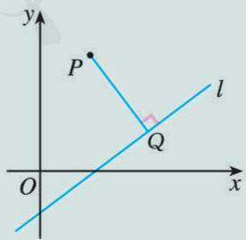  
图 2.3-5

点P到直线l的距离，就是从点P到直线l的垂线段PQ的长度，其中Q是垂足(图2.3-5). 因此，求出垂足Q的坐标，利用两点间的距离公式求出PQ|，就可以得到

点P到直线l的距离.

设 $A \neq 0 , \ B \neq 0 .$ 由 $P Q \perp l$ ，以及直线l的斜率为 $- { \frac { A } { B } }$ ，可得l的垂线PQ的斜率为$\frac { B } { A }$ ，因此，垂线PQ的方程为 $y - y _ { 0 } = \frac { B } { A } ( x - x _ { 0 } )$ ，即 $B x - A y = B x _ { 0 } - A y _ { 0 }$

解方程组

$$
\scriptstyle { \begin{array} { l } { \displaystyle \int \boldsymbol { A } \boldsymbol { x } + \boldsymbol { B } \boldsymbol { y } + \boldsymbol { C } = 0 , } \\ { \displaystyle B \boldsymbol { x } - \boldsymbol { A } \boldsymbol { y } = B \boldsymbol { x } _ { 0 } - \boldsymbol { A } \boldsymbol { y } _ { 0 } , } \end{array} }\tag{①}
$$

得直线l与PQ的交点坐标，即垂足Q的坐标为

$$
\Big ( \frac { B ^ { 2 } x _ { 0 } - A B y _ { 0 } - A C } { A ^ { 2 } + B ^ { 2 } } , ~ \frac { - A B x _ { 0 } + A ^ { 2 } y _ { 0 } - B C } { A ^ { 2 } + B ^ { 2 } } \Big ) .
$$

于是

$$
{ \begin{array} { r l } & { \mid P Q \mid = { \sqrt { \left( { \frac { B ^ { 2 } x _ { 0 } - A B y _ { 0 } - A C } { A ^ { 2 } + B ^ { 2 } } } - x _ { 0 } \right) ^ { 2 } + \left( { \frac { - A B x _ { 0 } + A ^ { 2 } y _ { 0 } - B C } { A ^ { 2 } + B ^ { 2 } } } - y _ { 0 } \right) ^ { 2 } } } } \\ & { \qquad = { \sqrt { \frac { ( A x _ { 0 } + B y _ { 0 } + C ) ^ { 2 } } { A ^ { 2 } + B ^ { 2 } } } } = { \frac { \mid A x _ { 0 } + B y _ { 0 } + C \mid } { \sqrt { A ^ { 2 } + B ^ { 2 } } } } . } \end{array} }
$$

因此，点 $P ( x _ { 0 } , y _ { 0 } )$ 到直线 $l \colon A x + B y + C = 0$ 的距离

$$
\boxed { d = \frac { \mid A x _ { 0 } + B y _ { 0 } + C \mid } { \sqrt { A ^ { 2 } + B ^ { 2 } } } . }
$$

可以验证，当 $A = 0$ ，或B=0时，上述公式仍然成立.

## 思考

上述方法中，我们根据点到直线距离的定义，将点到直线的距离转化为两点之间的距离，思路自然但运算量较大．反思求解过程，你发现引起复杂运算的原因了吗？由此能否给出简化运算的方法？

在上述方法中，若设垂足Q的坐标为 $( x , y )$ ，则

$$
| P Q | = \sqrt { ( x - x _ { 0 } ) ^ { 2 } + ( y - y _ { 0 } ) ^ { 2 } } .\tag{②}
$$

对于②式，你能给出它的几何意义吗?结合方程组①，能否直接求出 $( x - x _ { 0 } ) ^ { 2 } +$ $( y - y _ { 0 } ) ^ { 2 }$ ，进而求出 $| P Q |$ 呢？请你试一试！

## 探究

我们知道，向量是解决距离、角度问题的有力工具．能否用向量方法求点到直线的距离？

如图2.3-6，点P到直线l的距离，就是向量 $\overrightarrow { P Q }$ 的模.

设 $M ( x , \ y )$ 是直线l上的任意一点，n是与直线l的方向向量垂直的单位向量，则 $\overrightarrow { P Q }$ 是 $\overrightarrow { P M }$ 在n上的投影向量， $| { \overrightarrow { P Q } } | = | { \overrightarrow { P M } } \cdot n |$

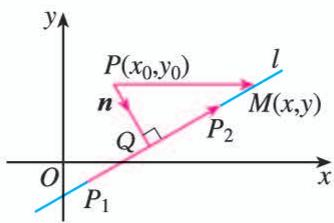  
图2.3-6

## 思考

如何利用直线l的方程得到与l的方向向量垂直的单位向量n？

设 $P _ { 1 } ( x _ { 1 } , \ y _ { 1 } ) , \ P _ { 2 } ( x _ { 2 } , \ y _ { 2 } )$ 是直线 $l \colon A x + B y + C = 0$ 上的任意两点，则 $\overrightarrow { P _ { 1 } P _ { 2 } } =$ $( x _ { 2 } - x _ { 1 } , ~ y _ { 2 } - y _ { 1 } )$ 是直线l的方向向量.把 $A x _ { 1 } + B y _ { 1 } + C = 0 , \ A x _ { 2 } + B y _ { 2 } + C = 0$ 两式相减，得 $A ( x _ { 2 } - x _ { 1 } ) + B ( y _ { 2 } - y _ { 1 } ) = 0$ 由平面向量的数量积运算可知，向量(A，B)与向量 $( x _ { 2 } - x _ { 1 } , ~ y _ { 2 } - y _ { 1 } )$ 垂直.向量 ${ \frac { 1 } { \sqrt { A ^ { 2 } + B ^ { 2 } } } } ( A , \ B )$ 就是与直线l的方向向量垂直的一个单位向量.我们取 $\pmb { n = } \frac { 1 } { \sqrt { A ^ { 2 } + B ^ { 2 } } } \ \left( A , \ B \right)$ ，从而

$$
\begin{array} { c } { { { \overrightarrow { P M } } \bullet n = ( x - x _ { 0 } , ~ y - y _ { 0 } ) \bullet \frac 1 { \sqrt { A ^ { 2 } + B ^ { 2 } } } ( A , ~ B ) } } \\ { { { } } } \\ { { = \frac 1 { \sqrt { A ^ { 2 } + B ^ { 2 } } } [ A ( x - x _ { 0 } ) + B ( y - y _ { 0 } ) ] } } \\ { { { } } } \\ { { { } = \frac 1 { \sqrt { A ^ { 2 } + B ^ { 2 } } } ( A x + B y - A x _ { 0 } - B y _ { 0 } ) . } } \end{array}
$$

因为点 $M ( x , \ y )$ 在直线l上，所以 $A x + B y + C = 0 ,$ 所以 $A x + B y = - C$ 代入上式，得

$$
{ \overrightarrow { P M } } \cdot n { = } { \frac { 1 } { \sqrt { A ^ { 2 } + B ^ { 2 } } } } ( - A x _ { 0 } { - } B y _ { 0 } { - } C ) .
$$

因此

$$
\vert P Q \vert = \overrightarrow { \vert P Q \vert } = \vert \overrightarrow { P M } \cdot n \vert = \frac { \vert A x _ { 0 } + B y _ { 0 } + C \vert } { \sqrt { A ^ { 2 } + B ^ { 2 } } } .
$$

## 思考

比较上述两种方法，第一种方法从定义出发，把问题转化为求两点间的距离，通过代数运算得到结果，思路自然；第二种方法利用向量投影，通过向量运算求出结果，简化了运算．除了上述两种方法，你还有其他推导方法吗？

例5 求点P(—1，2）到直线l：3x=2的距离.

分析：将直线l的方程写成 $3 x - 2 = 0$ ，再用点到直线的距离公式求解.

解：点P(-1，2）到直线 $l : ~ 3 x - 2 { = } 0$ 的距离

直线l有什么特性？由此你能给出简便解法吗？

$$
d = { \frac { \mid 3 \times ( - 1 ) - 2 \mid } { \sqrt { 3 ^ { 2 } + 0 ^ { 2 } } } } = { \frac { 5 } { 3 } } .
$$

例6已知 $\triangle A B C$ 的三个顶点分别是A(1，3)，B(3，1), $C ( - 1 , \ 0 )$ ，求 $\triangle A B C$ 的面积.

分析：由三角形面积公式可知，只要利用距离公式求出边AB的长和边AB上的高即可.

解：如图2.3-7，设边AB上的高为h，则

$$
S _ { \triangle A B C } { = } \frac { 1 } { 2 } \left| A B \right| h .
$$

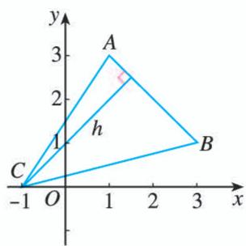  
图2.3-7

$$
\left| A B \right| = { \sqrt { ( 3 - 1 ) ^ { 2 } + ( 1 - 3 ) ^ { 2 } } } = 2 { \sqrt { 2 } } .
$$

边AB 上的高h就是点C到直线AB 的距离

边AB所在直线l的方程为

$$
{ \frac { y - 3 } { 1 - 3 } } { = } { \frac { x - 1 } { 3 - 1 } } ,
$$

即 $x + y - 4 = 0$

点C(-1，0)到直线 $l : x + y - 4 = 0$ 的距离

$$
h = \frac { \mid - 1 + 0 - 4 \mid } { \sqrt { 1 ^ { 2 } + 1 ^ { 2 } } } = \frac { 5 } { \sqrt { 2 } } .
$$

你还有其他解法吗？

因此， $S _ { \Delta A B C } = \frac { 1 } { 2 } \times 2 \sqrt { 2 } \times \frac { 5 } { \sqrt { 2 } } = 5 .$

## 练习

1. 求原点到下列直线的距离：

(1) $l \colon 3 x + 2 y - 2 6 = 0 ;$ (2) $l : \ x = y .$

2. 求下列点到直线的距离：

(1) $A \left( - 2 , \ 3 \right)$ $l \colon 3 x + 4 y + 3 = 0 ;$

(2) $B ( 1 , \ 0 )$ $l : \sqrt { 3 } x + y - \sqrt { 3 } = 0$

(3) $C ( 1 , \textrm { -- } 2 )$ $l : 4 x + 3 y = 0 .$

3. 已知点P(—1，2)到直线 $l : ~ 4 x - 3 y + c = 0$ 的距离为1，求C的值.

## 人教A版：2.5.1 直线与圆的位置关系

来源：02_第二章_直线和圆的方程.md（本地转写稿），转写稿第 1820—2075 行；截至下一指定标题前。

## 2.5.1 直线与圆的位置关系

我们知道，直线与圆有三种位置关系：

（1）直线与圆相交，有两个公共点；

（2）直线与圆相切，只有一个公共点；

（3）直线与圆相离，没有公共点.

## 思考

在初中，我们怎样判断直线与圆的位置关系？根据上述定义，如何利用直线和圆的方程判断它们之间的位置关系？

下面，我们通过具体例子进行研究

例1 已知直线 $l : ~ 3 x + y - 6 = 0$ 和圆心为C的圆 $x ^ { 2 } + y ^ { 2 } - 2 y - 4 = 0$ ，判断直线l与圆C的位置关系；如果相交，求直线l被圆C所截得的弦长.

分析：思路1：将判断直线l与圆C的位置关系转化为判断由它们的方程组成的方程组有无实数解、有几个实数解；若相交，可以由方程组解得两交点的坐标，利用两点间的距离公式求得弦长.

思路2：依据圆心到直线的距离与半径的关系，判断直线与圆的位置关系；若相交，则可利用勾股定理求得弦长.

解法1：联立直线l与圆C的方程，得

$$
\textstyle { \left\{ \begin{array} { l l } { 3 x + y - 6 = 0 , } \\ { x ^ { 2 } + y ^ { 2 } - 2 y - 4 = 0 . } \end{array} \right. }\tag{①}
$$

②

消去y，得 $x ^ { 2 } - 3 x + 2 = 0$ ，解得 $x _ { 1 } { = } 2 , \ x _ { 2 } { = } 1$

所以，直线l与圆C相交，有两个公共点.

把 $x _ { 1 } { = } 2 , \ x _ { 2 } { = } 1$ 分别代入方程①，得 $y _ { 1 } { = } 0 , ~ y _ { 2 } { = } 3 .$

所以，直线l与圆C的两个交点是 $A ( 2 , \ 0 ) , \ B ( 1 , \ 3 )$

因此 $| A B | = \sqrt { ( 1 { - } 2 ) ^ { 2 } + ( 3 { - } 0 ) ^ { 2 } } = \sqrt { 1 0 } .$

解法2：圆C的方程 $x ^ { 2 } + y ^ { 2 } - 2 y - 4 = 0$ 可化为 $x ^ { 2 } + ( y - 1 ) ^ { 2 } = 5$ ，因此圆心C的坐标为(0，1)，半径为 $\sqrt { 5 }$ ，圆心C(0，1）到直线l的距离

$$
d = \frac { \mid 3 \times 0 + 1 - 6 \mid } { \sqrt { 3 ^ { 2 } + 1 ^ { 2 } } } = \frac { 5 } { \sqrt { 1 0 } } < \sqrt { 5 } .
$$

所以，直线l与圆C相交，有两个公共点.

如图2.5-1，由垂径定理，得 $\left| A B \right| = 2 { \sqrt { r ^ { 2 } - d ^ { 2 } } } = { \sqrt { 1 0 } }$

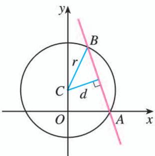

通过上述解法我们发现，在平面直角坐标系中，要判断直线l: $A x + B y + C = 0$ 与圆C： $( x - a ) ^ { 2 } + ( y - b ) ^ { 2 } = r ^ { 2 }$ 的位置关系，可以联立它们的方程，通过判定方程组

图 2.5-1

$$
\scriptstyle { \left\{ \begin{array} { l l } { A x + B y + C = 0 , } \\ { ( x - a ) ^ { 2 } + ( y - b ) ^ { 2 } = r ^ { 2 } } \end{array} \right. }
$$

的解的个数，得出直线与圆的公共点的个数，进而判断直线与圆的位置关系。若相交，可以由方程组解得两交点坐标，利用两点间的距离公式求得弦长.

我们还可以根据圆的方程求得圆心坐标与半径r，从而求得圆心到直线的距离d，通过比较d与r的大小，判断直线与圆的位置关系。若相交，则可利用勾股定理求得弦长

适当地利用已知图形的几何性质，有助于简化计算.

## 思考

与初中的方法比较，你认为用方程判断直线与圆的位置关系有什么优点？例1中两种解法的差异是什么？

例2 过点 $P ( 2 , \ 1 )$ 作圆 $O \colon x ^ { 2 } + y ^ { 2 } = 1$ 的切线l，求 切线l的方程.

分析：如图2.5-2，容易知道，点P(2，1）位于圆 $O { \mathrm { : } }$ $x ^ { 2 } + y ^ { 2 } = 1$ 外，经过圆外一点有两条直线与这个圆相切.我们设切线方程为 $y - 1 = k ( x - 2 )$ ，k为斜率.由直线与圆相切可求出k的值.

解法1：设切线l的斜率为k，则切线l的方程为 $y - 1 =$ $k \left( x - 2 \right)$ ，即 $k x - y + 1 - 2 k = 0$

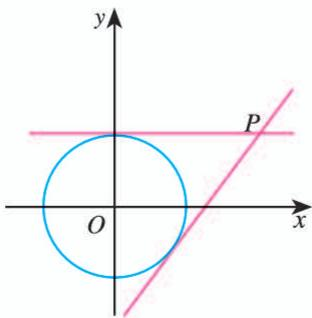  
图 2.5-2

由圆心(0，0)到切线l的距离等于圆的半径1，得

$$
{ \frac { \mid 1 - 2 k \mid } { \sqrt { k ^ { 2 } + 1 } } } = 1 ,
$$

解得k=0或 $\frac { 4 } { 3 }$

因此，所求切线l的方程为 $y = 1$ ，或 $4 x - 3 y - 5 = 0$

解法2：设切线l的斜率为k，则切线l的方程为 $y - 1 = k ( x - 2 )$

因为直线l与圆相切，所以方程组

$$
\scriptstyle \left\{ { \begin{array} { l } { y - 1 = h \left( x - 2 \right) , } \\ { x ^ { 2 } + y ^ { 2 } = 1 } \end{array} } \right.
$$

只有一组解.

消元，得

$$
( k ^ { 2 } + 1 ) x ^ { 2 } + ( 2 k - 4 k ^ { 2 } ) x + 4 k ^ { 2 } - 4 k = 0 .\tag{①}
$$

因为方程①只有一个解，所以

$$
\Delta = 4 k ^ { 2 } ( 1 { - } 2 k ) ^ { 2 } - 1 6 k ( k ^ { 2 } { + } 1 ) ( k { - } 1 ) = 0 ,
$$

解得k=0或 $\frac { 4 } { 3 }$

所以，所求切线l的方程为y=1，或 $4 x - 3 y - 5 = 0$

## 练习

1. 判断下列各组直线l与圆C的位置关系：

(1) $l : x - y + 1 = 0 .$

圆 $C : \ x ^ { 2 } + y ^ { 2 } = 3$

(2) $l : ~ 3 x + 4 y + 2 = 0 .$

圆C: $x ^ { 2 } + y ^ { 2 } - 2 x = 0$

(3) $l : x + y + 3 = 0 ,$

圆C： $x ^ { 2 } + y ^ { 2 } + 2 y = 0 .$

2. 已知直线 $4 x + 3 y - 3 5 = 0$ 与圆心在原点的圆C相切，求圆C的方程

3.判断直线 $2 x - y + 2 = 0$ 与圆 $( x - 1 ) ^ { 2 } + ( y - 2 ) ^ { 2 } = 4$ 的位置关系；如果相交，求直线被圆截得的弦长.

例3 图2.5-3是某圆拱形桥一孔圆拱的示意图.圆拱跨度 $A B = 2 0 \mathrm { ~ m ~ }$ ，拱高 $O P { = } 4 ~ \mathrm { m }$ 建造时每间隔4m需要用一根支柱支撑，求支柱 $A _ { 2 } P _ { 2 }$ 的高度（精确到0.01m).

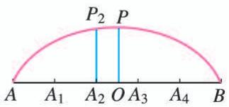  
图 2.5-3

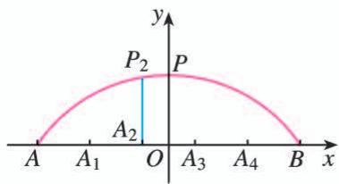  
图2.5-4

分析：建立如图2.5-4所示的直角坐标系，要得到支柱 $A _ { 2 } P _ { 2 }$ 的高度，只需求出点$P _ { 2 }$ 的纵坐标。

解：建立如图2.5-4所示的直角坐标系，使线段AB所在直线为x轴，O为坐标原点，圆心在y轴上.由题意，点P，B的坐标分别为(0，4)，(10，0). 设圆心坐标是(0，b)，圆的半径是r，那么圆的方程是

$$
x ^ { 2 } + ( y - b ) ^ { 2 } = r ^ { 2 } .
$$

点O是圆拱所在圆的圆心吗？

下面确定b和r的值.

因为P，B两点都在圆上，所以它们的坐标(0，4)，(10，0)都满足方程 $x ^ { 2 } + ( y -$ $b ) ^ { 2 } = r ^ { 2 }$ .于是，得到方程组

$$
\begin{array} { l } { { \{ 0 ^ { 2 } + ( 4 - b ) ^ { 2 } = r ^ { 2 } ,  } } \\ { {  1 0 ^ { 2 } + ( 0 - b ) ^ { 2 } = r ^ { 2 } . } } \end{array}
$$

解得

$$
b { = } { \mathrm { - } } 1 0 . 5 , \ r ^ { 2 } { = } 1 4 . 5 ^ { 2 } .
$$

所以，圆的方程是

$$
x ^ { 2 } + ( y + 1 0 . 5 ) ^ { 2 } = 1 4 . 5 ^ { 2 } .
$$

把点 $P _ { 2 }$ 的横坐标x=—2代入圆的方程，得

$$
( - 2 ) ^ { 2 } + ( y + 1 0 . 5 ) ^ { 2 } = 1 4 . 5 ^ { 2 } ,
$$

即 $y + 1 0 . 5 = \sqrt { 1 4 . 5 ^ { 2 } - ( - 2 ) ^ { 2 } } ( P _ { 2 }$ 的纵坐标 $y > 0$ ，平方根取正值).所以

$$
y = { \sqrt { 1 4 . 5 ^ { 2 } - ( - 2 ) ^ { 2 } } } - 1 0 . 5 \approx 1 4 . 3 6 - 1 0 . 5 = 3 . 8 6 ( { \mathrm { m } } ) .
$$

答：支柱 $A _ { 2 } P _ { 2 }$ 的高度约为3.86m.

## 思考

如果不建立平面直角坐标系，你能解决这个问题吗？由此比较综合法和坐标法的特点.

例4一个小岛的周围有环岛暗礁，暗礁分布在以小岛中心为圆心，半径为20km的圆形区域内.已知小岛中心位于轮船正西40km处，港口位于小岛中心正北30km处.如果轮船沿直线返港，那么它是否会有触礁危险？

分析：先画出示意图，了解小岛中心、轮船、港口的方位和距离.如图2.5-5，根据题意，建立适当的平面直角坐标系，求出暗礁所在区域的边缘圆的方程，以及轮船返港直线的方程，利用方程判断直线与圆的位置关系，进而确定轮船是否有触礁危险.

解：以小岛的中心为原点O，东西方向为x轴，建立如图2.5-5所示的直角坐标系.为了运算的简便，我们取10km为单位长度，则港口所在位置的坐标为(0，3)，轮船所在位置的坐标为(4，0).

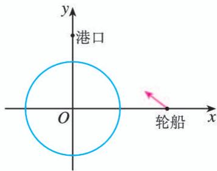  
图2.5-5

这样，受暗礁影响的圆形区域的边缘所对应的圆的方程为

$$
x ^ { 2 } + y ^ { 2 } = 4 ;
$$

轮船航线所在直线l的方程为

$\frac { x } { 4 } + \frac { y } { 3 } = 1$ ，即 $3 x + 4 y - 1 2 = 0 .$

联立直线l与圆O的方程，得

$$
\left\{ { \begin{array} { l l } { { 3 x + 4 y - 1 2 = 0 , } } \\ { { } } \\ { { x ^ { 2 } + y ^ { 2 } = 4 . } } \end{array} } \right.
$$

消去y，得

$$
2 5 x ^ { 2 } - 7 2 x + 8 0 = 0 .
$$

由 $\Delta = ( - 7 2 ) ^ { 2 } - 4 \times 2 5 \times 8 0 < 0$ ，可知方程组无解.

所以直线l与圆O相离，轮船沿直线返港不会有触礁危险

## 思考

你还能用其他方法解决上述问题吗？

用坐标法解决几何问题时，先用坐标和方程表示相应的几何元素：点、直线、圆，将几何问题转化为代数问题；然后通过代数运算解决代数问题；最后解释代数运算结果的几何含义，得到几何问题的结论。这就是用坐标法解决平面几何问题的“三步曲”：

第一步：建立适当的平面直角坐标系，用坐标和方程表示问题中的几何要素，如点、直线、圆，把平面几何问题转化为代数问题；

第二步：通过代数运算，解决代数问题；

第三步：把代数运算的结果“翻译”成几何结论

比较坐标法与向量法，它们在解决几何问题时，有什么异同点？

## 练习

1. 赵州桥的跨度是37.4 m，圆拱高约为7.2m. 求这座圆拱桥的拱圆的方程.

2. 某圆拱桥的水面跨度20m，拱高4m.现有一船，宽10m，水面以上高3m，这条船能否从桥下通过？

3. 在一个平面上，机器人从与点C(5，一3)的距离为9的地方绕点C顺时针而行，在行进过程中保持与点C的距离不变.它在行进

(第1题)

过程中到过点 $A \left( - 1 0 , \ 0 \right)$ 与B(0，12)的直线的最近距离和最远距离分别是多少？

## 沪教版2026：1.4 点到直线的距离

来源：沪教版选择性必修第一册2026-dollar-polished-fixed.md（本地转写稿），转写稿第 882—1030 行；截至下一指定标题前。

## 1.4 点到直线的距离

我们首先讨论直线 $l : {ax} + {by} + c = 0$ ( $a,b$ 不同时为零) 外一点 $P\left( {{x}_{0},{y}_{0}}\right)$ 到这条直线的距离. 根据点到直线距离的定义, 如图 1-4-1,过点 $P$ 作直线 $l$ 的垂线,设垂足是 $Q\left( {{x}_{Q},{y}_{Q}}\right)$ ,则线段 ${PQ}$ 的长度就是点 $P$ 到直线 $l$ 的距离 $d$ . 因此,只要求出 ${PQ}$ 所在直线的方程,然后与 $l$ 的方程联立得到一个二元一次方程组,解这个方程组就可以得到点 $Q$ 的坐标,进而利用两点间的距离公式求出 ${PQ}$ 的长度. 这种方法的思路很清晰,但运算量比较大. 为了简便计算, 我们介绍另外一种方法.

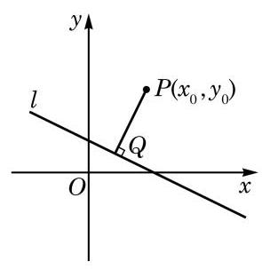

图 1-4-1

由直线 $l$ 的一般式方程知, $\overrightarrow{n} = \left( {a, b}\right)$ 是 $l$ 的一个法向量, 所以 $\overrightarrow{PQ}//\overrightarrow{n}$ ,即 $\left| {\cos \langle \overrightarrow{PQ},\overrightarrow{n}\rangle }\right|  = 1$ ,从而

$$
d = \left| \overrightarrow{PQ}\right|  = \frac{\left| \overrightarrow{PQ} \cdot  \overrightarrow{n}\right| }{\left| \overrightarrow{n}\right| } = \frac{\left| a\left( {x}_{Q} - {x}_{0}\right)  + b\left( {y}_{Q} - {y}_{0}\right) \right| }{\sqrt{{a}^{2} + {b}^{2}}}
$$

$$
= \frac{\left| \left( a{x}_{Q} + b{y}_{Q}\right)  - \left( a{x}_{0} + b{y}_{0}\right) \right| }{\sqrt{{a}^{2} + {b}^{2}}}.
$$

因为点 $Q$ 在 $l$ 上,所以 $a{x}_{Q} + b{y}_{Q} + c = 0$ ,即

$$
a{x}_{Q} + b{y}_{Q} =  - c.
$$

所以, $d = \frac{\left| -c - \left( a{x}_{0} + b{y}_{0}\right) \right| }{\sqrt{{a}^{2} + {b}^{2}}}$ ,从而得到点 $P\left( {{x}_{0},{y}_{0}}\right)$ 到直线 $l : {ax} + {by} + c = 0$ 的距离公式

$$
d = \frac{\left| a{x}_{0} + b{y}_{0} + c\right| }{\sqrt{{a}^{2} + {b}^{2}}}.
$$

当点 $P$ 在直线 $l$ 上时,上述公式仍然成立,此时 $d = 0$ .

例 1 根据下列条件,求点 $P$ 到直线 $l$ 的距离 $d$ :

(1) $P\left( {1,2}\right) , l : x + {2y} + 5 = 0$ ;

(2) $P\left( {-\sqrt{3},3}\right) , l : y = \sqrt{3}x + 3$ .

解(1)由点到直线的距离公式, 得

$$
d = \frac{\left| 1 + 2 \times  2 + 5\right| }{\sqrt{{1}^{2} + {2}^{2}}} = 2\sqrt{5}.
$$

(2)将直线 $l$ 的方程化为 $\sqrt{3}x - y + 3 = 0$ ，所以由点到直线的距离公式, 得

$$
d = \frac{\left| \sqrt{3} \times  \left( -\sqrt{3}\right)  + \left( -1\right)  \times  3 + 3\right| }{\sqrt{{\left( \sqrt{3}\right) }^{2} + {\left( -1\right) }^{2}}} = \frac{3}{2}.
$$

例 2 求平行直线 ${l}_{1} : \sqrt{2}x + y + 1 = 0$ 与 ${l}_{2} : \sqrt{2}x + y + 4 = 0$ 之间的距离.

解 两条平行线之间的距离就是其中一条直线上的一点到另一条直线的距离. 为方便计算,我们在直线 ${l}_{1}$ 上取一个特殊点 $P\left( {0, - 1}\right)$ ,点 $P$ 到直线 ${l}_{2} : \sqrt{2}x + y + 4 = 0$ 的距离为

$$
d = \frac{\left| \sqrt{2} \times  0 + 1 \times  \left( -1\right)  + 4\right| }{\sqrt{2 + 1}} = \sqrt{3}.
$$

所以,直线 ${l}_{1}$ 与 ${l}_{2}$ 之间的距离为 $\sqrt{3}$ .

如图 1-4-2,对于两条平行线 ${l}_{1} : {ax} + {by} + {c}_{1} = 0$ 与 ${l}_{2} : {ax} + \; {by} + {c}_{2} = 0\left( {a,b}\right.$ 不同时为零),我们可以采取同样的方法求它们之间的距离. 取 ${l}_{1}$ 上一点 $P\left( {{x}_{0},{y}_{0}}\right)$ ,则 $a{x}_{0} + b{y}_{0} + {c}_{1} = 0$ . 点 $P$ 到 ${l}_{2}$ 的距离 $d = \frac{\left| a{x}_{0} + b{y}_{0} + {c}_{2}\right| }{\sqrt{{a}^{2} + {b}^{2}}}$ . 由 $a{x}_{0} + b{y}_{0} + {c}_{1} = 0$ ,得 $a{x}_{0} + \; b{y}_{0} =  - {c}_{1}$ ,所以 $d = \frac{\left| -{c}_{1} + {c}_{2}\right| }{\sqrt{{a}^{2} + {b}^{2}}}$ . 也就是说: 平行线 ${l}_{1} : {ax} + \; {by} + {c}_{1} = 0$ 与 ${l}_{2} : {ax} + {by} + {c}_{2} = 0$ 的距离为

$$
d = \frac{\left| {c}_{1} - {c}_{2}\right| }{\sqrt{{a}^{2} + {b}^{2}}}.
$$

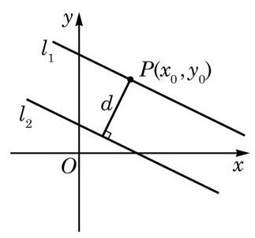

图 1-4-2

例 3 已知直线 ${l}_{1} : y = \sqrt{2}x + 1$ ，直线 ${l}_{2}$ 与 ${l}_{1}$ 平行，且与 ${l}_{1}$ 的距离为 2 . 求直线 ${l}_{2}$ 的方程.

解 由题意,可设 ${l}_{2}$ 的方程为 $y = \sqrt{2}x + b\left( {b \in  \mathbf{R}\text{ 且 }b \neq  1}\right)$ .

直线 ${l}_{1}$ 与 ${l}_{2}$ 的一般式方程为

$$
{l}_{1} : \sqrt{2}x - y + 1 = 0\text{ 与 }{l}_{2} : \sqrt{2}x - y + b = 0.
$$

由两条平行直线之间的距离公式, 得

$$
\frac{\left| 1 - b\right| }{\sqrt{{1}^{2} + {\left( \sqrt{2}\right) }^{2}}} = 2.
$$

解得 $b = 2\sqrt{3} + 1$ 或 $b =  - 2\sqrt{3} + 1$ .

所以,直线 ${l}_{2}$ 的方程为 $y = \sqrt{2}x + 2\sqrt{3} + 1$ 或 $y = \sqrt{2}x - 2\sqrt{3} + 1$ .

练习 1.4

1. 根据下列条件,求点 $M\left( {-2, - 1}\right)$ 到直线 $l$ 的距离 $d$ :

(1) $l : x = 3$

(2) $l : y = 3$ ；

(3) $l : {x + y} = {3;}$

(4) $l : y = {3x} - 5$ .

2. 在直角三角形 ${ABC}$ 中, $\angle A = \frac{\pi }{2},\left| {AB}\right|  = 6,\left| {AC}\right|  = 8$ . 求三角形的重心 $G$ 到斜边 ${BC}$ 所在直线的距离.

#### 习题 1.4

##### A 组

1. 求点 $P\left( {2,3}\right)$ 到直线 $l$ 的距离:

(1) $l : {3x} - {2y} = {13}$ ；

(2) $l : y =  - {2x} + 3$ .

2. 已知点 $A\left( {a,6}\right)$ 到直线 ${3x} - {4y} - 4 = 0$ 的距离等于 4,求实数 $a$ 的值.
3. 求下列两条平行线之间的距离:

(1) ${l}_{1} : {2x} - {3y} + 1 = 0,{l}_{2} : {4x} - {6y} + 1 = 0$ ；

(2) ${l}_{1} : y = \frac{\sqrt{3}}{2}x + 1,{l}_{2} : \sqrt{3}x - {2y} + 1 = 0$ .

4. 已知直线 ${l}_{1} : {2x} - y + a = 0$ 与直线 ${l}_{2} :  - {4x} + {2y} + 1 = 0$ 的距离为 $\frac{7\sqrt{5}}{10}$ ，求实数 $a$ 的值.

B 组

1. 已知点 $A\left( {1,0}\right) ,B\left( {4, - 4}\right)$ . 若点 $A$ 与点 $B$ 到直线 $l$ 的距离都为 2,求直线 $l$ 的方程.
2. 已知点 $P$ 是直线 ${3x} - {4y} + 2 = 0$ 上任意一点,求点 $P$ 与点 $A\left( {3, - 1}\right)$ 之间距离的最小值.
3. 已知直线 $l$ 经过点 $P\left( {1,1}\right)$ 且与直线 ${l}_{1} : y = \sqrt{3}x + 1$ 和 ${l}_{2} : y = \sqrt{3}x + 3$ 分别交于点 $A$ 和点 $B$ . 若 $\left| {AB}\right|  = \sqrt{2}$ ,求直线 $l$ 的方程.

课后阅读

解析几何的诞生

文艺复兴以来，生产力的发展对科学技术提出了全新的要求. 到 16 世纪，对运动与变化的研究已成为自然科学的中心问题. 这迫切需要一种新的数学工具, 从而诞生了解析几何.

有别于传统的纯几何方法, 解析几何将数与形有机地结合起来, 形成一门新的学科. 它的基本思想是在平面上引进 “坐标” 的概念, 并借助于平面上的点和有序实数对之间所建立的一一对应关系, 将一个代数方程与平面上一条曲线对应起来. 于是几何问题便可归结为代数问题, 反过来又可通过代数问题的研究发现新的几何结果.

借助于坐标来确定点的位置的思想在古代曾经出现过, 古希腊数学家阿波罗尼斯 (Apollonius)关于圆锥曲线性质的推导, 阿拉伯数学家通过圆锥曲线交点求解三次方程的研究, 都蕴含着这种思想.

解析几何的建立主要归功于两位 17 世纪的法国数学家笛卡儿 (R. Descartes) 和费马 (P. de Fermat). 他们工作的出发点不同, 却殊途同归.

1637 年笛卡儿出版了著名的哲学著作《方法论》，该书有三个附录，《几何学》是其中之一, 解析几何的发明就在这篇附录中. 笛卡儿的出发点是一个著名的古希腊数学问题: 帕普斯问题. 笛卡儿解决了一些特殊的情形, 由此建立起了历史上第一个斜坐标系. 在 《几何学》中, 笛卡儿也给出了直角坐标系的例子. 基于坐标系和曲线方程的思想, 笛卡儿还提出了一系列新颖的想法. 例如, 曲线的次数与坐标轴的选择无关, 利用曲线的方程表示求出两条不同曲线的公共点, 曲线的分类, 等等.

与笛卡儿不同, 费马工作的出发点是想恢复已失传的阿波罗尼斯的《论平面轨迹》, 为此, 他写成《平面与立体轨迹引论》(1629)一书，其中清晰地阐述了自己的解析几何思想. 费马在书中写道:“在最后的方程中出现两个未知量时，我们就得到一个轨迹，其中一个未知量的一端画出了一条直线或曲线. ”这就是说，用代数方法解几何问题时，最后得到含两个未知量的方程, 所得结果表示一轨迹 (直线或曲线). 因此, 费马以研究古希腊轨迹问题为目的, 以韦达(F. Viète)的符号代数为工具, 通过建立只含一条轴的坐标系, 将二元代数方程与几何曲线对应起来, 导引着解析几何的诞生.

解析几何的发明具有伟大的意义. 它使得原先以常量为主导的数学转变为以变量为主导的数学, 从而为微积分的创立搭起数学舞台; 它使得代数和几何融合为一体, 实现了几何图形的代数化; 经由代数和几何的相互转化, 它使数学家得以摆脱现实的束缚, 从三维空间进入高维空间, 探索更深层次的概念.

解析几何为我们打开了一扇通往全新数学世界的大门. 在解析几何诞生的背后, 蕴藏诸多有趣的数学故事, 充分体现了数学的人文精神.

## 沪教版2026：2.1 圆

来源：沪教版选择性必修第一册2026-dollar-polished-fixed.md（本地转写稿），转写稿第 1138—1766 行；截至下一指定标题前。

## 2.1 圆

### 1 曲线方程的概念

在上一章 1.2 节中, 我们针对具体的例子解释了什么是 “直线的方程”, 从而引导了全章的学习. 通过上一章的学习, 我们对“直线方程”有了更多认识. 在此基础上我们不难总结出 “直线方程” 的严格定义: 在一个平面直角坐标系中给定一条直线和一个关于 $x$ 与 $y$ 的二元一次方程,如果给定直线上的每一个点的坐标都是该给定方程的解, 而且以给定方程的解为坐标的点都在该给定直线上, 那么称这个给定的方程是给定直线的方程.

如果考虑更为一般的平面曲线 (直线是它的特例), 可以直接把这个定义推广而给出曲线方程的概念: 在一个平面直角坐标系中给定一条曲线和一个关于 $x$ 与 $y$ 的二元方程,如果给定曲线上的每一个点的坐标都是该给定方程的解, 而且以给定方程的解为坐标的点都在该给定曲线上, 那么称这个给定的方程是给定曲线的方程, 也称这条给定的曲线是给定方程的曲线.

### 2 圆的标准方程

在各种非直线的平面曲线中, 我们最熟悉的是圆.

在平面几何中已经知道, 圆 (circle) 是到一个定点的距离等于定长 (大于零) 的点的轨迹. 这个定点就是圆心 (center), 定长就是圆的半径 (radius). 如果一个圆在直角坐标平面上, 我们该如何确定这个圆的位置, 并且建立圆的方程呢?

显然, 只要圆心的位置及圆的半径确定, 一个圆在平面上的位置就完全确定了. 假设在平面直角坐标系中,已知圆 $C$ 的圆心是 $C\left( {a, b}\right)$ ,半径是 $r\left( {r > 0}\right)$ ,如图 2-1-1 所示. 我们来考察这个圆上的动点 $P\left( {x, y}\right)$ 的坐标所满足的方程.

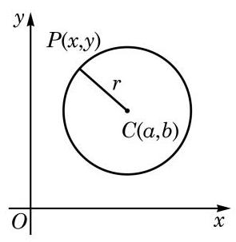

图 2-1-1

因为 $\left| {PC}\right|  = r$ ,即 $\sqrt{{\left( x - a\right) }^{2} + {\left( y - b\right) }^{2}} = r$ ,两边平方后得

$$
{\left( x - a\right) }^{2} + {\left( y - b\right) }^{2} = {r}^{2},
$$

①

所以圆 $C$ 上任意一点 $P\left( {x, y}\right)$ 的坐标都满足方程①.

反之,若平面上有一点 $M$ 的坐标 $\left( {{x}_{1},{y}_{1}}\right)$ 是方程①的解,则 ${\left( {x}_{1} - a\right) }^{2} + {\left( {y}_{1} - b\right) }^{2} = {r}^{2}$ ,即 ${\left| MC\right| }^{2} = {r}^{2}$ ,可得 $\left| {MC}\right|  = r$ . 所以,点 $M$ 在以 $C$ 为圆心、以 $r$ 为半径的圆上.

因此,方程①是圆 $C$ 的方程. 我们把它叫做圆的标准方程.

特别地,当 $a = b = 0$ ,即圆心在原点 $O\left( {0,0}\right)$ 时,圆的标准方程为

$$
{x}^{2} + {y}^{2} = {r}^{2}.
$$

---

若设 $N\left( {x, y}\right)$ 为圆 $C$ 上任意一点,能否由 $\overrightarrow{NP} \bot  \overrightarrow{NQ}$ 求得圆 $C$ 的方程?

---

例 1 已知两点 $P\left( {3,4}\right) ,Q\left( {-5,6}\right)$ ,求以 ${PQ}$ 为直径的圆 $C$ 的方程.

解 由已知,圆心 $C$ 为线段 ${PQ}$ 的中点,可得圆心 $C$ 的坐标为 $\left( {-1,5}\right)$ .

又半径 $r$ 为直径 ${PQ}$ 长度的一半,即

$$
r = \frac{1}{2}\left| {PQ}\right|  = \frac{1}{2}\sqrt{{\left( -5 - 3\right) }^{2} + {\left( 6 - 4\right) }^{2}} = \sqrt{17}.
$$

因此,所求圆的标准方程为 ${\left( x + 1\right) }^{2} + {\left( y - 5\right) }^{2} = {17}$ .

例 2 设平面上有一条长度为 4 的线段 ${AB}$ ,试建立适当的平面直角坐标系,求到线段 ${AB}$ 两端点的距离的平方和为 16 的点的轨迹方程.

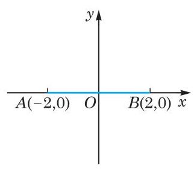

图 2-1-2

解 如图 2-1-2,取 ${AB}$ 的中点 $O$ 为原点, ${AB}$ 所在直线为 $x$ 轴,射线 ${OB}$ 方向为它的正方向,以过点 $O$ 且垂直于 ${AB}$ 的直线为 $y$ 轴,建立平面直角坐标系,则有 $A\left( {-2,0}\right) ,B\left( {2,0}\right)$ .

设点 $P\left( {x, y}\right)$ 到 $A,B$ 两点的距离的平方和为 16,就有

$$
\left[  {{\left( x + 2\right) }^{2} + {y}^{2}}\right]   + \left[  {{\left( x - 2\right) }^{2} + {y}^{2}}\right]   = {16},
$$

化简, 得

$$
{x}^{2} + {y}^{2} = 4
$$

因此,所求轨迹方程为 ${x}^{2} + {y}^{2} = 4$ ,其轨迹是以 $O\left( {0,0}\right)$ 为圆心、以 ${AB}$ 为直径的圆.

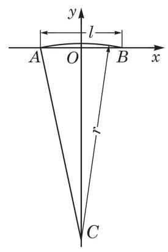

图 2-1-3

例 3 造船时, 为了船体放样, 要画出甲板圆弧线. 由于这条圆弧线的半径很大, 无法直接在钢板上用圆规画出, 需要先建立这条圆弧线的方程, 再用描点法画出圆弧线. 如图 2-1-3, 已知圆弧 $\overset{\frown}{AB}$ 的半径 $r$ 为 ${29}\mathrm{\;m}$ ,圆弧 $\overset{\frown}{AB}$ 所对的弦长 $l$ 为 ${12}\mathrm{\;m}$ , 以 $\mathrm{m}$ 为单位,建立适当的平面直角坐标系,并求圆弧 $\overset{\frown}{AB}$ 的方程. (结果精确到 ${0.001}\mathrm{\;m}$ )

解 以弦 ${AB}$ 所在直线为 $x$ 轴 (射线 ${AB}$ 方向为 $x$ 轴正方向), 弦 ${AB}$ 的垂直平分线为 $y$ 轴,建立平面直角坐标系. 可知弦的端点坐标分别为 $A\left( {-6,0}\right) ,B\left( {6,0}\right)$ .

设圆弧的圆心为 $C$ ,连接 ${AC}$ ,则

$$
\left| {AO}\right|  = \frac{1}{2}\left| {AB}\right|  = 6\left( \mathrm{\;m}\right) ,\left| {AC}\right|  = r = {29}\left( \mathrm{\;m}\right) ,
$$

从而

$$
\left| {OC}\right|  = \sqrt{{\left| AC\right| }^{2} - {\left| AO\right| }^{2}} = \sqrt{{29}^{2} - {6}^{2}} \approx  {28.373}\left( \mathrm{\;m}\right) ,
$$

即圆心的坐标为 $C\left( {0, - {28.373}}\right)$ .

所以,圆弧 $\overset{\frown}{AB}$ 的方程为 ${x}^{2} + {\left( y + {28.373}\right) }^{2} = {841}( - 6 \leq  x \leq  6$ , $y \geq  0)$ .

例 4 已知一个圆与 $y$ 轴相切,其圆心在直线 $x - {3y} = 0$ 上,且直线 $y = x$ 被该圆截得的弦长为 $2\sqrt{7}$ . 求此圆的方程.

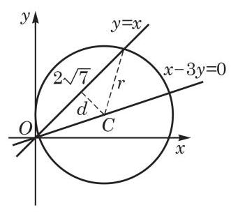

图 2-1-4

解 如图 2-1-4,设所求圆的圆心为 $C\left( {a, b}\right)$ ,半径为 $r$ ,则由圆心在直线 $x - {3y} = 0$ 上,得 $a = {3b}$ ,又圆与 $y$ 轴相切,得半径 $r = \left| a\right|$ .

圆心到直线 $x - y = 0$ 的距离

$$
d = \frac{\left| a - b\right| }{\sqrt{2}} = \frac{\left| 3b - b\right| }{\sqrt{2}} = \sqrt{2}\left| b\right| ,
$$

由勾股定理,可得 ${r}^{2} - {d}^{2} = {\left( \sqrt{7}\right) }^{2}$ ,即

$$
{\left| a\right| }^{2} - {\left( \sqrt{2}\left| b\right| \right) }^{2} = 9{b}^{2} - 2{b}^{2} = 7{b}^{2} = 7,
$$

解得

$$
b =  \pm  1\text{ . }
$$

当 $b = 1$ 时, $a = 3, r = 3$ ,圆的方程为 ${\left( x - 3\right) }^{2} + {\left( y - 1\right) }^{2} = 9$ ;

当 $b =  - 1$ 时, $a =  - 3, r = 3$ ,圆的方程为 ${\left( x + 3\right) }^{2} + {\left( y + 1\right) }^{2} = 9$ .

因此,所求圆的方程为 ${\left( x - 3\right) }^{2} + {\left( y - 1\right) }^{2} = 9$ 或 ${\left( x + 3\right) }^{2} + \; {\left( y + 1\right) }^{2} = 9.$

1. 求以 $C\left( {3,4}\right)$ 为圆心,且过点 $M\left( {1, - 3}\right)$ 的圆的方程.
2. 求以 $C\left( {-1,2}\right)$ 为圆心,且与直线 ${2x} - {3y} - 5 = 0$ 相切的圆的方程.
3. 一个圆与 $y$ 轴相切于点 $\left( {0,4}\right)$ ,且在 $x$ 轴正半轴上截得长为 6 的弦. 求此圆的方程.

### 3 圆的一般方程

我们知道直线的一般式方程是 ${ax} + {by} + c = 0\left( {a,b}\right.$ 不同时为零).

下面来建立圆的一般方程.

把圆的标准方程 ${\left( x - a\right) }^{2} + {\left( y - b\right) }^{2} = {r}^{2}$ 展开并整理,可得

$$
{x}^{2} + {y}^{2} - {2ax} - {2by} + {a}^{2} + {b}^{2} - {r}^{2} = 0.
$$

由此可见, 任何一个圆的方程都可以写成下面的形式:

$$
{x}^{2} + {y}^{2} + {Dx} + {Ey} + F = 0.
$$

②

其中, $D,E,F$ 均为实常数.

反过来,如果给定实常数 $D,E,F$ ,方程②是否都表示一个圆呢? 将方程②左边配方并整理, 可得

$$
{\left( x + \frac{D}{2}\right) }^{2} + {\left( y + \frac{E}{2}\right) }^{2} = \frac{{D}^{2} + {E}^{2} - {4F}}{4}.
$$

由此可以看出:

(1)当 ${D}^{2} + {E}^{2} - {4F} > 0$ 时，方程②表示以(-2、③，___ (-2、、号)为圆心、以 $\frac{\sqrt{{D}^{2} + {E}^{2} - {4F}}}{2}$ 为半径的圆；

(2)当 ${D}^{2} + {E}^{2} - {4F} = 0$ 时，方程②表示一个点 $\left( {-\frac{D}{2}, - \frac{E}{2}}\right)$ ；

---

${D}^{2} + {E}^{2} - {4F}$ 可以称为方程②的判别式.

---

(3)当 ${D}^{2} + {E}^{2} - {4F} < 0$ 时，方程②没有实根，此时方程 ②不表示任何图形.

因此,当 ${D}^{2} + {E}^{2} - {4F} > 0$ 时,方程②叫做圆的一般方程.

例 5 求经过 $A\left( {1,0}\right) ,B\left( {3,0}\right) ,C\left( {2,2}\right)$ 三点的圆的方程.

解 设所求圆的方程为

$$
{x}^{2} + {y}^{2} + {Dx} + {Ey} + F = 0,
$$

其中 $D,E,F$ 是待定常数.

因为点 $A,B,C$ 在所求圆上,所以有方程组

$$
\left\{  \begin{array}{l} D + F + 1 = 0, \\  {3D} + F + 9 = 0, \\  {2D} + {2E} + F + 8 = 0. \end{array}\right.
$$

解得

$$
\left\{  \begin{array}{l} D =  - 4, \\  E =  - \frac{3}{2}, \\  F = 3. \end{array}\right.
$$

此时

$$
{D}^{2} + {E}^{2} - {4F} = \frac{25}{4} > 0.
$$

因此,所求圆的方程为 ${x}^{2} + {y}^{2} - {4x} - \frac{3}{2}y + 3 = 0$ .

例 6 若圆 ${x}^{2} + {y}^{2} - {2x} + t = 0$ 与直线 ${2x} + y = 0$ 相交于 $A,B$ 两点,且 $\overrightarrow{OA} \cdot  \overrightarrow{OB} =  - 1$ (其中点 $O$ 为坐标原点). 求 $t$ 的值和圆的方程.

解 由圆的一般方程,知 ${\left( -2\right) }^{2} + {0}^{2} - {4t} > 0$ ,即 $t < 1$ .

设两个交点 $A,B$ 的坐标分别为 $\left( {{x}_{1},{y}_{1}}\right) ,\left( {{x}_{2},{y}_{2}}\right)$ ,它们应满足如下方程组

$$
\left\{  \begin{array}{l} {x}^{2} + {y}^{2} - {2x} + t = 0, \\  {2x} + y = 0, \end{array}\right.
$$

①

②

将②代入①，整理得

$$
5{x}^{2} - {2x} + t = 0.
$$

③

因为方程③有两个相异实根 ${x}_{1}$ 和 ${x}_{2}$ ,所以

$$
\Delta  = {\left( -2\right) }^{2} - 4 \times  5 \times  t > 0,
$$

即 $t$ 的值应满足 $t < \frac{1}{5}$ ,此时 $t < 1$ ,满足圆方程的条件.

由根与系数的关系,得 ${x}_{1}{x}_{2} = \frac{t}{5}$ .

再由方程②，得 ${y}_{1} =  - 2{x}_{1}$ ， ${y}_{2} =  - 2{x}_{2}$ .

所以, $\overrightarrow{OA} \cdot  \overrightarrow{OB} = {x}_{1}{x}_{2} + {y}_{1}{y}_{2} = {x}_{1}{x}_{2} + \left( {-2{x}_{1}}\right) \left( {-2{x}_{2}}\right)  = \; 5{x}_{1}{x}_{2} = t$ .

再由 $\overrightarrow{OA} \cdot  \overrightarrow{OB} =  - 1$ ,得 $t =  - 1$ ,满足条件 $t < \frac{1}{5}$ .

因此，所求圆的方程为 ${x}^{2} + {y}^{2} - {2x} - 1 = 0$ .

#### 练习 2.1(2)

1. 求经过 $A\left( {3,2}\right) ,B\left( {1,1}\right) ,C\left( {2, - 1}\right)$ 三点的圆的方程.
2. 讨论方程 ${x}^{2} + {y}^{2} - {2y} + \lambda \left( {{x}^{2} + {y}^{2} - {2x}}\right)  = 0\left( {\lambda \text{ 为实数 }}\right)$ 所表示的曲线.
3. 已知两点 $A\left( {-5,0}\right) ,B\left( {5,0}\right)$ ,动点 $P$ 到点 $A$ 的距离是它到点 $B$ 的距离的 3 倍. 求点 $P$ 的轨迹方程.

### 4 直线与圆的位置关系

在平面几何中, 我们已经知道直线与圆的三种位置关系: 有两个公共点时二者相交, 只有一个公共点时二者相切, 没有公共点时二者相离. 本节我们将借助圆和直线的方程, 利用代数方法来讨论直线与圆的位置关系.

---

把圆的方程写成 ${\left( x - s\right) }^{2} + {\left( y - t\right) }^{2} = \; {r}^{2}$ ,依据平面几何知识,直线 $l : {ax} + {by} + \; c = 0$ 与圆的位置关系取决于圆心 $\left( {s, t}\right)$ 到 $l$ 的距离和半径 $r$ 的大小关系, 请用上一章所学的点到直线距离的知识, 把各种不同的位置关系描述出来.

---

如果给定圆 $C : {x}^{2} + {y}^{2} + {Dx} + {Ey} + F = 0$ 和直线 $l : {ax} + \; {by} + c = 0$ ，与上一章讨论两条直线交点类似，平面上一点是直线 $l$ 与圆 $C$ 的公共点的充要条件是这一点的坐标是如下方程组的解:

$$
\left\{  \begin{array}{l} {x}^{2} + {y}^{2} + {Dx} + {Ey} + F = 0, \\  {ax} + {by} + c = 0. \end{array}\right.
$$

从而, 可以通过讨论上述方程组的解的不同情形来判断直线与圆的位置关系.

例 7 已知圆 $C$ 的方程是 ${x}^{2} + {y}^{2} = 9$ . 当 $b$ 为何值时,直线 $l : {2x} - y + b = 0$ 与圆 $C$ 分别有两个公共点？有一个公共点? 没有公共点?

解 解方程组

$$
\left\{  \begin{array}{l} {2x} - y + b = 0, \\  {x}^{2} + {y}^{2} = 9. \end{array}\right.
$$

①

②

把①化为 $y = {2x} + b$ ，代入②式，得

$$
{x}^{2} + {\left( 2x + b\right) }^{2} = 9,
$$

即

$$
5{x}^{2} + {4bx} + {b}^{2} - 9 = 0.
$$

③

方程③的判别式是

$$
\Delta  = {\left( 4b\right) }^{2} - 4 \times  5\left( {{b}^{2} - 9}\right)  =  - 4\left( {{b}^{2} - {45}}\right) .
$$

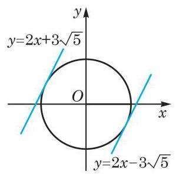

图 2-1-5

当 $\Delta  > 0$ ,即 $- 3\sqrt{5} < b < 3\sqrt{5}$ 时,方程③有两个不相等的实根,从而原方程组有两组不同的实数解,所以直线 $l$ 与圆 $C$ 有两个公共点.

当 $\Delta  = 0$ ,即 $b =  - 3\sqrt{5}$ 或 $b = 3\sqrt{5}$ 时,方程③有两个相等的实根,从而原方程组有两组相同的实数解,所以直线 $l$ 与圆 $C$ 只有一个公共点(图 2-1-5).

当 $\Delta  < 0$ ,即 $b <  - 3\sqrt{5}$ 或 $b > 3\sqrt{5}$ 时,方程③没有实根,从而原方程组没有实数解,所以直线 $l$ 与圆 $C$ 没有公共点.

解 (1) 因为 $M\left( {{x}_{0},{y}_{0}}\right)$ 是 $l$ 与圆 $O$ 的切点,可知 ${x}_{0}^{2} + {y}_{0}^{2} = 4$ ,且过点 $M$ 的半径 ${OM}$ 与 $l$ 垂直,即 $\overrightarrow{OM} = \left( {{x}_{0},{y}_{0}}\right)$ 是 $l$ 的一个法向量,于是可得切线 $l$ 的点法式方程为

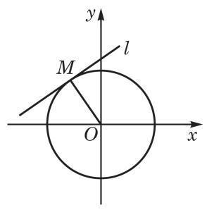

图 2-1-6

例 8 (1)如图2-1-6，已知 $M\left( {{x}_{0},{y}_{0}}\right)$ 为圆 $O$ : ${x}^{2} + {y}^{2} = 4$ 上一点,求过点 $M$ 的圆 $O$ 的切线 $l$ 的方程;

(2)求过点 $N\left( {2,2\sqrt{3}}\right)$ 且与圆 $O : {x}^{2} + {y}^{2} = 4$ 相切的直线的方程.

$$
{x}_{0}\left( {x - {x}_{0}}\right)  + {y}_{0}\left( {y - {y}_{0}}\right)  = 0.
$$

整理, 得

$$
{x}_{0}x + {y}_{0}y = {x}_{0}^{2} + {y}_{0}^{2}.
$$

?

所以,过点 $M$ 的圆 $O$ 的切线 $l$ 的方程为 ${x}_{0}x + {y}_{0}y = 4$ .

---

请将例 8(1) 的结论加以推广, 使之成为推广后命题的一个特例.

---

(2)由 $\left| {ON}\right|  = \sqrt{{2}^{2} + {\left( 2\sqrt{3}\right) }^{2}} = 4$ ，知点 $N$ 在已知圆 $O$ 外.

先考虑过点 $N$ 且具有斜率 $k$ 的直线，可设其方程为

$$
y - 2\sqrt{3} = k\left( {x - 2}\right) \text{ ,即 }{kx} - y - {2k} + 2\sqrt{3} = 0.
$$

此直线与圆 $O$ 相切当且仅当圆心 $O\left( {0,0}\right)$ 到该直线的距离为 2 , 所以

$$
\frac{\left| -2k + 2\sqrt{3}\right| }{\sqrt{{k}^{2} + 1}} = 2\text{ ,即 }{\left( k - \sqrt{3}\right) }^{2} = {k}^{2} + 1\text{ , }
$$

解得 $k = \frac{\sqrt{3}}{3}$ .

因此,得到过点 $N$ 的圆 $O$ 的一条切线,它的方程为

$$
\frac{\sqrt{3}}{3}x - y - \frac{2\sqrt{3}}{3} + 2\sqrt{3} = 0\text{ ,即 }x - \sqrt{3}y + 4 = 0\text{ . }
$$

?

过点 $N$ 可以作圆 $O$ 的两条切线,故另一条切线的斜率不存在,则其方程只能是 $x = 2$ ,即 $x - 2 = 0$ .

---

我们还可以验证圆心到直线 $x - 2 = 0$ 的距离等于半径 2 . 想一想, 这个验证是否必须?

---

因此,所求直线的方程为 $x - \sqrt{3}y + 4 = 0$ 或 $x - 2 = 0$ .

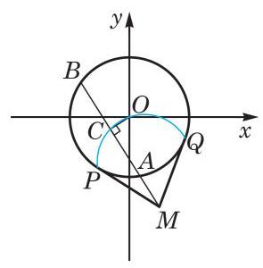

图 2-1-7

例 9 过圆 $O : {x}^{2} + {y}^{2} = {16}$ 外一点 $M\left( {2, - 6}\right)$ 任意作一条割线交圆 $O$ 于 $A,B$ 两点,求弦 ${AB}$ 的中点 $C$ 的轨迹.

解 如图 2-1-7,设弦 ${AB}$ 的中点 $C$ 的坐标为 $\left( {x, y}\right)$ ,连接 ${OC}$ . 可得 $\overrightarrow{OC} \bot  \overrightarrow{AB}$ ,即 $\overrightarrow{OC} \bot  \overrightarrow{MC}$ ,从而

$$
\overrightarrow{OC} \cdot  \overrightarrow{MC} = 0.
$$

又因为 $\overrightarrow{OC} = \left( {x, y}\right) ,\overrightarrow{MC} = \left( {x - 2, y + 6}\right)$ ,

所以 $x\left( {x - 2}\right)  + y\left( {y + 6}\right)  = 0$ ,即

$$
{\left( x - 1\right) }^{2} + {\left( y + 3\right) }^{2} = {10}.
$$

?

因此,点 $C$ 的轨迹是以 $\left( {1, - 3}\right)$ 为圆心、以 $\sqrt{10}$ 为半径,且位于圆 $O$ 内的一段圆弧 $\overset{\frown}{PQ}$ (图 2-1-7).

---

例 9 还有其他解法吗?

---

#### 练习 2.1(3)

1. ( 1 )求经过点 $\left( {-3,4}\right)$ 且与圆 ${x}^{2} + {y}^{2} = {25}$ 相切的直线的方程；

(2)求经过点 $\left( {2,4}\right)$ 且与圆 ${x}^{2} + {y}^{2} = 4$ 相切的直线的方程.

2. 当 $a$ 为何值时,直线 $x + y - a = 0$ 与圆 ${x}^{2} + {y}^{2} = 2$ 分别有如下位置关系:

(1)相交； (2)相切； (3)相离.

3. 已知直线 $l$ 经过点 $P\left( {6, - 4}\right)$ 且被圆 ${x}^{2} + {y}^{2} = {20}$ 截得长为 $6\sqrt{2}$ 的弦,求 $l$ 的方程.

### 5 圆与圆的位置关系

圆是常见的平面几何图形, 两个或多个圆之间不同位置关系的合理使用, 会对装置的功能或艺术品的美感产生不同的作用. 如图 2-1-8 中的自行车双轮、滚珠轴承、奥运五环、花布图案, 都是圆的位置关系应用的实例.

图 2-1-8

我们只讨论两个圆的位置关系.

从初中的平面几何学习中, 我们知道两个圆之间有内含(包括同心)、内切、相交、外切和外离五种位置关系(当两个圆内含或内切时, 两个圆半径不相等). 在平面直角坐标系中, 如果给出两个圆的标准方程

$$
{C}_{1} : {\left( x - {a}_{1}\right) }^{2} + {\left( y - {b}_{1}\right) }^{2} = {r}_{1}^{2},
$$

$$
{C}_{2} : {\left( x - {a}_{2}\right) }^{2} + {\left( y - {b}_{2}\right) }^{2} = {r}_{2}^{2},
$$

我们就可以从方程中读出两个圆的圆心坐标 $\left( {{a}_{1},{b}_{1}}\right) ,\left( {{a}_{2},{b}_{2}}\right)$ , 半径 ${r}_{1},{r}_{2}$ ,进而由圆心坐标求得圆心距

$$
d = \sqrt{{\left( {a}_{1} - {a}_{2}\right) }^{2} + {\left( {b}_{1} - {b}_{2}\right) }^{2}}.
$$

所以

当 $d < \left| {{r}_{1} - {r}_{2}}\right|$ 时,两圆内含 $\left( {{r}_{1} \neq  {r}_{2}}\right)$ ; 当 $d = \left| {{r}_{1} - {r}_{2}}\right|$ 时,两圆内切 $\left( {{r}_{1} \neq  {r}_{2}}\right)$ ; 当 $\left| {{r}_{1} - {r}_{2}}\right|  < d < {r}_{1} + {r}_{2}$ 时,两圆相交; 当 $d = {r}_{1} + {r}_{2}$ 时,两圆外切; 当 $d > {r}_{1} + {r}_{2}$ 时,两圆外离.

如果给出两个圆的一般方程

$$
{C}_{1} : {x}^{2} + {y}^{2} + {D}_{1}x + {E}_{1}y + {F}_{1} = 0,
$$

$$
{C}_{2} : {x}^{2} + {y}^{2} + {D}_{2}x + {E}_{2}y + {F}_{2} = 0,
$$

我们当然可以把它们都化成标准方程, 然后用上述圆心距与半径的关系判断这两个圆的位置关系. 此外, 我们也可以像判断两条直线的位置关系与判断直线和圆的位置关系那样, 通过解联立方程组判断两个圆有几个公共点, 从而得知它们是相交、相切 (包括内切与外切) 还是相离 (包括内含与外离). 因此, 我们解方

程组

$$
\left\{  \begin{array}{l} {x}^{2} + {y}^{2} + {D}_{1}x + {E}_{1}y + {F}_{1} = 0, \\  {x}^{2} + {y}^{2} + {D}_{2}x + {E}_{2}y + {F}_{2} = 0. \end{array}\right.
$$

如果上述方程组有两组不同的解,那么圆 ${C}_{1}$ 与圆 ${C}_{2}$ 相交; 如果上述方程组只有一组解 (实际上应该理解为两组相同的解, 因为它们是由一元二次方程两个相同的根得出的),那么圆 ${C}_{1}$ 与圆 ${C}_{2}$ 内切或外切; 如果上述方程组无解,那么圆 ${C}_{1}$ 与圆 ${C}_{2}$ 内含或外离.

上述方程组由两个二元二次方程组成, 只要把这两个方程相减, 一般情况下可以得到一个二元一次方程

$$
\left( {{D}_{1} - {D}_{2}}\right) x + \left( {{E}_{1} - {E}_{2}}\right) y + \left( {{F}_{1} - {F}_{2}}\right)  = 0.
$$

因此, 求解上述方程组, 只要把这个二元一次方程和上述方程组中的任何一个方程联立求解就可以了.

例 10 判断圆 ${C}_{1} : {x}^{2} + {y}^{2} - {2x} = 0$ 与圆 ${C}_{2} : {x}^{2} + {y}^{2} - {4y} = 0$ 的位置关系.

解 联立方程组 $\left\{  \begin{array}{l} {x}^{2} + {y}^{2} - {2x} = 0, \\  {x}^{2} + {y}^{2} - {4y} = 0. \end{array}\right.$ 将两方程相减并化简, 得 $x = {2y}$ . 把它代入第一个方程得到 $5{y}^{2} - {4y} = 0$ ,解得 ${y}_{1} = 0$ , ${y}_{2} = \frac{4}{5}$ ,从而 ${x}_{1} = 0,{x}_{2} = \frac{8}{5}$ .

所以,圆 ${C}_{1}$ 与圆 ${C}_{2}$ 相交于两点 $\left( {0,0}\right) ,\left( {\frac{8}{5},\frac{4}{5}}\right)$ .

我们介绍了两种判断两个圆的位置关系的方法: 一是化成标准方程后利用两圆圆心距和半径的关系来判断；二是用解方程法求出公共点坐标后再判断. 两种方法各有利弊, 前者能够准确区分内切与外切、内含与外离, 但无法给出公共点坐标; 后者可以给出公共点坐标, 但无法区分内切与外切、内含与外离. 解题时应根据需要采用适当的方法, 或者两者并用, 求出所有需要的信息.

例 11 证明圆 ${C}_{1} : {x}^{2} + {y}^{2} - {4x} + {6y} + 5 = 0$ 与圆 ${C}_{2}$ : ${x}^{2} + {y}^{2} - {6x} + {4y} + {11} = 0$ 内切,并求切点坐标.

解 把两个方程都化成圆的标准方程:

$$
{C}_{1} : {\left( x - 2\right) }^{2} + {\left( y + 3\right) }^{2} = 8,
$$

$$
{C}_{2} : {\left( x - 3\right) }^{2} + {\left( y + 2\right) }^{2} = 2.
$$

这两个圆的圆心坐标分别是 $\left( {2, - 3}\right)$ 与 $\left( {3, - 2}\right)$ ,从而它们的圆心距是 $d = \sqrt{{\left( 2 - 3\right) }^{2} + {\left( -3 + 2\right) }^{2}} = \sqrt{2}$ . 两个圆的半径分别是 ${r}_{1} = 2\sqrt{2}$ 与 ${r}_{2} = \sqrt{2}$ . 于是 $d = \left| {{r}_{1} - {r}_{2}}\right|$ ,所以圆 ${C}_{1}$ 与圆 ${C}_{2}$ 内切.

---

当 ${D}_{1} - {D}_{2}$ 与 ${E}_{1} - {E}_{2}$ 不同时为零时，二元一次方程 $\left( {{D}_{1} - {D}_{2}}\right) x + \left( {{E}_{1} - }\right. \; \left. {E}_{2}\right) y + \left( {{F}_{1} - {F}_{2}}\right)  = 0$ 所表示的直线有什么几何意义吗?

当 ${D}_{1} - {D}_{2}$ 与 ${E}_{1} - {E}_{2}$ 同时为零时, 两圆有什么样的位置关系?

---

把两个圆的方程相减并整理得 $x = 3 - y$ . 代入圆 ${C}_{1}$ 的方程并化简得 ${y}^{2} + {2y} + 1 = 0$ . 这个一元二次方程有两个相同的根 $y =  - 1$ ,从而 $x = 4$ . 由此得到圆 ${C}_{1}$ 与圆 ${C}_{2}$ 的切点是 $\left( {4, - 1}\right)$ .

例 12 如图 2-1-9(1)，圆 ${O}_{1}$ 与圆 ${O}_{2}$ 的半径都是 1， ${O}_{1}{O}_{2} = 4$ ,过动点 $P$ 分别作圆 ${O}_{1}$ 、圆 ${O}_{2}$ 的切线 ${PM},{PN}(M$ 、 $N$ 分别为切点),使得 $\left| {PM}\right|  = \sqrt{2}\left| {PN}\right|$ . 试通过建立适当的平面直角坐标系,求动点 $P$ 的轨迹.

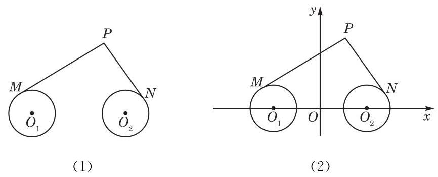

图 2-1-9

解 如图 2-1-9(2),以 ${O}_{1}{O}_{2}$ 的中点 $O$ 为原点, ${O}_{1}{O}_{2}$ 所在直线为 $x$ 轴,以线段 ${O}_{1}{O}_{2}$ 的垂直平分线为 $y$ 轴,建立平面直角坐标系,则 ${O}_{1}$ 的坐标为 $\left( {-2,0}\right) ,{O}_{2}$ 的坐标为 $\left( {2,0}\right)$ . 由 $\left| {PM}\right|  = \sqrt{2}\left| {PN}\right|$ ,得 ${\left| PM\right| }^{2} = 2{\left| PN\right| }^{2}$ .

又因为两圆的半径均为 1,所以由勾股定理,得 ${\left| PM\right| }^{2} = \; {\left| P{O}_{1}\right| }^{2} - 1,{\left| PN\right| }^{2} = {\left| P{O}_{2}\right| }^{2} - 1$ ,从而 ${\left| P{O}_{1}\right| }^{2} - 1 = 2\left( {{\left| P{O}_{2}\right| }^{2} - 1}\right)$ .

设点 $P$ 的坐标为 $\left( {x, y}\right)$ ,则

$$
{\left( x + 2\right) }^{2} + {y}^{2} - 1 = 2\left[  {{\left( x - 2\right) }^{2} + {y}^{2} - 1}\right]  ,
$$

整理, 得

$$
{x}^{2} + {y}^{2} - {12x} + 3 = 0,
$$

Q

化为标准方程, 得

$$
{\left( x - 6\right) }^{2} + {y}^{2} = {33}.
$$

因此，所求的轨迹是以(6,0)为圆心、以 $\sqrt{33}$ 为半径的圆.

---

注意轨迹与轨迹的方程二者的区别与联系.

---

#### 练习 2.1(4)

1. 已知圆 ${C}_{1} : {\left( x - 2\right) }^{2} + {\left( y - 2\right) }^{2} = 1$ 和圆 ${C}_{2} : {x}^{2} + {\left( y - m\right) }^{2} = {m}^{2}\left( {m > 0}\right)$ ,当 $m$ 为何值时,圆 ${C}_{1}$ 与圆 ${C}_{2}$ 分别内切、相交?
2. 求与圆 ${x}^{2} + {y}^{2} = {25}$ 外切于点 $P\left( {4, - 3}\right)$ 且半径为 1 的圆的方程.
3. 已知圆 ${x}^{2} + {y}^{2} - {2x} + {2y} - 3 = 0$ 和圆 ${x}^{2} + {y}^{2} + {4x} - 1 = 0$ 相交于 $A,B$ 两点,求公共弦 ${AB}$ 的长.

#### 习题 2.1

##### A 组

1. 根据下列条件,分别求圆的方程:

(1)圆心为 $C\left( {-\frac{3}{2},3}\right)$ ,半径 $r = \sqrt{3}$ ；

(2)圆心为 $C\left( {\sqrt{2},1}\right)$ ，过点 $A\left( {-1,\sqrt{2}}\right)$ ；

(3)与 $x$ 轴相交于 $A\left( {1,0}\right)$ 、 $B\left( {5,0}\right)$ 两点，且半径等于✓5.

2. 已知圆 ${\left( x - a\right) }^{2} + {\left( y - b\right) }^{2} = {r}^{2}\left( {r > 0}\right)$ ,求在下列情况下,实数 $a,b,r$ 应分别满足什么条件:

(1)圆过原点； (2)圆心在 $x$ 轴上；

(3)圆与 $x$ 轴相切； (4)圆与两坐标轴均相切.

3. 求过点 $M\left( {5,2}\right) ,N\left( {3,2}\right)$ ,且圆心在直线 $y = {2x} - 3$ 上的圆的方程.
4. 已知 ${a}^{2}{x}^{2} + \left( {a + 2}\right) {y}^{2} + {2ax} + a = 0$ 表示圆,求实数 $a$ 的值.
5. 直线 $l$ 与圆 ${x}^{2} + {y}^{2} + {2x} - {4y} + a = 0\left( {a < 3}\right)$ 相交于 $A,B$ 两点,且弦 ${AB}$ 的中点为 $\left( {0,1}\right)$ . 求直线 $l$ 的方程.
6. 已知圆过原点，且与 $x$ 轴、 $y$ 轴的交点的坐标分别为 $\left( {a,0}\right)$ 、 $\left( {0, b}\right)$ ，其中 ${ab} \neq  0$ . 求这个圆的方程.
7. 判断直线 $x\cos \theta  + y\sin \theta  = r$ 与圆 ${x}^{2} + {y}^{2} = {r}^{2}$ 的位置关系.
8. 已知直线 ${2x} + {3y} + 1 = 0$ 和圆 ${x}^{2} + {y}^{2} - {2x} - 3 = 0$ 相交于 $A,B$ 两点,求弦 ${AB}$ 的垂直平分线的方程.
9. 求与圆 ${x}^{2} + {y}^{2} = {25}$ 内切于点 $P\left( {3, - 4}\right)$ 且半径为 1 的圆的方程.
10. 已知圆 $C$ 过点 $\left( {-4,0}\right)$ 且与圆 ${x}^{2} + {y}^{2} - {4x} - {6y} = 0$ 相切于原点,求圆 $C$ 的方程.
11. 圆拱桥的一个圆拱如图所示,该圆拱的跨度 ${AB}$ 为 ${20}\mathrm{\;m}$ ,拱高 ${OP}$ 为 $4\mathrm{\;m}$ ,在建造过程中每隔 $4\mathrm{\;m}$ 需用一个支柱支撑. 求支柱 ${A}_{2}{B}_{2}$ 的高度. (结果精确到 ${0.01}\mathrm{\;m}$ )

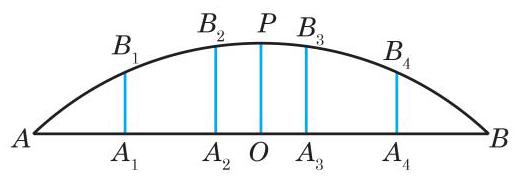

(第 11 题)

##### B 组

1. 给定点 $A\left( {2,3}\right)$ 与圆 $C : {x}^{2} + {y}^{2} = {25}$ ,求圆 $C$ 的过点 $A$ 最短弦所在直线的方程.
2. 一个圆过点 $\left( {2, - 1}\right)$ ,圆心在直线 ${2x} + y = 0$ 上,且与直线 $x - y - 1 = 0$ 相切. 求这个圆的方程.
3. 已知圆 ${x}^{2} + {y}^{2} + {6x} - {8y} + {25} = {r}^{2}$ 与 $x$ 轴相切，求这个圆截 $y$ 轴所得的弦长.
4. 求圆 $C : {x}^{2} + {y}^{2} + {4x} + {2y} - 3 = 0$ 关于点 $M\left( {1,1}\right)$ 对称的圆的方程.
5. 已知动直线 ${kx} - y + 1 = 0$ (其中 $k \in  \mathbf{R}$ ) 和圆 ${x}^{2} + {y}^{2} = 4$ 相交于 $A,B$ 两点,求弦 ${AB}$ 的中点的轨迹方程.
6. 求经过点 $\left( {5, - 5}\right)$ 且与圆 ${x}^{2} + {y}^{2} = {25}$ 相切的直线的方程.
7. 已知直线 $y = x + m$ 和曲线 $y = \sqrt{1 - {x}^{2}}$ 有两个不同的交点,求实数 $m$ 的取值范围.
8. 已知直线 $l : x - y + 4 = 0$ 与圆 $C : {\left( x - 1\right) }^{2} + {\left( y - 1\right) }^{2} = 2$ ,求圆 $C$ 上各点到直线 $l$ 的距离的最大值.
9. 已知实数 $x,y$ 满足 ${\left( x - 2\right) }^{2} + {y}^{2} = 3$ ,求 $\frac{y}{x}$ 的取值范围.
10. ${400}\mathrm{\;m}$ 标准跑道的内圈如图所示( ${400}\mathrm{\;m}$ 标准跑道最内圈的长度为 ${400}\mathrm{\;m}$ )，其中左右两端均是半径为 ${36}\mathrm{\;m}$ 的半圆弧.

(1)求每条直道的长度; ( $\pi$ 取 3.14,结果精确到 $1\mathrm{\;m}$ )

(2)建立适当的平面直角坐标系，写出上半部分跑道所对应的函数表达式.

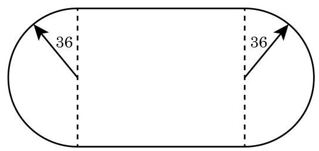

(第 10 题)

探究与实践

追捕走私船

如图 2-1-10,设直线 $l$ 为公海与领海的分界线,一巡逻艇在 $A$ 处发现北偏东 ${60}^{ \circ  }$ 海面 $B$ 处有一艘走私船,此走私船正向停泊在公海上接应的走私海轮 $C$ 航行,以便上海轮后逃窜. 已知巡逻艇的航速是走私船航速的 2 倍, $A$ 与公海相距约 12 海里,走私船可能向任一方向逃窜. 请回答下列问题:

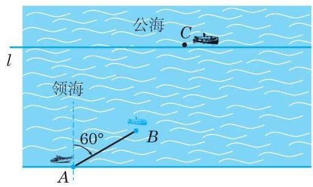

图 2-1-10

(1)如果走私船和巡逻艇都是沿直线航行，那么走私船能被截获的点是哪些？

(2)根据截获点的轨迹，探讨“可截获区域”和“非截获区域”；

(3)如果走私船在非截获区域就进入公海，那么巡逻艇追捕失败. 要保证在领海内捕获,就应保证 “非截获区域”与公海区域不相交 (即交集为空集). 此时, $A,B$ 相距最远是多少海里?
