# 诱导公式｜双教材原文摘录

本文件保留相关章节的讲解、例题与随堂练习，按版本分段。较宽章节含相邻知识和混合习题，尚未逐题筛选、配答或审校。原文为转写稿，请对照教材原件。

## 人教A版：5.3 诱导公式

来源：06_第五章_三角函数.md（本地转写稿），转写稿第 833—1124 行；截至下一指定标题前。

## 5.3 诱导公式

前面利用圆的几何性质，得到了同角三角函数之间的基本关系。我们知道，圆的最重要的性质是对称性，而对称性（如奇偶性）也是函数的重要性质。由此想到，可以利用圆的对称性，研究三角函数的对称性.

## 探究1

如图 5.3-1，在直角坐标系内，设任意角α的终边与单位圆交于点 $P _ { 1 }$

(1) 作 $P _ { 1 }$ 关于原点的对称点 $P _ { 2 }$ ，以 $O P _ { 2 }$ 为终边的角 $\beta$ 与角α有什么关系？角 $\beta , \ \alpha$ 的三角函数值之间有什么关系？

(2) 如果作 $P _ { 1 }$ 关于x 轴（或 γ 轴）的对称点$P _ { 3 }$ (或 $P _ { 4 } )$ ，那么又可以得到什么结论？

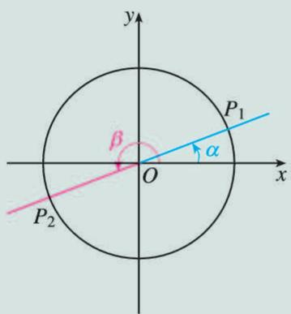  
图 5.3-1

下面，借助单位圆的对称性进行探究

如图5.3-2，以 $O P _ { 2 }$ 为终边的角β都是与角 $\pi + \alpha$ 终边相同的角，即 $\beta = 2 k \pi + \left( \pi + \alpha \right) \left( k \in \mathbf { Z } \right)$ .因此，只要探究角 $\pi + \alpha$ 与α的三角函数值之间的关系即可.

设 $P _ { 1 } ( x _ { 1 } , \ y _ { 1 } ) , \ P _ { 2 } ( x _ { 2 } , \ y _ { 2 } )$ .因为 $P _ { 2 }$ 是点 $P _ { 1 }$ 关于原点的对称点，所以

$$
x _ { 2 } = - x _ { 1 } , \ y _ { 2 } = - y _ { 1 } .
$$

根据三角函数的定义，得

$$
\sin \alpha { = } y _ { 1 } , \qquad \cos \alpha { = } x _ { 1 } , \qquad \tan \alpha { = } \frac { y _ { 1 } } { x _ { 1 } } ;
$$

$$
\sin ( \pi + \alpha ) = y _ { 2 } , \cos ( \pi + \alpha ) = x _ { 2 } , \tan ( \pi + \alpha ) = { \frac { y _ { 2 } } { x _ { 2 } } } .
$$

从而得

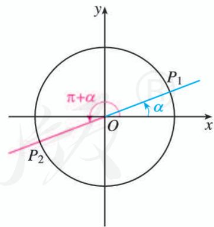  
图5.3-2


角π+α还可以看作是角α的终边按逆时针方向旋转角π得到的.

公式二

sin(π+α)=—sin α,   
cos(π+α)=—cos α，   
tan(π+α)= tan α.

如图5.3-3，作 $P _ { 1 }$ 关于x轴的对称点 $P _ { 3 }$ ，则以$O P _ { 3 }$ 为终边的角为一α，并且有

公式三

```prolog
sin(—α)=—sin α,
cos(—α) =cos α,
tan(—α)=—tan α.
```

如图5.3-4，作 $P _ { 1 }$ 关于y轴的对称点 $P _ { 4 }$ ，则以$O P _ { 4 }$ 为终边的角为 $\pi - \alpha$ ，并且有

公式四

sin(π—α) =sin α,   
cos(π—α) =—cos α,   
tan(π—α)=—tan α.

<span id="candidate-65"></span>

例1利用公式求下列三角函数值

(1) $\cos 2 2 5 ^ { \circ }$ (2) $\sin { \frac { 8 \pi } { 3 } }$ ;

(3) $\sin ( - \frac { 1 6 \pi } { 3 } )$ i

(4) $\tan ( - 2 0 4 0 ^ { \circ } )$

解：(1) $\cos 2 2 5 ^ { \circ } = \cos ( 1 8 0 ^ { \circ } + 4 5 ^ { \circ } )$

$$
\begin{array} { c } { { ( 2 ) \ \sin \displaystyle \frac { 8 \pi } { 3 } { = } \sin \bigl ( 2 \pi { + } \displaystyle \frac { 2 \pi } { 3 } \bigr ) } } \\ { { = \sin \displaystyle \frac { 2 \pi } { 3 } { = } \sin \bigl ( \pi { - } \displaystyle \frac { \pi } { 3 } \bigr ) } } \\ { { = \sin \displaystyle \frac { \pi } { 3 } { = } \displaystyle \frac { \sqrt { 3 } } { 2 } ; } } \end{array}
$$

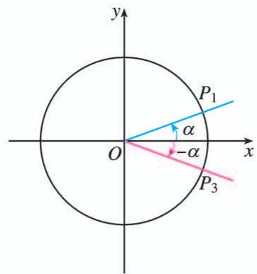  
图5.3-3

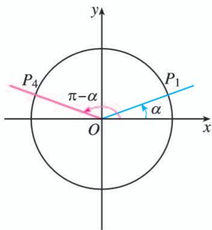  
图5.3-4

请你类比公式二，证明公式三和公式四.

$$
\scriptstyle \sin ( - { \frac { 1 6 \pi } { 3 } } ) = - \sin { \frac { 1 6 \pi } { 3 } }  \\ { \scriptstyle = - \sin \bigl ( 5 \pi + { \frac { \pi } { 3 } } \bigr ) } \\ { \scriptstyle = - \bigl ( - \sin { \frac { \pi } { 3 } } \bigr ) = { \frac { \sqrt { 3 } } { 2 } } ; }
$$

(4) tan(—2040°)=—tan 2040° =—tan(6×360°-120°) =tan 120°=tan(180°—60°) =—tan 60°=-√3.

## 思考

由例1，你对公式一～公式四的作用有什么进一步的认识？你能自己归纳一下把任意角的三角函数转化为锐角三角函数的步骤吗？

利用公式一～公式四，可以把任意角的三角函数转化为锐角三角函数，一般可按下面步骤进行：

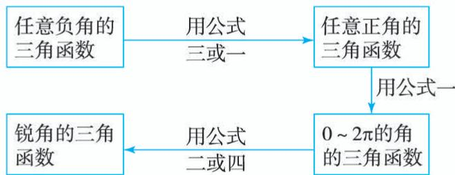

数学史上，求三角函数值曾经是一个重要而困难的问题。数学家制作了锐角三角函数表，并通过公式一～公式四，按上述步骤解决了问题。现在，我们可以利用计算工具方便地求任意角的三角函数值，所以这些公式的“求值”作用已经不重要了，但它们所体现的三角函数的对称性，在解决三角函数的各种问题中却依然有重要的作用.

## 例2 化简

$$
\frac { \cos ( 1 8 0 ^ { \circ } + \alpha ) \sin ( \alpha + 3 6 0 ^ { \circ } ) } { \tan ( - \alpha - 1 8 0 ^ { \circ } ) \cos ( - 1 8 0 ^ { \circ } + \alpha ) } .
$$

解：

$$
\begin{array} { c } { { \tan ( - \alpha - 1 8 0 ^ { \circ } ) = \tan \left[ - \left( 1 8 0 ^ { \circ } + \alpha \right) \right] } } \\ { { { } } } \\ { { = - \tan ( 1 8 0 ^ { \circ } + \alpha ) } } \\ { { { } } } \\ { { { } = - \tan \alpha , } } \end{array}
$$

$$
\begin{array} { c } { { \cos ( - 1 8 0 ^ { \circ } + \alpha ) = \cos [ - ( 1 8 0 ^ { \circ } - \alpha ) ] } } \\ { { { } } } \\ { { = \cos ( 1 8 0 ^ { \circ } - \alpha ) } } \\ { { { } } } \\ { { { } = - \cos \alpha , } } \end{array}
$$

$$
\scriptstyle \operatorname* { l f } \pmb { \operatorname { \mathbb { E } } } = \frac { - \cos \alpha \sin \alpha } { ( - \tan \alpha ) ( - \cos \alpha ) } = - \cos \alpha .
$$

## 练习

1. 将下列三角函数转化为锐角三角函数，并填在题中横线上：

(1) $\cos { \frac { 1 3 } { 9 } } \pi =$ (2) $\sin ( 1 + \pi ) = \qquad ;$ (3) $\sin ( - \frac { \pi } { 5 } )$ (4) $\tan ( - 7 0 ^ { \circ } 6 ^ { \prime } ) = \qquad ;$ (5) $\cos { \frac { 6 \pi } { 7 } } =$ (6) $\tan 1 0 0 0 ^ { \circ } 2 1 ^ { \prime } =$ =

2. 利用公式求下列三角函数值：(1) $\cos ( - 4 2 0 ^ { \circ } )$ (2) $\sin ( - \frac { 7 } { 6 } \pi )$ (3) $\tan ( - 1 1 4 0 ^ { \circ } )$ (4) $\cos ( - \frac { 7 7 } { 6 } \pi )$ (5) $\tan 3 1 5 ^ { \circ } ;$ (6) $\sin ( - \frac { 1 1 } { 4 } \pi )$

3. 化简：

(1) $\sin ( - \alpha - 1 8 0 ^ { \circ } ) \cos ( - \alpha ) \sin ( - \alpha + 1 8 0 ^ { \circ } )$

(2) $\cos ^ { 3 } { ( - \alpha ) } \sin ( 2 \pi + \alpha ) \tan ^ { 3 } { ( - \alpha - \pi ) } ,$

4. 填表：

<table><tr><td rowspan=1 colspan=1>α</td><td rowspan=1 colspan=1> $- { \frac { 4 \pi } { 3 } }$ </td><td rowspan=1 colspan=1> $- \frac { 5 \pi } { 4 }$ </td><td rowspan=1 colspan=1> $- \frac { 5 \pi } { 3 }$ </td><td rowspan=1 colspan=1> $- \frac { 7 \pi } { 4 }$ </td><td rowspan=1 colspan=1> $- \frac { 8 \pi } { 3 }$ </td><td rowspan=1 colspan=1> $- { \frac { 1 1 \pi } { 4 } }$ </td></tr><tr><td rowspan=1 colspan=1>sin α</td><td rowspan=1 colspan=1></td><td rowspan=1 colspan=1></td><td rowspan=1 colspan=1></td><td rowspan=1 colspan=1></td><td rowspan=1 colspan=1></td><td rowspan=1 colspan=1></td></tr><tr><td rowspan=1 colspan=1>cOs α</td><td rowspan=1 colspan=1></td><td rowspan=1 colspan=1></td><td rowspan=1 colspan=1></td><td rowspan=1 colspan=1></td><td rowspan=1 colspan=1></td><td rowspan=1 colspan=1></td></tr><tr><td rowspan=1 colspan=1>tanα</td><td rowspan=1 colspan=1></td><td rowspan=1 colspan=1></td><td rowspan=1 colspan=1></td><td rowspan=1 colspan=1></td><td rowspan=1 colspan=1></td><td rowspan=1 colspan=1></td></tr></table>

下面在探究1的基础上继续探究.

## 探究2

作 $P _ { 1 }$ 关于直线 $y = x$ 的对称点 $P _ { 5 }$ ，以 $O P _ { 5 }$ 为终边的角γ与角α有什么关系？角γ与角α的三角函数值之间有什么关系？

如图5.3-5，以 $O P _ { 5 }$ 为终边的角γ都是与角 ${ \frac { \pi } { 2 } } - \alpha$ 终边相同的角，即 $\gamma = 2 k \pi + \bigl ( \frac { \pi } { 2 } { - \alpha } \bigr )$ $( k \in \mathbf { Z } )$ .因此，只要探究角 ${ \frac { \pi } { 2 } } - \alpha$ 与α的三角函数值之间的关系即可.

设 $P _ { 5 } ( x _ { 5 } , \ y _ { 5 } )$ ，由于 $P _ { 5 }$ 是点 $P _ { 1 }$ 关于直线 $y = x$ 的对称点，可以证明

$$
x _ { 5 } = y _ { 1 } , ~ y _ { 5 } = x _ { 1 } .\tag{①}
$$

根据三角函数的定义，得

$$
\sin ( { \frac { \pi } { 2 } } - \alpha ) = y _ { 5 } , \cos ( { \frac { \pi } { 2 } } - \alpha ) = x _ { 5 } .
$$

从而得

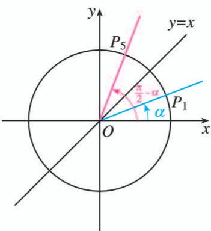

公式五

图5.3-5

$$
\sin ( { \frac { \pi } { 2 } } - \alpha ) = \cos \alpha ,
$$

$$
\cos ( { \frac { \pi } { 2 } } - \alpha ) = \sin \alpha .
$$

你能利用平面几何的知识，就图5.3-5所示的情况证明①式吗？其他情况呢？

## 探究3

作 $P _ { 5 }$ 关于γ轴的对称点，又能得到什么结论？

类似地，可得

公式六

$$
\sin ( \frac { \pi } { 2 } + \alpha ) = \cos \alpha ,
$$

$$
\cos ( { \frac { \pi } { 2 } } + \alpha ) = - \sin \alpha .
$$

角 ${ \frac { \pi } { 2 } } + \alpha$ 的终边与角α的终边具有怎样的对称性？据此你将如何证明公式六？

利用公式五或公式六，可以实现正弦函数与余弦函数的相互转化公式一～公式六都叫做诱导公式

<span id="candidate-66"></span>

例3证明：

(1) $\sin ( { \frac { 3 \pi } { 2 } } - \alpha ) = - \cos \alpha$

(2) $\cos ( { \frac { 3 \pi } { 2 } } + \alpha ) = \sin \alpha .$

证明：（1） $\sin ( \frac { 3 \pi } { 2 } - \alpha ) = \sin [ \pi + ( \frac { \pi } { 2 } - \alpha ) ]$ =—sin( π|2 −α) =-cos α;

$$
\begin{array} { c } { { ( 2 ) \ \cos \bigl ( \displaystyle \frac { 3 \pi } { 2 } + \alpha \bigr ) { } = \cos \left[ \pi + \bigl ( \displaystyle \frac { \pi } { 2 } + \alpha \bigr ) \right] } } \\ { { = - \cos \bigl ( \displaystyle \frac { \pi } { 2 } + \alpha \bigr ) = \sin \alpha . } } \end{array}
$$

<span id="candidate-67"></span>

例4 化简

$$
\frac { \sin ( 2 \pi - \alpha ) \cos ( \pi + \alpha ) \cos \left( { \frac { \pi } { 2 } } + \alpha \right) \cos \left( { \frac { 1 1 \pi } { 2 } } - \alpha \right) } { \cos ( \pi - \alpha ) \sin ( 3 \pi - \alpha ) \sin ( - \pi - \alpha ) \sin \left( { \frac { 9 \pi } { 2 } } + \alpha \right) } .
$$

解：原式

$$
\begin{array} { r l } & { = \frac { ( - \sin \alpha ) ( - \cos \alpha ) ( - \sin \alpha ) \cos \left[ 5 \pi + \left( \frac { \pi } { 2 } - \alpha \right) \right] } { \left( - \cos \alpha \right) \sin \left( \pi - \alpha \right) \left[ - \sin \left( \pi + \alpha \right) \right] \sin \left[ 4 \pi + \left( \frac { \pi } { 2 } + \alpha \right) \right] } } \\ & { = \frac { - \sin ^ { 2 } \alpha \cos \alpha \left[ - \cos \left( \frac { \pi } { 2 } - \alpha \right) \right] } { ( - \cos \alpha ) \sin \alpha \left[ - \left( - \sin \alpha \right) \right] \sin \left( \frac { \pi } { 2 } + \alpha \right) } } \\ & { = - \frac { \sin \alpha } { \cos \alpha } = - \tan \alpha . } \end{array}
$$

<span id="candidate-68"></span>

例5 已知 $\sin ( 5 3 ^ { \circ } - \alpha ) = \frac { 1 } { 5 }$ ，且 $- 2 7 0 ^ { \circ } < \alpha < - 9 0 ^ { \circ }$ ，求 $\sin ( 3 7 ^ { \circ } + \alpha )$ 的值.

分析：联系条件与结论，注意到 $( 5 3 ^ { \circ } - \alpha ) + ( 3 7 ^ { \circ } + \alpha ) = 9 0 ^ { \circ }$ ，由此可利用诱导公式解决问题.

解：因为 $( 5 3 ^ { \circ } - \alpha ) + ( 3 7 ^ { \circ } + \alpha ) = 9 0 ^ { \circ }$ ，所以由诱导公式五，得

因为

$$
\begin{array} { c } { { \sin ( 3 7 ^ { \circ } + \alpha ) = \sin [ 9 0 ^ { \circ } - ( 5 3 ^ { \circ } - \alpha ) ] } } \\ { { { } } } \\ { { = \cos ( 5 3 ^ { \circ } - \alpha ) } } \\ { { { } } } \\ { { - 2 7 0 ^ { \circ } < \alpha < - 9 0 ^ { \circ } , } } \\ { { { } } } \\ { { 1 4 3 ^ { \circ } < 5 3 ^ { \circ } - \alpha < 3 2 3 ^ { \circ } . } } \end{array}
$$

所以

由 $\sin ( 5 3 ^ { \circ } - \alpha ) = \frac { 1 } { 5 } > 0$ ，得 $1 4 3 ^ { \circ } < 5 3 ^ { \circ } - \alpha < 1 8 0 ^ { \circ }$

所以

$$
\cos ( 5 3 ^ { \circ } - \alpha ) = - { \sqrt { 1 - \sin ^ { 2 } ( 5 3 ^ { \circ } - \alpha ) } } = - { \sqrt { 1 - { \bigl ( } { \frac { 1 } { 5 } } { \bigr ) } ^ { 2 } } } = - { \frac { 2 { \sqrt { 6 } } } { 5 } } ,
$$

所以

$$
\sin ( 3 7 ^ { \circ } + \alpha ) = - { \frac { 2 { \sqrt { 6 } } } { 5 } } .
$$

1. 用诱导公式求下列三角函数值(可用计算工具，第(3)(4)(6)题精确到0.0001)：(1) $\cos { \frac { 6 5 } { 6 } } \pi ;$ (2) $\sin ( - \frac { 3 1 } { 4 } \pi )$ (3) $\cos ( - 1 1 8 2 ^ { \circ } 1 3 ^ { \prime } )$ (4) $\sin 6 7 0 ^ { \circ } 3 9 ^ { \prime } ;$ (5) $\tan \left( - { \frac { 2 6 \pi } { 3 } } \right)$ (6) $\tan 5 8 0 ^ { \circ } 2 1 ^ { \prime } .$

2. 证明： (1) $\cos ( { \frac { 5 } { 2 } } \pi - \alpha ) = \sin \alpha ;$ (2) $\cos ( { \frac { 7 } { 2 } } \pi + \alpha ) = \sin \alpha ;$ (3) $\sin ( { \frac { 9 } { 2 } } \pi - \alpha ) = \cos \alpha ;$ (4) $\sin ( { \frac { 1 1 } { 2 } } \pi - \alpha ) = - \cos \alpha .$

3. 化简：(1) $\frac { \cos { \Bigl ( \alpha - \frac { \pi } { 2 } \Bigr ) } } { \sin { \Bigl ( \frac { 5 \pi } { 2 } + \alpha \Bigr ) } } \sin ( \alpha - 2 \pi ) \cos ( 2 \pi - \alpha ) ;$ (3) $\frac { \cos ( \alpha - 3 \pi ) \cos ( { \frac { 3 \pi } { 2 } } - \alpha \ ) } { \sin ^ { 2 } ( \alpha - { \frac { \pi } { 2 } } ) }$

$$
\cos ^ { 2 } ( - \alpha ) - { \frac { \tan ( 2 \pi + \alpha ) } { \cos \left( { \frac { \pi } { 2 } } + \alpha \right) } } ;
$$

## 习题5.3


## 复习巩固

1. 用诱导公式求下列三角函数值(可用计算工具，第(2)(3)(4)(5)题精确到0.0001):(1) $\cos ( - \frac { 1 7 \pi } { 4 } )$ (2) $\sin ( - 1 ~ 5 7 4 ^ { \circ } )$ in (3) $\sin ( - 2 1 6 0 ^ { \circ } 5 2 ^ { \prime } )$ inR(4) $\cos ( - 1 7 5 1 ^ { \circ } 3 6 ^ { \prime } )$ (5) $\cos 1 6 1 5 ^ { \circ } 8 ^ { \prime }$ (6) $\sin ( - \frac { 2 6 } { 3 } \pi )$

2. 求证： (1) $\sin ( 3 6 0 ^ { \circ } - \alpha ) = - \sin \alpha ;$ (2) $\cos ( 3 6 0 ^ { \circ } - \alpha ) = \cos \alpha ;$ (3) $\tan ( 3 6 0 ^ { \circ } - \alpha ) = - \tan \alpha .$

3. 化简：(1) $1 + \sin ( \alpha - 2 \pi ) \sin ( \pi + \alpha ) - 2 \cos ^ { 2 } ( - \alpha ) ;$ (2) $\sin ( - 1 ~ 0 7 1 ^ { \circ } ) \sin ~ 9 9 ^ { \circ } + \sin ( - 1 7 1 ^ { \circ } ) \sin ( - 2 6 1 ^ { \circ } ) .$

4. 在单位圆中，已知角α的终边与单位圆的交点为 $P \left( - { \frac { 3 } { 5 } } , \ { \frac { 4 } { 5 } } \right)$ ，分别求角 $\pi + \alpha , \ - \alpha , \ { \frac { \pi } { 2 } } + \alpha$ 的正弦、余弦函数值

5. 已知 $\sin ( \frac { 7 \pi } { 2 } + \alpha ) = \frac { 3 } { 5 }$ ，那么cos α=（).(A) $- \frac { 4 } { 5 }$ (B) $- \frac { 3 } { 5 }$ (C) $\frac { 3 } { 5 }$ (D) $\frac { 4 } { 5 }$

6. 已知 $\sin ( \pi + \alpha ) = - \frac { 1 } { 2 }$ ，计算：(1) $\sin ( 5 \pi - \alpha )$ .n (2) $\sin ( \frac { \pi } { 2 } + \alpha )$ (3) $\cos \left( \alpha - \frac { 3 \pi } { 2 } \right)$ ; (4) $\tan \left( \frac { \pi } { 2 } { - } \alpha \right)$

7. 在△ABC中，试判断下列关系是否成立，并说明理由.(1) $\cos ( A + B ) = \cos C$ (2) $\sin ( A + B ) { = } \sin C ;$ (3) $\sin { \frac { A + B } { 2 } } { = } \sin { \frac { C } { 2 } }$ (4) $\cos { \frac { A + B } { 2 } } { = } \cos { \frac { C } { 2 } } .$

8. 已知 $\sin ( { \frac { \pi } { 3 } } - x ) = { \frac { 1 } { 3 } }$ ，且 $0 < x < \frac { \pi } { 2 }$ ，求 $\sin ( { \frac { \pi } { 6 } } + x )$ 和 $\cos ( { \frac { 2 \pi } { 3 } } + x )$ 的值.


## 拓广探索

9. 化简下列各式，其中 $n \in \mathbf { Z } ;$ (1) $\sin \left( { \frac { n \pi } { 2 } } + \alpha \right)$ (2) $\cos ( { \frac { n \pi } { 2 } } - \alpha )$

10.借助单位圆，还可以建立角的终边之间的哪些特殊位置关系？由此还能得到三角函数值之间的哪些恒等关系？

## 沪教版2026：6.1 正弦、余弦、正切、余切

来源：沪教版必修第二册2026-dollar-polished.md（本地转写稿），转写稿第 76—1056 行；截至下一指定标题前。

## 6.1 正弦、余弦、正切、余切

### 1 锐角的正弦、余弦、正切、余切

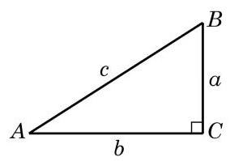

图 6-1-1

如图 6-1-1,将直角三角形 ${ABC}$ 中(其中 $\angle C = {90}^{ \circ  }$ ) $\angle A$ 、 $\angle B\text{ 、 }\angle C$ 的对边边长分别记作 $a\text{ 、 }b\text{ 、 }c$ . 在初中我们已经知道, 锐角 $A$ 的正弦、余弦、正切、余切的定义分别为

$$
\sin A = \frac{a}{c},\cos A = \frac{b}{c},\tan A = \frac{a}{b},\cot A = \frac{b}{a}.
$$

由简单的比值关系以及勾股定理, 还有如下结论:

$$
{\sin }^{2}A + {\cos }^{2}A = 1,\tan A = \frac{\sin A}{\cos A},
$$

$$
\cot A = \frac{\cos A}{\sin A},\cot A = \frac{1}{\tan A},
$$

$$
\sin \left( {{90}^{ \circ  } - A}\right)  = \cos A,\cos \left( {{90}^{ \circ  } - A}\right)  = \sin A,
$$

$$
\tan \left( {{90}^{ \circ  } - A}\right)  = \cot A,\cot \left( {{90}^{ \circ  } - A}\right)  = \tan A.
$$

我们还知道如下一些特殊角的正弦、余弦、正切、余切值 (表 6-1):

表 6-1

<table><tr><td>角度 $\alpha$</td><td>$\sin \alpha$</td><td>$\cos \alpha$</td><td>$\tan \alpha$</td><td>$\cot \alpha$</td></tr><tr><td>${30}^{ \circ  }$</td><td>$\frac{1}{2}$</td><td>$\frac{\sqrt{3}}{2}$</td><td>$\frac{\sqrt{3}}{3}$</td><td>$\sqrt{3}$</td></tr><tr><td>${45}^{ \circ  }$</td><td>$\frac{\sqrt{2}}{2}$</td><td>$\frac{\sqrt{2}}{2}$</td><td>1</td><td>1</td></tr><tr><td>${60}^{ \circ  }$</td><td>$\frac{\sqrt{3}}{2}$</td><td>$\frac{1}{2}$</td><td>$\sqrt{3}$</td><td>$\frac{\sqrt{3}}{3}$</td></tr></table>

### 2 任意角及其度量

在小学和初中我们已经知道, 角是具有公共端点的两条射线所组成的图形, 角还可以看作是平面上由一条射线绕着其端点从初始位置(始边)旋转到终止位置(终边)所形成的图形(图 6-1-2). 我们以前学习过的锐角、直角、钝角、平角和周角, 其大小都在 ${0}^{ \circ  }$ 到 ${360}^{ \circ  }$ 之间. 不过在体操、跳水等体育运动中,会听到转体 720°、转体1 080°等术语；当手表比标准时间慢或者快 10 分钟的时候,只需要将分针旋转 ${60}^{ \circ  }$ 就可以调节准确,但也有按顺时针和逆时针方向旋转的差异. 因此, 要准确地刻画这些现象, 对于角而言, 不但要考察旋转量, 而且要考察旋转方向, 这就需要适当推广角的概念.

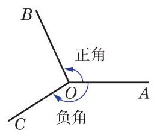

图 6-1-2

习惯上规定:一条射线绕端点按逆时针方向旋转所形成的角为正角，其度量值是正的；按顺时针方向旋转所形成的角为负角, 其度量值是负的(图 6-1-2).

特别地, 当一条射线没有旋转时, 我们也认为形成了一个角, 称为零角. 零角的始边与终边重合.

这样, 我们可将角的概念推广到任意角, 包括正角、负角与零角,也包括超过 ${360}^{ \circ  }$ 的角.

为了便于研究角及与其相关的问题,可将角置于平面直角坐标系中,使得角的顶点与坐标原点重合,角的始边与 $x$ 轴的正半轴重合. 此时角的终边在第几象限, 就说这个角是第几象限的角,或者说这个角属于第几象限. 如图 6-1-3, ${60}^{ \circ  }$ 和 ${420}^{ \circ  }$ 都是第一象限的角， ${135}^{ \circ  }$ 和 $- {225}^{ \circ  }$ 都是第二象限的角. 当角的终边在坐标轴上时, 就不说这些角属于哪一象限.

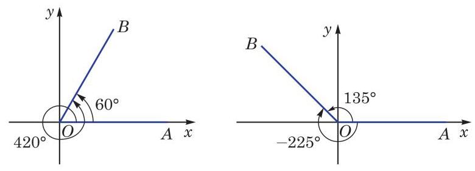

图 6-1-3

例如,若角 $\alpha$ 是第一象限的角,将其终边绕原点逆时针旋转 ${90}^{ \circ  }$ 后,所得的角 $\alpha  + {90}^{ \circ  }$ 是第二象限的角; 将其终边绕原点逆时针旋转 ${180}^{ \circ  }$ 后,所得的角 $\alpha  + {180}^{ \circ  }$ 是第三象限的角; 而将其终边绕原点顺时针旋转 ${90}^{ \circ  }$ 后,所得的角 $\alpha  - {90}^{ \circ  }$ 则是第四象限的角.

从角的形成过程中可以看到,与某一个角 $\alpha$ 的始边相同且终边重合的角有无数个,它们的大小与角 $\alpha$ 都相差 ${360}^{ \circ  }$ 的整数倍. 在图 6-1-3 中, ${60}^{ \circ  }$ 的角和 ${420}^{ \circ  }$ 的角的终边重合,前者与后者之差为 $- {360}^{ \circ  };{135}^{ \circ  }$ 的角和 $- {225}^{ \circ  }$ 的角的终边重合,前者与后者之差为 ${360}^{ \circ  }$ . 进一步,我们可以把所有与角 $\alpha$ 的终边重合的角 (包括角 $\alpha$ 本身)的集合表示为 Q

$$
\{ \beta  \mid  \beta  = k \cdot  {360}^{ \circ  } + \alpha , k \in  \mathbf{Z}\} .
$$

---

为简单起见, 在不引起混淆的前提下， “角 $\alpha$ ”或“ $\angle \alpha$ ”可简记作“ $\alpha$ ”.

---

<span id="candidate-69"></span>

例 1 判断下列各角分别属于哪个象限:

(1) $- {240}^{ \circ  }$ ； (2) ${2100}^{ \circ  }$ .

解(1)因为 $- {240}^{ \circ  } =  - {360}^{ \circ  } + {120}^{ \circ  }$ ,而 ${120}^{ \circ  }$ 的角属于第二象限, 所以 -240° 的角属于第二象限.

(2)因为 $2{100}^{ \circ  } = 5 \times  {360}^{ \circ  } + {300}^{ \circ  }$ ,而 ${300}^{ \circ  }$ 的角属于第四象限, 所以 2 ${100}^{ \circ  }$ 的角属于第四象限.

<span id="candidate-70"></span>

例 2 写出与 $- {200}^{ \circ  }$ 的终边重合的所有角组成的集合 $S$ , 并列举 $S$ 中满足不等式 $- {360}^{ \circ  } \leq  \beta  < {720}^{ \circ  }$ 的所有元素 $\beta$ .

解 因为

$$
S = \left\{  {\beta  \mid  \beta  = k \cdot  {360}^{ \circ  } - {200}^{ \circ  }, k \in  \mathbf{Z}}\right\}  ,
$$

所以当 $- {360}^{ \circ  } \leq  \beta  < {720}^{ \circ  }$ 时, $\beta  =  - {200}^{ \circ  }$ 或 ${160}^{ \circ  }$ 或 ${520}^{ \circ  }$ .

#### 练习 6.1(1)

1. 判断下列命题是否正确:

(1)终边重合的两个角相等; (2)锐角是第一象限的角；

(3)第二象限的角是钝角； (4)小于 ${90}^{ \circ  }$ 的角都是锐角.

2. 分别用集合的形式表示终边位于第三象限的所有角和终边位于 $y$ 轴正半轴上的所有角.
3. 在 ${0}^{ \circ  } \sim  {360}^{ \circ  }$ 范围内,分别找出终边与下列各角的终边重合的角,并判断它们是第几象限的角:

(1)一315°； (2) ${905.3}^{ \circ  }$ ； (3)-1090°； (4) ${530}^{ \circ  }$ .

度量长度可以用米为单位, 度量质量可以用千克为单位, 适当的单位制会给解决问题带来极大的便利. 度量角的大小与度量其他量一样, 也要选择一个同类的量作为度量的单位. 在平面几何中,我们把周角的 $\frac{1}{360}$ 作为 1 度. 用 “度” 作为单位来度量角的单位制叫做角度制.

表示角的方法, 用角度制虽很直观, 但很多情况下并不一定方便. 下面我们引入一种度量角的新方法, 为了叙述方便, 先讨论角度在 ${0}^{ \circ  }$ 到 ${360}^{ \circ  }$ 之间的情形. 观察不难发现: 在半径为 $r$ 的圆中,当圆心角为 ${360}^{ \circ  }$ 时,圆的周长为 ${2\pi r}$ ; 当圆心角为 ${180}^{ \circ  }$ 时, 半圆的弧长为 ${\pi r}$ ; 而当圆心角为 ${90}^{ \circ  }$ 时,四分之一圆的弧长为 $\frac{\pi r}{2}$ . 由初中所学习的计算扇形弧长公式可知,在给定半径的圆中, 弧的长度与相应圆心角的大小成正比例关系, 因此我们不仅可以用角度来度量弧的长度, 而且可以用弧长来度量角的大小. 具体来说,在半径为 $r$ 的圆周上,如果弧长 $l$ 所对应圆心角 $\alpha$ 的度数为 $n$ ,那么 $l$ 与 $n$ 之间的关系式为 $l = {2\pi r} \cdot  \frac{n}{360}$ ,即 $\frac{l}{r} = \; \frac{\pi }{180} \cdot  n$ ,这说明比值 $\frac{l}{r}$ 仅由角 $\alpha$ 的大小决定. 这样我们就可以用圆弧的长与圆半径的比值来表示这个圆弧所对的圆心角的大小. 相应地, 把弧长等于半径的弧所对的圆心角叫做 1 弧度 (radian) 的角(图 6-1-4). 用“弧度”作为单位来度量角的单位制叫做弧度制.

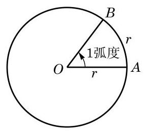

图 6-1-4

如果一个半径为 $r$ 的圆的圆心角 $\alpha$ 所对的弧长为 $l$ ,那么 $\frac{l}{r}$ 就是角 $\alpha$ 的弧度 (角 $\alpha$ 的弧度数通常也用 $\alpha$ 来表示),即 $\alpha  = \frac{l}{r}$ . 零角的弧度数为 0 . 从弧度的定义不难得知,周角为 ${2\pi }$ 弧度,即 ${360}^{ \circ  } = {2\pi }$ 弧度; 平角为 $\pi$ 弧度,即 ${180}^{ \circ  } = \pi$ 弧度. 从而有

---

在学习微积分后可以更明显地看出弧度制的优点.

---

${1}^{ \circ  } = \frac{\pi }{180}$ 弧度,1 弧度 $= \frac{{180}^{ \circ  }}{\pi }$ .

在任意角的情形下，角 $\alpha$ 的终边每逆时针旋转一圈，弧度加 ${2\pi }$ ; 角 $\alpha$ 的终边从起始位置顺时针旋转,弧度为负值,每顺时针旋转一圈,弧度减 ${2\pi }$ .

<span id="candidate-71"></span>

例 3 按下列要求,将 ${75}^{ \circ  }$ 换算成弧度:

(1)精确值;

(2)近似值. (结果精确到 0.001)

解 (1) ${75}^{ \circ  } = {75} \times  \frac{\pi }{180}$ 弧度 $= \frac{5}{12}\pi$ 弧度.

(2)计算得 $\frac{5}{12}\pi  \approx  {1.309}$ ,从而 ${75}^{ \circ  } \approx  {1.309}$ 弧度.

<span id="candidate-72"></span>

例 4 将 2.1 弧度换算成角度. (用度数表示, 结果保留两位小数)

解 2.1 弧度 $= {2.1} \times  \frac{{180}^{ \circ  }}{\pi } \approx  {120.32}^{ \circ  }$ .

请同学们根据一些常用特殊角的角度与弧度的对应关系, 填写下表.

表 6-2

<table><tr><td>角度</td><td>${0}^{ \circ  }$</td><td>${30}^{ \circ  }$</td><td>${45}^{ \circ  }$</td><td>${60}^{ \circ  }$</td><td></td><td></td><td>135°</td><td></td><td>180°</td><td>${270}^{ \circ  }$</td><td>${360}^{ \circ  }$</td></tr><tr><td>弧度</td><td></td><td></td><td></td><td></td><td>$\frac{\pi }{2}$</td><td>$\frac{2\pi }{3}$</td><td></td><td>$\frac{5\pi }{6}$</td><td>$\pi$</td><td></td><td>${2\pi }$</td></tr></table>

在弧度和角度的换算过程中, 应当注意角度制为 60 进位制. 例如, ${32}^{ \circ  }{18}^{\prime }$ 应先换算成 ${32.3}^{ \circ  }$ ,再换算成弧度.

在弧度制下, 每个角都是一个确定的实数, 而每个实数也可以表示一个确定的角, 这就构成了角的集合与实数集合之间的一个一一对应关系.

---

角度和弧度不可混用. 在使用计算器的时候, 要注意所指的是角度制还是弧度制.

---

在用弧度制表示角时, 通常省略“弧度”两字，只写这个角所对应的弧度数. 例如,角 $\alpha$ 和角 $\beta$ 的互补关系可以表示为 $\alpha  + \beta  = \; \pi$ ,而 $\sin {1.2}$ 则表示 1.2 弧度的角的正弦.

引入弧度制使得扇形的弧长和面积公式变得简洁漂亮, 更使微积分中的许多公式变得格外简明. 例如，如图 6-1-5，当扇形的圆心角为 ${n}^{ \circ  }$ ,而半径为 $r$ 时,扇形的弧长 $l$ 和面积 $S$ 的公式分别为 $l = \frac{n}{180} \times  {\pi r} = \frac{n\pi r}{180}$ 及 $S = \frac{n}{360} \times  \pi {r}^{2} = \frac{{n\pi }{r}^{2}}{360}$ . 在使用弧度制后,圆心角相应的弧度为 $\alpha  = \frac{\pi }{180} \times  n = \frac{n\pi }{180}$ ,因此上述公式可分别简化为

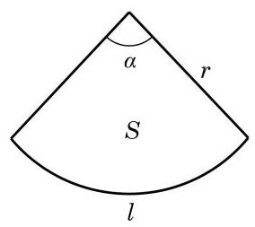

图 6-1-5

扇形的弧长 $l = {\alpha r}$ ,

扇形的面积 $S = \frac{1}{2}\alpha {r}^{2}$ .

<span id="candidate-73"></span>

例 5 写出终边在 $x$ 轴上的所有角组成的集合. (用弧度制表示)

解 当角 $\alpha$ 的终边在 $x$ 轴正半轴上时, $\alpha  = {2k\pi }, k \in  \mathbf{Z}$ ; 而当角 $\alpha$ 的终边在 $x$ 轴负半轴上时, $\alpha  = {2k\pi } + \pi , k \in  \mathbf{Z}$ .

所以,所求的角的集合为 $\{ \alpha  \mid  \alpha  = {k\pi }, k \in  \mathbf{Z}\}$ .

<span id="candidate-74"></span>

例 6 设 $\alpha$ 是第二象限的角,判断 $\frac{\alpha }{2}$ 是哪个象限的角.

解 因为 $\alpha$ 是第二象限的角,所以

$$
{2k\pi } + \frac{\pi }{2} < \alpha  < {2k\pi } + \pi , k \in  \mathbf{Z},
$$

从而有

$$
{k\pi } + \frac{\pi }{4} < \frac{\alpha }{2} < {k\pi } + \frac{\pi }{2}, k \in  \mathbf{Z}.
$$

(1)当 $k$ 为奇数时，设 $k = {2n} + 1, n \in  \mathbf{Z}$ ，就有

$$
{2n\pi } + \frac{5}{4}\pi  < \frac{\alpha }{2} < {2n\pi } + \frac{3}{2}\pi , n \in  \mathbf{Z},
$$

所以 $\frac{\alpha }{2}$ 是第三象限的角;

(2)当 $k$ 为偶数时,设 $k = {2n}, n \in  \mathbf{Z}$ ,就有

$$
{2n\pi } + \frac{\pi }{4} < \frac{\alpha }{2} < {2n\pi } + \frac{\pi }{2}, n \in  \mathbf{Z},
$$

所以 $\frac{\alpha }{2}$ 是第一象限的角.

由上可知, $\frac{\alpha }{2}$ 是第一象限或第三象限的角.

#### 练习 6.1(2)

1. 分别将下列角度化为弧度:

${15}^{ \circ  }$ ; $- {108}^{ \circ  }$ ; ${22}^{ \circ  }{30}^{\prime }$ .

2. 分别将下列弧度化为角度:

$\frac{11}{12}\pi \; - \frac{2}{5}\pi$ -3 (结果精确到 ${0.01}^{ \circ  }$ ).

3. 已知扇形的弧所对的圆心角为 ${54}^{ \circ  }$ ,且半径为 ${10}\mathrm{\;{cm}}$ . 求该扇形的弧长和面积.
4. 如果 $\alpha$ 是第三象限的角,判断 $\frac{\alpha }{2}$ 是哪个象限的角.

### 3 任意角的正弦、余弦、正切、余切

我们将锐角 $\alpha$ 置于平面直角坐标系中,使角 $\alpha$ 的顶点与坐标原点 $O$ 重合,始边与 $x$ 轴的正半轴重合,那么它的终边必在第一象限. 如图 6-1-6,在角 $\alpha$ 的终边上任取异于原点的一点 $P\left( {x, y}\right)$ , 它与原点的距离 $r = \sqrt{{x}^{2} + {y}^{2}} > 0$ . 过点 $P$ 作 $x$ 轴的垂线,设垂足为 $M$ ,则线段 ${OM}$ 的长度 $\left| {OM}\right|$ 为 $x$ ,而线段 ${MP}$ 的长度 $\left| {MP}\right|$ 为 $y$ . 根据锐角的正弦、余弦、正切及余切的定义,有

$$
\sin \alpha  = \frac{\left| MP\right| }{\left| OP\right| } = \frac{y}{r},\cos \alpha  = \frac{\left| OM\right| }{\left| OP\right| } = \frac{x}{r}.
$$

$$
\tan \alpha  = \frac{\left| MP\right| }{\left| OM\right| } = \frac{y}{x},\cot \alpha  = \frac{\left| OM\right| }{\left| MP\right| } = \frac{x}{y}.
$$

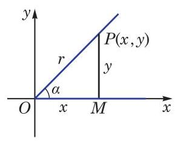

图 6-1-6

Q

---

线段 ${OM}$ 的长度通常用 $\left| {OM}\right|$ 表示. 在不引起混淆的前提下， 也可用 ${OM}$ 表示.

---

这说明锐角 $\alpha$ 的正弦、余弦、正切及余切可以用角 $\alpha$ 的终边上点的坐标来定义. 这样,就可以对任意给定的角 $\alpha$ ,定义其相应的正弦、余弦、正切及余切.

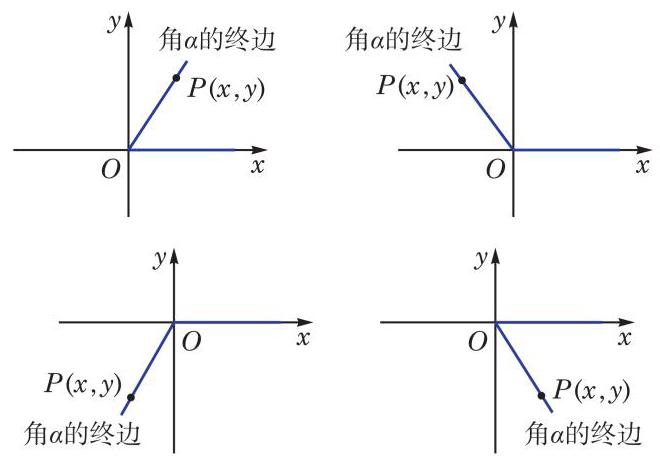

图 6-1-7

如图 6-1-7,在任意角 $\alpha$ 的终边上任取异于原点的一点 $P$ , 设其坐标为 $\left( {x, y}\right)$ ,并令 $\left| {OP}\right|  = r$ ,必有 $r = \sqrt{{x}^{2} + {y}^{2}} > 0$ . 这样,就可以分别定义角 $\alpha$ 的正弦、余弦、正切、余切为

$$
\sin \alpha  = \frac{y}{r},\;\cos \alpha  = \frac{x}{r},
$$

$$
\tan \alpha  = \frac{y}{x}\left( {x \neq  0}\right) ,\cot \alpha  = \frac{x}{y}\left( {y \neq  0}\right) .
$$

---

由相似三角形知识可知,角 $\alpha$ 的正弦、 余弦、正切及余切值只与角 $\alpha$ 的终边有关, 而与在终边上所取的点 $P$ 的位置无关.

---

应当注意的是: 当 $\alpha  = {k\pi } + \frac{\pi }{2}\left( {k \in  \mathbf{Z}}\right)$ ,即角 $\alpha$ 的终边位于 $y$ 轴上时, $\tan \alpha  = \frac{y}{x}$ 无意义; 而当 $\alpha  = {k\pi }\left( {k \in  \mathbf{Z}}\right)$ ,即角 $\alpha$ 的终边位于 $x$ 轴上时, $\cot \alpha  = \frac{x}{y}$ 无意义.

<span id="candidate-75"></span>

例 7 已知角 $\alpha$ 的终边经过点 $P\left( {1, - 2}\right)$ ，求角 $\alpha$ 的正弦、 余弦、正切及余切值.

解 由 $x = 1, y =  - 2$ ,有 $r = \sqrt{{1}^{2} + {\left( -2\right) }^{2}} = \sqrt{5}$ ,从而

$$
\sin \alpha  = \frac{y}{r} =  - \frac{2\sqrt{5}}{5},\cos \alpha  = \frac{x}{r} = \frac{\sqrt{5}}{5},
$$

$$
\tan \alpha  = \frac{y}{x} =  - 2,\cot \alpha  = \frac{x}{y} =  - \frac{1}{2}.
$$

<span id="candidate-76"></span>

例 8 已知角 $\alpha$ 的终边经过点 $P\left( {-2,0}\right)$ ,求角 $\alpha$ 的正弦、 余弦、正切及余切值.

解 由 $x =  - 2, y = 0$ ,有 $r = \sqrt{{\left( -2\right) }^{2} + {0}^{2}} = 2$ ,从而

$$
\sin \alpha  = \frac{y}{r} = 0,\cos \alpha  = \frac{x}{r} =  - 1,
$$

$$
\tan \alpha  = \frac{y}{x} = 0,\cot \alpha \text{ 不存在. }
$$

由于角 $\alpha$ 的正弦、余弦、正切及余切值可以由其终边上一点 $P$ 的坐标求出,因此不难根据点 $P$ 的坐标来判断角 $\alpha$ 的正弦、 余弦、正切及余切的符号,如表 6-3 所示.

表 6-3

<table><tr><td rowspan="2">角 $\alpha$ 所属的象限</td><td colspan="2">点 $P$ 的坐标</td><td rowspan="2">$\sin \alpha$</td><td rowspan="2">$\cos \alpha$</td><td rowspan="2">$\tan \alpha$</td><td rowspan="2">$\cot \alpha$</td></tr><tr><td>$x$</td><td>$y$</td></tr><tr><td>第一象限</td><td>+</td><td>+</td><td>+</td><td>+</td><td>+</td><td>+</td></tr><tr><td>第二象限</td><td>-</td><td>+</td><td>+</td><td>-</td><td>-</td><td>-</td></tr><tr><td>第三象限</td><td>-</td><td>-</td><td>-</td><td>-</td><td>+</td><td>+</td></tr><tr><td>第四象限</td><td>+</td><td>-</td><td>-</td><td>+</td><td>-</td><td>-</td></tr></table>

上表的结果可用图 6-1-8 直观表示.

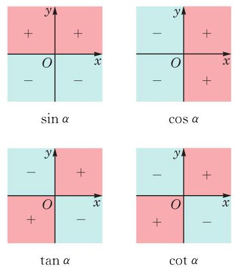

图 6-1-8

<span id="candidate-77"></span>

例 9 若角 $\alpha$ 满足 $\sin \alpha  > 0$ ,且 $\tan \alpha  < 0$ ,则角 $\alpha$ 属于第几象限?

解 由 $\sin \alpha  > 0$ ,知角 $\alpha$ 属于第一象限或第二象限或其终边位于 $y$ 轴的正半轴上. 又由 $\tan \alpha  < 0$ ,知 $\alpha$ 属于第二象限或第四象限.

因此,角 $\alpha$ 属于第二象限.

#### 练习 6.1(3)

1. 已知角 $\alpha$ 的终边过点 $P\left( {{2a}, - {3a}}\right) \left( {a < 0}\right)$ ，求角 $\alpha$ 的正弦、余弦、正切及余切值.
2. 已知角 $\alpha$ 的终边过点 $P\left( {0, - 3}\right)$ ,则下列值不存在的是 ( )

A. $\sin \alpha$ ; B. $\cos \alpha$ ;

C. $\tan \alpha$ ; D. $\cot \alpha$ .

3. 根据下列条件,分别判断角 $\theta$ 属于第几象限:

(1) $\sin \theta  =  - \frac{1}{2}$ 且 $\cos \theta  =  - \frac{\sqrt{3}}{2}$ ; (2) $\sin \theta  < 0$ 且 $\tan \theta  > 0$ .

根据定义,角 $\alpha$ 的正弦、余弦、正切及余切值仅与角 $\alpha$ 的大小有关,而与角 $\alpha$ 的终边上的点 $P$ 的位置无关,因此我们可以用角 $\alpha$ 的终边上到原点距离为 1 的点来确定角 $\alpha$ 的正弦、余弦、 正切及余切值.

半径为 1 个单位的圆称为单位圆(unit circle). 本章中, 如无特别说明, 单位圆通常指在平面直角坐标系中以原点为圆心, 以 1 为半径的圆.

将角 $\alpha$ 的顶点置于坐标原点 $O$ ,始边与 $x$ 轴的正半轴重合, 则角 $\alpha$ 的终边与以原点为圆心的单位圆交于唯一的一点 $P\left( {x, y}\right)$ , 如图 6-1-9 所示. 这样,任意一个角 $\alpha$ 对应于单位圆上一点 $P$ ; 反之,单位圆上一点 $P$ 可对应无穷多个角,但这些角的弧度数之差必为 ${2\pi }$ 的整数倍. 由定义可知, $x = \cos \alpha , y = \sin \alpha$ . 因此, 单位圆上点 $P$ 的坐标必可以写为 $\left( {\cos \alpha ,\sin \alpha }\right)$ .

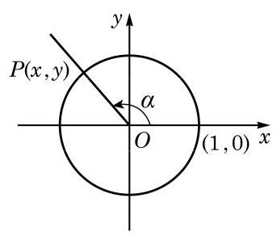

图 6-1-9

<span id="candidate-78"></span>

例 10 求角 $\frac{5\pi }{4}$ 的正弦、余弦和正切值.

解 设角 $\frac{5\pi }{4}$ 的终边交以原点为圆心的单位圆于点 $P$ ,过点 $P$ 作 $x$ 轴的垂线,其垂足为 $M$ ,如图 6-1-10 所示. 在直角三角形 ${OMP}$ 中, $\angle {MOP} = \frac{\pi }{4}$ ,由此可得 $\left| {OM}\right|  = \frac{\sqrt{2}}{2},\left| {MP}\right|  = \frac{\sqrt{2}}{2}$ ,所以点 $P$ 的坐标为 $\left( {-\frac{\sqrt{2}}{2}, - \frac{\sqrt{2}}{2}}\right)$ . 于是, $\sin \frac{5\pi }{4} =  - \frac{\sqrt{2}}{2},\cos \frac{5\pi }{4} = \; - \frac{\sqrt{2}}{2}$ ,而 $\tan \frac{5\pi }{4} = 1$ .

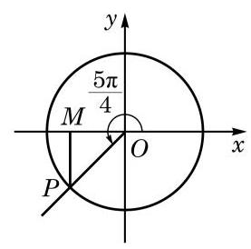

图 6-1-10

对终边与坐标轴重合的角 $\alpha$ ,设终边与以原点为圆心的单位圆的交点为 $P$ ,请同学们完成以下表格 (表 6-4).

表 6-4

<table><tr><td>$\alpha$</td><td>点 $P$ 的坐标</td><td>$\sin \alpha$</td><td>$\cos \alpha$</td><td>$\tan \alpha$</td><td>$\cot \alpha$</td></tr><tr><td>$\alpha  = {2k\pi }\left( {k \in  \mathbf{Z}}\right)$</td><td>(1,0)</td><td>0</td><td>1</td><td>0</td><td>不存在</td></tr><tr><td></td><td>(0,1)</td><td></td><td></td><td></td><td></td></tr><tr><td></td><td>(-1,0)</td><td></td><td></td><td></td><td></td></tr><tr><td></td><td>(0,-1)</td><td></td><td></td><td></td><td></td></tr></table>

设角 $\alpha$ 的终边经过异于原点的一点 $P\left( {x, y}\right)$ ,并记

$$
r = \sqrt{{x}^{2} + {y}^{2}} > 0.
$$

由定义, 有

$$
\sin \alpha  = \frac{y}{r},\cos \alpha  = \frac{x}{r},\tan \alpha  = \frac{y}{x}\left( {x \neq  0}\right) ,\cot \alpha  = \frac{x}{y}\left( {y \neq  0}\right) .
$$

由 ${x}^{2} + {y}^{2} = {r}^{2}$ ,就有

$$
{\sin }^{2}\alpha  + {\cos }^{2}\alpha  = 1.
$$

当 $\cos \alpha  \neq  0$ 时,有

$$
\tan \alpha  = \frac{\sin \alpha }{\cos \alpha }.
$$

当 $\sin \alpha  \neq  0$ 时,有

$$
\cot \alpha  = \frac{\cos \alpha }{\sin \alpha }.
$$

当 $\tan \alpha \text{ 、 }\cot \alpha$ 都有意义时,有

$$
\tan \alpha  \cdot  \cot \alpha  = 1.
$$

根据以上关系,如果知道角 $\alpha$ 的正弦、余弦、正切及余切之中的一个值, 就可以求出其他值.

<span id="candidate-79"></span>

例 11 已知 $\sin \alpha  = \frac{3}{5}$ ,且 $\alpha$ 为第二象限的角. 求 $\cos \alpha$ , $\tan \alpha$ 及 $\cot \alpha$ .

解 因为 $\alpha$ 为第二象限的角,所以 $\cos \alpha  < 0$ .

由 ${\sin }^{2}\alpha  + {\cos }^{2}\alpha  = 1$ ,得

$$
\cos \alpha  =  - \sqrt{1 - {\sin }^{2}\alpha } =  - \frac{4}{5},
$$

从而

$$
\tan \alpha  = \frac{\sin \alpha }{\cos \alpha } =  - \frac{3}{4},\cot \alpha  = \frac{1}{\tan \alpha } =  - \frac{4}{3}.
$$

<span id="candidate-80"></span>

例 12 已知 $\tan \alpha  =  - \frac{5}{12}$ ,求 $\sin \alpha \text{ 、 }\cos \alpha$ 及 $\cot \alpha$ .

解

$$
\cot \alpha  = \frac{1}{\tan \alpha } =  - \frac{12}{5}.
$$

因为 $\tan \alpha  =  - \frac{5}{12} < 0$ ,所以 $\alpha$ 为第二象限或第四象限的角.

因为 $\tan \alpha  = \frac{\sin \alpha }{\cos \alpha }$ ,所以 $\frac{\sin \alpha }{\cos \alpha } =  - \frac{5}{12}$ .

? 又因为 ${\sin }^{2}\alpha  + {\cos }^{2}\alpha  = 1$ ,解方程组

$$
\left\{  \begin{array}{l} {\sin }^{2}\alpha  + {\cos }^{2}\alpha  = 1, \\  \frac{\sin \alpha }{\cos \alpha } =  - \frac{5}{12}, \end{array}\right.
$$

得

---

能否利用直角三角形知识与角的正弦、 余弦、正切和余切值在各象限的符号, 快速给出例 12 的答案?

---

$\sin \alpha  = \frac{5}{13},\cos \alpha  =  - \frac{12}{13}$ ,或 $\sin \alpha  =  - \frac{5}{13},\cos \alpha  = \frac{12}{13}$ .

于是,当 $\alpha$ 为第二象限的角时, $\sin \alpha  = \frac{5}{13},\cos \alpha  =  - \frac{12}{13}$ ; 而当 $\alpha$ 为第四象限的角时, $\sin \alpha  =  - \frac{5}{13},\cos \alpha  = \frac{12}{13}$ .

#### 练习 6.1(4)

1. 求角 $\frac{5}{3}\pi$ 的正弦、余弦、正切及余切值.
2. 分别求 $\sin {k\pi }\left( {k \in  \mathbf{Z}}\right)$ 和 $\cos {k\pi }\left( {k \in  \mathbf{Z}}\right)$ 的值.
3. 已知 $\alpha$ 为第三象限的角， $\cos \alpha  =  - \frac{\sqrt{5}}{5}$ . 求 $\sin \alpha \text{ 、 }\tan \alpha$ 及 $\cot \alpha$ .
4. 已知 $\cot \alpha  = \frac{1}{3}$ ,求 $\sin \alpha \text{ 、 }\cos \alpha$ 及 $\tan \alpha$ .

利用任意角 $\alpha$ 的正弦、余弦、正切及余切之间的关系，可以化简表达式并证明一些恒等式.

<span id="candidate-81"></span>

例 13 ( 1 )已知 $\sin \alpha  + \cos \alpha  = \frac{1}{5}$ ，求 $\sin \alpha \cos \alpha$ 的值；

( 2 )已知 $\tan \alpha  = \frac{1}{2}$ ，求 ${\sin }^{2}\alpha  - \sin \alpha \cos \alpha  - {\cos }^{2}\alpha$ 的值.

解(1)因为

$$
{\left( \sin \alpha  + \cos \alpha \right) }^{2} = {\sin }^{2}\alpha  + {\cos }^{2}\alpha  + 2\sin \alpha \cos \alpha  = 1 + 2\sin \alpha \cos \alpha ,
$$

即

$$
\frac{1}{25} = 1 + 2\sin \alpha \cos \alpha ,
$$

所以 $\sin \alpha \cos \alpha  =  - \frac{12}{25}$ .

(2)因为 $\tan \alpha  = \frac{1}{2}$ ，所以 $\cos \alpha  \neq  0$ ，从而有

$$
{\sin }^{2}\alpha  - \sin \alpha \cos \alpha  - {\cos }^{2}\alpha  = \frac{{\sin }^{2}\alpha  - \sin \alpha \cos \alpha  - {\cos }^{2}\alpha }{{\sin }^{2}\alpha  + {\cos }^{2}\alpha }
$$

$$
= \frac{{\tan }^{2}\alpha  - \tan \alpha  - 1}{{\tan }^{2}\alpha  + 1}
$$

$$
= \frac{\frac{1}{4} - \frac{1}{2} - 1}{\frac{1}{4} + 1} =  - 1\text{ . }
$$

<span id="candidate-82"></span>

例 14 证明下列恒等式:

(1) $1 + {\tan }^{2}\alpha  = \frac{1}{{\cos }^{2}\alpha }$ ；

(2) $1 + {\cot }^{2}\alpha  = \frac{1}{{\sin }^{2}\alpha }$ ；

(3) $\frac{1 + \cos \alpha }{\sin \alpha } = \frac{\sin \alpha }{1 - \cos \alpha }$ ；___ Q

---

通常记

$\sec \alpha  = \frac{1}{\cos \alpha },$

$\csc \alpha  = \frac{1}{\sin \alpha }.$

<span id="candidate-83"></span>

例 14(1)与(2)中的公式就可简写为

$1 + {\tan }^{2}\alpha  = {\sec }^{2}\alpha ,$

$1 + {\cot }^{2}\alpha  = {\csc }^{2}\alpha$

---

(4) $\frac{{\sin }^{2}\alpha  - {\sin }^{2}\beta }{{\tan }^{2}\alpha  - {\tan }^{2}\beta } = {\cos }^{2}\alpha {\cos }^{2}\beta$ .

证明 (1) $1 + {\tan }^{2}\alpha  = 1 + \frac{{\sin }^{2}\alpha }{{\cos }^{2}\alpha } = \frac{{\cos }^{2}\alpha  + {\sin }^{2}\alpha }{{\cos }^{2}\alpha } = \frac{1}{{\cos }^{2}\alpha }$ .

(2) $1 + {\cot }^{2}\alpha  = 1 + \frac{{\cos }^{2}\alpha }{{\sin }^{2}\alpha } = \frac{{\sin }^{2}\alpha  + {\cos }^{2}\alpha }{{\sin }^{2}\alpha } = \frac{1}{{\sin }^{2}\alpha }$ .

(3)因为

$$
\frac{1 + \cos \alpha }{\sin \alpha } = \frac{\left( {1 + \cos \alpha }\right) \left( {1 - \cos \alpha }\right) }{\sin \alpha \left( {1 - \cos \alpha }\right) } = \frac{1 - {\cos }^{2}\alpha }{\sin \alpha \left( {1 - \cos \alpha }\right) }
$$

$$
= \frac{{\sin }^{2}\alpha }{\sin \alpha \left( {1 - \cos \alpha }\right) } = \frac{\sin \alpha }{1 - \cos \alpha },
$$

所以原式成立.

(4)因为左边 $= \frac{{\sin }^{2}\alpha  - {\sin }^{2}\beta }{\frac{{\sin }^{2}\alpha }{{\cos }^{2}\alpha } - \frac{{\sin }^{2}\beta }{{\cos }^{2}\beta }} = \frac{\left( {{\sin }^{2}\alpha  - {\sin }^{2}\beta }\right) {\cos }^{2}\alpha {\cos }^{2}\beta }{{\sin }^{2}\alpha {\cos }^{2}\beta  - {\sin }^{2}\beta {\cos }^{2}\alpha }$

$$
= \frac{\left( {{\sin }^{2}\alpha  - {\sin }^{2}\beta }\right) {\cos }^{2}\alpha {\cos }^{2}\beta }{{\sin }^{2}\alpha \left( {1 - {\sin }^{2}\beta }\right)  - {\sin }^{2}\beta \left( {1 - {\sin }^{2}\alpha }\right) }
$$

$$
= \frac{\left( {{\sin }^{2}\alpha  - {\sin }^{2}\beta }\right) {\cos }^{2}\alpha {\cos }^{2}\beta }{{\sin }^{2}\alpha  - {\sin }^{2}\beta }
$$

$$
= {\cos }^{2}\alpha {\cos }^{2}\beta  = \text{ 右边, }
$$

所以原式成立.

#### 练习 6.1(5)

1. 已知 $\tan \alpha  = 3$ ,求 $\frac{2\sin \alpha  + \cos \alpha }{\sin \alpha  - \cos \alpha }$ 的值.
2. 化简:

(1) ${\sin }^{2}\alpha  + {\sin }^{2}\alpha {\cos }^{2}\alpha  + {\cos }^{4}\alpha$ ; (2) $\sin \alpha \cos \alpha \left( {\tan \alpha  + \cot \alpha }\right)$ .

3. 证明: ${\cot }^{2}\alpha  - {\cos }^{2}\alpha  = {\cot }^{2}\alpha  \cdot  {\cos }^{2}\alpha$ .

### 4 诱导公式

${2k\pi } + \alpha \left( {k \in  \mathbf{Z}}\right) , - \alpha ,\pi  \pm  \alpha ,\frac{\pi }{2} \pm  \alpha$ 这些角都与角 $\alpha$ 有特殊的关系. 已知角 $\alpha$ 的正弦、余弦、正切及余切值,能否快速给出上述这些角的正弦、余弦、正切及余切值？这就是诱导公式要解决的问题.

由于角 ${2k\pi } + \alpha \left( {k \in  \mathbf{Z}}\right)$ 的终边与角 $\alpha$ 的终边重合,因此由定义有如下诱导公式:

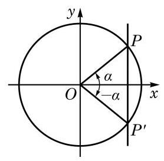

图 6-1-11

由这组诱导公式, 求任意角的正弦、余弦、正切及余切值可以转化为求 $\lbrack 0,{2\pi })$ 范围内一个角的相应值.

角 $\alpha$ 的终边与角 $- \alpha$ 的终边关于 $x$ 轴对称(图 6-1-11)，角 $\alpha$ 的终边与单位圆交于点 $P\left( {\cos \alpha ,\sin \alpha }\right)$ ，而角 $- \alpha$ 的终边与单位圆交于点 ${P}^{\prime }\left( {\cos \left( {-\alpha }\right) ,\sin \left( {-\alpha }\right) }\right)$ . 由于点 $P$ 与点 ${P}^{\prime }$ 关于 $x$ 轴对称, 其横坐标相等, 而纵坐标互为相反数, 因此有如下诱导公式:

$$
\sin \left( {-\alpha }\right)  =  - \sin \alpha ,\;\cos \left( {-\alpha }\right)  = \cos \alpha ,
$$

$$
\tan \left( {-\alpha }\right)  =  - \tan \alpha ,\;\cot \left( {-\alpha }\right)  =  - \cot \alpha .
$$

由这组诱导公式, 求负角的正弦、余弦、正切及余切值可以转化为求正角的相应值.

将角 $\alpha$ 的终边绕着原点 $O$ 按逆时针方向旋转 $\pi$ 弧度,得到角 $\pi  + \alpha$ 的终边 (图 6-1-12),这说明角 $\alpha$ 和角 $\pi  + \alpha$ 的终边在同一条直线上,但方向相反. 角 $\alpha$ 的终边与单位圆交于点 $P\left( {\cos \alpha ,\sin \alpha }\right)$ ,角 $\pi  + \alpha$ 的终边与单位圆交于点 ${P}^{\prime }(\cos \left( {\pi  + \alpha }\right)$ , $\sin \left( {\pi  + \alpha }\right) )$ . 由于点 $P$ 与点 ${P}^{\prime }$ 关于原点对称,其横坐标和纵坐标都互为相反数，因此有如下诱导公式:

$$
\sin \left( {\pi  + \alpha }\right)  =  - \sin \alpha ,\;\cos \left( {\pi  + \alpha }\right)  =  - \cos \alpha ,
$$

$$
\tan \left( {\pi  + \alpha }\right)  = \tan \alpha ,\;\cot \left( {\pi  + \alpha }\right)  = \cot \alpha .
$$

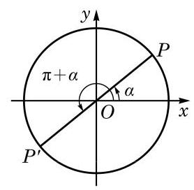

图 6-1-12

由这组诱导公式,求 $\lbrack 0,{2\pi })$ 范围内的角的正弦、余弦、正切及余切值可以转化到 $\lbrack 0,\pi )$ 范围内一个角的相应值.

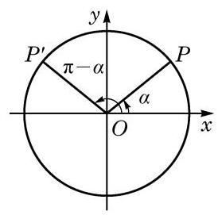

图 6-1-13

角 $\alpha$ 的终边与单位圆交于点 $P\left( {\cos \alpha ,\sin \alpha }\right)$ ,而角 $\pi  - \alpha$ 的终边与单位圆交于点 ${P}^{\prime }\left( {\cos \left( {\pi  - \alpha }\right) ,\sin \left( {\pi  - \alpha }\right) }\right)$ . 由于角 $\alpha$ 的终边和角 $\pi  - \alpha$ 的终边关于 $y$ 轴对称(图 6-1-13)，点 $P$ 与点 ${P}^{\prime }$ 关于 $y$ 轴对称, 其横坐标为相反数, 而纵坐标相等, 因此有如下诱导公式:

$$
\sin \left( {\pi  - \alpha }\right)  = \sin \alpha ,\;\cos \left( {\pi  - \alpha }\right)  =  - \cos \alpha ,
$$

$$
\tan \left( {\pi  - \alpha }\right)  =  - \tan \alpha ,\;\cot \left( {\pi  - \alpha }\right)  =  - \cot \alpha .
$$

由这组诱导公式,求 $\lbrack 0,\pi )$ 范围内的角的正弦、余弦、正切及余切值可以转化到 $\left\lbrack  {0,\frac{\pi }{2}}\right\rbrack$ 范围内一个角的相应值.

利用以上四组诱导公式, 就可以将终边不位于坐标轴上的任意角的正弦、余弦、正切及余切值, 与初中已学过的锐角的相应值有机地联系起来.

以上四组诱导公式说明, ${2k\pi } + \alpha \left( {k \in  \mathbf{Z}}\right) , - \alpha ,\pi  \pm  \alpha$ 的正弦、余弦、正切及余切值的绝对值等于角 $\alpha$ 的相应量的绝对值, 但这两个值之间可能差一个正负号. 由于诱导公式较多, 记忆其中的正负号并不容易, 但有一个很简单的方法可以加以判断, 即: 当 $\alpha$ 为锐角时,等式两边必须同时为正数或同时为负数.

例如, $\cos \left( {\pi  - \alpha }\right)$ 的绝对值应该同 $\cos \alpha$ 的绝对值相等,即成立 $\cos \left( {\pi  - \alpha }\right)  =  \pm  \cos \alpha$ . 但当 $\alpha$ 为锐角时, $\pi  - \alpha$ 是第二象限的角,这时 $\cos \left( {\pi  - \alpha }\right)  < 0$ ,而 $\cos \alpha  > 0$ ,所以前式中应该取负号, 即有 $\cos \left( {\pi  - \alpha }\right)  =  - \cos \alpha$ .

<span id="candidate-84"></span>

例 15 利用诱导公式求值:

(1) $\sin \frac{20}{3}\pi$

(2) $\cos \left( {-\frac{7}{6}\pi }\right)$ ；

(3) $\tan \left( {-\frac{19}{4}\pi }\right)$ .

Q

解 (1) $\sin \frac{20}{3}\pi  = \sin \left( {{6\pi } + \frac{2}{3}\pi }\right)  = \sin \frac{2}{3}\pi$

$$
= \sin \left( {\pi  - \frac{\pi }{3}}\right)  = \sin \frac{\pi }{3} = \frac{\sqrt{3}}{2}.
$$

---

到底使用哪一个诱导公式求值, 可以有多种选择.

---

(2) $\cos \left( {-\frac{7}{6}\pi }\right)  = \cos \frac{7}{6}\pi  = \cos \left( {\pi  + \frac{\pi }{6}}\right)  =  - \cos \frac{\pi }{6} =  - \frac{\sqrt{3}}{2}$ .

(3) $\tan \left( {-\frac{19}{4}\pi }\right)  =  - \tan \frac{19}{4}\pi  =  - \tan \left( {{5\pi } - \frac{\pi }{4}}\right)$

$$
=  - \tan \left( {\pi  - \frac{\pi }{4}}\right)  = \tan \frac{\pi }{4} = 1.
$$

<span id="candidate-85"></span>

例 16 化简: $\frac{\sin \left( {{2\pi } - \alpha }\right) \tan \left( {\pi  + \alpha }\right) \cot \left( {-\pi  - \alpha }\right) }{\cos \left( {\pi  - \alpha }\right) \tan \left( {{3\pi } - \alpha }\right) }$ .

解 因为

$$
\sin \left( {{2\pi } - \alpha }\right)  = \sin \left( {-\alpha }\right)  =  - \sin \alpha ,\tan \left( {\pi  + \alpha }\right)  = \tan \alpha ,
$$

$\cot \left( {-\pi  - \alpha }\right)  =  - \cot \left( {\pi  + \alpha }\right)  =  - \cot \alpha ,\cos \left( {\pi  - \alpha }\right)  =  - \cos \alpha ,$

$$
\tan \left( {{3\pi } - \alpha }\right)  = \tan \left( {\pi  - \alpha }\right)  =  - \tan \alpha ,
$$

所以

原式 $= \frac{\left( {-\sin \alpha }\right) \tan \alpha \left( {-\cot \alpha }\right) }{\left( {-\cos \alpha }\right) \left( {-\tan \alpha }\right) } = \frac{\sin \alpha }{\cos \alpha }\cot \alpha  = \tan \alpha \cot \alpha  = 1$ .

#### 练习 6.1(6)

1. 证明:

(1) $\sin \left( {{2\pi } - \alpha }\right)  =  - \sin \alpha$ ; (2) $\cos \left( {{2\pi } - \alpha }\right)  = \cos \alpha$ ；

(3) $\tan \left( {{2\pi } - \alpha }\right)  =  - \tan \alpha$ ； (4) $\cot \left( {{2\pi } - \alpha }\right)  =  - \cot \alpha$ .

2. 利用诱导公式求值:

(1) $\sin \frac{11}{4}\pi$ (2) $\cos \left( {-\frac{5}{6}\pi }\right)$ ； (3) $\tan \left( {-\frac{14}{3}\pi }\right)$ .

3. 化简:

(1) $\frac{\sin \left( {{180}^{ \circ  } - \alpha }\right) }{\sin \left( {{180}^{ \circ  } + \alpha }\right) } + \frac{\cos \left( {{360}^{ \circ  } - \alpha }\right) }{\cos \left( {{180}^{ \circ  } + \alpha }\right) } + \frac{\tan \left( {{180}^{ \circ  } + \alpha }\right) }{\tan \left( {-\alpha }\right) }$ ;

(2) $\frac{\sin \left( {\pi  - \alpha }\right) }{\cos \left( {\pi  + \alpha }\right) } \cdot  \frac{\sin \left( {{2\pi } - \alpha }\right) }{\tan \left( {\pi  + \alpha }\right) }$ .

角 $\alpha$ 的终边与角 $\frac{\pi }{2} - \alpha$ 的终边关于直线 $y = x$ 对称 (图 6-1-14),角 $\alpha$ 的终边与单位圆交于点 $P\left( {\cos \alpha ,\sin \alpha }\right)$ ,而角 $\frac{\pi }{2} - \alpha$ 的终边与单位圆交于点 ${P}^{\prime }\left( {\cos \left( {\frac{\pi }{2} - \alpha }\right) ,\sin \left( {\frac{\pi }{2} - \alpha }\right) }\right)$ . 由于点 $P$ 与点 ${P}^{\prime }$ 关于直线 $y = x$ 对称,即点 $P$ 的横坐标与点 ${P}^{\prime }$ 的纵坐标相等,而点 $P$ 的纵坐标与点 ${P}^{\prime }$ 的横坐标相等,因此有如下诱导公式:

$$
\sin \left( {\frac{\pi }{2} - \alpha }\right)  = \cos \alpha ,\;\cos \left( {\frac{\pi }{2} - \alpha }\right)  = \sin \alpha ,
$$

$$
\tan \left( {\frac{\pi }{2} - \alpha }\right)  = \cot \alpha ,\;\cot \left( {\frac{\pi }{2} - \alpha }\right)  = \tan \alpha .
$$

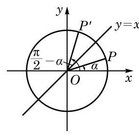

图 6-1-14

Q

在以上公式中将 $\alpha$ 用 $- \alpha$ 代换,就有

$$
\sin \left( {\frac{\pi }{2} + \alpha }\right)  = \cos \left( {-\alpha }\right)  = \cos \alpha ,
$$

即

$$
\sin \left( {\frac{\pi }{2} + \alpha }\right)  = \cos \alpha .
$$

同理, 有如下诱导公式:

$$
\sin \left( {\frac{\pi }{2} + \alpha }\right)  = \cos \alpha ,\;\cos \left( {\frac{\pi }{2} + \alpha }\right)  =  - \sin \alpha ,
$$

$$
\tan \left( {\frac{\pi }{2} + \alpha }\right)  =  - \cot \alpha ,\;\cot \left( {\frac{\pi }{2} + \alpha }\right)  =  - \tan \alpha .
$$

上述两组诱导公式说明正弦和余弦可以互相转化, 正切和余切也可以互相转化.

以上两组诱导公式说明角 $\frac{\pi }{2} \pm  \alpha$ 的正(余)弦、正(余)切值的绝对值,必等于角 $\alpha$ 的余(正)弦、余(正)切值的绝对值,但这两者可能差一个正负号. 这个正负号的确定方法是: 当 $\alpha$ 为锐角时, 等式两边必须同时为正数或同时为负数.

例如, $\cos \left( {\frac{\pi }{2} + \alpha }\right)$ 的绝对值应该同 $\sin \alpha$ 的绝对值相等,即成立 $\cos \left( {\frac{\pi }{2} + \alpha }\right)  =  \pm  \sin \alpha$ . 但当 $\alpha$ 为锐角时, $\frac{\pi }{2} + \alpha$ 是第二象限的角,这时 $\cos \left( {\frac{\pi }{2} + \alpha }\right)  < 0$ ,而 $\sin \alpha  > 0$ ,所以前式中应该取负号,即有 $\cos \left( {\frac{\pi }{2} + \alpha }\right)  =  - \sin \alpha$ .

<span id="candidate-86"></span>

例 17 证明:

(1) $\sin \left( {\frac{3\pi }{2} + \alpha }\right)  =  - \cos \alpha$ ;

(2) $\cos \left( {\frac{3\pi }{2} + \alpha }\right)  = \sin \alpha$ ；

---

角 $\alpha$ 的终边和角 $- \alpha$ 的终边关于角 $\frac{\alpha  + \left( {-\alpha }\right) }{2} = 0$ 的终边所在直线 $\left( {x\text{ 轴 }}\right)$ 对称; 角 $\alpha$ 的终边和角 $\pi  - \alpha$ 的 终 边 关 于 角 $\frac{\alpha  + \left( {\pi  - \alpha }\right) }{2} = \frac{\pi }{2}$ 的终边所在直线 $\left( {y\text{ 轴 }}\right)$ 对称. 一般地,角 $\alpha$ 的终边和角 $\beta$ 的终边关于角 $\frac{\alpha  + \beta }{2}$ 的终边所在直线对称.

---

(3) $\tan \left( {\frac{3\pi }{2} + \alpha }\right)  =  - \cot \alpha$

(4) $\cot \left( {\frac{3\pi }{2} + \alpha }\right)  =  - \tan \alpha$ .

证明 (1) $\sin \left( {\frac{3\pi }{2} + \alpha }\right)  = \sin \left( {\pi  + \frac{\pi }{2} + \alpha }\right)$

$$
=  - \sin \left( {\frac{\pi }{2} + \alpha }\right)  =  - \cos \alpha .
$$

(2)(3)(4)的证明方法类似，请同学们自行完成.

例 17 中的这组公式也可称为诱导公式. 观察所有上述这些诱导公式,关于角 $\frac{k\pi }{2} \pm  \alpha \left( {k \in  \mathbf{Z}}\right)$ 的正弦、余弦、正切及余切值呈现的规律可以总结为如下口诀: 奇变偶不变, 符号看象限. 例如, $\frac{\pi }{2}$ 及 $\frac{3\pi }{2}$ 都是 $\frac{\pi }{2}$ 的奇数倍,如果等式左边是 $\frac{\pi }{2} \pm  \alpha ,\frac{3\pi }{2} \pm  \alpha$ 的正弦、余弦、正切、余切之一,那么等式右边相应的必定是 $\alpha$ 的余弦、正弦、余切、正切,这就是“奇变”; 而 ${2k\pi }\left( {k \in  \mathbf{Z}}\right) \text{ 、 }0\text{ 、 }\pi$ 都是 $\frac{\pi }{2}$ 的偶数倍,等式两边的正弦、余弦、正切及余切的名称就应该相同，这就是“偶不变”. 等式右边角 $\alpha$ 的正弦、余弦、正切及余切前的符号可以将 $\alpha$ 视为锐角 (实际上 $\alpha$ 此时可以为任意角),由等式左边的角 $\frac{\pi }{2} \pm  \alpha ,\frac{3\pi }{2} + \alpha ,{2k\pi } + \alpha , - \alpha ,\pi  \pm  \alpha$ 所在象限的正弦、余弦、正切及余切值的符号来确定，即“符号看象限”. 这一点在前面已有说明.

<span id="candidate-87"></span>

例 18 化简: $\frac{\sin \left( {\frac{\pi }{2} + \alpha }\right) \cos \left( {\frac{\pi }{2} + \alpha }\right) \sin \left( {\frac{\pi }{2} - \alpha }\right) }{\tan \left( {\frac{\pi }{2} + \alpha }\right) \cos \left( {\frac{3}{2}\pi  + \alpha }\right) \sin \left( {-\pi  + \alpha }\right) }$ .

解 原式 $= \frac{\cos \alpha \left( {-\sin \alpha }\right) \cos \alpha }{\left( {-\cot \alpha }\right) \sin \alpha \left( {-\sin \alpha }\right) }$

$$
=  - \frac{{\cos }^{2}\alpha }{\frac{\cos \alpha }{\sin \alpha }\sin \alpha }
$$

$$
=  - \cos \alpha \text{ . }
$$

<span id="candidate-88"></span>

例 19 已知点 $A$ 的坐标为 $\left( {-\frac{3}{5},\frac{4}{5}}\right)$ ,将 ${OA}$ 绕坐标原点 $O$ 逆时针旋转 $\frac{\pi }{2}$ 至 $O{A}^{\prime }$ . 求点 ${A}^{\prime }$ 的坐标.

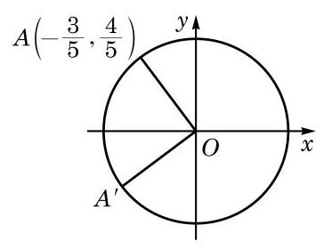

图 6-1-15

解 如图 6-1-15,由 ${OA} = O{A}^{\prime } = 1$ ,在单位圆中 $A(\cos \theta$ , $\sin \theta )$ 满足 $\cos \theta  =  - \frac{3}{5},\sin \theta  = \frac{4}{5}$ .

这样对点 ${A}^{\prime }\left( {{x}^{\prime },{y}^{\prime }}\right)$ ,有

$$
{x}^{\prime } = \cos \left( {\theta  + \frac{\pi }{2}}\right)  =  - \sin \theta  =  - \frac{4}{5},
$$

$$
{y}^{\prime } = \sin \left( {\theta  + \frac{\pi }{2}}\right)  = \cos \theta  =  - \frac{3}{5}.
$$

所以，点 ${A}^{\prime }$ 的坐标为 $\left( {-\frac{4}{5}, - \frac{3}{5}}\right)$ .

#### 练习 6.1(7)

1. 证明:

(1) $\sin \left( {\frac{3\pi }{2} - \alpha }\right)  =  - \cos \alpha$ ； (2) $\cos \left( {\frac{3\pi }{2} - \alpha }\right)  =  - \sin \alpha$ ；

(3) $\tan \left( {\frac{3\pi }{2} - \alpha }\right)  = \cot \alpha$ ； (4) $\cot \left( {\frac{3\pi }{2} - \alpha }\right)  = \tan \alpha$ .

2. 化简: $\frac{\sin \left( {\frac{\pi }{2} + \alpha }\right) \cot \left( {\frac{3\pi }{2} - \alpha }\right) \cos \left( {{3\pi } + \alpha }\right) }{\cot \left( {\frac{\pi }{2} - \alpha }\right) \cos \left( {\frac{3\pi }{2} + \alpha }\right) \cot \left( {\pi  - \alpha }\right) }$ .
3. 已知点 $A$ 的坐标为 $\left( {3,4}\right)$ ,将 ${OA}$ 绕坐标原点 $O$ 顺时针旋转 $\frac{\pi }{2}$ 至 $O{A}^{\prime }$ . 求点 ${A}^{\prime }$ 的坐标.

### 5 已知正弦、余弦或正切值求角

如果 $\alpha$ 是锐角,且满足 $\sin \alpha  = \frac{1}{2}$ ,那么 $\alpha  = \frac{\pi }{6}$ . 如果不限定 $\alpha$ 是锐角,那么由诱导公式 $\sin \left( {\pi  - \alpha }\right)  = \sin \alpha  = \frac{1}{2}$ 可知, $\alpha  = \frac{5\pi }{6}$ 也满足 $\sin \alpha  = \frac{1}{2}$ . 再由诱导公式 $\sin \left( {{2k\pi } + \alpha }\right)  = \sin \alpha \left( {k \in  \mathbf{Z}}\right)$ 可知, $\alpha  = {2k\pi } + \frac{\pi }{6}$ 或 $\alpha  = {2k\pi } + \frac{5\pi }{6}\left( {k \in  \mathbf{Z}}\right)$ 都满足 $\sin \alpha  = \frac{1}{2}$ . 那么,是否还有其他的角 $\alpha$ 满足 $\sin \alpha  = \frac{1}{2}$ 呢? 下面我们就来研究这个问题.

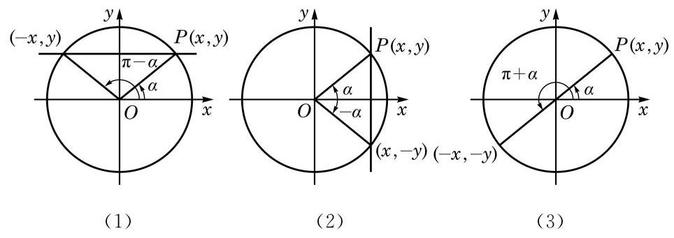

图 6-1-16

为此目的,设 $\alpha$ 是一个任意给定的角,我们希望确定所有满足 $\sin \beta  = \sin \alpha$ 的角 $\beta$ . 设角 $\alpha$ 的终边与以原点为圆心的单位圆的交点为 $P\left( {x, y}\right)$ ,过点 $P$ 作 $y$ 轴的垂线,如图 6-1-16(1) 所示. 由正弦的定义，满足 $\sin \beta  = \sin \alpha$ 的角 $\beta$ 的终边与单位圆的交点必在此直线上.

当 $\alpha  \neq  {l\pi } + \frac{\pi }{2}\left( {l \in  \mathbf{Z}}\right)$ 时，此直线交单位圆于两点 $\left( {x, y}\right)$ 和 $\left( {-x, y}\right)$ . 由于这两点分别位于角 $\alpha$ 和角 $\pi  - \alpha$ 的终边上,因此满足 $\sin \beta  = \sin \alpha$ 的角 $\beta$ 的全体为 $\left\{  {\beta  \mid  \beta  = {2k\pi } + \alpha }\right.$ 或 $\beta  = {2k\pi } + \pi  - \alpha$ , $k \in  \mathbf{Z}\}$ ,可简记作 $\{ \beta  \mid  \beta  = {k\pi } + {\left( -1\right) }^{k}\alpha , k \in  \mathbf{Z}\}$ .

当 $\alpha  = {l\pi } + \frac{\pi }{2}\left( {l \in  \mathbf{Z}}\right)$ 时,过点 $P$ 且垂直于 $y$ 轴的直线与单位圆相切于 $\left( {0, y}\right)$ ,此时满足 $\sin \beta  = \sin \alpha$ 的角 $\beta$ 的全体为 $\{ \beta  \mid  \beta  = {2k\pi } + \alpha , k \in  \mathbf{Z}\}$ ,这个集合也可以用上面所示的形式来表示. 事实上, 其表达式与上述集合第一部分中所给的表达式完全相同, 而对于上述集合第二部分所给的表达式, 由于在 $\alpha  = {l\pi } + \frac{\pi }{2}\left( {l \in  \mathbf{Z}}\right)$ 时,

$$
\beta  = {2k\pi } + \pi  - \alpha  = {2k\pi } - {l\pi } + \frac{\pi }{2}
$$

$$
= 2\left( {k - l}\right) \pi  + {l\pi } + \frac{\pi }{2} = 2\left( {k - l}\right) \pi  + \alpha \left( {k - l \in  \mathbf{Z}}\right) ,
$$

此时它也与上述集合第一部分中所给的表达式一致.

这样, 我们就得到:

若 $\sin x = \sin \alpha$ ,则

$$
x = {2k\pi } + \alpha \text{ 或 }x = {2k\pi } + \pi  - \alpha , k \in  \mathbf{Z},
$$

即

$$
x = {k\pi } + {\left( -1\right) }^{k}\alpha , k \in  \mathbf{Z}.
$$

同理,如图 6-1-16(2),若角 $\alpha$ 的终边与以原点为圆心的单位圆的交点为 $P\left( {x, y}\right)$ ,则由余弦的定义,满足 $\cos \beta  = \cos \alpha$ 的角 $\beta$ 的终边与单位圆的交点在过点 $P$ 且垂直于 $x$ 轴的直线上,从而满足 $\cos \beta  = \cos \alpha$ 的角 $\beta$ 的全体为 $\{ \beta  \mid  \beta  = {2k\pi } \pm  \alpha , k \in  \mathbf{Z}\}$ . 这样, 我们就得到:

若 $\cos x = \cos \alpha$ ,则 $x = {2k\pi } \pm  \alpha , k \in  \mathbf{Z}$ .

如图 6-1-16(3)，若角 $\alpha$ 的终边与以原点为圆心的单位圆的交点为 $P\left( {x, y}\right)$ ,则由正切的定义,满足 $\tan \beta  = \tan \alpha$ 的角 $\beta$ 的终边与单位圆的交点在过原点 $O$ 和点 $P$ 的直线上,从而满足 $\tan \beta  = \tan \alpha$ 的角 $\beta$ 的全体为 $\{ \beta  \mid  \beta  = {k\pi } + \alpha , k \in  \mathbf{Z}\}$ . 这样,我们就得到:

若 $\tan x = \tan \alpha$ ,则 $x = {k\pi } + \alpha , k \in  \mathbf{Z}$ .

<span id="candidate-89"></span>

例 20 根据下列条件,分别求角 $x$ :

(1)已知 $\sin x = \frac{\sqrt{3}}{2}$ ；

(2)已知 $\cos x =  - \frac{\sqrt{2}}{2}$ ；

(3)已知 $\tan x = \frac{\sqrt{3}}{3}$ .

解 (1) 因为 $\sin \frac{\pi }{3} = \frac{\sqrt{3}}{2}$ ,所以原式等价于求解 $\sin x = \; \sin \frac{\pi }{3}$ ,从而其解为 $x = {k\pi } + {\left( -1\right) }^{k}\frac{\pi }{3}, k \in  \mathbf{Z}$ .

(2)因为 $\cos \left( {\pi  - \frac{\pi }{4}}\right)  =  - \cos \frac{\pi }{4} =  - \frac{\sqrt{2}}{2}$ ，所以原式等价于求解 $\cos x = \cos \frac{3\pi }{4}$ ,从而其解为 $x = {2k\pi } \pm  \frac{3\pi }{4}, k \in  \mathbf{Z}$ .

(3)因为 $\tan \frac{\pi }{6} = \frac{\sqrt{3}}{3}$ ，所以原式等价于求解 $\tan x = \tan \frac{\pi }{6}$ ， 从而其解为 $x = {k\pi } + \frac{\pi }{6}, k \in  \mathbf{Z}$ .

<span id="candidate-90"></span>

例 21 分别求满足下列条件的角 $x$ 的集合:

(1) $\sin {2x} = \frac{\sqrt{3}}{2}, x \in  \left\lbrack  {0,{2\pi }}\right\rbrack$ ；

(2) $\cos \left( {x + \frac{\pi }{6}}\right)  = \frac{\sqrt{2}}{2}$ ；

(3) $\tan \left( {{2x} + \frac{\pi }{3}}\right)  =  - \frac{\sqrt{3}}{3}$ .

解(1)因为 $\sin \frac{\pi }{3} = \frac{\sqrt{3}}{2}$ ，所以原式等价于求解 $\sin {2x} = \; \sin \frac{\pi }{3}$ ,从而 ${2x} = {k\pi } + {\left( -1\right) }^{k}\frac{\pi }{3}, k \in  \mathbf{Z}$ ,即 $x = \frac{k\pi }{2} + {\left( -1\right) }^{k}\frac{\pi }{6}$ , $k \in  \mathbf{Z}$ . 又因为 $x \in  \left\lbrack  {0,{2\pi }}\right\rbrack$ ,所以满足条件的所有角 $x$ 组成的集合为 $\left\{  {\frac{\pi }{6},\frac{\pi }{3},\frac{7\pi }{6},\frac{4\pi }{3}}\right\}$ .

(2)因为 $\cos \frac{\pi }{4} = \frac{\sqrt{2}}{2}$ ，所以原式等价于求解 $\cos \left( {x + \frac{\pi }{6}}\right)  = \; \cos \frac{\pi }{4}$ ,从而 $x + \frac{\pi }{6} = {2k\pi } \pm  \frac{\pi }{4}, k \in  \mathbf{Z}$ ,于是满足条件的所有角 $x$ 组成的集合为 $\left\{  {x\left| {\;x = {2k\pi } + \frac{\pi }{12}}\right. \text{ 或 }x = {2k\pi } - \frac{5\pi }{12}, k \in  \mathbf{Z}}\right\}$ .

(3)因为 $\tan \left( {\pi  - \frac{\pi }{6}}\right)  =  - \tan \frac{\pi }{6} =  - \frac{\sqrt{3}}{3}$ ，所以原式等价于求解 $\tan \left( {{2x} + \frac{\pi }{3}}\right)  = \tan \frac{5\pi }{6}$ ,从而 ${2x} + \frac{\pi }{3} = {k\pi } + \frac{5\pi }{6}, k \in  \mathbf{Z}$ ,于是满足条件的所有角 $x$ 组成的集合为 $\left\{  {x\left| {\;x = \frac{k\pi }{2} + \frac{\pi }{4}}\right. , k \in  \mathbf{Z}}\right\}$ .

#### 练习 6.1(8)

1. 根据下列条件,分别求角 $x$ :

(1)已知 $\sin x =  - \frac{\sqrt{3}}{2}$ ；

(2)已知 $\cos x =  - \frac{1}{2}$ ；

(3)已知 $\tan x =  - \sqrt{3}$ .

2. 分别求满足下列条件的角 $x$ 的集合:

(1) $2\sin \left( {x + \frac{\pi }{3}}\right)  = 1, x \in  \left\lbrack  {0,{2\pi }}\right\rbrack$ ；

(2) $\cos \left( {{2x} + \frac{\pi }{4}}\right)  =  - \frac{1}{2}$ ；

(3) $\tan \left( {{3x} + \frac{\pi }{4}}\right)  =  - 1$ .

#### 习题 6.1

##### A 组

1. 选择题:

(1)在下列各组的两个角中，终边不重合的一组是 ( )

A. -43°与 ${677}^{ \circ  }$ ; B. ${900}^{ \circ  }$ 与 $- {1260}^{ \circ  }$ ;

C. -120°与 ${960}^{ \circ  }$ ; D. ${150}^{ \circ  }$ 与 ${630}^{ \circ  }$ .

(2)在平面直角坐标系中，下列结论正确的是 ( )

A. 小于 $\frac{\pi }{2}$ 的角一定是锐角; B. 第二象限的角一定是钝角;

C. 始边相同且相等的角的终边一定重合; D. 始边相同且终边重合的角一定相等.

(3)如果 $\alpha$ 是锐角，那么 ${2\alpha }$ 是 ( )

A. 第一象限的角; B. 第二象限的角;

C. 小于 ${180}^{ \circ  }$ 的正角; D. 钝角.

2. 找出与下列各角的终边重合的角 $\alpha \left( {{0}^{ \circ  } \leq  \alpha  < {360}^{ \circ  }}\right)$ ,并判别下列各角是第几象限的角:

(1) $- {1441}^{ \circ  }$ ; (2) ${890}^{ \circ  }$ .

3. 把下列各角度化为弧度, 并判断它们是第几象限的角:

(1) ${225}^{ \circ  }$ ; (2)1500°； (3) $- {22}^{ \circ  }{30}^{\prime }$ ； (4) $- {216}^{ \circ  }$ .

4. 已知扇形的弧长为 $\frac{5\pi }{3}$ ,半径为 2 . 求该扇形的圆心角 $\alpha$ 及面积 $S$ .
5. 已知角 $\alpha$ 的终边分别经过以下各点,求角 $\alpha$ 的正弦、余弦、正切和余切值:

(1) $\left( {3, - 4}\right)$ ； (2) $\left( {-1, - \sqrt{3}}\right)$ .

6. 不用计算器, 根据角所属的象限, 判断下列各式的符号:

(1) $\sin {237}^{ \circ  }\cos {390}^{ \circ  }$ ; (2) $\tan {135}^{ \circ  }\cos {275}^{ \circ  }$ ；

(3) $\frac{\cos \frac{5\pi }{6}\tan \frac{11\pi }{6}}{\sin \frac{2\pi }{3}}$ .

7. 根据下列条件,确定角 $\theta$ 所属的象限:

(1) $\sin \theta  < 0$ 且 $\cos \theta  > 0$ ；

(2) $\frac{\sin \theta }{\tan \theta } > 0$ .

8. 分别求 $\frac{2\pi }{3}$ 及 $\frac{7\pi }{6}$ 的正弦、余弦及正切值.
9. ( 1 )已知 $\sin \alpha  =  - \frac{2}{3}$ ，且 $\alpha$ 是第四象限的角. 求 $\cos \alpha$ 及 $\tan \alpha$ ；

( 2 )已知 $\tan \alpha  =  - \frac{1}{2}$ ，求 $\sin \alpha$ 及 $\cos \alpha$ .

10. 证明下列恒等式:

(1) ${\sin }^{4}\alpha  + {\cos }^{4}\alpha  = 1 - 2{\sin }^{2}\alpha {\cos }^{2}\alpha$ ;

(2) $\tan \alpha  - \cot \alpha  = \frac{1 - 2{\cos }^{2}\alpha }{\sin \alpha \cos \alpha }$ .

11. ( 1 )已知 $\tan \alpha  = 2$ ，求 $\frac{\sin \alpha  - \cos \alpha }{\sin \alpha  + \cos \alpha }$ 的值；

(2)若 $\sin \alpha  - \cos \alpha  = \frac{1}{2}$ ，求 $\sin \alpha \cos \alpha$ 的值.

12. 用诱导公式求值:

(1) $\sin {1110}^{ \circ  }$ ; (2) $\cos \frac{7\pi }{4}$ ； (3) $\cos \left( {-{600}^{ \circ  }}\right)$ ； (4) $\tan \left( {-\frac{7\pi }{6}}\right)$ .

13. 利用诱导公式,分别求角 $\frac{23\pi }{3}$ 和 $- \frac{87\pi }{4}$ 的正弦、余弦及正切值.
14. 化简下列各式:

(1) $\cos \left( {{90}^{ \circ  } + \alpha }\right)  + \sin \left( {{180}^{ \circ  } - \alpha }\right)  - \sin \left( {{180}^{ \circ  } + \alpha }\right)  + \sin \left( {-\alpha }\right)$ ;

(2) $\frac{\sin \left( {\pi  - \alpha }\right) }{\tan \left( {\pi  + \alpha }\right) } \cdot  \frac{\cot \left( {\frac{\pi }{2} - \alpha }\right) }{\tan \left( {\frac{\pi }{2} + \alpha }\right) } \cdot  \frac{\cos \left( {-\alpha }\right) }{\sin \left( {{2\pi } - \alpha }\right) }$ ;

(3) $\frac{\sin \left( {\alpha  - \pi }\right) \cot \left( {\alpha  - {2\pi }}\right) }{\cos \left( {\alpha  - \pi }\right) \tan \left( {\alpha  - {2\pi }}\right) }$ ；

(4) $\frac{\tan \left( {\pi  + \alpha }\right) \cos \left( {-\pi }\right) \cos \left( {{2\pi } - \alpha }\right) }{\cot \left( {\pi  - \alpha }\right) \sin \left( {{3\pi } + \alpha }\right) }$ .

##### B 组

1. 写出与下列各角的终边重合的所有角组成的集合 $S$ ,并写出 $S$ 中适合不等式 $- {360}^{ \circ  } \leq \; \alpha  < {720}^{ \circ  }$ 的元素 $\alpha$ :

(1) ${60}^{ \circ  }$ ； (2)-21°.

2. 已知 ${0}^{ \circ  } < \beta  < {180}^{ \circ  }$ ,若将角 $\beta$ 的终边顺时针旋转 ${120}^{ \circ  }$ 所得的角的终边与角 $\beta$ 的 5 倍角的终边重合. 求角 $\beta$ .
3. 已知一个扇形的周长是 16 , 面积是 12 . 求其圆心角的大小.
4. 写出终边在直线 $y = x$ 上的所有角组成的集合. (分别用角度制和弧度制来表示)
5. 填空题:

(1)若 $\alpha$ 为第二象限的角，则 ${2\pi } - \alpha$ 为第___象限的角；

(2)若角 $\alpha$ 的终边与角 $\beta$ 的终边关于 $x$ 轴对称，则 $\alpha$ 与 $\beta$ 的关系是___；

(3)若角 $\alpha$ 与 $\beta$ 满足关系 $\alpha  = \left( {{2k} + 1}\right) \pi  - \beta \left( {k \in  \mathbf{Z}}\right)$ ，则角 $\alpha$ 与 $\beta$ 的终边关于___ 对称.

6. 已知一个扇形的周长为 ${20}\mathrm{\;{cm}}$ ，当圆心角等于多少时，这个扇形的面积最大，并求该最大值.
7. 已知 $\alpha$ 为第二象限的角,其终边上有一点 $P\left( {x,\sqrt{5}}\right)$ ,且 $\cos \alpha  = \frac{\sqrt{2}}{4}x$ . 求 $\tan \alpha$ .
8. 证明下列恒等式:

(1) ${\sin }^{2}\alpha  + {\sin }^{2}\beta  - {\sin }^{2}\alpha {\sin }^{2}\beta  + {\cos }^{2}\alpha {\cos }^{2}\beta  = 1$ ;

(2) $2\left( {1 - \sin \alpha }\right) \left( {1 + \cos \alpha }\right)  = {\left( 1 - \sin \alpha  + \cos \alpha \right) }^{2}$ .

9. 已知 $\alpha$ 是第二象限的角,化简: $\sqrt{\frac{1 + \sin \alpha }{1 - \sin \alpha }} + \sqrt{\frac{1 - \sin \alpha }{1 + \sin \alpha }}$ .
10. 已知 $\sin \alpha  + \cos \alpha  = \frac{1}{5},\alpha  \in  \left( {0,\pi }\right)$ . 求 $\sin \alpha$ 和 $\cos \alpha$ .
11. 已知 $\sin \alpha$ 及 $\cos \alpha$ 是关于 $x$ 的方程 $2{x}^{2} + {4kx} + {3k} = 0$ 的两个实根,求实数 $k$ .
12. 根据下列条件,求角 $x$ :

(1) $\tan x = \sqrt{3}$ ，且 $x$ 是第三象限的角； (2) $\cos x =  - \frac{\sqrt{2}}{2}, x \in  \lbrack 0,{2\pi })$ ；

(3) $\sin x =  - \frac{1}{2}$ ； (4) $2\cos \left( {{2x} + \frac{\pi }{8}}\right)  = 1$ .
