# 立体几何垂直证明｜双教材原文摘录

本文件保留相关章节的讲解、例题与随堂练习，按版本分段。较宽章节含相邻知识和混合习题，尚未逐题筛选、配答或审校。原文为转写稿，请对照教材原件。

## 人教A版：8.6.2 直线与平面垂直

来源：04_第八章_立体几何初步.md（本地转写稿），转写稿第 2009—2723 行；截至下一指定标题前。

## 8.6.2 直线与平面垂直

在日常生活中，我们对直线与平面垂直有很多感性认识.比如，旗杆与地面的位置关系（图8.6-7)，教室里相邻墙面的交线与地面的位置关系等，都给我们以直线与平面垂直的形象.

  
图8.6-7

## 观察

如图8.6-8，在阳光下观察直立于地面的旗杆AB及它在地面的影子BC．随着时间的变化，影子BC的位置在不断地变化，旗杆所在直线 AB 与其影子 BC 所在直线是否保持垂直？

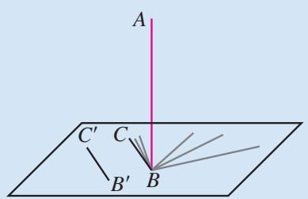  
图8.6-8

事实上，随着时间的变化，尽管影子BC的位置在不断地变化，但是旗杆AB所在直线始终与影子BC所在直线垂直．也就是说，旗杆AB所在直线与地面上任意一条过点B的直线垂直.对于地面上不过点B的任意一条直线 $B ^ { \prime } C ^ { \prime }$ ，总能在地面上找到过点B的一条直线与之平行，根据异面直线垂直的定义，可知旗杆AB所在直线与直线 $B ^ { \prime } C ^ { \prime }$ 也垂直．因此，旗杆AB所在直线与地面上任意一条直线都垂直

一般地，如果直线l与平面α内的任意一条直线都垂直，我们就说直线l 与平面α互相垂直，记作 $l \perp \alpha .$ 直线 l 叫做平面α的垂线，平面α叫做直线l的垂面．直线与平面垂直时，它们唯一的公共点P叫做垂足.

画直线与平面垂直时，通常把直线画成与表示平面的平行四边形的一边垂直，如图8.6-9所示.

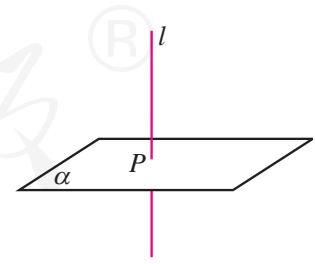  
图 8.6-9

## 思考

在同一平面内，过一点有且只有一条直线与已知直线垂直．将这一结论推广到空间，过一点垂直于已知平面的直线有几条？为什么？

可以发现，过一点垂直于已知平面的直线有且只有一条.

过一点作垂直于已知平面的直线，则该点与垂足间的线段，叫做这个点到该平面的垂线段，垂线段的长度叫做这个点到该平面的距离.

下面我们来研究直线与平面垂直的判定，即探究直线与平面垂直的充分条件.

根据定义可以进行判断，但无法验证一条直线与一个平面内的所有直线都垂直．那么，有没有可行的方法？

在棱锥的体积公式中，棱锥的高就是棱锥的顶点到底面的距离.

## 探究

如图8.6-10，准备一块三角形的纸片ABC，过△ABC的顶点A翻折纸片，得到折痕AD，将翻折后的纸片竖起放置在桌面上（BD，DC与桌面接触）.

（1） 折痕 AD 与桌面垂直吗？

(2)如何翻折才能使折痕AD 与桌面垂直？为什么？

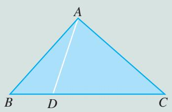  
图8.6-10

容易发现，AD所在直线与桌面所在平面α垂直（图8.6-11）的充要条件是折痕AD是BC边上的高．这时，由于翻折之后垂直关系不变，所以直线AD与平面α内的两条相交直线BD，DC都垂直.

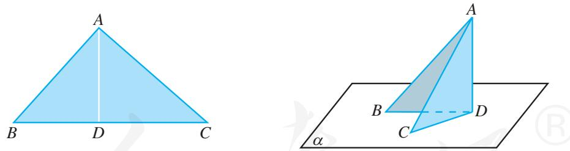  
图8.6-11

事实上，由基本事实的推论2，平面α可以看作由两条相交直线BD，DC所唯一确定的，所以当直线AD垂直于这两条相交直线时，就能保证直线AD与α内所有直线都垂直.

一般地，我们有如下判定直线与平面垂直的定理

定理如果一条直线与一个平面内的两条相交直线垂直，那么该直线与此平面垂直.

它可以用符号表示为：

$$
m \subset \alpha , n \subset \alpha , m \cap n = P , l \bot m , l \bot n \Rightarrow l \bot \alpha .
$$

定理体现了“直线与 平面垂直”和“直线与直 线垂直”的互相转化.

## 3 思考

两条相交直线可以确定一个平面，两条平行直线也可以确定一个平面，那么定理中的“两条相交直线”可以改为“两条平行直线”吗？你能从向量的角度解释原因吗？如果改为“无数条直线”呢？

例3 求证：如果两条平行直线中的一条直线垂直于一个平面，那么另一条直线也垂直于这个平面.

已知：如图8.6-12， $a / / b , \ a \perp \alpha$ ，求证 $b \perp \alpha$

分析：要证明直线 $b \perp \alpha$ ，根据直线与平面垂直的判定定理可知，只需证明直线b垂直于平面α内的两条相交直线即可.

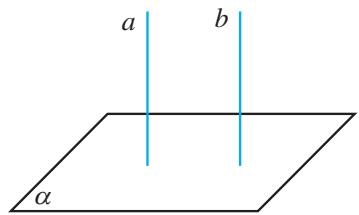  
图 8.6-12

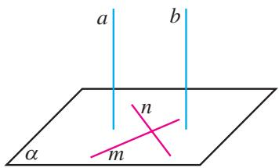  
图8.6-13

证明：如图8.6-13，在平面α内取两条相交直线m，n.$\because$ 直线 $a \perp \alpha$   
$\therefore a \bot m , a \bot n .$   
$\because b / / a ,$   
$\therefore b \bot m , b \bot n .$   
又 $m \subset \alpha , n \subset \alpha , m$ ，n是两条相交直线，  
$\therefore b \bot \alpha .$

你能用直线与平面垂直的定义证明这个结论吗？

如图8.6-14，一条直线l与一个平面α相交，但不与这个平面垂直，这条直线叫做这  
个平面的斜线，斜线和平面的交点A叫做斜足.过斜线上斜足以外的一点P向平面α引  
垂线PO，过垂足O和斜足A的直线AO叫做斜线在这个平  
面上的射影．平面的一条斜线和它在平面上的射影所成的  
角，叫做这条直线和这个平面所成的角 如果 AB 是平面 α 内 如果 AB 是平面 α 内

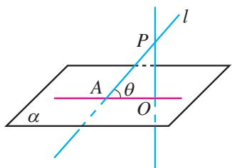  
图8.6-14

的任意一条不与直线AO重合的直线，那么直线PA 与直线AB 所成的角和直线PA 与这个平面所成的角的大小关系是什么？

一条直线垂直于平面，我们说它们所成的角是 $9 0 ^ { \circ }$ ；一条直线和平面平行，或在平面内，我们说它们所成的角是 $0 ^ { \circ }$ .直线与平面所成的角θ的取值范围是 $0 ^ { \circ } \leqslant \theta \leqslant 9 0 ^ { \circ }$

例4 如图8.6-15，在正方体 $A B C D - A _ { 1 } B _ { 1 } C _ { 1 } D _ { 1 }$ 中，求直线$A _ { 1 } B$ 和平面 $A _ { 1 } D C B _ { 1 }$ 所成的角.

分析：关键是找出直线 $A _ { 1 } B$ 在平面 $A _ { 1 } D C B _ { 1 }$ 上的射影.

解：连接 $B C _ { 1 } , \ B C _ { 1 }$ 与 $B _ { 1 } C$ 相交于点O，连接 $A _ { 1 } O$ 设正方体的棱长为a.

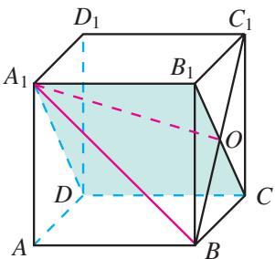

$$
\begin{array} { r l } { \because } & { { } A _ { 1 } B _ { 1 } \bot B _ { 1 } C _ { 1 } , \ A _ { 1 } B _ { 1 } \bot B _ { 1 } B , \ B _ { 1 } C _ { 1 } \bigcap B _ { 1 } B = B _ { 1 } , } \end{array}
$$

$\therefore \quad A _ { 1 } B _ { 1 } \bot$ 平面 $B C C _ { 1 } B _ { 1 }$

图 8.6-15

$$
\therefore A _ { 1 } B _ { 1 } \bot B C _ { 1 } .
$$

又 $B C _ { 1 } \bot B _ { 1 } C$

$\therefore B C _ { 1 } \bot$ 平面 $A _ { 1 } D C B _ { 1 }$

$\therefore A _ { 1 } O$ 为斜线 $A _ { 1 } B$ 在平面 $A _ { 1 } D C B _ { 1 }$ 上的射影， $\angle B A _ { 1 } O$ 为 $A _ { 1 } B$ 和平面 $A _ { 1 } D C B _ { 1 }$ 所成的角.

在 $\mathrm { R t } \triangle A _ { 1 } B O$ 中， $A _ { 1 } B = \sqrt { 2 } a$ $B O { = } \frac { \sqrt { 2 } } { 2 } a$

$$
\therefore B O = { \frac { 1 } { 2 } } A _ { 1 } B .
$$

$$
\therefore \angle B A _ { 1 } O = 3 0 ^ { \circ } .
$$

∴直线 $A _ { 1 } B$ 和平面 $A _ { 1 } D C B _ { 1 }$ 所成的角为 $3 0 ^ { \circ }$

## 练习

1. 如果两条直线和一个平面所成的角相等，那么这两条直线一定平行吗？

2. 如图，四棱锥 S-ABCD的底面是正方形，SD⊥平面 ABCD，求证：AC⊥平面 SDB.

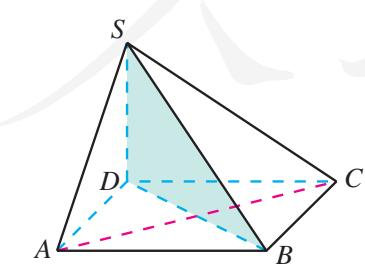  
(第2题)

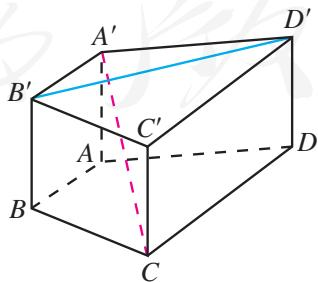  
(第3题)

3. 如图，在直四棱柱 $A ^ { \prime } B ^ { \prime } C ^ { \prime } D ^ { \prime } { - } A B C D$ 中，当底面四边形ABCD满足什么条件时， $A ^ { \prime } C \bot B ^ { \prime } D ^ { \prime } ?$

4. 过 $\triangle A B C$ 所在平面α外一点P，作 $P O \bot \alpha$ ，垂足为O，连接PA，PB，PC.

(1) 若 $P A = P B = P C$ ，则点O是 $\triangle A B C$ 的 心.

(2) 若 $P A = P B = P C , \angle C = 9 0 ^ { \circ }$ ，则点O是AB边的 点.

(3) 若 $P A \perp P B , \ P B \perp P C , \ P C \perp P A$ ，垂足都为P，则点O是△ABC的\_心.

下面我们研究直线与平面垂直的性质，即探究在直线 $a$ 与平面α垂直的条件下能推出哪些结论.

根据已有经验，我们可以探究直线a与平面α内的直线的关系．但由定义，a与α内的所有直线都垂直．所以，可以探究a，α与其他直线或平面的关系.

我们知道，在平面内，垂直于同一条直线的两条直线平行．在空间中是否有类似的性质呢?

## 观察

（1）如图8.6-16，在长方体 $A B C D - A ^ { \prime } B ^ { \prime } C ^ { \prime } D ^ { \prime }$ 中，棱 $A A ^ { \prime }$ $B B ^ { \prime }$ $C C ^ { \prime }$ $D D ^ { \prime }$ 所在直线都垂直于平面ABCD，它们之间具有什么位置关系？

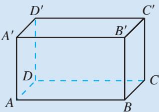  
图8.6-16

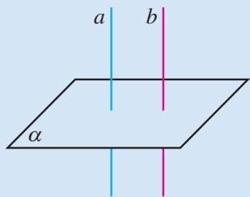  
图8.6-17

(2) 如图 8.6-17，已知直线 a，b 和平面 α．如果 $a \perp \alpha , \ b \perp \alpha$ ，那么直线a，b一定平行吗？

可以发现，这些直线相互平行．不失一般性，我们以（2）为例加以证明．如图8.6-18，假设b与 $a$ 不平行，且 $b \cap \alpha = O$ 显然点O不在直线a上，所以点O与直线a可确定一个平面，在该平面内过点O作直线 $b ^ { \prime } / / a$ ，则直线b与 $b ^ { \prime }$ 是相交于点O的两条不同直线，所以直线b与 $b ^ { \prime } \overrightarrow { \Pi }$ 确定平面 $\beta$ ，设 $\alpha \cap \beta = c$ ，则 $O \in c$ 因为 $a \perp \alpha , \ b \perp \alpha$ ，所以$a \perp c , b \perp c$ ．又因为 $b ^ { \prime } / / a$ ，所以 $b ^ { \prime } \bot c$ 这样在平面 $\beta$ 内，经过直线c上同一点O就有两条直线 $b , \ b ^ { \prime }$ ′与c垂直，显然不可能.因此b∥/a. $b / / a$ 0

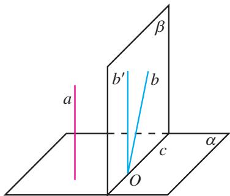  
图8.6-18

由于无法把两条直线a，b归入到一个平面内，所以在定理的证明中，无法应用平行直线的判定知识，也无法应用基本事实4. 在这种情况下我们采用了“反证法”.

这样，我们得到了直线与平面垂直的一条性质定理：

定理 垂直于同一个平面的两条直线平行

直线与平面垂直的性质定理告诉我们，可以由两条直线与一个平面垂直判定这两条直线互相平行．直线与平面垂直的性质定理揭示了“平行”与“垂直”之间的内在联系.

在 $a \perp \alpha$ 的条件下，如果平面α外的直线b与直线a垂直，你能得到什么结论？如果平面 $\beta$ 与平面α平行，你又能得到什么结论？

你还能自己提出更多的问题，发现更多的结论吗？

例5 如图8.6-19，直线l平行于平面α，求证：直线l 上各点到平面α的距离相等.

证明：过直线l上任意两点A，B分别作平面α的垂线 $A A _ { 1 } , \ B B _ { 1 }$ ，垂足分别为 $A _ { 1 } , \ B _ { 1 }$

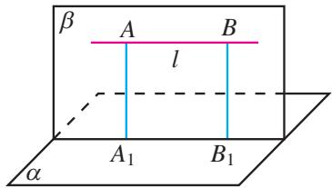

$$
\because { \cal A } \ = _ { 1 } \perp \alpha , { \cal B } \ = _ { 1 } \perp \alpha ,
$$

图8.6-19

$$
\therefore A A _ { 1 } / / \ B B _ { 1 } .
$$

设直线 $A A _ { 1 } , \ B B$ 1确定的平面为 $\beta , \ \beta \cap \alpha = A _ { 1 } B _ { 1 }$

$$
\because l / / \alpha ,
$$

$$
\therefore l / / A _ { 1 } B _ { 1 } .
$$

$\therefore$ 四边形 $A A _ { 1 } B _ { 1 } B$ 是矩形.

$$
\therefore A A _ { 1 } = B B _ { 1 } .
$$

由A，B是直线l上任取的两点，可知直线l上各点到平面α的距离相等.

一条直线与一个平面平行时，这条直线上任意一点到这个平面的距离，叫做这条直线到这个平面的距离．由例5我们还可以进一步得出，如果两个平面平行，那么其中一个平面内的任意一点到另一个平面的距离都相等，我们把它叫做这两个平行平面间的距离. S

在棱柱、棱台的体积公式中，它们的高就是它们的底面间的距离.

例6 推导棱台的体积公式

$$
V _ { \ast \ast  } = \frac { 1 } { 3 } h ( S ^ { \prime } + \sqrt { S ^ { \prime } S } + S ) ,
$$

其中 $S ^ { \prime }$ ，S分别是棱台的上、下底面面积，h是高.

解：如图8.6-20，延长棱台各侧棱交于点P，得到截得棱台的棱锥.过点P作棱台的下底面的垂线，分别与棱台的上、下底面交于点$O ^ { \prime } , O$ ，则PO垂直于棱台的上底面（想一想，为什么？)，从而 $O ^ { \prime } O { = } h$

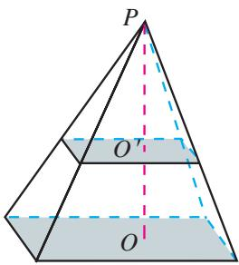  
图8.6-20

设截得棱台的棱锥的体积为V，去掉的棱锥的体积为 $V ^ { \prime }$ 、高为 $h ^ { \prime }$ ，则 $P O ^ { \prime } = h ^ { \prime }$ 于是

$$
V ^ { \prime } { = } \frac { 1 } { 3 } S ^ { \prime } h ^ { \prime } , ~ V { = } \frac { 1 } { 3 } S ( h ^ { \prime } { + } h ) .
$$

所以棱台的体积

$$
V _ { \oplus \oplus \spadesuit } = V - V ^ { \prime } = \frac { 1 } { 3 } S ( h ^ { \prime } + h ) - \frac { 1 } { 3 } S ^ { \prime } h ^ { \prime } = \frac { 1 } { 3 } \lbrack S h + ( S - S ^ { \prime } ) h ^ { \prime } \rbrack .\tag{①}
$$

由棱台的上、下底面平行，可以证明棱台的上、下底面相似，并且

$$
\frac { S ^ { ' } } { S } { = } \frac { h ^ { ' 2 } } { ( { h ^ { ' } { + } h } ) ^ { 2 } } ,
$$

所以

$$
{ h ^ { \prime } } \mathrm { { = } } \frac { \sqrt { S ^ { ' } } h } { { \sqrt { S } } - { \sqrt { S ^ { ' } } } } .
$$

①请你自己证明这个结论.

代入①，得

$$
\begin{array} { c } { { V _ { \tt t a f } { = } { \displaystyle \frac { 1 } { 3 } } h \left[ S + ( S { - } S ^ { \prime } ) \ \frac { \sqrt { S ^ { \prime } } } { \sqrt { S } - \sqrt { S ^ { \prime } } } \right] } } \\ { { { } } } \\ { { { = } { \displaystyle \frac { 1 } { 3 } } h \left( S ^ { \prime } { + } \sqrt { S ^ { \prime } S } + S \right) . } } \end{array}
$$

## 练习

1. 已知直线a，b和平面α，且 $a \perp b , ~ a \perp \alpha$ ，则b与α的位置关系是

2. 已知A，B两点在平面α的同侧，且它们与α的距离相等，求证：直线 $A B / / \alpha$

3. 如图，EA 和 DC 都垂直于平面ABC，且 $E A = 2 D C$ ，F是EB的中点，求证：DF//平面ABC.

4. 求证：垂直于同一条直线的两个平面互相平行.（提示：过这条直线作平面与这两个平面相交，则它们的交线平行.)

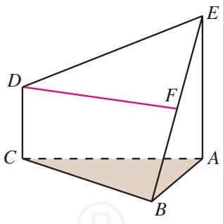  
(第3题)

## 8.6.3 平面与平面垂直

像研究直线与平面垂直一样，我们首先应给出平面与平面垂直的定义．那么，该如何定义呢？不妨回顾一下直线与平面垂直、直线与直线垂直的定义过程.

在定义直线与平面垂直时，我们利用了直线与直线的垂直．所以，直线与直线垂直是研究直线、平面垂直问题的基础.

在平面几何中，我们先定义了角的概念，利用角刻画两条相交直线的位置关系，进而研究直线与直线互相垂直这种特殊情况．类似地，我们需要先引进二面角的概念，用以刻画两个相交平面的位置关系，进而研究两个平面互相垂直

如图8.6-21，从一条直线出发的两个半平面所组成的图形叫做二面角（dihedralan-$\mathrm { g l e } )$ ．这条直线叫做二面角的棱，这两个半平面叫做二面角的面．棱为AB，面分别为α，$\beta$ 的二面角记作二面角 $\alpha \mathrm { - } A B \mathrm { - } \beta .$ ，有时为了方便，也可在α， $\beta$ 内（棱以外的半平面部分）分别取点P，Q，将这个二面角记作二面角 $P { - } A B { - } Q$ 如果棱记作l，那么这个二面角记作二面角 $\alpha { - } l { - } \beta$ 或二面角 P-l-Q.

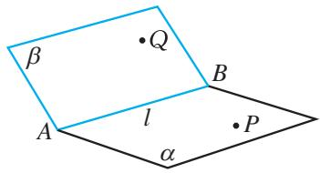  
图 8.6-21

平面内的一条直线把平面分成两部分，这两部分通常称为半平面.

## 思考

如图8.6-22，在日常生活中，我们常说“把门开大一些”，是指哪个角大一些？受此启发，你认为应该怎样刻画二面角的大小呢？

  
图8.6-22

如图8.6-23，在二面角 $\alpha { - } l { - } \beta$ 的棱l上任取一点O，以点O为垂足，在半平面α和 $\beta$ 内分别作垂直于棱l 的射线OA 和 OB，则射线 OA 和 OB 构成的 $\angle A O B$ 叫做二面角的平面角.

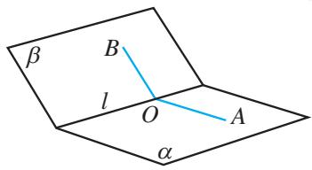  
图8.6-23

∠AOB的大小与点O在l上的位置有关吗？为什么？

二面角的大小可以用它的平面角来度量，二面角的平面角是多少度，就说这个二面角是多少度．平面角是直角的二面角叫做直二面角．二面角的平面角α的取值范围是 $0 ^ { \circ } \leqslant$ $\alpha { \leqslant } 1 8 0 ^ { \circ }$

## 观察

教室相邻的两个墙面与地面可以构成几个二面角？分别指出构成这些二面角的面、棱、平面角及其度数.

教室里的墙面所在平面与地面所在平面相交，它们所成的二面角是直二面角，我们常说墙面直立于地面上.

一般地，两个平面相交，如果它们所成的二面角是直二面角，就说这两个平面互相垂直．平面α与β垂直，记作α⊥β.

如图8.6-24，画两个互相垂直的平面时，通常把表示平面的两个平行四边形的一组边画成垂直.

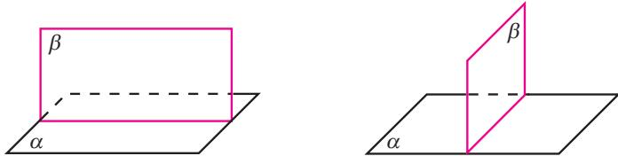  
图8.6-24

在明确了两个平面互相垂直的定义的基础上，我们研究两个平面垂直的判定和性质.先研究平面与平面垂直的判定.

## 观察

如图8.6-25，建筑工人在砌墙时，常用铅锤来检测所砌的墙面与地面是否垂直．如果系有铅锤的细线紧贴墙面，工人师傅就认为墙面垂直于地面，否则他就认为墙面不垂直于地面．这种方法说明了什么道理？

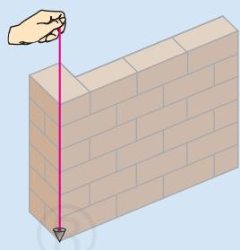  
图8.6-25

这种方法告诉我们，如果墙面经过地面的垂线，那么墙面与地面垂直．类似的结论也可以在长方体中发现．如图8.6-26，在长方体 $A B C D - A ^ { \prime } B ^ { \prime } C ^ { \prime } D ^ { \prime }$ 中，平面 $A B B ^ { \prime } A ^ { \prime }$ 经过平面ABCD的一条垂线 $A A ^ { \prime }$ ，此时，平面 $A B B ^ { \prime } A ^ { \prime }$ 垂直于平面ABCD.

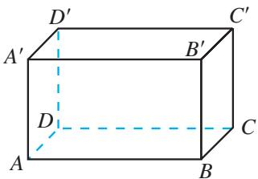

一般地，我们有下面判定两个平面互相垂直的定理：

定理 如果一个平面过另一个平面的垂线，那么这两个平面垂直.

图8.6-26

它可以用符号表示为：

$$
a \subseteq \alpha , \ a \bot \beta \Rightarrow \alpha \bot \beta .
$$

这个定理说明，可以由直线与平面垂直证明平面与平面垂直.

例7 如图8.6-27所示，在正方体 $A B C D - A ^ { \prime } B ^ { \prime } C ^ { \prime } D ^ { \prime }$ 中，求证：平面 $A ^ { \prime } B D \perp$ 平面 $A C C ^ { \prime } A ^ { \prime }$

分析：要证平面 $A ^ { \prime } B D \perp \mp$ 面 $A C C ^ { \prime } A ^ { \prime }$ ，根据两个平面垂直的判定定理，只需证明平面 $A ^ { \prime } B D$ 经过平面 $A C C ^ { \prime } A ^ { \prime }$ 的一条垂线即可.这需要利用AC，BD是正方形ABCD的对角线.

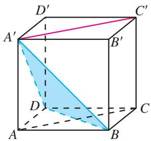

证明： $\because \quad A B C D - A ^ { \prime } B ^ { \prime } C ^ { \prime } D ^ { \prime }$ 是正方体，

∴ AA′⊥平面 ABCD,

图8.6-27

∴ AA′⊥BD.

又 BD⊥AC， AA′∩AC=A,

∴BD⊥平面 $A C C ^ { \prime } A ^ { \prime }$

∴平面 $A ^ { \prime } B D \perp$ 平面 $A C C ^ { \prime } A ^ { \prime }$

例8 如图8.6-28，AB是O的直径，PA垂直于O所在的平面，C是圆周上不同于A，B的任意一点．求证：平面 PAC⊥平面 PBC.

分析：要证明两个平面垂直，根据两个平面垂直的判定定理，只需证明其中一个平面内的一条直线垂直于另一个平面.而由直线和平面垂直的判定定理，还需证明这条直线和另一个平面内的两条相交直线垂直．在本题中，由题意可知 $B C \bot A C$ $B C \bot P A , A C \cap P A = A$ ，从而BC⊥平面PAC，进而平面$P A C \bot$ 平面 PBC.

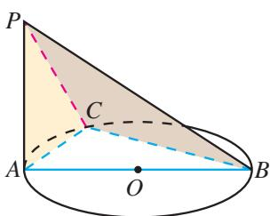  
图8.6-28

证明：∵PA⊥平面ABC，

BC⊂平面ABC,

∴ PA⊥BC.

∵ 点C是圆周上不同于A，B的任意一点，AB是O的直径，

∴ $\angle B C A = 9 0 ^ { \circ }$ ，即 $B C \bot A C$

又 $P A \cap A C = A$ ，PA⊂平面 PAC，AC⊂平面 PAC，

∴ BC⊥平面 PAC.

又 BC⊂平面 PBC，

∴平面 $P A C \bot$ 平面 $P B C$

## 练习

1. 如图，检查工件的相邻两个（平）面是否垂直时，只要用曲尺的一边紧靠在工件的一个面上，另一边在工件的另一个面上转动，观察尺边和这个面是否密合就可以了．这是为什么？

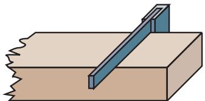

2. 已知直线 $a , \ b$ 与平面 $\alpha , ~ \beta , ~ \gamma$ ，能使 $\alpha \perp \beta$ 的充分条件是（ ）.(A) $\alpha \perp \gamma , \ \beta \perp \gamma$ (B) $\alpha \cap \beta = a , \ b \bot a , \ b \subset \beta$ (C) $a / / \beta , \ a / / \alpha$ (D) $a / / \alpha , \ a \perp \beta$

(第1题)

3. 如图， $A B \bot$ 平面 BCD, $B C \bot C D$ ，你能发现哪些平面互相垂直？为什么？

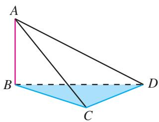  
(第3题)

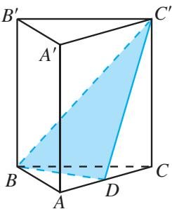  
(第4题)

4. 如图，在正三棱柱 $A B C / / B ^ { \prime } C ^ { \prime }$ 中，D为棱AC的中点．求证：平面 $B D C ^ { \prime } \perp$ 平面 $A C C ^ { \prime } A ^ { \prime }$

下面我们研究平面与平面垂直的性质，也就是在两个平面互相垂直的条件下，能推出哪些结论.

如果两个平面互相垂直，根据已有的研究经验，我们可以先研究其中一个平面内的直线与另一个平面具有什么位置关系.

## 探究

如图8.6-29，设 $\alpha \perp \beta , \alpha \cap \beta = a$ .则 $\beta$ 内任意一条直线b与a有什么位置关系？相应地，b与α有什么位置关系？为什么？

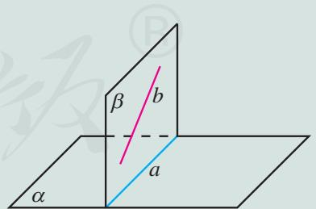  
图8.6-29

显然，b与a平行或相交．当 $b / / a$ 时， $b / / \alpha$ ；当b与a相交时，b与α也相交.

特别地，当 $b \perp a$ 时，如图 $8 , 6 \AA - 3 0$ ，设b与a的交点为A，过点A在α内作直线 $c \perp a$ 则直线b，c所成的角就是二面角 $\alpha { - } a { - } \beta$ 的平面角．由 $\alpha \perp \beta$ 知， $b \perp c$ 又因为 $b \perp a \perp a$ 和c是α内的两条相交直线，所以 $b \perp \alpha$

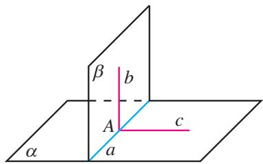  
图8.6-30

由此我们得到平面与平面垂直的性质定理：

定理两个平面垂直，如果一个平面内有一直线垂直于这两个平面的交线，那么这条直线与另一个平面垂直.

这个定理说明，由平面与平面垂直可以得到直线与平面垂直

这个性质定理可以用于解决现实生活中的问题．例如，装修房子时，要在墙壁上画出与地面垂直的直线，只需在墙面上画出地面与墙面的交线的垂线即可

## 探究

设平面α⊥平面 $\beta$ ，点Ρ 在平面α内，过点Ρ 作平面 $\beta$ 的垂线 $a$ ，直线 a 与平面α具有什么位置关系？

我们知道，过一点只能作一条直线与已知平面垂直．因此，如果过一点有两条直线与平面垂直，那么这两条直线重合.

如图8.6-31，设 $\alpha \cap \beta = c$ ，过点P在平面α内作直线 $b \perp c$ ，根据平面与平面垂直的性质定理， $b \perp \beta .$ 因为过一点有且只有一条直线与平面 $\beta$ 垂直，所以直线 $a$ 与直线b重合，因此 $a \subseteq \alpha$

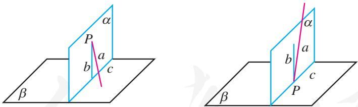  
图8.6-31

对于两个平面互相垂直的性质，我们探究了一个平面内的直线与另一个平面的特殊位置关系．如果直线不在两个平面内，或者把直线换成平面，你又能得到哪些结论？

下面的例子就是其中的一些结果.

例9如图8.6-32，已知平面 $\alpha \perp$ 平面 $\beta$ ，直线 $a \perp \beta , \ a \mathcal { Z } \alpha$ 判断 $a$ 与 $\alpha$ 的位置关系.

解：在α内作垂直于 $\alpha$ 与 $\beta$ 交线的直线b.

$$
\because \alpha \_ s \beta ,
$$

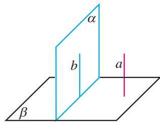  
图8.6-32

$$
\therefore \quad b \perp \beta .
$$

又a⊥β，

即直线a 与平面α平行.

例10 如图8.6-33，已知 PA⊥平面 ABC，平面 PAB⊥平面 PBC，求证：BC⊥平面PAB.

分析：要证明 BC⊥平面 PAB，需证明 BC垂直于平面 PAB 内的两条相交直线．由已知条件易得 BC⊥PA. 再利用平面 PAB⊥平面 PBC，过点 A 作 PB 的垂线 AE，由两个平面垂直的性质可得BC⊥AE.

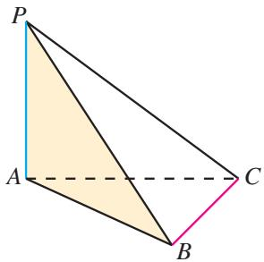  
图8.6-33

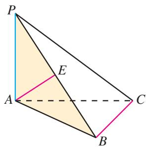  
图8.6-34

证明：如图8.6-34，过点A作AE⊥PB，垂足为E.

∵ 平面 PAB⊥平面 PBC，平面 PAB∩平面 PBC=PB，

∴ AE⊥平面 PBC.

∵ BC⊂平面 PBC，

∴ AE⊥BC.

∵ PA⊥平面ABC，BC⊂平面ABC，

∴ PA⊥BC.

又 $P A \cap A E { = } A$

∴ BC⊥平面 PAB.

从本节的讨论可以看到，由直线与直线垂直可以判定直线与平面垂直；由直线与平面垂直的定义可以得到直线与直线垂直；由直线与平面垂直可以判定平面与平面垂直；而由平面与平面垂直的性质可以得到直线与平面垂直．这进一步揭示了直线、平面之间的位置关系可以相互转化.

1. 判断下列命题是否正确，正确的在括号内画“√”，错误的画“”

（1）如果平面 $\alpha \perp$ 平面β，那么平面α内所有直线都垂直于平面β ()

(2)如果平面α⊥平面β，那么平面α内一定存在直线平行于平面β ()

（3）如果平面α不垂直于平面 $\dot { \beta }$ ，那么平面α内一定不存在直线垂直于平面β. ()

2. 若平面 $\alpha \perp$ 平面 $\beta ,$ 且 $\alpha \cap \beta = l$ ，则下列命题中正确的个数是（）.

（1）平面α内的直线必垂直于平面 $\dot { \beta }$ 内的任意一条直线.

（2）平面α内的已知直线必垂直于平面β内的无数条直线.

（3）平面α内的任一条直线必垂直于平面 $\beta .$

（4）过平面α内任意一点作交线l的垂线，则此垂线必垂直于平面β.(A) 3 (B) 2 (C) 1 (D) 0

3. 已知α，β是两个不同的平面，m为平面α内的一条直线，则 $^ { 6 6 } \alpha \perp \beta ^ { 9 }$ 是“m⊥β”的（）.（A）充分不必要条件 （B）必要不充分条件(C) 充要条件 （D）既不充分也不必要条件

4. 已知平面α，β，直线a，且 $\alpha \perp \beta , ~ \alpha \cap \beta = A B , ~ a / / \alpha , ~ a \perp A B$ ，判断直线a与平面β的位置关系，并说明理由.

## 习题8.6

## 复习巩固

## 1. 选择题

（1）若空间中四条不同的直线 $l _ { 1 } , ~ l _ { 2 } , ~ l _ { 3 } , ~ l .$ 满足 $l _ { 1 } \perp l _ { 2 } , l _ { 2 } \perp l _ { 3 } , l _ { 3 } \perp l _ { 4 }$ ，则下面结论正确的是（）.

(A) $l _ { 1 } \perp l _ { 4 }$ (B) $l _ { 1 } / / l _ { 4 }$ R

(C) $l _ { 1 } , \ l _ { 4 }$ 既不垂直也不平行 V(D) $l _ { 1 } , \ l _ { 4 }$ 的位置关系不确定

（2)设l，m，n均为直线，其中m，n在平面α内，则 $^ { 6 6 } l \perp \alpha ^ { 5 5 }$ 是 $^ { 6 6 } l \perp m$ 且 ${ \mathrm { ~ } } l { \mathrm { ~ } } \bot n ^ { \prime \prime }$ 的().

（A）充分不必要条件 （B） 必要不充分条件

(C) 充要条件 （D）既不充分也不必要条件

(3) 直线 $l _ { 1 } , \ l _ { 2 }$ 互相平行的一个充分条件是（）.(A) $l _ { 1 } , \ l _ { 2 }$ 都平行于同一个平面 (B) $l _ { 1 } , \ l _ { 2 }$ 与同一个平面所成的角相等(C) $l _ { 1 } , \ l _ { 2 }$ 都垂直于同一个平面 (D) $l _ { 1 }$ 平行于 $l _ { 2 }$ 所在的平面

2.判断下列命题是否正确，正确的在括号内画“√”，错误的画“”

（1）过平面外一点，有且只有一条直线与这个平面垂直 ()

（2）过平面外一点，有且只有一条直线与这个平面平行. (）

（3）过直线外一点，有且只有一个平面与这条直线垂直 ()（4）过直线外一点，有且只有一个平面与这条直线平行 ()（5）过直线外一点，有且只有一条直线与这条直线平行. ()

3. 判断下列命题是否正确，正确的说明理由，错误的举例说明.（1）一条直线平行于一个平面，另一条直线与这个平面垂直，则这两条直线互相垂直；（2）如果平面 $\alpha / /$ 平面 $\alpha _ { 1 }$ ，平面 $\beta /  /$ 平面 $\beta _ { 1 }$ ，那么平面α与平面β所成的二面角和平面 $\alpha _ { 1 }$ 与平面 $\beta _ { 1 }$ 所成的二面角相等或互补；（3）如果平面α⊥平面 $\beta ,$ 平面 $\beta _ { - }$ L平面γ，那么平面α⊥平面γ.

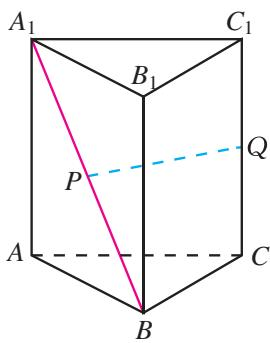

4. 如图，在直三棱柱 $A B C { - } A _ { 1 } B _ { 1 } C _ { 1 }$ 中，CA=CB，P为 $A _ { 1 } B$ 的中点，Q为棱 $C _ { 1 } C$ 的中点．求证：(1) $P Q \bot A B$ (2) $P Q \bot C _ { 1 } C ;$ (3) $P Q \bot A _ { 1 } B .$

(第4题)

5. 如图，在三棱锥P-ABC中，CD⊥AB，垂足为D，PO⊥底面ABC，垂足为O，且O在CD上，求证AB⊥PC.

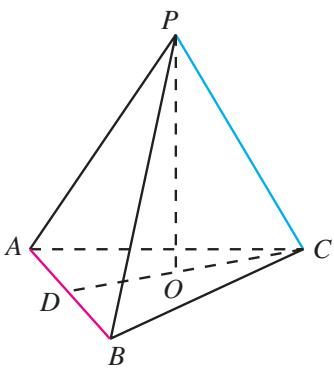  
(第5题)

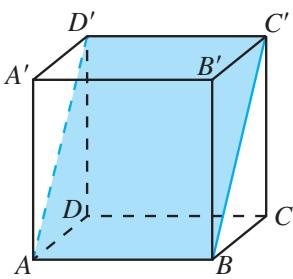  
(第6题)

6. 如图，在正方体 $A B C D - A ^ { \prime } B ^ { \prime } C ^ { \prime } D ^ { \prime }$ 中，平面 $A B C ^ { \prime } D ^ { \prime }$ 与正方体的各个面所在的平面所成的二面角的大小分别是多少？

7. 如图，在三棱锥V-ABC中，已知 $\angle V A B = \angle V A C = \angle A B C =$ $9 0 ^ { \circ }$ ，判断平面VAB与平面VBC的位置关系，并说明理由.

8. 求证：如果共点的三条直线两两垂直，那么它们中每两条直线 确定的平面也两两垂直

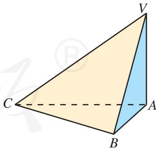

9. 已知平面 $\alpha , ~ \beta , ~ \gamma ,$ 且 $\alpha \perp \gamma , \ \beta / / \alpha$ ，求证 $\beta \perp \gamma .$

10. 已知平面 $\alpha , ~ \beta , ~ \gamma$ ，且 $\alpha \perp \gamma , \ \beta \perp \gamma , \ \alpha \cap \beta = l$ ，求证l⊥γ.

(第 7题)  

## 综合运用

11. 如下页图，在正方体 $A B C D - A _ { 1 } B _ { 1 } C _ { 1 } D _ { 1 }$ 中，点P，Q分别为棱AD， $\mathrm { C C _ { 1 } }$ 的中点.求证 $A _ { 1 } P$ $\perp B Q$

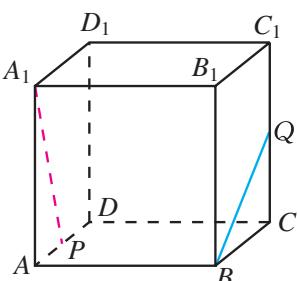  
(第11题)

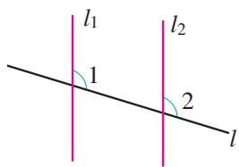

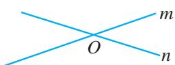  
(第12题)

12. 如图，m，n是两条相交直线， $l _ { 1 } , \ l _ { 2 }$ 是与m，n都垂直的两条直线，且直线l与 $l _ { 1 }$ ， $l _ { 2 }$ 都相 交，求证 $\angle 1 = \angle 2 .$

13. 求证：两条平行直线与同一个平面所成的角相等.

14. 如图，在棱锥 V-ABC 中，VO⊥平面 ABC， $O \in C D$ ，VA=VB，AD=BD，你能判定 $C D \perp$ AB，以及 AC=BC 吗？

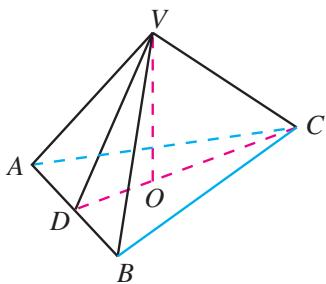  
(第14题)

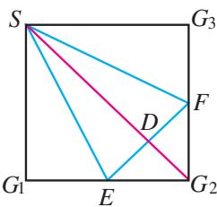  
(第15题)

15. 如图，在正方形 $S G _ { 1 } G _ { 2 } G _ { 3 }$ 中，E，F分别是 $G _ { 1 } G _ { 2 } , G _ { 2 } G _ { 3 }$ 的中点，D是EF的中点．若沿SE，SF及EF把这个正方形折成一个四面体，使 $G _ { 1 } , G _ { 2 } , G _ { 3 }$ 三点重合，重合后的点记为G，则在四面体S-EFG中，哪些棱与面互相垂直？ V

16.求证：垂直于两个平行平面中的一个平面的直线也垂直于另一个平面.

17. 求证：三个两两垂直的平面的交线也两两垂直

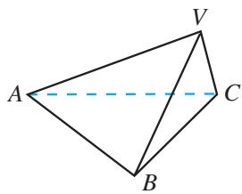

18. 如图，在三棱锥V-ABC中， $V A = V B = A B = A C = B C = 2 , \ V C = 1$ 作出二面角V-AB-C的平面角，并求出它的余弦值

(第18题)  

## 拓广探索

19. 如图，在直三棱柱 $A B C { - } A _ { 1 } B _ { 1 } C _ { 1 }$ 中， $\angle A B C = 9 0 ^ { \circ } , \ A A _ { 1 } = A B$ ，求证 $\boldsymbol { A } _ { 1 } \boldsymbol { C } \perp \boldsymbol { A } \boldsymbol { B } _ { 1 }$

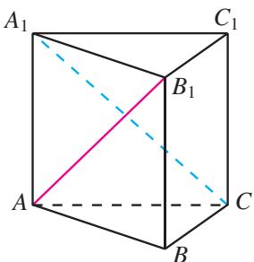  
(第19题)

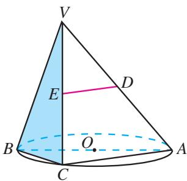  
(第20题)

20.如上页图，AB是O的直径，点C是O上的动点，过动点C的直线VC垂直于⊙O所在平面，D，E分别是VA，VC的中点．判断直线DE与平面VBC的位置关系，并说明理由.

21.如图，在四棱锥P-ABCD中，底面ABCD为正方形，PA底面ABCD，PA=AB，E 为线段PB 的中点，F为线段 BC上的动点．平面AEF与平面PBC是否互相垂直？如果垂直，请证明；如果不垂直，请说明理由.

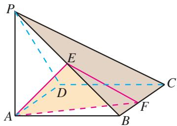  
(第21题)

## 2 阅读与思考

## 欧几里得《原本》与公理化方法

古希腊最为重要的数学著作《原本》是由古希腊数学家欧几里得编著，大约是在公元前300年左右完成的．欧几里得将公元前7世纪以来希腊几何学家积累起来的丰富成果收集、整理起来，并且加以系统化.他从少数已被经验反复验证的公理出发，运用逻辑推理以及数学运算方法演绎出一系列定理与推论，写成了十三卷数学巨著《原本》，使几何学成为一门独立的、演绎的科学.

欧几里得《原本》在人类数学史中第一次给出了公理化的数学体系．过去所积累下来的数学知识是零碎的、片断的，欧几里得借助逻辑方法，把这些知识组织起来，加

欧几里得（Euclid，约公元前330—约前275）

以分类、比较，揭示彼此间的内在联系，把它们组织在一个严密的系统之中，《原本》体现的理性精神对数学的发展产生了深远影响，它跨越地域、民族、语言、时间的障碍传播到了整个世界，其中公理化方法作为一种理论形式为人们普遍接受．按照数学的定义、公理与三段论的逻辑论证来组织数学理论已成为人们的共识．《原本》为数学发展树起一面旗帜，并成为理性思维的象征.

什么是公理化方法呢？

公理化方法就是从尽可能少的原始概念（基本概念）和尽可能少的一组不加证明的原始命题（公理、公设）出发，通过严格的逻辑推理，推导出其余的命题，使某一数学分支成为演绎系统的一种方法.

基本概念是不加定义的，它们必须是真正基本的，无法用更原始、更基本的概念定义．如中学数学中的点、直线、平面、集合等概念都是基本概念.

公理是对基本概念间的相互关系和基本性质所作的一种阐述和规定．如“两点确定一条直线”“过不在同一条直线上的三个点，有且只有一个平面”等都是作为公理的命题.

公理化方法主要有以下三个作用：

1. 概括整理数学知识.《原本》就是欧几里得用公理化的方法把零散的几何知识归为一体，树立了以公理化方法研究数学的典范.

2. 促进新理论的创立. 由于公理化方法把数学分支的基础分析得十分清楚，结构严谨有序，这就有利于比较数学各分支实质上的异同，从而推动和促进数学新理论的产生，促进数学基础的研究与探索．例如，非欧几何就是在研究和应用公理化的过程中产生的.

3. 对其他学科有示范作用.由于数学公理化方法表述数学理论的简捷性、条理性，以及结构的和谐性，为其他科学理论的表述起了示范作用．其他科学纷纷效法，建立了自己的公理化系统．例如，牛顿仿效欧氏几何，把哥白尼到开普勒时期所积累的力学知识用公理化方法组成一个逻辑体系，使人们能够从万有引力定律（公理）和牛顿三定律（公理）出发，依逻辑方法把力学定律逐条推出．杰弗逊的《独立宣言》、马克思的《资本论》、马尔萨斯的《人口论》也都借鉴了公理化的思想方法.

《原本》是一部影响人类文明进程的不朽之作．两千多年来，它一直是几何学的标准教材，哥白尼、伽利略、笛卡儿、牛顿等伟大的科学家都对它做过深入钻研，深刻体会了其中的公理化方法，并借鉴到自己的科学工作中，从而对人类文明作出了伟大贡献.

## 文献阅读与数学写作\*

## 几何学的发展

目的：了解欧氏几何的发展以及对数学和人类文明的贡献.

要求：题目自拟，主题突出，论述清楚.

过程：阅读书籍、请教老师、专家或者上网收集欧氏几何发展的历史资料，如发展过程、重要结果、主要人物、关键事件以及对数学和人类文明的贡献等.

交流：将论文发至班级在线交流群，或者制作板报等，供大家学习、交流，进一步了解欧氏几何对数学以及人类文明的贡献

## 沪教版2026：10.3 直线与平面的位置关系

来源：沪教版必修第三册2026-dollar-polished.md（本地转写稿），转写稿第 866—1742 行；截至下一指定标题前。

## 10.3 直线与平面的位置关系

一条直线和一个平面的位置关系有且只有以下三种:

1. 直线在平面上一一有无数个公共点;
2. 直线和平面相交 - 只有一个公共点;
3. 直线和平面平行一一没有公共点.

### 1 直线与平面平行

上面我们已按照直线与平面的公共点的个数来划分了空间直线与平面的位置关系, 其中, 当直线与平面没有公共点时, 我们说直线与平面平行, 并沿用平面几何中的平行符号来表示, 如 $l//\alpha$ . 但是,因为直线与平面都是无限延伸的,要直接判断直线与平面是否有公共点往往是比较困难的, 所以我们需要一个简便的直线与平面平行的判定定理.

观察房门的转动情景可以看到, 房门开启后, 无论门转到什么位置，房门外沿所在的直线始终都是和门框所在的平面平行的. 这是因为房门的外沿与内沿是平行的, 而在房门的转动过程中, 内沿始终都在门框所在的平面上. 由此可以引出下面的直线与平面平行的判定定理:

直线与平面平行的判定定理 如果不在平面上的一条直线与这个平面上的一条直线平行, 那么该直线与这个平面平行.

下面, 用反证法来证明这个定理.

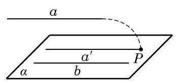

图 10-3-1

已知: 如图 10-3-1,直线 $a$ 不在平面 $\alpha$ 上,直线 $b$ 在平面 $\alpha$ 上,且 $a//b$ .

求证: 直线 $a//$ 平面 $\alpha$ .

证明 假设直线 $a$ 不平行于平面 $\alpha$ ,则直线 $a$ 与平面 $\alpha$ 有公共点,设为点 $P$ . 在平面 $\alpha$ 上,过点 $P$ 作已知直线 $b$ 的平行线

 ${a}^{\prime }$ . 因为 $a$ 不在 $\alpha$ 上,所以 ${a}^{\prime }$ 与 $a$ 不重合. 另一方面,因为 $a// \; b,{a}^{\prime }//b$ ,所以 ${a}^{\prime }//a$ ,这和 $a$ 与 ${a}^{\prime }$ 交于点 $P$ 矛盾. 所以原假设不成立,从而 $a//\alpha$ .

依据上述判定定理,要判定不在平面上的一条直线与这个平面平行, 只要在此平面上找到此直线的一条平行线即可.

证明 如图 10-3-2,因为棱 $B{B}_{1}$ 平行且等于棱 $D{D}_{1}$ ,所以 $B{B}_{1}{D}_{1}D$ 是平行四边形,从而 ${BD}//{B}_{1}{D}_{1}$ . 因为直线 ${B}_{1}{D}_{1}$ 在平面 $A{B}_{1}{D}_{1}$ 上,而直线 ${BD}$ 不在平面 $A{B}_{1}{D}_{1}$ 上,由上述判定定理,得到直线 ${BD}//$ 平面 $A{B}_{1}{D}_{1}$ .

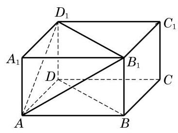

图 10-3-2

例 1 在长方体 ${ABCD} - {A}_{1}{B}_{1}{C}_{1}{D}_{1}$ 中,证明直线 ${BD}$ 平行于平面 $A{B}_{1}{D}_{1}$ .

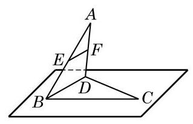

图 10-3-3

例 2 证明: 空间四边形相邻两边中点的连线, 必平行于经过另外两边的平面.

已知: 如图 10-3-3,在空间四边形 ${ABCD}$ 中,设 $E\text{ 、 }F$ 分别是两边 ${AB}\text{ 、 }{AD}$ 的中点.

求证: ${EF}//$ 平面 ${BCD}$ .

证明 连接 ${BD}$ . 在 $\bigtriangleup {ABD}$ 中,中位线 ${EF}$ 必平行于边 ${BD}$ .

因为 ${BD}$ 在平面 ${BCD}$ 上,而 ${EF}$ 不在平面 ${BCD}$ 上,由上述判定定理,得到 ${EF}//$ 平面 ${BCD}$ .

#### 练习 10.3(1)

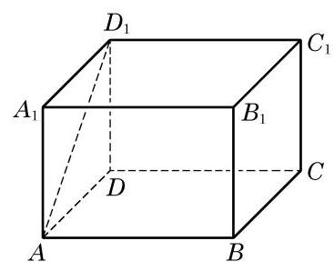

(第 1 题)

1. 如图,在长方体 ${ABCD} - {A}_{1}{B}_{1}{C}_{1}{D}_{1}$ 的 6 个面中,

(1)与 ${AB}$ 平行的平面是___.

(2)与 $A{D}_{1}$ 平行的平面是___.

2. 判断下列命题的真假, 并说明理由:

(1)若直线 $a$ 上有无数个点不在平面 $\alpha$ 上，则 $a//\alpha$ ；

(2)若直线 $a$ 与平面 $\alpha$ 上的一条直线平行,则 $a$ 与平面 $\alpha$ 上的任意一条直线都平行;

(3)若两条平行直线中的一条平行于一个平面，则另一条直线也平行于这个平面；

(4)设直线 $a$ 在平面 $\alpha$ 上，直线 $b$ 不在平面 $\alpha$ 上，并且 $a//b$ ，则 $b//\alpha$ .

3. 若直线 $l$ 不平行于平面 $\alpha$ ,且 $l$ 不在平面 $\alpha$ 上,判断下列结论是否成立,并说明理由:

(1)平面 $\alpha$ 上的所有直线都与 $l$ 异面;

(2)平面 $\alpha$ 上不存在与 $l$ 平行的直线；

(3)平面 $\alpha$ 上存在唯一的一条直线与 $l$ 平行；

(4)平面 $\alpha$ 上的直线都与 $l$ 相交.

如果一条直线和一个平面平行, 那么这个平面上是否一定可以找到与这条直线平行的直线呢? 有下面的定理.

直线与平面平行的性质定理 如果一条直线与一个平面平行, 过这条直线的一个平面与此平面相交, 那么其交线必与该直线平行.

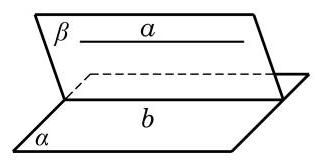

图 10-3-4

如图 10-3-4,已知直线 $a$ 与平面 $\alpha$ 平行,过直线 $a$ 的一个平面 $\beta$ 与平面 $\alpha$ 相交于直线 $b$ .

求证: $a//b$ .

证明 由 $a//\alpha$ ,故 $a$ 和 $\alpha$ 没有公共点.

又因为 $b \subset  \alpha$ ,所以 $a$ 和 $b$ 没有公共点.

因为 $a$ 和 $b$ 同在平面 $\beta$ 上,且没有公共点,所以 $a//b$ .

图 10-3-5

例 3 在如图 10-3-5 所示的一块多面体木料中,棱 ${BC}$ 平行于平面 ${A}^{\prime }{B}^{\prime }{C}^{\prime }{D}^{\prime }$ .

(1)要经过平面 ${A}^{\prime }{B}^{\prime }{C}^{\prime }{D}^{\prime }$ 上的一点 $P$ 和棱 ${BC}$ 将木料锯开, 应怎样画线?

(2)所画的线与平面 ${ABCD}$ 是什么位置关系？

解(1)因为 ${BC}$ 平行于平面 ${A}^{\prime }{B}^{\prime }{C}^{\prime }{D}^{\prime }$ ,平面 ${BC}{C}^{\prime }{B}^{\prime }$ 经过 ${BC}$ 并与平面 ${A}^{\prime }{B}^{\prime }{C}^{\prime }{D}^{\prime }$ 交于 ${B}^{\prime }{C}^{\prime }$ ,由上述定理,得 ${BC}//{B}^{\prime }{C}^{\prime }$ .

图 10-3-6

在平面 ${A}^{\prime }{B}^{\prime }{C}^{\prime }{D}^{\prime }$ 上,过点 $P$ 作直线 ${EF}$ ,使 ${EF}//{B}^{\prime }{C}^{\prime }$ , ${EF}$ 分别交棱 ${A}^{\prime }{B}^{\prime }\text{ 、 }{C}^{\prime }{D}^{\prime }$ 于点 $E\text{ 、 }F$ . 连接 ${BE}\text{ 、 }{CF}$ ,则 ${EF}$ 、 ${BE}$ 及 ${CF}$ 就是应画的线,如图 10-3-6 所示.

(2)所画的线中， ${BE}\text{ 、 }{CF}$ 显然都与平面 ${ABCD}$ 相交. 又因为 ${EF}//{{B}^{\prime }{C}^{\prime }}$ ，从而 ${EF}//{BC}$ . 因此，由前述的判定定理，有 ${EF}//$ 平面 ${ABCD}$ .

#### 练习 10.3(2)

1. 判断下列命题的真假, 并说明理由:

(1)若两直线 $a$ 、 $b$ 互相平行，则 $a$ 平行于经过 $b$ 的任何平面；

(2)若直线 $a$ 与平面 $\alpha$ 平行，则 $a$ 平行于 $\alpha$ 内的任何直线；

(3)若两直线 $a\text{ 、 }b$ 都与平面 $\alpha$ 平行，则 $a//b$ ；

(4)若直线 $a$ 平行于平面 $\alpha$ ，直线 $b$ 在平面 $\alpha$ 上，则 $a//b$ 或者 $a$ 与 $b$ 为异面直线.

2. 证明: 若不在给定平面上的两条平行直线中的一条平行于给定平面, 则另一条直线也平行于给定平面.
3. 设直线 $a//$ 平面 $\alpha$ ,求证: 过 $a$ 任意作与 $\alpha$ 相交的平面,所有这些平面与 $\alpha$ 的交线都是平行的.

### 2 直线与平面垂直

如图 10-3-7,将书打开直立在桌面上,观察书的书脊 ${AB}$ 和各页与桌面的交线的位置关系,可以发现: 书脊 ${AB}$ 所在的直线,和每一页与桌面的交线都是垂直的. 这时,我们说书脊 ${AB}$ 所在的直线垂直于桌面所在的平面.

图 10-3-7

日常生活中, 旗杆与地面、桥柱与水面等, 都给我们以一条直线和一个平面垂直的形象.

定义 如果一条直线与平面上的任意一条直线都垂直, 就说这条直线与这个平面互相垂直.

图 10-3-8

如果直线 $l$ 与平面 $\alpha$ 垂直,我们记作 $l\bot \alpha$ . 这时,直线 $l$ 叫做平面 $\alpha$ 的垂线 (或者法线), $l$ 与 $\alpha$ 的交点叫做垂足. 画示意图时,通常使直线 $l$ 与表示平面 $\alpha$ 的平行四边形的一边垂直 (图 10-3-8).

显然, 用上述定义来直接判断线面垂直关系是很困难的, 能否像线面平行的情形一样找到一个简便的判定定理呢?

先做一个实验: 请同学们准备一块三角形纸片 ${ABC}$ ,过 $\bigtriangleup {ABC}$ 的顶点 $A$ 翻折纸片,得到折痕 ${AD}$ . 将翻折后的纸片竖起放置在桌面上,并使得边 ${DB}\text{ 、 }{DC}$ 均在桌面上.

(1)折痕 ${AD}$ 与桌面垂直吗？

(2)如何翻折才能使折痕 ${AD}$ 与桌面所在平面 $\alpha$ 垂直？

通过实验会发现,当且仅当折痕 ${AD}$ 是边 ${BC}$ 上的高时, ${AD}$ 所在直线与桌面所在平面才垂直 (图 10-3-9).

图 10-3-10

图 10-3-9

生活中, 我们可以发现许多竖杆的底座是十字形的 (图 10-3-10)，只要竖杆与底座的两条边垂直，就可以保证竖杆垂直于地面。

由上面的实验和实际经验, 我们可以发现下面的事实.

直线与平面垂直的判定定理 如果一条直线与一个平面上的两条相交直线都垂直, 那么此直线与该平面垂直.

---

有兴趣的同学可以自己试一试证明此判定定理.

---

有了这个判定定理, 我们就可以解释上面的实验与实际经验. 例如,在图 10-3-9 中,由折痕 ${AD} \bot  {BC}$ ,而翻折保持这种垂直关系不变,从而 ${AD} \bot  {CD},{AD} \bot  {BD}$ . 因此,由上述判定定理就知道,折痕 ${AD}$ 与桌面所在的平面 $\alpha$ 垂直.

例 4 证明: 如果两条平行直线 $a\text{ 、 }b$ 中的一条 $a$ 垂直于一个平面 $\alpha$ ,那么另一条 $b$ 也垂直于这个平面 $\alpha$ .

图 10-3-11

证明 如图 10-3-11,在平面 $\alpha$ 上作两条相交直线 $m\text{ 、 }n$ . 因为 $a \bot  \alpha$ ,根据直线与平面垂直的定义,知 $a \bot  m, a \bot  n$ . 又因为 $a//b$ ,所以 $b \bot  m, b \bot  n$ . 因为 $m\text{ 、 }n$ 是平面 $\alpha$ 上的两条相交直线,所以 $b \bot$ 平面 $\alpha$ .

由例 4 可知, 如果一组平行线中的一条与一个平面垂直, 那么其他平行线也都与这个平面垂直. 我们现在考虑反过来的问题: 垂直于同一个平面的直线是否都平行呢?

答案是肯定的, 我们有下面的定理.

直线与平面垂直的性质定理 垂直于同一个平面的两条直线互相平行.

图 10-3-12

已知: $a\text{ 、 }b$ 是两条直线,且 $a \bot  \alpha , b \bot  \alpha$ (图 10-3-12).

求证: $a//b$ .

证明 用反证法. 设 $a$ 与 $b$ 不平行,直线 $b$ 与平面 $\alpha$ 的交点为 $B$ . 过点 $B$ 作直线 ${b}^{\prime }$ ,使得 ${b}^{\prime }//a$ . 由直线 $b$ 与 ${b}^{\prime }$ 确定的平面记为 $\beta$ ,设平面 $\beta$ 与平面 $\alpha$ 的交线为 $l$ . 因为 $a \bot  \alpha , b \bot  \alpha$ ,所以 $a \bot  l, b \bot  l$ ; 由 ${b}^{\prime }//a$ ,又可得出 ${b}^{\prime } \bot  l$ . 直线 $b$ 与 ${b}^{\prime }$ 都在平面 $\beta$ 上,都过点 $B$ ,且都垂直于直线 $l$ ,这与 “在同一个平面上,过一点有且只有一条直线与已知直线垂直”矛盾. 由此得到 $a//b$ .

由上述线面垂直的定义和定理可以得到下面的推论:

推论 1 过一点有且只有一个平面与给定的直线垂直.

推论 2 过一点有且只有一条直线与给定的平面垂直.

由推论 2,如图 10-3-13(1),过平面 $\alpha$ 外任意给定的一点 $M$ ,有且只有一条直线与平面 $\alpha$ 垂直,从而把点 $M$ 与垂足 $N$ 之间的距离叫做点 $M$ 到平面 $\alpha$ 的距离. 利用线面平行和线面垂直的性质定理可以证明,如果一条直线 $l$ 平行于一个平面 $\alpha$ ,那么直线 $l$ 上任意两点到平面 $\alpha$ 的距离都相等 (证明过程留作习题),从而就可以把直线 $l$ 上一点 $M$ 到平面 $\alpha$ 的距离定义为直线 $l$ 到与它平行的平面 $\alpha$ 的距离 (图10-3-13(2)).

图 10-3-13

图 10-3-14

例 5 如图 10-3-14,在正方体 ${ABCD} - {A}_{1}{B}_{1}{C}_{1}{D}_{1}$ 中,

(1)判断直线 ${AC}$ 与平面 $B{B}_{1}{D}_{1}D$ ，以及直线 ${AC}$ 与平面 ${A}_{1}{BD}$ 是否垂直,并证明你的结论;

(2)设正方体的棱长为 1，分别求点 $A$ 及直线 $A{A}_{1}$ 到平面 $B{B}_{1}{D}_{1}D$ 的距离.

解 (1) 直线 ${AC}$ 与平面 $B{B}_{1}{D}_{1}D$ 垂直. 证明如下: 由正方体的定义,知 ${B}_{1}B \bot  {AB},{B}_{1}B \bot  {BC}$ ,从而 ${B}_{1}B$ 垂直于底面 ${ABCD}$ ,所以 ${AC} \bot  {B}_{1}B$ . 因为底面是正方形,其对角线互相垂直,所以 ${AC} \bot  {BD}$ . 由于 ${B}_{1}B$ 和 ${BD}$ 是平面 $B{B}_{1}{D}_{1}D$ 内的两条相交直线,由前述的判定定理,得 ${AC} \bot$ 平面 $B{B}_{1}{D}_{1}D$ .

直线 ${AC}$ 与平面 ${A}_{1}{BD}$ 不垂直. 理由是: 因为 ${AC}//{A}_{1}{C}_{1}$ , 而 $\bigtriangleup D{A}_{1}{C}_{1}$ 是等边三角形, $\angle D{A}_{1}{C}_{1} = {60}^{ \circ  }$ ,所以直线 ${AC}$ 与平面 ${A}_{1}{BD}$ 上的一条直线 ${A}_{1}D$ 不垂直,从而直线 ${AC}$ 与平面 ${A}_{1}{BD}$ 不垂直.

(2)由(1)，知 ${AC}$ 与平面 $B{B}_{1}{D}_{1}D$ 垂直，所以 $A$ 到平面 $B{B}_{1}{D}_{1}D$ 的距离就是垂线段 ${AO}$ 的长度,它等于 $\frac{\sqrt{2}}{2}$ . 又因为 $A{A}_{1}//B{B}_{1}$ ,由直线和平面平行的判定定理,知 $A{A}_{1}//$ 平面 $B{B}_{1}{D}_{1}D$ ,从而 $A{A}_{1}$ 到平面 $B{B}_{1}{D}_{1}D$ 的距离就是点 $A$ 到平面 $B{B}_{1}{D}_{1}D$ 的距离,等于 $\frac{\sqrt{2}}{2}$ .

#### 练习 10.3(3)

1. 加工六角螺母, 只要螺母的六个侧面都是矩形, 那么六条侧棱一定都垂直于螺母的上下两面. 请说明理由.

(第 1 题)

(第 3 题)

2. 设 ${AB}$ 和 ${CD}$ 都是平面 $\alpha$ 的垂线,其垂足分别为 $B\text{ 、 }D$ . 已知 ${AB} = 2\mathrm{\;{cm}}$ , ${CD} = {5\mathrm{\;{cm}}}$ ， ${BD} = 4\mathrm{\;{cm}}$ . 求线段 ${AC}$ 的长.
3. 如图,已知 ${PA}$ 垂直于平面 $\alpha ,{PB}$ 垂直于平面 $\beta , A\text{ 、 }B$ 为相应的垂足,且 $l$ 为平面 $\alpha$ 与平面 $\beta$ 的交线. 求证: $l \bot$ 平面 ${PAB}$ .

### 3 直线与平面所成的角

不在平面上的一条直线与这个平面的位置关系, 除了平行和垂直, 还有一种更一般的位置关系, 即此直线与平面虽然相交, 但不垂直，称之为斜交. 如图 10-3-15(1)，此时直线 $l$ 称为平面 $\alpha$ 的斜线,直线 $l$ 与平面 $\alpha$ 的交点 $A$ 称为斜足.

图 10-3-15

如何度量平面的斜线与平面的倾斜程度呢? 我们在直线 $l$ 上任取一个不同于斜足的点 $P$ ,如图 10-3-15(2) 所示. 过点 $P$ 作平面 $\alpha$ 的垂线,垂足记为 $O$ . 连接 ${OA}$ ,直线 ${OA}$ 叫做斜线 $l$ 在平面 $\alpha$ 上的投影(也称射影). 线段 ${PA}$ 的投影是线段 ${OA}$ . 容易证明， 平面的一条斜线在平面上的投影与点 $P$ 的选择无关,是唯一确定的,从而可以用斜线与它的投影所成的锐角 $\theta$ 来定义此斜线与平面所成的角.

Q

定义 平面的一条斜线和它在平面上的投影所成的锐角, 叫做这条直线和这个平面所成的角.

另外, 我们约定, 如果一条直线垂直于平面, 我们说它们所成的角是直角；如果一条直线和平面平行或在该平面上，就说二者所成的角是 ${0}^{ \circ  }$ 的角.

解(1)因为 ${A}_{1}A \bot$ 平面 ${ABCD}$ ，且点 ${A}_{1}$ 在平面 ${ABCD}$ 上的射影是点 $A$ ,即 ${AB}$ 是 ${A}_{1}B$ 在平面 ${ABCD}$ 上的射影,而 ${AB}$ 与 ${A}_{1}B$ 所成的角是 ${45}^{ \circ  }$ ,所以直线 ${A}_{1}B$ 和平面 ${ABCD}$ 所成的角是 ${45}^{ \circ  }$ .

图 10-3-16

例 6 如图 10-3-16,在正方体 ${ABCD} - {A}_{1}{B}_{1}{C}_{1}{D}_{1}$ 中,

(1)求直线 ${A}_{1}B$ 和平面 ${ABCD}$ 所成的角的大小；

(2)求直线 ${D}_{1}B$ 和平面 ${ABCD}$ 所成的角的大小.

Q

(2)因为 ${D}_{1}D \bot$ 平面 ${ABCD}$ ，且点 ${D}_{1}$ 在平面 ${ABCD}$ 上的射影是点 $D$ ,所以 $\angle {D}_{1}{BD}$ 就是直线 ${D}_{1}B$ 和平面 ${ABCD}$ 所成的角. 设正方体 ${ABCD} - {A}_{1}{B}_{1}{C}_{1}{D}_{1}$ 的棱长为 $a$ . 由 ${DB} = \sqrt{2}a$ , $\tan \angle {D}_{1}{BD} = \frac{{D}_{1}D}{DB} = \frac{a}{\sqrt{2}a} = \frac{\sqrt{2}}{2}$ ,得 $\angle {D}_{1}{BD} = \arctan \frac{\sqrt{2}}{2}$ . 所以, 直线 ${D}_{1}B$ 和平面 ${ABCD}$ 所成的角是 $\arctan \frac{\sqrt{2}}{2}$ .

---

在直线与平面垂直的情况下，其投影就是相应的垂足.

借助图 10-3-16, 证明: 从平面外一点向这个平面所引的垂线段和斜线段中, (1)垂线段比斜线段都短；(2)两条斜线段相等的充要条件是它们相应的两条投影相等.

---

例 7 如图 10-3-17,设 $l$ 是平面 $\alpha$ 的一条斜线,与平面 $\alpha$ 交于点 $O,{l}^{\prime }$ 是 $l$ 在平面 $\alpha$ 上的投影， ${l}^{\prime \prime }$ 是平面 $\alpha$ 上过点 $O$ 的另一条直线， $l$ 与 ${l}^{\prime }$ 所成的角为 $\theta$ ， $l$ 与 ${l}^{\prime \prime }$ 所成的角为 $\mu$ . 求证: $\theta  < \mu$ .

图 10-3-17

---

这个例题的证明不是“纯几何”的, 但数学不同分支的知识和方法的综合运用, 有时可以快捷地解决问题.

---

证明 在 $l$ 上取异于 $O$ 的一点 $A$ ,过点 $A$ 作 ${l}^{\prime }$ 与 ${l}^{\prime \prime }$ 的垂线, 垂足分别是 $B$ 与 $C$ ,连接 ${BC}$ . 因为 ${l}^{\prime }$ 是 $l$ 在平面 $\alpha$ 上的投影, ${AB}$ 是平面 $\alpha$ 的垂线， $\bigtriangleup {ABC}$ 是直角三角形， $\angle {ABC}$ 是直角， 所以 $\left| {AB}\right|  < \left| {AC}\right|$ . 在直角三角形 ${ABO}$ 与 ${ACO}$ 中,分别有

Q

$$
\sin \theta  = \frac{\left| AB\right| }{\left| AO\right| },\sin \mu  = \frac{\left| AC\right| }{\left| AO\right| },
$$

由此可见 $\sin \theta  < \sin \mu$ . 因为在 $\left( {0,\frac{\pi }{2}}\right)$ 中正弦函数是增函数,所以 $\theta  < \mu$ .

如果 ${l}^{\prime \prime }$ 是平面 $\alpha$ 上的任意直线, $l$ 与 ${l}^{\prime \prime }$ 所成的角 $\mu$ 可以通过把 ${l}^{\prime \prime }$ 在平面 $\alpha$ 上平行移动到通过 $O$ 的位置 (不排除与 ${l}^{\prime }$ 重合的情况) 而得到. 据例 7 得知,总有 $\theta  \leq  \mu$ . 这说明了: 斜线与平面所成的角, 是这条斜线与平面内任何直线所成的角中的最小的角.

#### 练习 10.3(4)

1. 已知斜线段的长度是斜线段在平面内的投影的长的两倍, 求这条斜线和这个平面所成的角的大小.
2. 在正方体 ${ABCD} - {A}_{1}{B}_{1}{C}_{1}{D}_{1}$ 中, $E$ 是边 ${A}_{1}{D}_{1}$ 的中点.

(1)求 ${A}_{1}C$ 和面 ${AD}{D}_{1}{A}_{1}$ 所成的角的大小；

(2)求 ${EB}$ 和底面 ${A}_{1}{B}_{1}{C}_{1}{D}_{1}$ 所成的角的大小.

3. 在图 10-3-17 中,平面 $\alpha$ 上的斜线 $l$ 与平面 $\alpha$ 所成的角为 $\theta ,{l}^{\prime }$ 是 $l$ 在平面 $\alpha$ 上的投影, $O$ 是 $l$ 与平面 $\alpha$ 的交点,点 $B$ 是 $l$ 上一点 $A$ 在 $\alpha$ 上的投影, ${OC}$ 是 $\alpha$ 上的任意一条直线. 如果 $\theta  = {45}^{ \circ  },\angle {BOC} = {45}^{ \circ  }$ ,求 $\angle {AOC}$ ,并验证 $\angle {AOC} > \theta$ .

### 4 三垂线定理

关于平面的斜线及其在平面上的投影, 我们有下面的定理.

空间直线与平面

三垂线定理 平面上的一条直线和这个平面的一条斜线垂直的充要条件是它和这条斜线在平面上的投影垂直.

Q

---

在讨论空间直线的垂直关系时, 三垂线定理是一个常用的工具.

---

图 10-3-18

已知: 如图 10-3-18, $P$ 是平面 $\alpha$ 外一点, ${PA}$ 是平面 $\alpha$ 的斜线,交 $\alpha$ 于点 $A$ . 过点 $P$ 作平面 $\alpha$ 的垂线 ${PO}$ ,垂足是 $O$ ,直线 ${OA}$ 是 ${PA}$ 在平面 $\alpha$ 上的投影.

求证: 对平面 $\alpha$ 上的任一直线 $a, a \bot  {OA}$ 是 $a \bot  {PA}$ 的充要条件.

证明 先证充分性,即证明从 $a \bot  {OA}$ 可以推出 $a \bot  {PA}$ .

因为 ${PO} \bot$ 平面 $\alpha$ ,而 $a \subset  \alpha$ ,所以 ${PO} \bot  a$ . 这样,连同假设条件,直线 $a$ 垂直于两条相交直线 ${PO}$ 与 ${OA}$ ,从而它垂直于这两条相交直线所确定的平面 ${PAO}$ . 而直线 ${PA} \subset$ 平面 ${PAO}$ ,于是 $a \bot  {PA}$ .

再证必要性,即反过来从 $a \bot  {PA}$ 可以推出 $a \bot  {OA}$ .

同上,我们有 ${PO} \bot  a$ ,这个条件连同假设条件 $a \bot  {PA}$ ,推出直线 $a$ 垂直于两条相交直线 ${PO}$ 与 ${PA}$ 所确定的平面 ${PAO}$ . 而直线 ${OA} \subset$ 平面 ${PAO}$ ,于是 $a \bot  {OA}$ .

例 8 如图 10-3-19,已知正方体 ${ABCD} - {A}_{1}{B}_{1}{C}_{1}{D}_{1}$ .

求证: ${AC} \bot  B{D}_{1}$ .

图 10-3-19

?

---

在此正方体中, 还有哪些面的对角线与 $B{D}_{1}$ 垂直? 为什么? 由此能得到 $B{D}_{1}$ 垂直于哪些截面?

---

证明 直线 $B{D}_{1}$ 在平面 ${ABCD}$ 上的投影是 ${BD}$ ,显然有 ${BD} \; \bot  {AC}$ .

例 9 如图 10-3-20,小河的一侧有一条笔直的道路 $l$ , 对岸有电塔 ${AB}$ ,已知其高为 $h$ . 现只有自制的可用于测量水平角度的简易仪器和皮尺作为测量工具, 请说明还需测量的数据,然后运用三垂线定理给出求电塔顶 $A$ 与道路 $l$ 的距离 $d$ 的

图 10-3-20

由三垂线定理,就得 ${AC} \bot  B{D}_{1}$ .

公式.

---

选择满足 $\angle {CDB} = \; {45}^{ \circ  }$ (也可以是 ${30}^{ \circ  }$ 或 ${60}^{ \circ  }$ 的特殊角) 的点 $D$ 使解题过程最简洁, 得到的计算公式最简单. 其他的选择也可解决问题, 但过程和结果都更复杂.

---

解 在道路 $l$ 上取一点 $C$ ,使 ${BC} \bot  l$ ,再用测量工具在 $l$ 上另取一点 $D$ ,使 $\angle {CDB} = {45}^{ \circ  }$ ,用皮尺测得 ${CD} = a$ .

因为 ${BC}$ 是 ${AC}$ 在地面上的投影,且 ${BC} \bot  {CD}$ ,由三垂线定理,得 ${AC} \bot  {CD}$ ,从而斜线 ${AC}$ 的长度就是电塔顶 $A$ 与道路 $l$ 的距离 $d$ .

在直角三角形 ${BCD}$ 中, $\angle {BCD} = {90}^{ \circ  },\angle {CDB} = {45}^{ \circ  },{CD} \; = a$ ,故 ${BC} = a$ . 而在直角三角形 ${ABC}$ 中,由勾股定理,得 $A{C}^{2} = A{B}^{2} + B{C}^{2}$ ,故 ${AC} = \sqrt{{h}^{2} + {a}^{2}}$ ,即电塔顶 $A$ 与道路 $l$ 的距离是

$$
d = \sqrt{{h}^{2} + {a}^{2}},
$$

其中 $h$ 是电塔的高度, $a$ 是道路 $l$ 上所取两个点 $C$ 与 $D$ 之间的距离.

#### 练习 10.3(5)

1. 过 $\bigtriangleup {ABC}$ 所在平面 $\alpha$ 外的一点 $P$ ,作 ${PO} \bot  \alpha$ ,垂足为 $O$ ,连接 ${PA}\text{ 、 }{PB}$ 及 ${PC}$ .

(1)若 ${PA} = {PB} = {PC}$ ，则点 $O$ 是 $\bigtriangleup  {ABC}$ 的___，心；

(2)若 ${PA} = {PB} = {PC}$ ， ${\angle {ACB}} = {90}^{ \circ  }$ ，则点 $O$ 是边 ${AB}$ 的___，点；

(3)若 ${PA}\bot {PB},{PB}\bot {PC},{PC}\bot {PA}$ ，则点 $O$ 是 $\bigtriangleup  {ABC}$ 的___，

(第 3 题)

2. 已知 $O$ 是 $\bigtriangleup {ABC}$ 的垂心，过点 $O$ 作平面 ${ABC}$ 的垂线， $P$ 是垂线上的一点. 求证: ${PA} \bot  {BC}$ .
3. 如图,已知 ${ABCD}$ 是矩形, ${PA} \bot$ 平面 ${ABCD}$ .

(1)求证: $\angle {PBC} = {90}^{ \circ  }$ ；

(2)若 ${PC}\bot {BD}$ ，求证:四边形 ${ABCD}$ 是正方形.

#### 习题 10.3

##### A 组

1. 如图，在长方体 ${ABCD} - {A}_{1}{B}_{1}{C}_{1}{D}_{1}$ 中， $E$ 是棱 $D{D}_{1}$ 的中点，试判断 $B{D}_{1}$ 与平面 ${AEC}$ 的位置关系,并说明理由.

(第 1 题)

(第 3 题)

2. 在长方体 ${ABCD} - {A}_{1}{B}_{1}{C}_{1}{D}_{1}$ 中, $M\text{ 、 }N$ 分别为矩形 ${A}_{1}{AD}{D}_{1}$ 和 ${D}_{1}{C}_{1}{CD}$ 的中心. 求证: ${MN}//$ 平面 ${ABCD}$ .
3. 如图, $\alpha  \cap  \beta  = {CD},\alpha  \cap  \gamma  = {EF},\beta  \cap  \gamma  = {AB},{AB}//\alpha$ . 求证: ${CD}//{EF}$ .
4. 已知 $E\text{ 、 }F$ 分别是空间四边形 ${ABCD}$ 的边 ${BC}\text{ 、 }{AD}$ 的中点,过直线 ${EF}$ 且平行于 ${AB}$ 的平面与 ${AC}$ 交于点 $G$ . 求证: $G$ 是 ${AC}$ 的中点.
5. 证明: 如果直线 $l//$ 平面 $\alpha$ ,那么 $l$ 上任意两点到平面 $\alpha$ 的距离都相等.
6. 已知平面 $\alpha$ 与平面 $\beta$ 相交于直线 ${AB}$ ,直线 ${PC}$ 垂直于平面 $\alpha$ ,直线 ${PD}$ 垂直于平面 $\beta$ ,其垂足分别为 $C\text{ 、 }D$ . 求证: ${AB} \bot  {CD}$ .
7. 由平面 $\alpha$ 外一点 $A$ 向 $\alpha$ 分别引斜线段 ${AB}\text{ 、 }{AC}$ ，已知这两条斜线段和平面 $\alpha$ 所成的角的大小之比为 $2 : 1$ ，而它们的长度之比为 $2 : 3$ . 分别求斜线段 ${AB}\text{ 、 }{AC}$ 和平面 $\alpha$ 所成的角的大小.
8. 从平面外一点 $D$ 向该平面引垂线段 ${DA}$ 及斜线段 ${DB}\text{ 、 }{DC}$ ，已知 ${DA}$ 的长为 $a$ ， $\angle {BDA} = \angle {CDA} = {60}^{ \circ  }$ , $\angle {BDC} = {90}^{ \circ  }$ . 求 ${BC}$ 的长.
9. 证明: 两条平行直线和同一个平面所成的角的大小相等.
10. 在正方体 ${ABCD} - {A}_{1}{B}_{1}{C}_{1}{D}_{1}$ 中,求证: ${D}_{1}B \bot$ 平面 $A{B}_{1}C$ .

##### B 组

(第 1 题)

1. 如图,在四面体 ${ABCD}$ 中, $E\text{ 、 }F$ 分别是 $\bigtriangleup {ACD}\text{ 、 }\bigtriangleup {BCD}$ 的重心. 该四面体中,哪些面与 ${EF}$ 平行? 请说明理由.
2. 如图,已知 ${BD}$ 是 $\odot  O$ 的直径,点 $C$ 是 $\odot  O$ 上的动点. 设过动点 $C$ 的直线 ${AC}$ 垂直于 $\odot  O$ 所在的平面,且 $E\text{ 、 }F$ 分别是边 ${AC}\text{ 、 }{AD}$ 的中点. 求证: ${EF} \bot$ 平面 ${ABC}$ .

(第 2 题)

(第 3 题)

3. 如图,在棱长为 1 的正方体 ${ABCD} - {A}_{1}{B}_{1}{C}_{1}{D}_{1}$ 中, $E\text{ 、 }F$ 及 $G$ 分别为棱 $B{B}_{1}$ 、 $D{D}_{1}$ 和 $C{C}_{1}$ 的中点.

(1)求证: ${C}_{1}F//$ 平面 ${DEG}$ ；

(2)试在棱 ${CD}$ 上取一点 $M$ ，使 ${D}_{1}M \bot$ 平面 ${DEG}$ .

4. 从一个角的顶点出发, 作一条不垂直于这个角所在平面的射线. 如果此射线和这个角两边所成的角相等, 求证: 该射线在平面上的投影是这个角的角平分线.

(第 5 题)

5. 如图，在 $\bigtriangleup  {ABC}$ 中， ${\angle {ACB}} = {90}^{ \circ  }$ ，且 ${DA}$ 垂直于 $\bigtriangleup  {ABC}$ 所在的平面 $\alpha , M\text{ 、 }N$ 分别是边 ${AC}\text{ 、 }{DB}$ 的中点.

求证: ${MN} \bot  {AC}$ .

## 10.4 平面与平面的位置关系

两个平面的位置关系只有两种情况:平行或相交. 在本节中, 我们将讨论如何判断平面间的平行与垂直关系, 以及如何更精确地刻画两个相交平面间的位置关系.

### 1 平面与平面平行

我们希望通过直线间或线面间的平行关系来判断平面间的平行关系. 为此, 先思考下面的问题:

(1)如果平面 $\alpha$ 平行于平面 $\beta$ ,那么这两个平面上的一切直线都相互平行吗?

(2)如果平面 $\alpha$ 上有一条直线与平面 $\beta$ 平行,那么能保证这两个平面平行吗?

(3)如果平面 $\alpha$ 上有两条相交直线与平面 $\beta$ 平行，那么能保证这两个平面平行吗?

图 10-4-1

问题(1)的回答是否定的. 事实上, 长方体的上、下两个底面平行,但这两个底面上的直线间有不同的位置关系,如 ${AB}$ 平行于 ${A}_{1}{B}_{1}$ ,而 ${AB}$ 与 ${A}_{1}{D}_{1}$ 异面且垂直,如图 10-4-1 所示.

问题 (2) 的回答也是否定的. 例如, 当三角板的一条边所在的直线与桌面所在的平面平行时, 不能保证三角板所在平面与桌面所在平面保持平行, 因为这个三角板还可以绕这条边转动.

至于问题(3)，其答案应是肯定的，因为两条相交的直线完全确定了这个平面. 我们可以用反证法来严格地加以证明: 如图 10-4-2,假设 $\alpha$ 不平行于 $\beta$ ,那么 $\alpha$ 与 $\beta$ 相交于直线 $l$ . 由直线与平面平行的性质定理知,直线 $a$ 及 $b$ 均平行于 $l$ ,从而 $a//b$ . 这与已知 $a\text{ 、 }b$ 是相交直线矛盾. 故假设不成立,即 $\alpha //\beta$ .

图 10-4-2

由此, 我们就得到了下面的定理.

两个平面平行的判定定理 如果一个平面上的两条相交直线与另一个平面平行, 那么这两个平面平行.

上述定理可以帮助我们方便地判断两个平面是否平行. 例如, 在测量时, 为判断一个平面与水平面是否平行, 可将水平仪 (图 10-4-3)置放在这个平面上，并变换方向测试两次，如果水平仪的水泡两次都居中，就可以断定这个平面和水平面是平行的.

图 10-4-3

例 1 证明: 长方体 ${ABCD} - {A}_{1}{B}_{1}{C}_{1}{D}_{1}$ 的平面 $A{B}_{1}{D}_{1}$ 平行于平面 ${C}_{1}{DB}$ .

证明 如图 10-4-4,不在平面 $A{B}_{1}{D}_{1}$ 上的直线 $B{C}_{1}$ 平行于平面 $A{B}_{1}{D}_{1}$ 上的直线 $A{D}_{1}$ ,所以直线 $B{C}_{1}//$ 平面 $A{B}_{1}{D}_{1}$ . 同理,不在平面 $A{B}_{1}{D}_{1}$ 上的直线 ${C}_{1}D//$ 平面 $A{B}_{1}{D}_{1}$ . 因为 $B{C}_{1}$ 与 ${C}_{1}D$ 是相交直线,所以它们确定的平面 ${C}_{1}{BD}//$ 平面 $A{B}_{1}{D}_{1}$ .

图 10-4-4

由上面的讨论可知, 如果两个平面平行, 一个平面上的直线与另一个平面上的直线可能是平行的, 也有可能是异面的. 那么, 如何在两个平行平面上找到相互平行的直线呢? 为此, 我们来考察两个平行平面与第三个平面相交的情况, 得出下面的定理.

图 10-4-5

两个平面平行的性质定理 如果两个平行平面同时和第三个平面相交,那么它们的交线平行.

证明 如图 10-4-5,设平面 $\gamma$ 与平行平面 $\alpha \text{ 、 }\beta$ 相交,有两条交线 $a\text{ 、 }b$ . 因为 $\alpha //\beta$ ，所以 $\alpha \text{ 、 }\beta$ 没有公共点，从而交线 $a$ 、 $b$ 也没有公共点. 又因为 $a\text{ 、 }b$ 都在平面 $\gamma$ 上,所以 $a//b$ .

图 10-4-6

例 2 证明: 若一条直线 $l$ 垂直于两个平行平面 $\alpha \text{ 、 }\beta$ 中的一个平面 $\alpha$ ,则它必垂直于另一个平面 $\beta$ .

证明 如图 10-4-6,记 $A$ 为直线 $l$ 与平面 $\alpha$ 的交点(垂足). 设 $b$ 是平面 $\beta$ 内任意给定的一条直线,而平面 $\gamma$ 是经过点 $A$ 与直线 $b$ 的平面. 设 $\gamma  \cap  \alpha  = a$ .

因为平面 $\alpha //$ 平面 $\beta$ ,平面 $\gamma$ 与平面 $\alpha$ 和平面 $\beta$ 的交线分别为直线 $a$ 和直线 $b$ ,所以 $a//b$ . 又因为直线 $l$ 垂直于平面 $\alpha$ ,所以 $l \bot  b$ . 由直线与平面垂直的定义,知 $l \bot  \beta$ .

图 10-4-7

在 10.3 节我们已经定义过点到平面的距离以及一条直线到与它平行的平面的距离,现在可以进一步定义两个平行平面之间的距离. 为此,先注意到,如果平面 $\alpha //$ 平面 $\beta$ ,在平面 $\alpha$ 上任取两点 $M$ 与 $N$ ,那么平面 $\alpha$ 上的直线 ${MN}$ 与平面 $\beta$ 没有交点, 所以 ${MN}//$ 平面 $\beta$ (图 10-4-7). 由此可见,点 $M$ 与点 $N$ 到平面 $\beta$ 的距离是相等的. 这说明了平面 $\alpha$ 上的任意点到平面 $\beta$ 的距离都相等. 这个距离也等于平面 $\beta$ 上任意一点到平面 $\alpha$ 的距离: 如图10-4-7,过平面 $\alpha$ 上的点 $M$ 作平面 $\beta$ 的垂线,交平面 $\beta$ 于 ${M}^{\prime }$ , 则 $M{M}^{\prime }$ 既是点 $M$ 到平面 $\beta$ 的距离,也是点 ${M}^{\prime }$ 到平面 $\alpha$ 的距离.

这样, 我们可以把两个平行平面之间的距离定义为其中一个平面上的任意一点到另外一个平面的距离. 上一段的论述表明这样的定义是没有歧义的.

#### 练习 10.4(1)

1. 判断下列命题的真假, 并说明理由:

(1)若一个平面内的两条直线均平行于另一个平面, 则这两个平面平行;

(2)若一个平面内两条不平行的直线都平行于另一个平面，则这两个平面平行；

(3)若两个平面平行，则其中一个平面中的任何直线都平行于另一个平面；

(4)平行于同一个平面的两个平面平行;

(5)若一个平面内的任何一条直线都平行于另一个平面, 则这两个平面平行.

(第 2 题)

2. 如图,已知正方体 ${ABCD} - {A}_{1}{B}_{1}{C}_{1}{D}_{1}$ 的棱长为 $a$ ,求:

(1)点 ${A}_{1}$ 到直线 ${BC}$ 的距离；

(2)点 $A$ 到平面 ${B}_{1}{BC}{C}_{1}$ 的距离；

(3) ${B}_{1}{D}_{1}$ 到平面 ${ABCD}$ 的距离；

(4)平面 ${B}_{1}{BC}{C}_{1}$ 到平面 ${A}_{1}{AD}{D}_{1}$ 的距离.

3. 证明: 夹在两个平行平面间的平行线段相等.

### 2 二面角

在开门时，有时开得大些，有时开得小些，这里的“大”或 “小”，可用门所在平面和门框所在平面之间的夹角的大小来说明. 那么, 我们如何来度量两个平面之间的夹角呢?

图 10-4-8

如图 10-4-8, 从一条直线出发的两个半平面所组成的图形叫

做二面角(dihedral angle). 这条直线叫做二面角的棱, 这两个半平面叫做二面角的面，但允许这两个半平面重合或者构成一个平面. 棱为 ${AB}$ ,两个面为 $\alpha \text{ 、 }\beta$ 的二面角,记作二面角 $\alpha  - {AB} - \beta$ ; 也可以在 $\alpha \text{ 、 }\beta$ 上 (棱以外的半平面部分) 分别取点 $P\text{ 、 }Q$ ,将这个二面角记作二面角 $P - {AB} - Q$ . 如果棱记作 $l$ ,那么这个二面角也可以记作二面角 $\alpha  - l - \beta$ 或 $P - l - Q$ .

下面我们要讨论的问题是应该如何刻画一个二面角的大小.

如图 10-4-9,若在二面角 $\alpha  - l - \beta$ 的棱 $l$ 上任取一点 $O$ ,且过 $O$ 分别在面 $\alpha$ 、 $\beta$ 上作棱 $l$ 的垂线 ${OA}$ 和 ${OB}$ ，容易证明射线 ${OA}$ 和 ${OB}$ 构成的角 $\angle {AOB}$ 的大小与点 $O$ 的取法无关. 因此,我们可以用 $\angle {AOB}$ 来表示二面角 $\alpha  - l - \beta$ ，并称其为二面角 $\alpha  - l - \beta$ 的平面角. 当二面角的两个半平面重合或者构成一个平面时, $\angle {AOB}$ 等于 ${0}^{ \circ  }$ 或者 ${180}^{ \circ  }$ ,所以二面角的取值范围是 $\left\lbrack  {0,\pi }\right\rbrack$ . 当二面角 $\alpha  - l - \beta$ 的大小等于直角时, 我们称这个二面角为直二面角.

图 10-4-9

---

该如何给两个平面的夹角下定义呢?

---

当两个平面相交所成的二面角是直二面角时, 我们就说这两个平面互相垂直.

两个互相垂直的平面, 一般画成图 10-4-10 的样子: 将直立平面的竖边画成和水平平面的横边垂直. 平面 $\alpha$ 与平面 $\beta$ 垂直， 记作 $\alpha  \bot  \beta$ .

图 10-4-10

用下面的定理判定两个平面垂直比直接用定义要方便一些.

平面与平面垂直的判定定理 如果一个平面经过另一个平面的一条垂线,那么这两个平面垂直.

证明 设平面 $\beta$ 过另一平面 $\alpha$ 的垂线 ${OA}$ ,点 $O$ 在平面 $\alpha$ 上, 则平面 $\beta$ 与平面 $\alpha$ 交于过点 $O$ 的直线 $l$ ，且 ${OA}\bot l$ . 如图 10-4-11， 在平面 $\alpha$ 上过点 $O$ 作 ${OB} \bot  l$ ，则 $\angle {AOB}$ 是二面角 $\alpha  - l - \beta$ 的平面角. 由 ${OA} \bot  \alpha$ 与 ${OB} \subset  \alpha$ ,推出 ${OA} \bot  {OB}$ ,即 $\angle {AOB}$ 是直角,从而二面角 $\alpha  - l - \beta$ 是直二面角,所以 $\beta  \bot  \alpha$ .

图 10-4-11

上面的定理的条件与结论实际上是一对充要条件, 也就是说, 我们还可以证明: 如果两个平面垂直, 那么其中一个平面过另一个平面的一条垂线. 下面的定理是这个结论的推广.

平面与平面垂直的性质定理 如果两个平面垂直, 那么其中一个平面上垂直于两平面交线的直线与另一个平面垂直.

证明 仍参看图 10-4-11,平面 $\alpha  \bot$ 平面 $\beta$ ,它们的交线是 $l$ . 直线 ${OA} \subset  \beta$ ,且 ${OA} \bot  l$ ,垂足是 $O$ . 过点 $O$ 在平面 $\alpha$ 上作 ${OB} \bot \; l$ ,则 $\angle {AOB}$ 是二面角 $\alpha  - l - \beta$ 的平面角. 由于 $\beta  \bot  \alpha$ , $\angle {AOB}$ 是直角,即 ${OA} \bot  {OB}$ ,这个条件连同条件 ${OA} \bot  l$ 立即推出 ${OA} \bot$ 平面 $\alpha$ .

图 10-4-12

例 3 如图 10-4-12,已知正方体 ${ABCD} - {A}_{1}{B}_{1}{C}_{1}{D}_{1}$ .

(1)作出二面角 ${A}_{1} - {BD} - A$ 的平面角;

(2)求证:平面 ${A}_{1}{AC}{C}_{1} \bot$ 平面 ${A}_{1}{BD}$ .

解(1)连接 ${AC},{AC}$ 与 ${BD}$ 交于点 $O$ ,则 ${AC} \bot  {BD}$ ,连接 $O{A}_{1}$ . 由 ${A}_{1}B = {A}_{1}D$ ,知 ${A}_{1}O \bot  {BD}$ ,所以 $\angle {A}_{1}{OA}$ 就是二面角 ${A}_{1} - {BD} - A$ 的一个平面角.

(2)证明:因为 ${A}_{1}A \bot$ 平面 ${ABCD}$ ，所以 ${BD} \bot  {A}_{1}A$ . 再由 ${BD} \bot  {AC},{A}_{1}A \cap  {AC} = A$ ,可得 ${BD} \bot$ 平面 ${A}_{1}{AC}{C}_{1}$ . 由上述判定定理,得平面 ${A}_{1}{AC}{C}_{1} \bot$ 平面 ${A}_{1}{BD}$ .

#### 练习 10.4(2)

1. 已知平面 $\alpha  \bot$ 平面 $\beta$ ,判断下列命题是否正确,并说明理由:

(1)平面 $\alpha$ 上的任意一条直线都垂直于平面 $\beta$ 上的任意一条直线；

(2)平面 $\alpha$ 上的任意一条直线都垂直于平面 $\beta$ 上的无数条直线；

(第 2 题)

(3)平面 $\alpha$ 上的任意一条直线都垂直于平面 $\beta$ ；

(4)过平面 $\alpha$ 上任意一点作平面 $\alpha$ 与 $\beta$ 交线的垂线 $l$ ,则 $l \bot  \beta$ .

2. 如图,已知 ${AB} \bot$ 平面 ${BCD},{BC} \bot  {CD}$ ,有哪些平面互相垂直? 为什么?
3. 证明: 如果两个平面垂直, 那么过第一个平面上一点且垂直于第二个平面的直线, 必在第一个平面上.

#### 习题 10.4

##### A 组

1. 判断下列命题的真假, 并说明理由:

(1)平行于同一条直线的两个平面平行;

(2)若两个平面分别经过两条平行直线，则这两个平面平行；

(3)分别在两个平行平面上的两条直线平行；

(4)与两条异面直线都平行的两个平面平行.

2. 如图,在正方体 ${ABCD} - {A}_{1}{B}_{1}{C}_{1}{D}_{1}$ 中, ${AE} = {A}_{1}{E}_{1},{AF} = {A}_{1}{F}_{1}$ . 求证: ${EF}// \; {E}_{1}{F}_{1}$ ,且 ${EF} = {E}_{1}{F}_{1}$ .

(第 2 题)

(第 3 题)

3. 如图，在空间几何体中， $A$ 、 $B$ 、 $C$ 为不共线的三点， $A{A}_{1}//B{B}_{1}//C{C}_{1}$ ，且 $A{A}_{1} = \; B{B}_{1} = C{C}_{1}$ . 求证: 平面 ${ABC}//$ 平面 ${A}_{1}{B}_{1}{C}_{1}$ .
4. 如图,直线 $a$ 及直线 $b$ 是异面直线,直线 $a\text{ 、 }b$ 分别在两个平行平面 $\alpha$ 和 $\beta$ 上. 又设直线 $l \bot  a, l \bot  b$ . 求证: $l \bot  \alpha , l \bot  \beta$ .

(第 4 题)

(第 5 题)

5. 如图,设 $\alpha \text{ 、 }\beta \text{ 、 }\gamma$ 三平面互相平行,直线 $a$ 与 $b$ 分别交 $\alpha \text{ 、 }\beta \text{ 、 }\gamma$ 于点 $A\text{ 、 }B\text{ 、 }C$ 和点 $D\text{ 、 }E\text{ 、 }F$ . 求证: $\frac{AB}{BC} = \frac{DE}{EF}$ .

空间直线与平面

6. 在正方体 ${ABCD} - {A}^{\prime }{B}^{\prime }{C}^{\prime }{D}^{\prime }$ 中,平面 ${AB}{C}^{\prime }{D}^{\prime }$ 与正方体的各个面所成的二面角的大小分别是多少?
7. 在 ${30}^{ \circ  }$ 二面角的一个面内有一个点,它到另一个面的距离是 ${10}\mathrm{\;{cm}}$ . 求这个点到二面角的棱的距离.
8. 如图，在四面体 ${ABCD}$ 中，已知 ${AB} = {AC} = {BD} = {CD} = 2,{BC} = 2\sqrt{3},$ 且 ${AD} = 1$ . 试作出二面角 $A - {BC} - D$ 的平面角,并求它的度数.

(第 8 题)

(第 10 题)

9. 判断下列命题的真假，并说明理由:

(1)若平面 $\alpha  \bot$ 平面 $\beta$ ，平面 $\beta  \bot$ 平面 $\gamma$ ，则平面 $\alpha  \bot$ 平面 $\gamma$ ；

(2)若平面 $\alpha //$ 平面 ${\alpha }_{1}$ ，平面 $\beta //$ 平面 ${\beta }_{1}$ ，平面 $\alpha  \bot$ 平面 $\beta$ ，则平面 ${\alpha }_{1} \bot$ 平面 ${\beta }_{1}.$

10. 如图,已知 ${AB}$ 是平面 $\alpha$ 的垂线, ${AC}$ 是平面 $\alpha$ 的一条斜线, ${CD}$ 在 $\alpha$ 上,且垂直于 ${AC}$ . 求证: 平面 ${ABC} \bot$ 平面 ${ACD}$ .
11. 已知平面 $\alpha \text{ 、 }\beta \text{ 、 }\gamma$ ,且 $\alpha$ 及 $\beta$ 均垂直于 $\gamma$ ,记 $\alpha$ 与 $\beta$ 的交线为 $l$ . 求证: $l$ 垂直于 $\gamma$ .

##### B 组

1. 假设 $m\text{ 、 }n$ 是两条相交直线, ${l}_{1}\text{ 、 }{l}_{2}$ 是与 $m\text{ 、 }n$ 都垂直的两条直线,但直线 $l$ 至少与 $m\text{ 、 }n$ 中的一条不垂直. 求证: 直线 $l$ 与 ${l}_{1}\text{ 、 }{l}_{2}$ 所成的角的大小相等.

(第 2 题)

2. 如图,在四面体 ${VABC}$ 中,从顶点 $V$ 作平面 ${ABC}$ 的垂线,垂足 $O$ 恰好落在 $\bigtriangleup {ABC}$ 的中线 ${CD}$ 上. 如果 ${VA} = {VB}$ ,能否判定 ${AC} = \; {BC}$ 以及平面 ${VCD} \bot$ 平面 ${VAB}$ ?
3. 证明: 三个两两垂直的平面的相应交线也两两垂直.
4. 自二面角内一点分别向两个面作垂线, 求证: 它们所成的角与二面角的平面角相等或互补.
5. 证明: 垂直于同一条直线的两个平面平行.

## *10.5 异面直线间的距离

前面已经定义了两条异面直线所成的角, 但这显然还不足以完全确定两条异面直线的相对位置. 例如, 在图 10-5-1 中, $\alpha  - l - \beta$ 为一个二面角,在平面 $\alpha$ 上作一直线 $a$ 垂直于棱 $l$ ,垂足为 $A$ ; 而在平面 $\beta$ 上分别作两条直线 $b$ 及 $c$ 垂直于棱 $l$ ,垂足分别为 $B\text{ 、 }C$ . 由 $b//c$ ,异面直线 $a\text{ 、 }b$ 所成的角与 $a\text{ 、 }c$ 所成的角是相等的,但 $b$ 及 $c$ 离 $a$ 的距离却不一样. 该如何定义两条异面直线的距离呢?

图 10-5-1

在图 10-5-1 中,是否可以用线段 ${AB}$ 和 ${AC}$ 来分别表示异面直线 $a\text{ 、 }b$ 之间及异面直线 $a\text{ 、 }c$ 之间的距离呢? 要想这样做, 首先需要保证用这样的方式所定义的距离是唯一确定的, 也就是说, 要证明下面的定理.

定理 对于任意给定的两条异面直线, 存在唯一的一条直线与这两条直线都垂直并且相交.

图 10-5-2

已知: 直线 $a\text{ 、 }b$ 是异面直线.

求证: 存在唯一的直线与 $a\text{ 、 }b$ 都垂直且相交.

证明 先证明存在性. 如图 10-5-2,在直线 $a$ 上任取一点 $P$ ,过 $P$ 作直线 ${b}_{1}$ ,使得 ${b}_{1}//b$ . 设 $a$ 及 ${b}_{1}$ 所确定的平面为 $\alpha$ , 则 $b//\alpha$ . 过直线 $b$ 作平面 $\beta$ 垂直于平面 $\alpha$ ,并相交于直线 ${b}_{2}$ . 由 $b// \; \alpha$ ,有 $b//{b}_{2}$ . 又因 $b//{b}_{1}$ ,故 ${b}_{1}//{b}_{2}$ . 设 $a$ 与 ${b}_{2}$ 的交点为 $A$ ,在平面 $\beta$ 上过 $A$ 作直线 ${AB}$ 垂直于 ${b}_{2}$ . 因为平面 $\beta$ 垂直于平面 $\alpha$ , 所以直线 ${AB}$ 垂直于平面 $\alpha$ ,从而直线 ${AB} \bot  a$ . 这样,直线 ${AB}$ 与异面直线 $a\text{ 、 }b$ 都垂直且相交.

Q

---

这个存在性的证明方法称为构造法, 即在证明过程中实际上给出了构造公垂线的方法.

---

再证明唯一性. 如图 10-5-3,假设除了 ${AB}$ ,还有一条直线 ${MN}$ ,使得 ${MN} \bot  a,{MN} \bot  b$ ,垂足分别为 $M\text{ 、 }N$ . 因为 $b//{b}_{2}$ ,所以 ${MN} \bot  {b}_{2}$ ,而 $a$ 与 ${b}_{2}$ 是平面 $\alpha$ 上的两条相交直线,所以 ${MN} \bot  \alpha$ . 又 ${AB} \bot  \alpha$ ,所以 ${MN}//{AB}$ ,从而 $A\text{ 、 }B\text{ 、 }M\text{ 、 }N$ 共面,而这与 ${AM}\text{ 、 }{BN}$ 是异面直线矛盾.

图 10-5-3

由此定理, 任意两条异面直线的公垂线是唯一存在的. 我们

将与两条异面直线都垂直且相交的直线称为这两条异面直线的公垂线, 公垂线的两个垂足之间的线段称为异面直线的公垂线段, 两条异面直线的公垂线段的长度就叫做两条异面直线的距离. 我们还可以证明: 两条异面直线的公垂线段, 是连接两条异面直线所有线段中的最短线段.

求两条异面直线之间的距离是立体几何中比较困难的问题, 其难点主要在于要找两条异面直线的公垂线段. 回顾上述定理的证明过程,如图 10-5-2,因为 $b//\alpha$ ,异面直线 $a$ 与 $b$ 之间的距离等于公垂线段 ${AB}$ 的长,也等于直线 $b$ 到平面 $\alpha$ 的距离,所以在求两条异面直线的距离时, 可以先过其中一条直线作一个平面平行于另一条直线, 从而把线线间的距离转化为线面间的距离.

解 (1) 因为 ${AB} \bot  B{B}_{1},{D}_{1}{B}_{1} \bot  B{B}_{1}$ ,所以 $B{B}_{1}$ 就是异面直线 ${D}_{1}{B}_{1}$ 与 ${AB}$ 的公垂线段,从而所求的距离为 $a$ .

图 10-5-4

例 1 如图 10-5-4,已知正方体 ${ABCD} - {A}_{1}{B}_{1}{C}_{1}{D}_{1}$ 的棱长为 $a$ .

(1)求异面直线 ${D}_{1}{B}_{1}$ 与 ${AB}$ 之间的距离；

(2)求异面直线 $B{D}_{1}$ 与 ${AD}$ 之间的距离.

(2)因为 ${AD}//{BC}$ ，而 ${BC}$ 在平面 ${A}_{1}{BC}{D}_{1}$ 上，所以 ${AD}//D$ 平面 ${A}_{1}{BC}{D}_{1}$ . 又因为 $B{D}_{1}$ 在平面 ${A}_{1}{BC}{D}_{1}$ 上,所以异面直线 $B{D}_{1}$ 与 ${AD}$ 之间的距离就等于直线 ${AD}$ 到平面 ${A}_{1}{BC}{D}_{1}$ 的距离, 即等于点 $A$ 到平面 ${A}_{1}{BC}{D}_{1}$ 的距离,其值为 $\frac{\sqrt{2}}{2}a$ .

图 10-5-5

例 2 如图 10-5-5,在空间四边形 ${ABCD}$ 中, ${AB} = \; {AD} = 2\sqrt{13},{BC} = {CD} = {BD} = 4$ ,二面角 $A - {BD} - C$ 的平面角等于 ${120}^{ \circ  }$ . 求直线 ${AC}$ 与 ${BD}$ 之间的距离.

解 取 ${BD}$ 的中点 $E$ . 因为 ${AB} = {AD},{BC} = {CD}$ ，所以 ${AE} \; \bot  {BD},{CE} \bot  {BD}$ ，从而二面角 $A - {BD} - C$ 的平面角为 $\angle {AEC}$ ，且 ${BD}$ 垂直于平面 ${AEC}$ . 在 $\bigtriangleup {AEC}$ 中,作 ${EF} \bot  {AC}$ ,垂足为 $F$ , 则 ${EF}$ 为异面直线 ${AC}$ 与 ${BD}$ 的公垂线段. 由 ${AB} = {AD} = 2\sqrt{13}$ , ${BC} = {CD} = {BD} = 4$ ,可得 ${AE} = 4\sqrt{3},{CE} = 2\sqrt{3}$ . 因为二面角 $A - {BD} - C$ 的平面角 $\angle {AEC} = {120}^{ \circ  }$ ，所以由余弦定理，得 ${AC} = \; \sqrt{A{E}^{2} + C{E}^{2} - {2AE} \cdot  {CE} \cdot  \cos {120}^{ \circ  }} = \sqrt{{48} + {12} + 2 \times  4\sqrt{3} \times  2\sqrt{3} \times  \frac{1}{2}} =$

$2\sqrt{21}$ . 由三角形面积公式,得 ${EF} \cdot  {AC} = {AE} \cdot  {EC} \cdot  \sin \angle {AEC}$ .

所以, ${EF} = \frac{{12}\sqrt{3}}{2\sqrt{21}} = \frac{6\sqrt{7}}{7}$ ,即为所求异面直线的距离.

练习 10.5

(第 1 题)

1. 如图,设正方体 ${ABCD} - {A}_{1}{B}_{1}{C}_{1}{D}_{1}$ 的棱长为 1,求下列异面直线之间的距离:

(1) ${AD}$ 与 ${B}_{1}B$ ；

(2) ${AB}$ 与 ${D}_{1}C$ .

2. 求两条异面直线之间的距离问题, 除了可转化为求直线与平面间的距离, 还可以转化为求两个平行平面之间的距离. 请给出两个平行平面的构造方法, 并说明为什么两条异面直线之间的距离就等于这样两个平行平面之间的距离.
3. 设两条电线所在的直线是异面直线,它们的距离是 $1\mathrm{\;m}$ ,所成的角的大小是 ${60}^{ \circ  }$ . 已知这两条电线上各有一点,距离公垂线的垂足都是 ${10}\mathrm{\;m}$ . 求这两点之间的距离.

#### 习题 10.5

##### A 组

1. 已知一平面平行于两条异面直线，一直线与两异面直线都垂直，那么这个平面与这条直线的位置关系是 ( )

A. 平行; B. 垂直;

C. 斜交; D. 不能确定.

2. 在棱长为 $a$ 的正方体 ${ABCD} - {A}_{1}{B}_{1}{C}_{1}{D}_{1}$ 中,求:

(1) ${D}_{1}{B}_{1}$ 与 ${C}_{1}C$ 之间的距离；

(2) ${AC}$ 与 ${D}_{1}{B}_{1}$ 之间的距离.

(第 3 题)

3. 如图, 在四面体 ${ABCD}$ 中, 已知所有棱长都为 $a$ . 求两异面直线 ${AB}$ 与 ${CD}$ 之间的距离.
4. 在 ${60}^{ \circ  }$ 的二面角的棱上,有两个点 $A\text{ 、 }B,{AC}\text{ 、 }{BD}$ 分别是这个二面角的两个面上垂直于 ${AB}$ 的线段. 已知 ${AB} = 4\mathrm{\;{cm}},{AC} = \; 6\mathrm{\;{cm}},{BD} = 8\mathrm{\;{cm}}$ . 求 ${CD}$ 的长.
5. 若两异面直线 $a\text{ 、 }b$ 所成的角的大小为 ${70}^{ \circ  }$ ,过空间内一点 $P$ 作

空间直线与平面与直线 $a\text{ 、 }b$ 所成的角均是 ${70}^{ \circ  }$ 的直线 $l$ ,则所作直线 $l$ 的条数为 ( )

A. 1; B. 2;

C. 3; D. 4.

6. 如果两个平面分别垂直于两条异面直线中的一条, 求证: 这两个平面的交线与这两条异面直线的公垂线平行或重合.

##### B 组

1. 在直二面角的棱上有 $A\text{ 、 }B$ 两点, ${AC}$ 和 ${BD}$ 分别在两个面上,并且都垂直于棱 ${AB}$ . 若 ${AB} = 8\mathrm{\;{cm}},{AC} = 6\mathrm{\;{cm}},{BD} = {24}\mathrm{\;{cm}}$ ,求 ${CD}$ 的长及 ${AB}$ 和 ${CD}$ 之间的距离.
2. 如图,在长方体 ${ABCD} - {A}_{1}{B}_{1}{C}_{1}{D}_{1}$ 中, ${AB} = a,{BC} = b, A{A}_{1} = c$ . 求异面直线 ${B}_{1}B$ 与 $A{C}_{1}$ 之间的距离.

(第 2 题)

(第 3 题)

3. 如图,已知正方体 ${ABCD} - {A}_{1}{B}_{1}{C}_{1}{D}_{1}$ 的棱长为 1 . 求异面直线 ${A}_{1}B$ 与 ${B}_{1}{D}_{1}$ 之间的距离.
