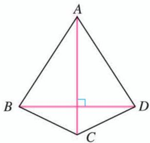
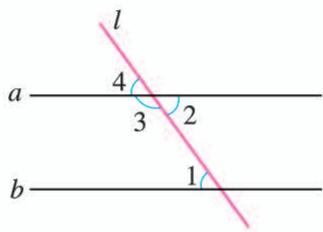
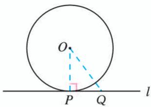
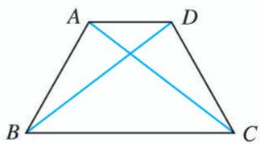

# 充要条件｜双教材原文摘录

本文件保留相关章节的讲解、例题与随堂练习，按版本分段。较宽章节含相邻知识和混合习题，尚未逐题筛选、配答或审校。原文为转写稿，请对照教材原件。

## 人教A版：1.4.1 充分条件与必要条件

来源：01_第一章_集合与常用逻辑用语.md（本地转写稿），转写稿第 718—1082 行；截至下一指定标题前。

## 1.4.1 充分条件与必要条件

## 思考

下列“若 $p$，则 $q$”形式的命题中，哪些是真命题？哪些是假命题？

(1）若平行四边形的对角线互相垂直，则这个平行四边形是菱形；

(2) 若两个三角形的周长相等，则这两个三角形全等；

（3）若 $x ^ { 2 } - 4 x + 3 = 0$ ，则 $x = 1$ ；

(4) 若平面内两条直线 $a$ 和 $b$ 均垂直于直线 $l$，则 $a \parallel b$。

在命题（1）（4）中，由条件 $p$ 通过推理可以得出结论 $q$，所以它们是真命题。在命题（2）（3）中，由条件 $p$ 不能得出结论 $q$，所以它们是假命题。

一般地，“若 $p$，则 $q$”为真命题，是指由 $p$ 通过推理可以得出 $q$。这时，我们就说，由 $p$ 可以推出 $q$，记作

$$
p \Longrightarrow q ,
$$

并且说，$p$ 是 $q$ 的充分条件（sufficient condition），$q$ 是 $p$ 的必要条件（necessary condition）。

①此时，如果q不成立，则p一定不成立.所以，q对于p成立而言是必要的.请举例说明.

如果“若 $p$，则 $q$”为假命题，那么由条件 $p$ 不能推出结论 $q$，记作 $p \nRightarrow q$。此时，我们就说 $p$ 不是 $q$ 的充分条件，$q$ 不是 $p$ 的必要条件。

上述命题（1）（4）中的 $p$ 是 $q$ 的充分条件，$q$ 是 $p$ 的必要条件，而命题（2）（3）中的 $p$ 不是 $q$ 的充分条件，$q$ 不是 $p$ 的必要条件。

例1 下列“若 $p$，则 $q$”形式的命题中，哪些命题中的 $p$ 是 $q$ 的充分条件？

（1）若四边形的两组对角分别相等，则这个四边形是平行四边形；

（2）若两个三角形的三边成比例，则这两个三角形相似；

（3）若四边形为菱形，则这个四边形的对角线互相垂直；

(4) 若 $x ^ { 2 } = 1$ ，则 $x = 1$

(5) 若 $a = b$ ，则 $a c = b c$

(6)若x，y为无理数，则 $x y$ 为无理数.

解：（1）这是一条平行四边形的判定定理，$p \Rightarrow q$，所以 $p$ 是 $q$ 的充分条件。

（2）这是一条相似三角形的判定定理，$p \Rightarrow q$，所以 $p$ 是 $q$ 的充分条件。

（3）这是一条菱形的性质定理，$p \Rightarrow q$，所以 $p$ 是 $q$ 的充分条件。

(4) 由于 $(-1)^2=1$，但 $-1\neq 1$，$p\nRightarrow q$，所以 $p$ 不是 $q$ 的充分条件。

举反例是判断一个命题是假命题的重要方法.

（5）由等式的性质知，$p \Rightarrow q$，所以 $p$ 是 $q$ 的充分条件。

(6) $\sqrt{2}$ 为无理数，但 $\sqrt{2}\times\sqrt{2}=2$ 为有理数，$p\nRightarrow q$，所以 $p$ 不是 $q$ 的充分条件。

## 思考

例1中命题（1）给出了“四边形是平行四边形”的一个充分条件，即“四边形的两组对角分别相等”．这样的充分条件唯一吗？如果不唯一，那么你能再给出几个不同的充分条件吗？

我们说p是q的充分条件，是指由条件p可以推出结论q，但这并不意味着只能由这个条件p才能推出结论q.一般来说，对给定结论q，使得q成立的条件p是不唯一的例如，我们知道，下列命题均为真命题：

①若四边形的两组对边分别相等，则这个四边形是平行四边形；

②若四边形的一组对边平行且相等，则这个四边形是平行四边形；

③若四边形的两条对角线互相平分，则这个四边形是平行四边形.所以，“四边形的两组对边分别相等”“四边形的一组对边平行且相等”“四边形的两条对角线互相平分”都是“四边形是平行四边形”的充分条件.

事实上，例1中命题（1）及上述命题①②③均是平行四边形的判定定理。所以，平行四边形的每一条判定定理都给出了“四边形是平行四边形”的一个充分条件，即这个条件能充分保证四边形是平行四边形。类似地，平行线的每一条判定定理都给出了“两直线平行”的一个充分条件，例如“内错角相等”这个条件就充分保证了“两条直线平行”。

一般地，数学中的每一条判定定理都给出了相应数学结论成立的一个充分条件.

例2 下列“若 $p$，则 $q$”形式的命题中，哪些命题中的 $q$ 是 $p$ 的必要条件？

（1）若四边形为平行四边形，则这个四边形的两组对角分别相等；

（2）若两个三角形相似，则这两个三角形的三边成比例；

（3）若四边形的对角线互相垂直，则这个四边形是菱形；

(4) 若 $x = 1$，则 $x^2 = 1$；

(5) 若 $a c = b c$ ，则 $a = b$

(6)若 $x y$ 为无理数，则x，y为无理数.

解：（1）这是平行四边形的一条性质定理，$p\Rightarrow q$，所以，$q$ 是 $p$ 的必要条件。

(2) 这是三角形相似的一条性质定理，$p\Rightarrow q$，所以，$q$ 是 $p$ 的必要条件。

（3）如图1.4-1，四边形 $ABCD$ 的对角线互相垂直，但它不是菱形，$p\nRightarrow q$，所以，$q$ 不是 $p$ 的必要条件。

(4) 显然，$p\Rightarrow q$，所以，$q$ 是 $p$ 的必要条件。

(5) 由于 $(-1)\times 0=1\times 0$，但 $-1\neq 1$，$p\nRightarrow q$，所以，$q$ 不是 $p$ 的必要条件。

(6) 由于 $1\times\sqrt{2}=\sqrt{2}$ 为无理数，但 $1$、$\sqrt{2}$ 不全是无理数，$p\nRightarrow q$，所以，$q$ 不是 $p$ 的必要条件。

图1.4-1

一般地，要判断“若 $p$，则 $q$”形式的命题中 $q$ 是否为 $p$ 的必要条件，只需判断是否有“$p\Rightarrow q$”，即“若 $p$，则 $q$”是否为真命题。

## 思考

例2中命题（1）给出了“四边形是平行四边形”的一个必要条件，即“这个四边形的两组对角分别相等”．这样的必要条件是唯一的吗？如果不唯一，你能给出“四边形是平行四边形”的几个其他必要条件吗？

我们说 $q$ 是 $p$ 的必要条件，是指以 $p$ 为条件可以推出结论 $q$，但这并不意味着由条件 $p$ 只能推出结论 $q$。一般来说，给定条件 $p$，由 $p$ 可以推出的结论 $q$ 是不唯一的。例如，下列命题都是真命题：

①若四边形是平行四边形，则这个四边形的两组对边分别相等；

②若四边形是平行四边形，则这个四边形的一组对边平行且相等；

③若四边形是平行四边形，则这个四边形的两条对角线互相平分

这表明，“四边形的两组对边分别相等”“四边形的一组对边平行且相等”“四边形的两条对角线互相平分”都是“四边形是平行四边形”的必要条件.

我们知道，例2中命题(1)及上述命题①②③均为平行四边形的性质定理.所以，平行四边形的每条性质定理都给出了“四边形是平行四边形”的一个必要条件．类似地，平行线的每条性质定理都给出了“两直线平行”的一个必要条件，例如“同位角相等”是“两直线平行”的必要条件，也就是说，如果同位角不相等，那么就不可能有“两直线平行”.

一般地，数学中的每一条性质定理都给出了相应数学结论成立的一个必要条件.

## 练习

1. 下列“若 $p$，则 $q$”形式的命题中，哪些命题中的 $p$ 是 $q$ 的充分条件？

（1）若平面内点P在线段AB的垂直平分线上，则 $P A = P B$

（2）若两个三角形的两边及一边所对的角分别相等，则这两个三角形全等；

（3）若两个三角形相似，则这两个三角形的面积比等于周长比的平方.

2. 下列“若 $p$，则 $q$”形式的命题中，哪些命题中的 $q$ 是 $p$ 的必要条件？

（1）若直线 $l$ 与 $\odot O$ 有且仅有一个交点，则 $l$ 为 $\odot O$ 的一条切线；

(2)若x是无理数，则 $x ^ { 2 }$ 也是无理数.

3. 如图，直线 $a$ 与 $b$ 被直线 $l$ 所截，分别得到了 $\angle 1$，$\angle 2$，$\angle 3$ 和 $\angle 4$。请根据这些信息，写出几个“$a\parallel b$”的充分条件和必要条件。

  
(第3题)

## 1.4.2 充要条件

## 思考

下列“若 $p$，则 $q$”形式的命题中，哪些命题与它们的逆命题都是真命题？

(1）若两个三角形的两角和其中一角所对的边分别相等，则这两个三角形全等；

(2)若两个三角形全等，则这两个三角形的周长相等；

(3) 若一元二次方程 $a x ^ { 2 } + b x + c = 0$ 有两个不相等的实数根，则 $a c < 0$

(4) 若 A ∪B 是空集，则 A 与 B 均是空集.

不难发现，上述命题中的命题（1)(4）和它们的逆命题都是真命题；命题（2）是真命题，但它的逆命题是假命题；命题（3）是假命题，但它的逆命题是真命题

将命题“若 $p$，则 $q$”中的条件 $p$ 和结论 $q$ 互换，就得到一个新的命题“若 $q$，则 $p$”，称这个命题为原命题的逆命题。

如果“若 $p$，则 $q$”和它的逆命题“若 $q$，则 $p$”均是真命题，即既有 $p\Rightarrow q$，又有 $q\Rightarrow p$，就记作

$$
p \Longleftrightarrow q .
$$

此时，$p$ 既是 $q$ 的充分条件，也是 $q$ 的必要条件，我们说 $p$ 是 $q$ 的充分必要条件，简称为充要条件（necessary and sufficient condition）。显然，如果 $p$ 是 $q$ 的充要条件，那么 $q$ 也是 $p$ 的充要条件。

概括地说，如果 $p\Longleftrightarrow q$，那么 $p$ 与 $q$ 互为充要条件。上述命题（1）（4）中的 $p$ 与 $q$ 互为充要条件。

例3 下列各题中，哪些 $p$ 是 $q$ 的充要条件？

(1) $p$：四边形是正方形，$q$：四边形的对角线互相垂直且平分；

(2) $p$：两个三角形相似，$q$：两个三角形三边成比例；

(3) $p：xy>0$，$q：x>0，y>0$；

(4) $p：x=1$ 是一元二次方程 $ax^2+bx+c=0$ 的一个根，$q：a+b+c=0$（$a\neq 0$）。

解：（1）因为对角线互相垂直且平分的四边形不一定是正方形（为什么），所以 $q\nRightarrow p$，所以 $p$ 不是 $q$ 的充要条件。

(2) 因为“若 $p$，则 $q$”是相似三角形的性质定理，“若 $q$，则 $p$”是相似三角形的判定定理，所以它们均为真命题，即 $p\Longleftrightarrow q$，所以 $p$ 是 $q$ 的充要条件。

(3) 因为 $xy>0$ 时，$x>0$、$y>0$ 不一定成立（为什么），所以 $p\nRightarrow q$，所以 $p$ 不是 $q$ 的充要条件。

(4) 因为“若 $p$，则 $q$”与“若 $q$，则 $p$”均为真命题，即 $p\Longleftrightarrow q$，所以 $p$ 是 $q$ 的充要条件。

## 探究

通过上面的学习，你能给出“四边形是平行四边形”的充要条件吗？

可以发现，“四边形的两组对角分别相等”“四边形的两组对边分别相等”“四边形的一组对边平行且相等”和“四边形的对角线互相平分”既是“四边形是平行四边形”的充分条件，又是必要条件，所以它们都是“四边形是平行四边形”的充要条件.

另外，我们再看平行四边形的定义：

两组对边分别平行的四边形叫做平行四边形

它表明“四边形的两组对边分别平行”也是“四边形是平行四边形”的一个充要条件.

上面的这些充要条件从不同角度刻画了“平行四边形”这个概念，据此我们可以给出平行四边形的其他定义形式.例如：

两组对边分别相等的四边形叫做平行四边形；

对角线互相平分的四边形叫做平行四边形.

类似地，利用“两个三角形全等”的充要条件，可以给出“三角形全等”的其他定义形式，而且这些定义是相互等价的；同样，利用“两个三角形相似”的充要条件，可以给出“相似三角形”其他定义形式，这些定义也是相互等价的；等等

例4 已知：$\odot O$ 的半径为 $r$，圆心 $O$ 到直线 $l$ 的距离为 $d$。求证：$d=r$ 是直线 $l$ 与 $\odot O$ 相切的充要条件。

分析：设 $p:d=r$，$q$：直线 $l$ 与 $\odot O$ 相切。要证 $p$ 是 $q$ 的充要条件，只需分别证明充分性 $(p\Rightarrow q)$ 和必要性 $(q\Rightarrow p)$ 即可。

证明：设 $p:d=r$，$q$：直线 $l$ 与 $\odot O$ 相切。

(1) 充分性 $(p\Rightarrow q)$：如图1.4-2，作 $OP\perp l$ 于点 $P$，则 $OP=d$。若 $d=r$，则点 $P$ 在 $\odot O$ 上。在直线 $l$ 上任取一点 $Q$（异于点 $P$），连接 $OQ$。在 $\mathrm{Rt}\triangle OPQ$ 中，$OQ>OP=r$。所以，除点 $P$ 外直线 $l$ 上的点都在 $\odot O$ 的外部，即直线 $l$ 与 $\odot O$ 仅有一个公共点 $P$。所以直线 $l$ 与 $\odot O$ 相切。

  
图1.4-2

(2) 必要性 $(q\Rightarrow p)$：若直线 $l$ 与 $\odot O$ 相切，不妨设切点为 $P$，则 $OP\perp l$。因此，$d=OP=r$。

由（1）（2）可得，$d=r$ 是直线 $l$ 与 $\odot O$ 相切的充要条件。

## 练习

1. 下列各题中，哪些p是q的充要条件?

(1) $p$：三角形为等腰三角形，$q$：三角形存在两角相等；

(2) $p$：$\odot O$ 内两条弦相等，$q$：$\odot O$ 内两条弦所对的圆周角相等；

(3) $p$：$A\cap B$ 为空集，$q$：$A$ 与 $B$ 之一为空集。

2.分别写出“两个三角形全等”和“两个三角形相似”的几个充要条件.

3. 证明：如图，梯形ABCD为等腰梯形的充要条件为 $A C = B D$。

(第3题)

## 习题1.4

## 复习巩固

1. 举例说明：

(1) p 是q的充分不必要条件；

(2)p是q的必要不充分条件；

(3) p 是q的充要条件.

2. 在下列各题中，判断p是q的什么条件(请用“充分不必要条件”“必要不充分条件”“充要条件”“既不充分也不必要条件”回答）：

(1)p：三角形是等腰三角形，q：三角形是等边三角形；

(2) p：一元二次方程 $a x ^ { 2 } + b x + c = 0$ 有实数根， $q : b ^ { 2 } - 4 a c \geq 0 ( a \neq 0 )$

(3) $p \colon a \in P \cap Q , \ q \colon a \in P \ ;$

(4) $p \colon \ a \in P \bigcup Q , \ q \colon \ a \in P \ .$

(5) $p \colon x { > } y , \ q \colon x ^ { 2 } { > } y ^ { 2 } .$

3. 判断下列命题的真假：

(1) 点 $P$ 到圆心 $O$ 的距离大于圆的半径是点 $P$ 在 $\odot O$ 外的充要条件；

（2)两个三角形的面积相等是这两个三角形全等的充分不必要条件；

(3)A∪B=A 是B⊆A的必要不充分条件；

(4)x 或y为有理数是xy 为有理数的既不充分也不必要条件.

## 综合运用

4. 已知 $A=\{x\mid x\text{满足条件 }p\}$，$B=\{x\mid x\text{满足条件 }q\}$，

(1）如果A⊆B，那么p是q的什么条件?

(2)如果B⊆A，那么p是q的什么条件？

（3）如果A=B，那么p是q的什么条件？

5. 设 $a \mathrm { ~ , ~ } b \mathrm { ~ , ~ } c \in \mathbf { R } .$ 证明： $a ^ { 2 } + b ^ { 2 } + c ^ { 2 } = a b + a c + b c$ 的充要条件是 $a = b = c$

## 拓广探索

6. 设 $a,b,c$ 分别是 $\triangle ABC$ 的三条边，且 $a\leqslant b\leqslant c$。我们知道，如果 $\triangle ABC$ 为直角三角形，那么 $a^2+b^2=c^2$（勾股定理）。反过来，如果 $a^2+b^2=c^2$，那么 $\triangle ABC$ 为直角三角形（勾股定理的逆定理）。由此可知，$\triangle ABC$ 为直角三角形的充要条件是 $a^2+b^2=c^2$。

请利用边长a，b，c分别给出 $\triangle A B C$ 为锐角三角形和钝角三角形的一个充要条件，并证明.

## 阅读与思考

## 几何命题与充分条件、必要条件

通过前面的学习我们发现，对于一种几何图形或几何图形之间的关系，可以通过充要条件给出它的等价定义，通过充分条件给出它的判定定理，通过必要条件给出它的性质定理.利用充分条件、必要条件梳理已学的几何命题，可以促进我们更深入地理解几何图形及其关系.下面以相似三角形为例进行说明.

为了方便，我们记q：两个三角形相似.

## 1. 相似三角形的定义

三角形的相似是三角形之间的一种关系，它的定义是：三个角分别相等、三条边成比例的两个三角形叫做相似三角形.

记p：三个角分别相等且三条边成比例.因为 $p { \Rightarrow } q , q { \Rightarrow } p$ ，所以p是q的充要条件.

三条边、三个内角是三角形的六个要素，相似三角形的定义从两个三角形各要素间的相互关系给出了两个三角形相似的充要条件.

## 2. 相似三角形的判定

相似三角形的判定指出了“满足什么条件的两个三角形相似”.初中学过如下判定定理：

(1)三边成比例的两个三角形相似；

(2)两边成比例且夹角相等的两个三角形相似；

(3)两角分别相等的两个三角形相似.

记 $p_1$：三边成比例，$p_2$：两边成比例且夹角相等，$p_3$：两角分别相等，我们有 $p_1\Rightarrow q$，$p_2\Rightarrow q$，$p_3\Rightarrow q$，即 $p_1$，$p_2$，$p_3$ 分别给出了 $q$ 的一个充分条件。

上述判定定理分别从两个三角形的边、边角、角等要素之间的相互关系给出了相似三角形的充分条件.事实上，我们还可以给出相似三角形的其他充分条件，例如“相似于同一个三角形的两个三角形相似”(这表明，“相似”具有传递性).

利用判定定理我们可以判定两个三角形是相似三角形.

想一想：（1）你能给出相似三角形的其他充分条件吗？（2）利用判定定理可以判定两个三角形不是相似三角形吗？为什么？

## 3. 相似三角形的性质

相似三角形的性质给出了两个三角形相似所必须满足的条件．换言之，如果不满足这个条件，那么这两个三角形就一定不相似。在初中，我们学过的相似三角形性质定理有：

(1）相似三角形对应线段的比都相等(等于相似比)，特别地，相似三角形的对应边之比、对应高之比、对应中线之比、对应角平分线之比都相等(等于相似比)；

(2) 相似三角形的对应角相等；

(3)相似三角形周长的比等于对应边之比(相似比)；

(4)相似三角形面积的比等于对应边之比的平方(相似比的平方).

记 $r_1$：对应线段的比等于相似比，$r_2$：对应角相等，$r_3$：周长的比等于对应边之比，$r_4$：面积的比等于对应边之比的平方，我们有 $q\Rightarrow r_1$，$q\Rightarrow r_2$，$q\Rightarrow r_3$，$q\Rightarrow r_4$，即 $r_1$，$r_2$，$r_3$，$r_4$ 分别给出了 $q$ 的一个必要条件。例如，如果 $r_1$ 不成立，即对应线段的比不全相等，那么这两个三角形就一定不相似。因此，利用性质定理可以判定两个三角形不是相似三角形。

想一想：利用性质定理可以判定两个三角形是相似三角形吗？为什么？

以上性质定理分别从三角形的要素、三角形中的重要线段及重要几何量等方面给出了相似三角形的必要条件.你能给出相似三角形的其他必要条件吗?

分析上述命题，可以发现，有些条件是 $q$ 的充要条件，例如 $p_1(r_1)$，$p_2$，$p_3(r_2)$，据此可以构造出相似三角形的等价定义：

(1)三边成比例的两个三角形叫做相似三角形；

(2)两边成比例且夹角相等的两个三角形叫做相似三角形；

(3) 两角分别相等的两个三角形叫做相似三角形.

由上述任意一个定义出发，我们也可以推出相似三角形的其他性质，你能试一试吗？

请你仿照上述思路，对等腰三角形、直角三角形、平行四边形（矩形、菱形、正方形）等图形的知识进行梳理.

## 沪教版2026：1.2 常用逻辑用语

来源：沪教版必修第一册2026-dollar-polished.md（本地转写稿），转写稿第 625—939 行；截至下一指定标题前。

## 1.2 常用逻辑用语

### 1 命题

在初中时已经知道, 用自然语言、符号或式子表达, 且可以判断其真假的语句叫做命题 (proposition)。命题通常用陈述句表述. 其含义判断为真的命题叫做真命题, 判断为假的命题叫做假命题. 例如, “ 4 能被 2 整除”是真命题， “ 3 能被 2 整除”是假命题.

例 1 下列语句哪些是命题？如果是命题，那么它们是真命题还是假命题？为什么？

(1)个位数字是 5 的自然数能被 5 整除；

(2)凡直角三角形都相似；

(3)请起立；

(4)若两个角互为补角，则这两个角不相等；

(5)若两个三角形的三组对应边相等，则这两个三角形全等;

(6)你是高一学生吗？

(7) $x > 3$ .

解 语句(3)(6)(7)不是命题；语句(1)(2)(4)(5)是命题，其中语句(1)(5)是真命题，语句(2)(4)是假命题.

(1)这是一个真命题. 因为个位数字是 5 的自然数可写成 ${10k} + 5$ 的形式 $\left( {k \in  \mathbf{N}}\right)$ ,而 ${10k} + 5 = 5\left( {{2k} + 1}\right)$ ,它总能被 5 整除, 所以个位数字是 5 的自然数能被 5 整除.

(2)因为三个角分别为 ${90}^{ \circ  }$ 、 ${45}^{ \circ  }$ 、 ${45}^{ \circ  }$ 的直角三角形与三个角分别为 ${90}^{ \circ  }$ 、 ${60}^{ \circ  }$ 、 ${30}^{ \circ  }$ 的直角三角形是不相似的，所以“凡直角三角形都相似”是一个假命题.

(3)“请起立”无法判定真假，它不是一个命题.

(4)取一个角为 ${90}^{ \circ  }$ ，另一个角也为 ${90}^{ \circ  }$ ，它们是互补的，同

时它们也是相等的, 所以 “若两个角互为补角, 则这两个角不相等”是一个假命题.

(5) 这是一个真命题, 它是两个三角形全等的一个判定定理.

(6)因为“你是高一学生吗？”不是陈述句，无法判断其真假， 所以它不是命题.

(7)虽然“ $x > 3$ ”是陈述句，但是它包含一个可变的对象 $x$ ， 无法判断其真假，因此它不是命题. 当 $x$ 被赋予不同的值时，它就成为不同的命题. 例如,当 $x = 4$ 时,“ $x > 3$ ” 是真命题；当 $x = 1$ 时,“ $x > 3$ ”是假命题.

例 1 中命题( 4 )与( 5 )具有“若 $\alpha$ ，则 $\beta$ ”的形式. 在保持含义不变的前提下，例 1 中命题( 1 )与( 2 )也可改写为这种形式:

若一个自然数的个位数字是 5 ，则这个自然数能被 5 整除；

若两个三角形都是直角三角形, 则它们相似.

在形如

“若 $\alpha$ ,则 $\beta$ ”

的命题中,陈述句 $\alpha$ 称为条件, $\beta$ 称为结论.

命题“若 $\alpha$ ,则 $\beta$ ”是真命题,是指所有满足条件 $\alpha$ 的对象都满足结论 $\beta$ . 用集合的语言描述即

$\{ x \mid  x$ 满足 $\alpha \}  \subseteq  \{ x \mid  x$ 满足 $\beta \}$ .

所以, 要确定这类命题是真命题, 就必须给出其证明, 如例 1 中的(1)与(5).

命题“若 $\alpha$ ,则 $\beta$ ”是假命题,是指存在满足条件 $\alpha$ 的对象, 它不满足结论 $\beta$ . 所以,要确定这类命题是假命题,可用处理例 1 中( 2 )与( 4 )的方法，举一个满足条件 $\alpha$ 而不满足结论 $\beta$ 的例子就可以了.

定义 如果命题“若 $\alpha$ ,则 $\beta$ ”是真命题,那么就称 $\alpha$ 推出 $\beta$ , 记作 $\alpha  \Rightarrow  \beta$ (或 $\beta  \Leftarrow  \alpha$ ).

因为子集关系满足传递性, 所以推出关系也满足传递性:

若 $\alpha  \Rightarrow  \beta$ 且 $\beta  \Rightarrow  \gamma$ ,则 $\alpha  \Rightarrow  \gamma$ .

它是逻辑推理的基础.

例 2 将下列命题改写成“若 $\alpha$ ，则 $\beta$ ”的形式，并判断 “ $\alpha  \Rightarrow  \beta$ ” 是否成立.

---

“若 $\alpha$ ,则 $\beta$ ”形式的命题也可写为“如果 $\alpha$ ,那么 $\beta$ ”的形式.

这种方法在数学上称为举反例.

---

(1)等腰三角形的两底角相等;

(2)凡是素数都是奇数；

(3)对顶角相等.

解(1)若一个三角形是等腰三角形，则它的两个底角相等. 这是一个真命题. 所以，“ $\alpha  \Rightarrow  \beta$ ”成立.

(2)若 $n$ 是素数，则 $n$ 是奇数. 这是一个假命题，因为 2 是素数,但它是偶数. 所以,“ $\alpha  \Rightarrow  \beta$ ”不成立.

(3)若两个角是对顶角，则这两个角相等. 这是一个真命题. 所以，“ $\alpha  \Rightarrow  \beta$ ”成立.

#### 练习 1.2(1)

1. 举几个生活中的命题的例子, 并判断其真假.
2. 判断下列命题的真假, 并说明理由:

(1)所有偶数都不是素数；

(2) $\{ 1\}$ 是 $\{ 0,1,2\}$ 的真子集；

(3)0 是 $\{ 0,1,2\}$ 的真子集；

(4)如果集合 $A$ 是集合 $B$ 的子集，那么 $B$ 不是 $A$ 的子集.

3. 用“ $\Rightarrow$ ”表示下列陈述句 $\alpha$ 与 $\beta$ 之间的推出关系:

(1) $\alpha  : {\bigtriangleup {ABC}}$ 是等边三角形， $\beta$ : ${\bigtriangleup {ABC}}$ 是轴对称图形；

(2) $\alpha  : {x}^{2} = 4,\beta  : x = 2$ .

### 2 充分条件与必要条件

先看一个例子:我们要培养的是德智体美劳全面发展的社会主义建设者和接班人. 显然, 对于这样“全面发展”的学生来说, 其学习成绩一定是好的; 反过来, 学习成绩好的学生不一定是 “全面发展”的，因为可能其他方面不是很好. 也就是说，“学习成绩好” 对于“全面发展”是不可缺少的，但只有“学习成绩好”还不够.

定义 对于两个陈述句 $\alpha$ 与 $\beta$ ,如果 $\alpha  \Rightarrow  \beta$ ,就称 $\alpha$ 是 $\beta$ 的充分条件 (sufficient condition),亦称 $\beta$ 是 $\alpha$ 的必要条件 (necessary condition). Q

---

该定义中,“充分”二字说明 “ $\alpha$ 成立时， $\beta$ 一定成立”；而 “必要”二字说明“β不成立时, $\alpha$ 一定不成立”.

---

由例 2 知道, “一个三角形是等腰三角形”是 “一个三角形有两个角相等”的充分条件，“两个角相等”是“两个角是对顶角”的

必要条件, 而“一个数是素数”不是“一个数是奇数”的充分条件.

例 3 判断下列各组中的 $\alpha$ 分别是 $\beta$ 的什么条件,并说明理由.

(1) $\alpha$ :四边形 ${ABCD}$ 是正方形， $\beta$ :四边形 ${ABCD}$ 的四个内角都是直角;

(2) $\alpha  : {x}^{2}$ 是有理数， $\beta  : x$ 是有理数.

解(1)因为正方形的四个内角都是直角，所以命题“若 $\alpha$ ， 则 $\beta$ ”是真命题， $\alpha$ 是 $\beta$ 的充分条件.

反之, 因为四个内角都是直角的四边形也可以是长宽不相等的矩形,所以命题“若 $\beta$ ,则 $\alpha$ ”是假命题, $\alpha$ 不是 $\beta$ 的必要条件.

(2)因为有理数 $\frac{r}{s}\left( {r\text{ 、 }s \in  \mathbf{Z}}\right)$ 的平方 $\frac{{r}^{2}}{{s}^{2}}$ 必是一个有理数， 所以“若 $\beta$ ,则 $\alpha$ ”是真命题, $\alpha$ 是 $\beta$ 的必要条件.

反之,因为 ${\left( \sqrt{2}\right) }^{2} = 2$ 是有理数,但 $\sqrt{2}$ 是无理数,所以“若 $\alpha$ ,则 $\beta$ ”是假命题, $\alpha$ 不是 $\beta$ 的充分条件.

定义 对于两个陈述句 $\alpha$ 与 $\beta$ ,如果既有 $\alpha  \Rightarrow  \beta$ ,又有 $\beta  \Rightarrow  \alpha$ , 就称 $\alpha$ 是 $\beta$ 的充分必要条件,简称充要条件,记作 $\alpha  \Leftrightarrow  \beta$ ,读作 “ $\alpha$ 与 $\beta$ 等价”或“ $\alpha$ 成立当且仅当 $\beta$ 成立”.

例如, “三角形的两个内角相等”是 “三角形的两条边相等” 的充要条件; “实数 $x\text{ 、 }y$ 满足 $\left| x\right|  = \left| y\right|$ ” 是 “实数 $x\text{ 、 }y$ 满足 $\left( {x + y}\right) \left( {x - y}\right)  = 0$ ” 的充要条件.

例 4 已知 $m$ 是实数，集合

$$
M = \{ 2,3, m + 6\} , N = \{ 0,7\} .
$$

求证:“ $m = 1$ ” 是 “ $M \cap  N = \{ 7\}$ ” 的充要条件.

证明 先证充分性 (即证 $m = 1 \Rightarrow  M \cap  N = \{ 7\}$ ). 当 $m = 1$ 时, $M = \{ 2,3,7\}$ . 又因为 $N = \{ 0,7\}$ ,所以 $M \cap  N = \{ 7\}$ .

再证必要性 (即证 $M \cap  N = \{ 7\}  \Rightarrow  m = 1$ ). 当 $M \cap  N = \{ 7\}$ 时, 由 $7 \in  M$ ,得 $m + 6 = 7$ ,因此 $m = 1$ .

综上所述，“ $m = 1$ ”是“ $M \cap  N = \{ 7\}$ ”的充要条件.

#### 练习 1.2(2)

1. 已知 $\alpha$ : 四边形 ${ABCD}$ 的两组对边分别平行, $\beta$ : 四边形 ${ABCD}$ 为矩形, $\gamma$ : 四边

---

下一小节将给出 $\sqrt{2}$ 是无理数的证明.

---

集合与逻辑形 ABCD 的两组对边分别相等. 用 “充分非必要”“必要非充分” “充要”或 “既非充分又非必要”填空:

(1) $\alpha$ 是 $\beta$ 的___条件；

(2) $\beta$ 是 $\gamma$ 的___条件；

(3)α是 $\gamma$ 的___条件.

2. 设 $\alpha  : 1 \leq  x < 4,\beta  : x < m,\alpha$ 是 $\beta$ 的充分条件. 求实数 $m$ 的取值范围.

### 3 反证法

反证法是数学中常用的证明方法之一. 下面, 我们学习如何用反证法证明一些命题.

在前面已经提到,要判断命题“若 $\alpha$ ,则 $\beta$ ”是假命题,只要存在一个满足条件 $\alpha$ 但不满足结论 $\beta$ 的对象就行了. 但是要判断命题“若 $\alpha$ ,则 $\beta$ ”是真命题,就需要证明所有满足条件 $\alpha$ 的对象都满足结论 $\beta$ . 有时直接验证这一点并不是一件容易的事. Q

---

数学命题中的“所有”也可称为“对任意给定的一个”或“对每一个”.

---

例 5 设 $n \in  \mathbf{Z}$ . 证明: 若 ${n}^{2}$ 是偶数,则 $n$ 也是偶数.

证明 假设结论“ $n$ 是偶数”不成立,即假设 $n$ 是奇数. 由 $n$ 是奇数,可设 $n = {2k} + 1, k \in  \mathbf{Z}$ .

因为

$$
{n}^{2} = {\left( 2k + 1\right) }^{2} = 4{k}^{2} + {4k} + 1 = 4\left( {{k}^{2} + k}\right)  + 1,
$$

这说明 ${n}^{2}$ 是奇数,与已知条件 ${n}^{2}$ 是偶数矛盾.

所以,一开始的假设不成立,即 $n$ 是偶数.

例 5 的证明方法与以前的证明方法不同. 它首先假设结论 $\beta$ 不成立( $\beta$ 为假)，然后经过正确的逻辑推理得出矛盾，从而说明 “ $\beta$ 为假”是不可能发生的,即结论 $\beta$ 是正确的. 这样的证明方法叫反证法.

应用反证法证明命题的第一步是假设命题的结论不成立, 即否定命题的结论. 这一步是十分关键的. 只有这一步表述对了, 接下来的逻辑推理才有意义.

数学上一些常用的否定形式见表 1-2.

表 1-2 一些常用的否定形式

<table><tr><td>陈述句 $\alpha$</td><td>$\alpha$ 的否定形式</td></tr><tr><td>$x > 1$</td><td>$x \leq  1$</td></tr><tr><td>$x > 1$ 或 $y > 1$</td><td>$x \leq  1$ 且 $y \leq  1$</td></tr><tr><td>集合 $A$ 中满足性质 $p$ 的元素至少有两个</td><td>集合 $A$ 中满足性质 $p$ 的元素最多有一个</td></tr><tr><td>所有的 $a \in  A$ 满足性质 $p$</td><td>至少存在一个 $a \in  A$ 不满足性质 $p$</td></tr><tr><td>所有的 $a \in  A$ 不满足性质 $p$</td><td>至少存在一个 $a \in  A$ 满足性质 $p$</td></tr></table>

例 6 设 $x\text{ 、 }y \in  \mathbf{R}$ . 证明: 若 $x + y > 2$ ,则 $x > 1$ 或 $y > 1$ .

证明 用反证法证明.

假设 $x \leq  1$ 且 $y \leq  1$ ,则 $x + y \leq  2$ ,这与已知条件 $x + y > 2$ 矛盾.

所以假设不成立,即 $x > 1$ 或 $y > 1$ .

例 5 和例 6 证明的都是“若 $\alpha$ ,则 $\beta$ ” 形式的命题. 对一些其他形式的命题, 也可用反证法证明.

例 7 证明: $\sqrt{2}$ 是无理数.

证明 用反证法证明.

假设 $\sqrt{2}$ 是有理数. 则可设

$$
\sqrt{2} = \frac{m}{n}
$$

其中 $m$ 与 $n$ 是互素的正整数. 于是 $m = \sqrt{2}n$ . 两边平方,得 ${m}^{2} = 2{n}^{2}$ . 所以, ${m}^{2}$ 是偶数. 由例 5,知 $m$ 也是偶数. 于是,可设 $m = {2k}, k$ 为正整数. 将其代入 ${m}^{2} = 2{n}^{2}$ ,得 $2{n}^{2} = 4{k}^{2}$ ,即 ${n}^{2} = 2{k}^{2}$ ,故 ${n}^{2}$ 是偶数. 再根据例 5,知 $n$ 也是偶数. 于是 $m\text{ 、 }n$ 有公因数 2,这与 $m\text{ 、 }n$ 互素的假设矛盾.

所以假设不成立,即 $\sqrt{2}$ 是无理数.

#### 练习 1.2(3)

1. 设 $n \in  \mathbf{Z}$ . 证明: 若 ${n}^{3}$ 是奇数,则 $n$ 是奇数.
2. 证明: 对于三个实数 $a\text{ 、 }b\text{ 、 }c$ ,若 $a \neq  c$ ,则 $a \neq  b$ 或 $b \neq  c$ .

---

元素个数一般指正整数.

结论“ $x > 1$ 或 $y > 1$ ” 不成立,即“ $x$ 与 $y$ 中至少有一个大于 1 ”不成立. 也就是 “ $x$ 与 $y$ 都不大于 1 ”.

例 7 的证明是历史上著名的一个反证法证明.

一个实数是有理数当且仅当它可以表示成两个整数的商 $\frac{m}{n}$ . 如果 $m$ 与 $n$ 有大于 1 的公因数, 总可以进行约分, 所以不妨设 $m$ 与 $n$ 是互素的.

---

#### 习题 1.2

##### A 组

1. 判断下列语句是否为命题:

(1)有的正方形是三角形;

(2)任意一个三角形的内角和都为 ${180}^{ \circ  }$ ；

(3)1 是自然数吗?

(4)3>π；

(5) $2 \in  \left( {0,5}\right)$ ，且 $2 \in  \mathbf{Z}$ .

2. 判断下列命题的真假, 并说明理由:

(1)如果 $a\text{ 、 }b$ 都是奇数，那么 $a + b$ 是偶数；

(2)一组对边平行且两对角线等长的四边形是平行四边形;

(3)如果 $A \cap  B = A$ ，那么 $A \cup  B = B$ .

3. 如果 $a\text{ 、 }b\text{ 、 }c$ 为实数,设 $\alpha  : a = b = c = 0;\beta  : a\text{ 、 }b\text{ 、 }c$ 中至少有一个为 0 $\gamma  : {a}^{2} + \sqrt{b} + \left| c\right|  = 0$ . 那么 $\alpha$ ___ $\beta ;\alpha$ ___ $\gamma ;\beta$ ___ $\gamma$ . (用符号“ $\Leftarrow$ ”“ $\Rightarrow$ ”或 “⇔”填空)
4. 下列各组中, $\alpha$ 是 $\beta$ 的什么条件?

(1) $\alpha$ :四边形 ${ABCD}$ 的四条边等长， $\beta$ :四边形 ${ABCD}$ 是正方形；

(2) $\alpha  : {\bigtriangleup {ABC}}$ 与 $\bigtriangleup  {DEF}$ 全等， $\beta$ : ${\bigtriangleup {ABC}}$ 与 $\bigtriangleup  {DEF}$ 的周长相等；

(3) $\alpha  : x$ 是 2 的倍数， $\beta  : x$ 是 6 的倍数；

(4) $\alpha  :$ 集合 $A \subseteq  B, B \subseteq  C, C \subseteq  A,\beta  \mathrel{\text{ := }}$ 集合 $A = B = C$ ；

(5) $\alpha  : A \cap  B = A \cap  C,\beta  : B = C$ .

5. 已知 $l\text{ 、 }m$ 都是自然数,试判断“ $l + m$ 是偶数”与“ $l\text{ 、 }m$ 都是偶数”是否等价,并说明理由.
6. 证明: “四边形 ${ABCD}$ 是平行四边形” 是 “四边形 ${ABCD}$ 的对角线互相平分”的充要条件.

##### B 组

1. 判断下列命题的真假, 并说明理由:

(1)若 $A \cap  B = \varnothing , C \subset  B$ ，则 $A \cap  C = \varnothing$ ；

(2)若 $a\text{ 、 }b \in  \mathbf{R}$ ,则关于 $x$ 的方程 $\left( {a + 1}\right) x + b = 0$ 的解为 $x =  - \frac{b}{a + 1}$ .

2. 已知 $a$ 为实数. 写出关于 $x$ 的方程 $a{x}^{2} + {2x} + 1 = 0$ 至少有一个实根的一个充要条件、一个充分非必要条件和一个必要非充分条件.
3. 若 $\alpha  : \{ 2\}  \subset  B \subseteq  \{ 2,3,4\} ,\beta  : B = \{ 2,4\}$ ,则 $\alpha$ 是 $\beta$ 的 ( )

A. 充分非必要条件; B. 必要非充分条件;

C. 充要条件; D. 既非充分又非必要条件.

4. 已知 $\alpha  : x < {3m} - 1$ 或 $x >  - m,\beta  : x < 2$ 或 $x \geq  4$ .

(1)若 $\alpha$ 是 $\beta$ 的充分条件，求实数 $m$ 的取值范围；

(2)若 $\alpha$ 是 $\beta$ 的必要条件，求实数 $m$ 的取值范围.
