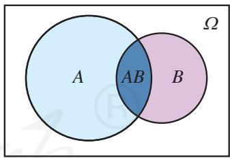

# 条件概率｜双教材原文摘录

本文件保留相关章节的讲解、例题与随堂练习，按版本分段。较宽章节含相邻知识和混合习题，尚未逐题筛选、配答或审校。原文为转写稿，请对照教材原件。

## 人教A版：7.1.1 条件概率

来源：03_第七章_随机变量及其分布.md（本地转写稿），转写稿第 18—242 行；截至下一指定标题前。

## 7.1.1 条件概率

问题1 某个班级有45名学生，其中男生、女生的人数及团员的人数如表7.1-1所示.

表 7.1-1  
单位：人
<table><tr><td rowspan=1 colspan=1></td><td rowspan=1 colspan=1>团员</td><td rowspan=1 colspan=1>非团员</td><td rowspan=1 colspan=1>合计</td></tr><tr><td rowspan=1 colspan=1>男生</td><td rowspan=1 colspan=1>16</td><td rowspan=1 colspan=1>9</td><td rowspan=1 colspan=1>25</td></tr><tr><td rowspan=1 colspan=1>女生</td><td rowspan=1 colspan=1>14</td><td rowspan=1 colspan=1>6</td><td rowspan=1 colspan=1>20</td></tr><tr><td rowspan=1 colspan=1>合计</td><td rowspan=1 colspan=1>30</td><td rowspan=1 colspan=1>15</td><td rowspan=1 colspan=1>45</td></tr></table>

在班级里随机选择一人做代表.

（1）选到男生的概率是多少？

（2）如果已知选到的是团员，那么选到的是男生的概率是多少？

随机选择一人做代表，则样本空间Ω包含45个等可能的样本点．用A表示事件“选到团员”，B表示事件“选到男生”，根据表7.1-1中的数据可以得出， $n \left( \varOmega \right) = 4 5$ $n ( A ) = 3 0 , \ n ( B ) = 2 5 ,$

（1）根据古典概型知识可知，选到男生的概率

$$
P \left( B \right) = \frac { n \left( B \right) } { n \left( \Omega \right) } = \frac { 2 5 } { 4 5 } = \frac { 5 } { 9 } .
$$

（2）“在选到团员的条件下，选到男生”的概率就是“在事件A发生的条件下，事件B发生”的概率，记为 $P ( B \left| A \right. )$ ．此时相当于以A为样本空间来考虑事件B发生的概率，而在新的样本空间中事件B就是积事件AB，包含的样本点数n(AB)=16. 根据古典概型知识可知，

$$
P ( B | A ) = \frac { n \left( A B \right) } { n \left( A \right) } = \frac { 1 6 } { 3 0 } = \frac { 8 } { 1 5 } .
$$

问题2 假定生男孩和生女孩是等可能的，现考虑有两个小孩的家庭．随机选择一个家庭，那么

（1）该家庭中两个小孩都是女孩的概率是多大？

（2）如果已经知道这个家庭有女孩，那么两个小孩都是女孩的概率又是多大？

观察两个小孩的性别，用b表示男孩，g表示女孩，则样本空间 $\Omega =$ $\left\{ b b , b g , g b , g g \right\}$ ，且所有样本点是等可能的．用A表示事件“选择的家庭中有女孩”，B表示事件“选择的家庭中两个小孩都是女孩”，则 $A = \{ b g , \ g b , \ g g \} , \ B = \{ g g \}$

（1）根据古典概型知识可知，该家庭中两个小孩都是女孩的概率

$$
P ( B ) = \frac { n \left( B \right) } { n \left( \varOmega \right) } = \frac { 1 } { 4 } .
$$

（2）“在选择的家庭有女孩的条件下，两个小孩都是女孩”的概率就是“在事件A发生的条件下，事件B发生”的概率，记为 $P ( B \left| A \right. )$ ．此时A成为样本空间，事件B就是积事件AB．根据古典概型知识可知，

$$
P ( B \mid A ) = \frac { n \left( A B \right) } { n \left( A \right) } = \frac { 1 } { 3 } .
$$

在上面两个问题中，在事件A发生的条件下，事件B发生的概率都是

$$
P ( B | A ) { = } { \frac { n \left( A B \right) } { n \left( A \right) } } .
$$

这个结论对于一般的古典概型仍然成立．事实上，如图7.1-1所示，若已知事件A发生，则A成为样本空间．此时，事件B发生的概率是AB包含的样本点数与A包含的样本点数的比值，即

$$
P ( B | A ) { = } { \frac { n \left( A B \right) } { n \left( A \right) } } .
$$

因为

$$
P ( B | A ) { = } \frac { n ( A B ) } { n ( A ) } { = } \frac { \displaystyle \frac { n \left( A B \right) } { n ( \Omega ) } } { \displaystyle \frac { n \left( A \right) } { n ( \Omega ) } } { = } \frac { P ( A B ) } { P ( A ) } ,
$$

  
图 7.1-1

所以，在事件A发生的条件下，事件B发生的概率还可以通过 $\frac { P ( A B ) } { P ( A ) }$ 来计算.

一般地，设A，B为两个随机事件，且 $P ( A ) { > } 0$ ，我们称

$$
P ( B | A ) { = } { \frac { P ( A B ) } { P ( A ) } }
$$

为在事件A发生的条件下，事件B发生的条件概率，简称条件概率（conditional proba-bility).

## 探究

在问题1和问题2中，都有 $P ( B | A ) { \neq } P ( B )$ ·一般地， $P ( B \left| A \right. )$ 与 P(B)不一定相等．如果 $P ( B \left| A \right. )$ 与 $P \left( B \right)$ 相等，那么事件A与B 应满足什么条件？

直观上看，当事件A与B相互独立时，事件A发生与否不影响事件B发生的概率，这等价于 $P \left( B \left| A \right. \right) = P \left( B \right)$ 成立.

事实上，若事件A与B相互独立，即 $P ( A B ) = P ( A ) P ( B )$ ，且 $P ( A ) { > } 0$ ，则

$$
P ( B \mid A ) { = } \frac { P ( A B ) } { P ( A ) } { = } \frac { P ( A ) P ( B ) } { P ( A ) } { = } P ( B ) { ; }
$$

反之，若 $P \left( B \left| A \right. \right) = P \left( B \right)$ ，且 $P ( A ) { > } 0$ ，则

$$
P ( B ) { = } \frac { P ( A B ) } { P ( A ) } { \Rightarrow } P ( A B ) { = } P ( A ) P ( B ) ,
$$

即事件A与B相互独立.

因此，当 $P ( A ) { > } 0$ 时，当且仅当事件A与B相互独立时，有 $P \left( B \left| A \right. \right) = P \left( B \right)$

## 3 思考

对于任意两个事件A与B，如果已知 $P \left( A \right)$ 与 $P ( B | A )$ ，如何计算 $P ( A B )$ 呢？

由条件概率的定义，对任意两个事件A与B，若 $P ( A ) { > } 0$ ，则

$$
P ( A B ) { = } P ( A ) P ( B \mid A ) .
$$

我们称上式为概率的乘法公式

例1 在5道试题中有3道代数题和2道几何题，每次从中随机抽出1道题，抽出的题不再放回．求：

（1）第1次抽到代数题且第2次抽到几何题的概率；

（2）在第1次抽到代数题的条件下，第2次抽到几何题的概率.

分析：如果把“第1次抽到代数题”和“第2次抽到几何题”作为两个事件，那么问题（1）就是积事件的概率，问题（2）就是条件概率．可以先求积事件的概率，再用条件概率公式求条件概率；也可以先求条件概率，再用乘法公式求积事件的概率.

解：设A=“第1次抽到代数题”， $B = ~ ^ { 6 6 }$ 第2次抽到几何题”，则“第1次抽到代数题且第2次抽到几何题”就是事件AB.

方法1（1）从5道试题中每次不放回地随机抽取2道，试验的样本空间Ω包含20个等可能的样本点，即 $n \left( \Omega \right) = \mathrm { A } _ { 5 } ^ { 2 } = 5 \times 4 = 2 0$

因为 $n ( A B ) { = } \mathrm { A } _ { 3 } ^ { 1 } { \times } \mathrm { A } _ { 2 } ^ { 1 } { = } 3 { \times } 2 { = } 6$ ，所以

$$
P ( A B ) { = } \frac { n \left( A B \right) } { n \left( \Omega \right) } { = } \frac { 6 } { 2 0 } { = } \frac { 3 } { 1 0 } .
$$

（2）“在第1次抽到代数题的条件下，第2次抽到几何题”的概率就是事件A发生的条件下，事件B发生的概率．显然 $P \left( A \right) = \frac { 3 } { 5 }$ .利用条件概率公式，得

$$
P ( B | A ) { = } { \frac { P ( A B ) } { P ( A ) } } { = } { \frac { \frac { 3 } { 1 0 } } { \frac { 3 } { 5 } } } { = } { \frac { 1 } { 2 } } .
$$

方法2 因为 $n \left( A \right) = 3 \times 4 = 1 2 , \ n \left( A B \right) = 3 \times 2 = 6$ ，所以

$$
P ( B \mid A ) = \frac { n \left( A B \right) } { n \left( A \right) } = \frac { 6 } { 1 2 } = \frac { 1 } { 2 } .
$$

又 $P \left( A \right) = \frac { 3 } { 5 }$ ，利用乘法公式可得

$$
P ( A B ) { = } P ( A ) P ( B \mid A ) { = } { \frac { 3 } { 5 } } { \times } { \frac { 1 } { 2 } } { = } { \frac { 3 } { 1 0 } } .
$$

例1求条件概率用了两种方法：一种是基于样本空间Ω，先计算 $P \left( A \right)$ 和 $P ( A B )$ 再利用条件概率公式求 $P ( B \left| A \right. )$ ；另一种是根据条件概率的直观意义，增加了“A发生”的条件后，样本空间缩小为A，求 $P ( B | A )$ 就是以A为样本空间计算AB的概率.

在例1中，已知第1次抽到代数题，这时还余下4道试题，其中代数题和几何题各2道．显然，事件A发生的条件下，事件B发生的概率为 $P \left( B \mid A \right) = \frac { 2 } { 4 } = \frac { 1 } { 2 }$ ．这等价于将A中的12个样本点合并为4个等可能的样本点，通常用这种方法求 $P ( B \left| A \right. )$ 更便捷.

条件概率只是缩小了样本空间，因此条件概率同样具有概率的性质．设 $P ( A ) { > } 0$ ，则

(1) $P \left( \Omega \left| A \right. \right) = 1$ i

（2）如果B和C是两个互斥事件，则 $P ( B \bigcup C \left| A \right. ) = P ( B \left| A \right. ) + P ( C \left| A \right. )$

（3）设B和B互为对立事件，则 $P ( { \overline { { B } } } | A ) { = } 1 { - } P ( B | A )$

例2已知3张奖券中只有1张有奖，甲、乙、丙3名同学依次不放回地各随机抽取1张．他们中奖的概率与抽奖的次序有关吗？

分析：要知道中奖概率是否与抽奖次序有关，只要考察甲、乙、丙3名同学的中奖概率是否相等．因为只有1张有奖，所以“乙中奖”等价于“甲没中奖且乙中奖”，“丙中奖”等价于“甲和乙都没中奖”，利用乘法公式可求出乙、丙中奖的概率.

解：用A，B，C分别表示甲、乙、丙中奖的事件，则 $B { = } \overline { { { A } } } B , C { = } \overline { { { A } } } \overline { { { B } } }$

$$
P \left( A \right) = \frac { 1 } { 3 } ;
$$

$$
P ( B ) = P ( \overline { { A } } B ) = P ( \overline { { A } } ) P ( B | \overline { { A } } ) = \frac { 2 } { 3 } \times \frac { 1 } { 2 } = \frac { 1 } { 3 } ,
$$

$$
P ( C ) = P ( \overline { { A } } \overline { { B } } ) = P ( \overline { { A } } ) P ( \overline { { B } } | \overline { { A } } ) = \frac { 2 } { 3 } \times \frac { 1 } { 2 } = \frac { 1 } { 3 } .
$$

因为 $P \left( A \right) = P \left( B \right) = P \left( C \right)$ ，所以中奖的概率与抽奖的次序无关.

事实上，在抽奖问题中，无论是放回随机抽取还是不放回随机抽取，中奖的概率都与抽奖的次序无关.

例3 银行储蓄卡的密码由6位数字组成.某人在银行自助取款机上取钱时，忘记了密码的最后1位数字．求：

（1）任意按最后1位数字，不超过2次就按对的概率；

（2）如果记得密码的最后1位是偶数，不超过2次就按对的概率

分析：最后1位密码“不超过2次就按对”等价于“第1次按对，或者第1次按错但第2次按对”.因此，可以先把复杂事件用简单事件表示，再利用概率的性质求解.

解：（1）设 $A _ { i } = \mathbf { \partial } ^ { 6 6 }$ 第 i 次按对密码” $( i = 1 , ~ 2 )$ ，则事件“不超过2次就按对密码”可表示为

$$
A { = } A _ { 1 } \cup \overline { { A } } _ { 1 } A _ { 2 } .
$$

事件 $A _ { 1 }$ 与事件 $\overline { { A } } _ { 1 } A _ { 2 }$ 互斥，由概率的加法公式及乘法公式，得

$$
P ( A ) = P ( A _ { 1 } ) + P ( \overline { { A } } _ { 1 } A _ { 2 } ) = P ( A _ { 1 } ) + P ( \overline { { A } } _ { 1 } ) P ( A _ { 2 } | \overline { { A } } _ { 1 } ) = \frac { 1 } { 1 0 } + \frac { 9 } { 1 0 } \times \frac { 1 } { 9 } = \frac { 1 } { 5 } .
$$

因此，任意按最后1位数字，不超过2次就按对的概率为 $\frac { 1 } { 5 }$

(2) 设 $B = ~ ^ { 6 6 }$ 最后1位密码为偶数”，则

$$
P ( A \mid B ) = P ( A _ { 1 } \mid B ) + P ( \overline { { { A } } } _ { 1 } A _ { 2 } \mid B ) = \frac { 1 } { 5 } + \frac { 4 \times 1 } { 5 \times 4 } = \frac { 2 } { 5 } .
$$

因此，如果记得密码的最后1位是偶数，不超过2次就按对的概率为 ${ \frac { 2 } { 5 } } .$

## 练习

1. 设A⊆B，且 $P ( A ) = 0 . 3 , \ P \left( B \right) = 0 . 6$ 根据事件包含关系的意义及条件概率的意义，直接写出$P ( B \left| A \right. )$ 和 $P ( A \mid B )$ 的值，再由条件概率公式进行验证

2. 从一副不含大小王的52张扑克牌中，每次从中随机抽出1张扑克牌，抽出的牌不再放回．已知第1次抽到A牌，求第2次抽到A牌的概率.

3. 袋子中有10个大小相同的小球，其中7个白球，3个黑球．每次从袋子中随机摸出1个球，摸出的球不再放回．求：

（1）在第1次摸到白球的条件下，第2次摸到白球的概率；

（2）两次都摸到白球的概率.

## 沪教版2026：7.1 条件概率与相关公式

来源：沪教版选择性必修第二册2026-dollar-polished.md（本地转写稿），转写稿第 3172—3477 行；截至下一指定标题前。

## 7.1 条件概率与相关公式

### 1 条件概率

假设一个袋子里装有大小与质地相同的 2 个黑球、 3 个白球, 两人依次随机不放回地摸 1 个球, 可知第一个人摸到白球的概率为 $\frac{3}{5}$ ,那么第二个人摸到白球的概率是多少呢? 第二个人摸到白球的概率是否与第一个人相同？有的人会认为:如果第一个人摸到的是白球, 那么剩下的白球还有 2 个, 第二个人摸到白球的概率应是 $\frac{1}{2}$ ; 而如果第一个人摸到的是黑球,那么剩下的白球还有 3 个,第二个人摸到白球的概率应是 $\frac{3}{4}$ . 人们必然会产生疑惑:第二个人摸到白球的概率究竟是多少？

其实, 我们刚才所说的是两个不同意义的概率: 一个是以前讨论过的概率, 一个则是本章要介绍的条件概率. 我们知道, 一个事件发生的概率是该事件的一个属性, 它不会因为其他事件是否发生而改变. 但是我们可以谈论在其他事件发生的条件下, 该事件发生的概率. 这时候谈论的就是条件概率, 而不是原本的概率.

从上面这个例子看,设事件 $A$ 是第一个人摸到白球,事件 $B$ 是第二个人摸到白球. 当 $A$ 发生之后,袋子里剩下 4 个球,其中 2 个白球、 2 个黑球. 这样, 对第二个摸球的人来说, 相应的随机现象就与第一个人摸球之前不同, 样本空间也不同了. 这时 $B$ 发生的概率是 $\frac{1}{2}$ ,这是条件概率.

什么是条件概率 (conditional probability)? 在古典概率模型中,事件 $A$ 发生之后,随机现象的结果就剩下事件 $A$ 中的样本点,所以事件 $A$ 变成了由这些样本点所构成的新的样本空间. 这个样本空间仍然是等可能的,这时事件 $B$ 发生的概率称为事

---

注意 “求事件 $A$ 发生且事件 $B$ 发生的概率”与“已知事件 $A$ 发生,求事件 $B$ 发生的概率”两者的不同.

---

件 $B$ 关于 $A$ 的条件概率,或在事件 $A$ 发生的条件下,事件 $B$ 发生的概率,或已知事件 $A$ 发生,事件 $B$ 发生的概率,记为 $P\left( {B \mid  A}\right)$ . 事实上,这等于是在一个样本空间为 $A$ 的随机试验中,求事件 $A \cap  B$ 发生的概率,即

$$
P\left( {B \mid  A}\right)  = \frac{\left| A \cap  B\right| }{\left| A\right| }.
$$

将上式的分子、分母同时除以 $\left| \Omega \right|$ ,就得到条件概率公式: 在事件 $A$ 发生的条件下,事件 $B$ 发生的概率是

$$
P\left( {B \mid  A}\right)  = \frac{P\left( {A \cap  B}\right) }{P\left( A\right) }.
$$

例 1 掷一颗骰子并观察出现的点数. 已知出现的点数不超过 3 ，求出现的点数是奇数的概率.

解 设事件 $A$ 表示“出现的点数不超过 3 ”，事件 $B$ 表示“出现的点数是奇数”. 题目所求概率是事件 $A$ 发生的条件下,事件 $B$ 发生的概率,也就是求 $P\left( {B \mid  A}\right)$ . 因为 $A = \{ 1,2,3\} , B = \; \{ 1,3,5\}$ ,所以 $A \cap  B = \{ 1,3\}$ ,从而 $P\left( {A \cap  B}\right)  = \frac{2}{6}$ . 因此

$$
P\left( {B \mid  A}\right)  = \frac{P\left( {A \cap  B}\right) }{P\left( A\right) } = \frac{\frac{2}{6}}{\frac{3}{6}} = \frac{2}{3}.
$$

如果已知相应的条件概率, 那么就可以计算两事件同时发生的概率: 事件 $A\text{ 、 }B$ 同时发生的概率等于 $A$ 发生的概率与在 $A$ 发生的条件下 $B$ 发生的概率的乘积,即

$$
P\left( {A \cap  B}\right)  = P\left( A\right) P\left( {B \mid  A}\right) .
$$

这个公式称为概率的乘法公式.

例 2 一个罐子中有大小与质地相同的黑、白、红三个球, 不放回地摸球. 求:

(1)在第一次没有摸到黑球的条件下，第二次也没有摸到黑球的概率;

---

前一个公式适用于古典概率模型, 后一个公式适用于所有的情况.

---

(2)两次都没有摸到黑球的概率.

解 用 $A\text{ 、 }B$ 分别表示第一次、第二次没有摸到黑球的事件.

(1)第一个问题是计算条件概率. $A$ 发生之后,罐子中还有两个球, 且其中一个是黑球, 所以

$$
P\left( {B \mid  A}\right)  = \frac{1}{2}.
$$

( 2 )第二个问题是计算 $A$ 、 $B$ 同时发生的概率. 已知 $P\left( A\right)  = \frac{2}{3}, P\left( {B \mid  A}\right)  = \frac{1}{2}$ ,由概率的乘法公式,有

$$
P\left( {A \cap  B}\right)  = P\left( A\right) P\left( {B \mid  A}\right)  = \frac{2}{3} \times  \frac{1}{2} = \frac{1}{3}.
$$

如果事件 $A$ 与 $B$ 独立,那么就有 $P\left( {A \cap  B}\right)  = P\left( A\right) P\left( B\right)$ , 从而条件概率

$$
P\left( {B \mid  A}\right)  = \frac{P\left( {A \cap  B}\right) }{P\left( A\right) } = \frac{P\left( A\right) P\left( B\right) }{P\left( A\right) } = P\left( B\right) .
$$

这说明在两个事件独立的情况下，条件概率等于概率. 反之, 若条件概率等于概率, 则两个事件是独立的.

#### 练习 7.1(1)

1. 一个家庭有两个孩子.

(1)已知年龄大的是女孩，求年龄小的也是女孩的概率；

(2)已知其中一个是女孩，求另一个也是女孩的概率.

2. 掷一颗骰子,令事件 $A = \{ 2,3,5\} , B = \{ 1,2,4,5,6\}$ . 求 $P\left( A\right) \text{ 、 }P\left( B\right)$ 、 $P\left( {A \cap  B}\right)$ 及 $P\left( {A \mid  B}\right)$ .
3. 在一个盒子中有大小与质地相同的 20 个球, 其中 10 个红球, 10 个白球. 两人依次不放回地各摸 1 个球, 求:

(1)在第一个人摸出 1 个红球的条件下，第二个人摸出 1 个白球的概率；

(2)第一个人摸出 1 个红球，且第二个人摸出 1 个白球的概率.

### 2 全概率公式

全概率公式是指一个事件发生的概率是其在不同条件下发生概率的加权平均, 这是一个简单直观的重要公式.

例 3 假设某产品的一个部件来自三个供应商，供货占比分别是 $\frac{1}{2}\text{ 、 }\frac{1}{6}\text{ 、 }\frac{1}{3}$ ,而它们的良品率分别是 ${0.96}\text{ 、 }{0.90}\text{ 、 }{0.93}$ . 问: 该部件的总体良品率是多少?

解 总体良品率显然不是三个良品率的简单平均, 而是与部件供应商的供货占比有关. 因此, 总体良品率为

$$
{0.96} \times  \frac{1}{2} + {0.90} \times  \frac{1}{6} + {0.93} \times  \frac{1}{3} = {0.48} + {0.15} + {0.31} = {0.94},
$$

即为这三个供应商良品率的加权平均, 而其中的权重就是供货占比.

这正应用了全概率公式的思想. 设某个随机试验的结果可以分成 $n$ 种情况,即设样本空间 $\Omega$ 可分成 $n$ 个两两不同时发生 (两两互斥)的事件 ${\Omega }_{1},{\Omega }_{2},\cdots ,{\Omega }_{n}$ ,即

$$
\Omega  = {\Omega }_{1} \cup  {\Omega }_{2} \cup  \cdots  \cup  {\Omega }_{n},
$$

且当 $i \neq  j$ 时有 ${\Omega }_{i} \cap  {\Omega }_{j} = \varnothing$ . 因此有

$$
\mathop{\sum }\limits_{{k = 1}}^{n}P\left( {\Omega }_{k}\right)  = 1
$$

一个事件 $A$ 的发生可以看作是在不同情况下分别发生,即成立

$$
A = \left( {A \cap  {\Omega }_{1}}\right)  \cup  \left( {A \cap  {\Omega }_{2}}\right)  \cup  \cdots  \cup  \left( {A \cap  {\Omega }_{n}}\right) .
$$

因此, 由概率的可加性和乘法公式, 得

$$
P\left( A\right)  = P\left( {A \cap  {\Omega }_{1}}\right)  + P\left( {A \cap  {\Omega }_{2}}\right)  + \cdots  + P\left( {A \cap  {\Omega }_{n}}\right)
$$

$$
= P\left( {A \mid  {\Omega }_{1}}\right) P\left( {\Omega }_{1}\right)  + P\left( {A \mid  {\Omega }_{2}}\right) P\left( {\Omega }_{2}\right)  + \cdots  + P\left( {A \mid  {\Omega }_{n}}\right) P\left( {\Omega }_{n}\right) .
$$

于是我们得到全概率公式

$$
P\left( A\right)  = \mathop{\sum }\limits_{{k = 1}}^{n}P\left( {A \mid  {\Omega }_{k}}\right) P\left( {\Omega }_{k}\right) .
$$

---

全概率公式是概率的可加性与乘法公式的组合.

---

所以 $P\left( A\right)$ 实际上是条件概率 $P\left( {A \mid  {\Omega }_{k}}\right)$ 的加权平均,而条件概率 $P\left( {A \mid  {\Omega }_{k}}\right)$ 的权重为 $P\left( {\Omega }_{k}\right) , k = 1,2,\cdots , n$ .

全概率公式是计算概率的一种重要方法. 现在我们用它来回答抽签时抽到好签的概率是否与抽签顺序有关的问题.

抽签的方式有两种:放回与不放回. 放回的情况很简单，因为每次抽签的结果是相互独立的, 所以抽到好签的概率当然与抽签顺序无关. 对于不放回的情况，我们用前面不放回摸球的例子来说明.

例 4 一个袋子中装有大小与质地相同的 3 个白球、 2 个黑球，5 个人依次不放回地摸球，求每个人摸到白球的概率.

解 用事件 $A$ 表示第一个人摸到白球,事件 $B$ 表示第二个人摸到白球. 显然, $P\left( A\right)  = \frac{3}{5}$ . 第二个人摸球的时候有两种可能的情况:一种是 $A$ 发生，即第一个人摸到白球，这时袋子中剩有 2 白 2 黑; 另一种是 $A$ 没有发生,即第一个人摸到黑球,这时袋子中剩有 3 白 1 黑. 在第一种情况下,条件概率为 $P\left( {B \mid  A}\right) \; = \frac{2}{4}$ ; 而在第二种情况下,条件概率为 $P\left( {B \mid  \bar{A}}\right)  = \frac{3}{4}$ . 由于上述两种情况发生的概率分别是 $\frac{3}{5}$ 和 $\frac{2}{5}$ ,因此可以直观地看出 $B$ 发生的概率应该是两个条件概率的加权平均, 即

$$
P\left( B\right)  = \frac{2}{4} \times  \frac{3}{5} + \frac{3}{4} \times  \frac{2}{5} = \frac{12}{20} = \frac{3}{5},
$$

其值与 $P\left( A\right)$ 相等.

第三个人摸球，记他摸到白球的事件为 $C$ ，其概率是多少呢? 前面两个人摸球会产生四种可能的情况:

$$
{\Omega }_{1} = A \cap  B,{\Omega }_{2} = A \cap  \bar{B},{\Omega }_{3} = \bar{A} \cap  B,{\Omega }_{4} = \bar{A} \cap  \bar{B}.
$$

用乘法公式, 这四种情况发生的概率分别是

$$
\frac{3}{5} \times  \frac{2}{4} = \frac{6}{20},\frac{3}{5} \times  \frac{2}{4} = \frac{6}{20},\frac{2}{5} \times  \frac{3}{4} = \frac{6}{20},\frac{2}{5} \times  \frac{1}{4} = \frac{2}{20}.
$$

例如,

$$
P\left( {\Omega }_{2}\right)  = P\left( {A \cap  \bar{B}}\right)  = P\left( A\right) P\left( {\bar{B} \mid  A}\right)  = \frac{3}{5} \times  \frac{2}{4} = \frac{6}{20},
$$

其余同理. 在这四种情况下, 袋子中剩下的黑、白球的个数分别是: 1 白 2 黑、 2 白 1 黑、 3 白 1 黑、 3 白 0 黑, 因此事件 $C$ 的条件概率分别是 $\frac{1}{3}\text{ 、 }\frac{2}{3}\text{ 、 }\frac{2}{3}\text{ 、 }1$ . 再应用全概率公式,就推出

$$
P\left( C\right)  = \mathop{\sum }\limits_{{k = 1}}^{4}P\left( {C \mid  {\Omega }_{k}}\right) P\left( {\Omega }_{k}\right)
$$

$$
= \frac{1}{3} \times  \frac{6}{20} + \frac{2}{3} \times  \frac{6}{20} + \frac{2}{3} \times  \frac{6}{20} + 1 \times  \frac{2}{20}
$$

$$
= \frac{36}{60} = \frac{3}{5},
$$

---

请详细证明第四、 第五个人摸到白球的概率仍然是 $\frac{3}{5}$ .

---

其值仍与 $P\left( A\right)$ 相等.

类似地,第四、第五个人摸到白球的概率仍然是 $\frac{3}{5}$ ,也就是说, 摸到白球的概率与摸球的顺序无关.

---

我们经常简单地说“抽签与顺序无关”，实际上是指抽到什么签的可能性与顺序无关.

---

例 5 设有两个罐子, $A$ 罐中放有 2 个白球、 1 个黑球, $B$ 罐中放有 3 个白球,这些球的大小与质地相同. 现在从两个罐子中各摸 1 个球并交换,求这样交换 2 次后,黑球还在 $A$ 罐中的概率.

解 设事件 ${A}_{1}\text{ 、 }{A}_{2}$ 分别表示“交换 1 次后黑球还在 $A$ 罐中” 和“交换 2 次后黑球还在 $A$ 罐中”. 易见 ${A}_{1}$ 相当于第一次摸球的时候没有摸到黑球,其概率为 $\frac{2}{3}$ ,即 $P\left( {A}_{1}\right)  = \frac{2}{3}$ . 第一次交换之后,有两种可能的情况: 一种是黑球在 $A$ 罐中,其概率是 $\frac{2}{3}$ ; 另一种是黑球在 $B$ 罐中,其概率是 $\frac{1}{3}$ . 由全概率公式

$$
P\left( {A}_{2}\right)  = P\left( {{A}_{2} \mid  {A}_{1}}\right) P\left( {A}_{1}\right)  + P\left( {{A}_{2} \mid  {\bar{A}}_{1}}\right) P\left( {\bar{A}}_{1}\right) ,
$$

其中 $P\left( {{A}_{2} \mid  {A}_{1}}\right)$ 是已知黑球在 $A$ 罐中、再次交换后还在 $A$ 罐中的条件概率,它等于第二次没有摸到黑球的概率,是 $\frac{2}{3}$ ; 类似地, $P\left( {{A}_{2} \mid  {\bar{A}}_{1}}\right)$ 是已知黑球在 $B$ 罐中、再次交换后又回到 $A$ 罐中的条件概率,它等于第二次摸到黑球的概率,是 $\frac{1}{3}$ . 因此

$$
P\left( {A}_{2}\right)  = \frac{2}{3} \times  \frac{2}{3} + \frac{1}{3} \times  \frac{1}{3} = \frac{5}{9}.
$$

#### 练习 7.1(2)

1. 公司库房中的某个零件的 70% 来自 A 公司, 30% 来自 B 公司，两个公司的正品率分别是 95% 和 90%. 从库房中任取一个零件, 求它是正品的概率.
2. 盒子中有大小与质地相同的 5 个红球和 4 个白球, 从中随机取 1 个球, 观察其颜色后放回, 并同时放入与其相同颜色的球 3 个, 再从盒子中取 1 个球. 求第二次取出的球是白色的概率.
3. 从一个放有大小与质地相同的 3 个黑球、 2 个白球的袋子里摸出 2 个球并放入另外一个空袋子里, 再从后一个袋子里摸出 1 个球. 求该球是黑色的概率.

*3 贝叶斯公式

全概率公式是利用条件概率 $P\left( {A \mid  {\Omega }_{k}}\right)$ 与权重 $P\left( {\Omega }_{k}\right) \; \left( {k = 1,2,\cdots , n}\right)$ 来计算事件发生的概率 $P\left( A\right)$ . 在某些场合下, 我们也需要计算在 $A$ 发生的条件下 ${\Omega }_{k}$ 发生的概率 $P\left( {{\Omega }_{k} \mid  A}\right) \; \left( {k = 1,2,\cdots , n}\right)$ .

例 6 已知人群中有 5%的人患有一种严重的疾病，而已有的检测方法很繁琐, 也很昂贵. 某公司自称发明了一种方便且成本低廉的医学检测方法，已知这种方法对患有这种疾病的人检测时, 90%呈阳性反应, 而对不患有这种疾病的人检测时, 有 5%的人呈阳性反应. 从这两个数据看, 这种方法似乎是不错的, 管理部门该怎么评价它的准确率？

解 首先要清楚什么是一个检测方法的准确率. 检测方法的准确率是指当一个人被检测呈阳性反应时, 他的确患有这种疾病的概率. 用事件 $B$ 表示一个人患有此疾病, $P\left( B\right)$ 就是患病率,并用事件 $A$ 来表示其检测呈阳性. 我们要计算条件概率 $P\left( {B \mid  A}\right)$ . 由已知条件,患病率 $P\left( B\right)  = {0.05}$ ,患病者检测呈阳性的概率 $P\left( {A \mid  B}\right)  = {0.9}$ ,非患病者检测呈阳性的概率 $P\left( {A \mid  \bar{B}}\right)  = {0.05}$ . 由全概率公式, 有

$$
P\left( A\right)  = P\left( {A \mid  B}\right) P\left( B\right)  + P\left( {A \mid  \bar{B}}\right) P\left( \bar{B}\right)
$$

$$
= {0.9} \times  {0.05} + {0.05} \times  {0.95} = {0.0925}\text{ . }
$$

再由条件概率公式及概率的乘法公式, 就得到

$$
P\left( {B \mid  A}\right)  = \frac{P\left( {A \cap  B}\right) }{P\left( A\right) } = \frac{P\left( {A \mid  B}\right) P\left( B\right) }{P\left( A\right) } = \frac{{0.9} \times  {0.05}}{0.0925} = \frac{18}{37}.
$$

这说明其准确率不到 $\frac{1}{2}$ ,管理部门可能认为这种检测方法的准确率不够理想.

上面计算概率 $P\left( {B \mid  A}\right)$ 的公式的一般形式称为贝叶斯公式, 即对 $i = 1,2,\cdots , n$ ,成立

$$
P\left( {{\Omega }_{i} \mid  A}\right)  = \frac{P\left( {A \mid  {\Omega }_{i}}\right) P\left( {\Omega }_{i}\right) }{\mathop{\sum }\limits_{{k = 1}}^{n}P\left( {A \mid  {\Omega }_{k}}\right) P\left( {\Omega }_{k}\right) }.
$$

实际上, 由乘法公式得

$$
P\left( {A \mid  {\Omega }_{i}}\right) P\left( {\Omega }_{i}\right)  = P\left( {A \cap  {\Omega }_{i}}\right)  = P\left( A\right) P\left( {{\Omega }_{i} \mid  A}\right) ,
$$

因此

$$
P\left( {{\Omega }_{i} \mid  A}\right)  = \frac{P\left( {A \mid  {\Omega }_{i}}\right) P\left( {\Omega }_{i}\right) }{P\left( A\right) },
$$

再对分母应用全概率公式即推出贝叶斯公式.

对于任意给定的 $i$ 来说, $P\left( {\Omega }_{i}\right)$ 称为事件 ${\Omega }_{i}$ 的先验概率 (prior probability). 一个已经发生了的事件 $A$ 可以看作一个新的信息. 在 $A$ 发生的条件下, ${\Omega }_{i}$ 的概率 $P\left( {{\Omega }_{i} \mid  A}\right)$ 可以看作对原概率 $P\left( {\Omega }_{i}\right)$ 的一个矫正,称为后验概率 (posterior probability).

---

贝叶斯公式诱导出一种统计学观点， 也是哲学观点: 事件的概率可以根据出现的新信息进行修正.

---

贝叶斯公式提供了一种通过不断学习经验来认识随机现象的思想, 是机器学习的理论基础之一.

#### 练习 7.1(3)

1. 设某公路上经过的货车与客车的数量之比为 2 :1 , 货车中途停车修理的概率为 0.02，客车中途停车修理的概率为 0.01 . 今有一辆汽车中途停车修理，求该汽车是货车的概率.
2. 已知在所有男子中有 5% 患有色盲症，在所有女子中有 0.25% 患有色盲症. 现随机抽取一人发现患有色盲症，问:其为男子的概率是多少？(设男子和女子的人数相等)

#### 习题 7.1

##### A 组

1. 掷一颗骰子所得的样本空间为 $\Omega  = \{ 1,2,3,4,5,6\}$ . 令事件 $A = \{ 2,3,5\} , B = \{ 1,2,4$ , 5,6\}. 求 $P\left( {B \mid  A}\right)$ .
2. 将一枚质地均匀的硬币抛掷 2 次，设事件 $A$ 为“第一次出现正面”，事件 $B$ 为“第二次出现正面”. 求 $P\left( {A \mid  B}\right)$ 与 $P\left( {B \mid  A}\right)$ .
3. 某工厂有四条流水线生产同一产品, 已知这四条流水线的产量分别占总产量的 15%、20%、30%和35%，又知这四条流水线的产品不合格率依次为 0.05、0.04、0.03 和 0.02 . 从该厂的这一产品中任取一件, 抽到不合格品的概率是多少?
4. 假设有两箱同种零件, 第一箱内装有 50 件, 其中 10 件为一等品; 第二箱内装有 30 件, 其中 18 件为一等品(两箱外观相同). 现从两箱中随意挑出一箱, 然后从该箱中随机地取出一个零件. 求取出的零件是一等品的概率.

##### B 组

1. 设某种动物活到 20 岁的概率为 0.8 ，活到 25 岁的概率为 0.4 . 现有一只 20 岁的该种动物, 它活到 25 岁的概率是多少?
2. 袋中装有编号为 1 到 $N$ 的 $N$ 个球. 先从袋中任取一个球,若该球不是 1 号球,则放回袋中; 若是 1 号球, 则不放回, 然后再摸一次. 求第二次摸到 2 号球的概率.
