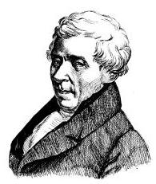
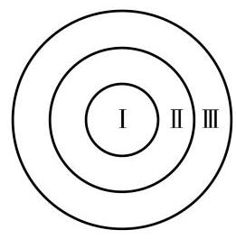

# 古典概型｜双教材原文摘录

本文件保留相关章节的讲解、例题与随堂练习，按版本分段。较宽章节含相邻知识和混合习题，尚未逐题筛选、配答或审校。原文为转写稿，请对照教材原件。

## 人教A版：10.1.3 古典概型

来源：06_第十章_概率.md（本地转写稿），转写稿第 291—551 行；截至下一指定标题前。

## 10.1.3 古典概型

研究随机现象，最重要的是知道随机事件发生的可能性大小．对随机事件发生可能性大小的度量（数值）称为事件的概率（probability），事件A的概率用P（A）表示.

我们知道，通过试验和观察的方法可以得到一些事件的概率估计．但这种方法耗时多，而且得到的仅是概率的近似值．能否通过建立适当的数学模型，直接计算随机事件的概率呢?

## 思考

在10.1.1节中，我们讨论过彩票摇号试验、抛掷一枚均匀硬币的试验及掷一枚质地均匀骰子的试验．它们的共同特征有哪些？

考察这些试验的共同特征，就是要看它们的样本点及样本空间有哪些共性．可以发

现，它们具有如下共同特征：

（1）有限性：样本空间的样本点只有有限个；

（2）等可能性：每个样本点发生的可能性相等.

我们将具有以上两个特征的试验称为古典概型试验，其数学模型称为古典概率模型，简称古典概型.

下面我们就来研究古典概型.

## 思考

考虑下面两个随机试验，如何度量事件A和事件B 发生的可能性大小？

(1）一个班级中有18名男生、22名女生．采用抽签的方式，从中随机选择一名学生，事件A=“抽到男生”；

(2)抛掷一枚质地均匀的硬币3 次，事件B =“恰好一次正面朝上”.

对于问题（1），班级中共有40名学生，从中选择一名学生，因为是随机选取的，所以选到每个学生的可能性都相等，这是一个古典概型.

抽到男生的可能性大小，取决于男生数在班级学生数中所占的比例大小．因此，可以用男生数与班级学生数的比值来度量.显然，这个随机试验的样本空间中有40个样本点，而事件A=“抽到男生”包含18个样本点．因此，事件A发生的可能性大小为 ${ \frac { 1 8 } { 4 0 } } { = } { \frac { 9 } { 2 0 } } .$

对于问题（2），我们用1表示硬币“正面朝上”，用0表示硬币“反面朝上”，则试验的样本空间

$$
\begin{array} { r } { \Omega = \{ ( 1 , \ 1 , \ 1 ) , \ ( 1 , \ 1 , \ 0 ) , \ ( 1 , \ 0 , \ 1 ) , \ ( 1 , \ 0 , \ 0 ) , \ } \\ { ( 0 , \ 1 , \ 1 ) , \ ( 0 , \ 1 , \ 0 ) , \ ( 0 , \ 0 , \ 1 ) , \ ( 0 , \ 0 , \ 0 ) \} , } \end{array}
$$

共有8个样本点，且每个样本点是等可能发生的，所以这是一个古典概型

事件B发生的可能性大小，取决于这个事件包含的样本点在样本空间包含的样本点中所占的比例大小.因此，可以用事件包含的样本点数与样本空间包含的样本点数的比值来度量. 因为 $B = \{ ( 1 , \ 0 , \ 0 ) , \ ( 0 , \ 1 , \ 0 ) , \ ( 0 , \ 0 , \ 1 ) \}$ ，所以事

$$
\frac { 3 } { 8 }
$$

一般地，设试验E是古典概型，样本空间Ω包含n个样本点，事件A包含其中的k个样本点，则定义事件A的概率

$$
P ( A ) = \frac { k } { n } = \frac { n ( A ) } { n ( \Omega ) } .
$$

其中，n（A）和n（Ω）分别表示事件A和样本空间Ω包含的样本点个数.

①法国数学家拉普拉斯（P.-S.Laplace，17491827）在 1812年把该式作为概率的一般定义，现在我们称它为概率的古典定义.

例7单项选择题是标准化考试中常用的题型，一般是从A，B，C，D四个选项中选择一个正确答案．如果考生掌握了考查的内容，他可以选择唯一正确的答案．假设考生有一题不会做，他随机地选择一个答案，答对的概率是多少？

解：试验有选A、选B、选C、选D共4种可能结果，试验的样本空间可以表示为$\Omega = \{ \mathrm { A } , \ \mathrm { B } , \ \mathrm { C } , \ \mathrm { D } \}$ ．考生随机选择一个答案，表明每个样本点发生的可能性相等，所以这是一个古典概型．设M=“选中正确答案”，因为正确答案是唯一的，所以 $n ( M ) = 1$ 所以，考生随机选择一个答案，答对的概率

$$
P ( M ) = { \frac { 1 } { 4 } } .
$$

## 思考

在标准化考试中也有多选题，多选题是从A，B，C，D四个选项中选出所有正确的答案（四个选项中至少有两个选项是正确的)．你认为单选题和多选题哪种更难选对？为什么？

例8 抛掷两枚质地均匀的骰子（标记为Ⅰ号和Ⅱ号），观察两枚骰子分别可能出现的基本结果.

（1）写出这个试验的样本空间，并判断这个试验是否为古典概型；

（2）求下列事件的概率：

A = “两个点数之和是 5”；

B = “两个点数相等”；

C=“I号骰子的点数大于Ⅱ号骰子的点数”.

解：（1）抛掷一枚骰子有6种等可能的结果，Ⅰ号骰子的每一个结果都可与Ⅱ号骰子的任意一个结果配对，组成掷两枚骰子试验的一个结果．用数字m表示Ⅰ号骰子出现的点数是m，数字n表示Ⅱ号骰子出现的点数是n，则数组(m，n）表示这个试验的一个样本点．因此该试验的样本空间

$$
\begin{array} { r } { \Omega = \{ ( \textbf { \ } m , \textbf { \ } n ) \ | _ { \textbf { \ } m , n } \in \{ 1 , \textbf { \ } 2 , \textbf { \ } 3 , \textbf { \ } 4 , \textbf { \ } 5 , \textbf { \ } 6 \} \} , } \end{array}
$$

其中共有 36 个样本点.

由于骰子的质地均匀，所以各个样本点出现的可能性相等，因此这个试验是古典概型.

(2)因为A={(1，4)，(2，3)，(3，2)，(4，1)}，所以 $n \left( A \right) = 4$ ，从而

$$
P \left( A \right) = \frac { n \left( A \right) } { n \left( \Omega \right) } = \frac { 4 } { 3 6 } = \frac { 1 } { 9 } ;
$$

因为B={(1，1)，(2，2)，(3，3)，(4，4)，(5，5)，(6，6)}，所以 $n ( B ) = 6$ ，从而

$$
P ( B ) = \frac { n \left( B \right) } { n \left( \Omega \right) } = \frac { 6 } { 3 6 } = \frac { 1 } { 6 } ;
$$

因为

C ={(2，1)，(3,1)，(3，2)，(4，1)，(4，2)，(4，3)，(5，1)，(5，2),

$$
( 5 , \ 3 ) , \ ( 5 , \ 4 ) , \ ( 6 , \ 1 ) , \ ( 6 , \ 2 ) , \ ( 6 , \ 3 ) , \ ( 6 , \ 4 ) , \ ( 6 , \ 5 ) \} ,
$$

所以 $n \left( C \right) = 1 5$ ，从而

$$
P ( C ) = \frac { n \left( C \right) } { n \left( \Omega \right) } = \frac { 1 5 } { 3 6 } = \frac { 5 } { 1 2 } .
$$

## 思考

在例8中，为什么要把两枚骰子标上记号？如果不给两枚骰子标记号，会出现什么情况？你能解释其中的原因吗？

如果不给两枚骰子标记号，则不能区分所抛掷出的两个点数分别属于哪枚骰子，如抛掷出的结果是1点和2点，有可能第一枚骰子的结果是1点，也有可能第二枚骰子的结果是1点．这样，（1，2）和（2，1）的结果将无法区别.

当不给两枚骰子标记号时，试验的样本空间 $\Omega _ { 1 } = \{ ( m , \ n ) \ | \ m , \ n \in \{ 1 , \ 2 , \ 3 , \ 4 , \nonumber$ $5 , \ 6 \}$ ，且 $m \leqslant n \}$ ，则 $n ( \varOmega _ { 1 } ) = 2 1$ ．其中，事件A=“两个点数之和是 $5 ^ { \mathfrak { s } }$ 的结果变为$A = \{ ( 1 , \ 4 ) , \ ( 2 , \ 3 ) \}$ ，这时 $P ( A ) = { \frac { 2 } { 2 1 } }$

## 3 思考

同一个事件的概率，为什么会出现两个不同的结果呢？

可以发现，36个结果都是等可能的；而合并为21个可能结果时，（1，1）和（1，2）发生的可能性大小不等，这不符合古典概型特征，所以不能用古典概型公式计算概率，因此 $P ( A ) = { \frac { 2 } { 2 1 } }$ 是错误的. 2 R

## 归纳

求解古典概型問题的一般思路：

（1）明确试验的条件及要观察的结果，用适当的符号（字母、数字、数组等）表示试验的可能结果（借助图表可以帮助我们不重不漏地列出所有的可能结果)；

(2) 根据实际问题情境判断样本点的等可能性；

(3） 计算样本点总个数及事件 A 包含的样本点个数，求出事件 A 的概率.

例9袋子中有5个大小质地完全相同的球，其中2个红球、3个黄球，从中不放回地依次随机摸出2个球，求下列事件的概率：

(1) A = “第一次摸到红球”；

(2) B = “第二次摸到红球”；

(3) AB = “两次都摸到红球”.

解：将两个红球编号为1，2，三个黄球编号为3，4，5.第一次摸球时有5种等可能的结果，对应第一次摸球的每个可能结果，第二次摸球时都有4种等可能的结果．将两次摸球的结果配对，组成20种等可能的结果，用表10.1-2表示.

表 10.1-2
<table><tr><td rowspan=2 colspan=1>第一次</td><td rowspan=1 colspan=5>第二次</td></tr><tr><td rowspan=1 colspan=1>1</td><td rowspan=1 colspan=1>2</td><td rowspan=1 colspan=1>3</td><td rowspan=1 colspan=1>4</td><td rowspan=1 colspan=1>5</td></tr><tr><td rowspan=1 colspan=1>1.</td><td rowspan=1 colspan=1>×</td><td rowspan=1 colspan=1>(1,2)</td><td rowspan=1 colspan=1>(1, 3)</td><td rowspan=1 colspan=1>(1, 4)</td><td rowspan=1 colspan=1>(1,5)</td></tr><tr><td rowspan=1 colspan=1>2</td><td rowspan=1 colspan=1>(2,1)</td><td rowspan=1 colspan=1>X</td><td rowspan=1 colspan=1>(2,3)</td><td rowspan=1 colspan=1>(2,4)</td><td rowspan=1 colspan=1>(2，5)</td></tr><tr><td rowspan=1 colspan=1>3</td><td rowspan=1 colspan=1>(3, 1)</td><td rowspan=1 colspan=1>(3,2)</td><td rowspan=1 colspan=1>X</td><td rowspan=1 colspan=1>(3，4)</td><td rowspan=1 colspan=1>(3，5)</td></tr><tr><td rowspan=1 colspan=1>4</td><td rowspan=1 colspan=1>(4, 1)</td><td rowspan=1 colspan=1>(4,2)</td><td rowspan=1 colspan=1>(4, 3)</td><td rowspan=1 colspan=1>X</td><td rowspan=1 colspan=1>(4,5)</td></tr><tr><td rowspan=1 colspan=1>5</td><td rowspan=1 colspan=1>(5,1)</td><td rowspan=1 colspan=1>(5，2)</td><td rowspan=1 colspan=1>(5，3)</td><td rowspan=1 colspan=1>(5，4)</td><td rowspan=1 colspan=1>X</td></tr></table>

（1）第一次摸到红球的可能结果有8种（表中第1，2行），即

$$
\begin{array} { r l } { { } } & { { A = \{ ( 1 , ~ 2 ) , ~ ( 1 , ~ 3 ) , ~ ( 1 , ~ 4 ) , ~ ( 1 , ~ 5 ) , } }  \\ { { } } & { { ( 2 , ~ 1 ) , ~ ( 2 , ~ 3 ) , ~ ( 2 , ~ 4 ) , ~ ( 2 , ~ 5 ) \} , } } \end{array}
$$

所以

$$
P \left( A \right) = \frac { 8 } { 2 0 } = \frac { 2 } { 5 } .
$$

（2）第二次摸到红球的可能结果也有8种（表中第1，2列），即

$$
\begin{array} { r l } { { } } & { { B = \{ ( 2 , ~ 1 ) , ~ ( 3 , ~ 1 ) , ~ ( 4 , ~ 1 ) , ~ ( 5 , ~ 1 ) , } }  \\ { { } } & { { ( 1 , ~ 2 ) , ~ ( 3 , ~ 2 ) , ~ ( 4 , ~ 2 ) , ~ ( 5 , ~ 2 ) \} , } } \end{array}
$$

所以

$$
P ( B ) = { \frac { 8 } { 2 0 } } = { \frac { 2 } { 5 } } .
$$

（3）事件AB 包含2个可能结果，即 $A B = \{ ( 1 , ~ 2 )$ (2，1)}，所以

$$
P ( A B ) = \frac { 2 } { 2 0 } = \frac { 1 } { 1 0 } .
$$

如果同时摸出2个球，那么事件AB的概率是多少？

例10 从两名男生（记为 $\mathrm { B _ { 1 } }$ 和 $\mathrm { B } _ { 2 } )$ 、两名女生（记为 $\mathrm { G } _ { 1 }$ 和 $\mathrm { ~ G _ { 2 } ~ } )$ 中任意抽取两人，

（1）分别写出有放回简单随机抽样、不放回简单随机抽样和按性别等比例分层随机抽样的样本空间；

（2）在三种抽样方式下，分别计算抽到的两人都是男生的概率

解：设第一次抽取的人记为 $x _ { 1 }$ ，第二次抽取的人记为 $x _ { 2 }$ ，则可用数组 $( \mathbf { \nabla } _ { x _ { 1 } } , \mathbf { \nabla } _ { x _ { 2 } } )$ 表示样本点.

（1）根据相应的抽样方法可知：

有放回简单随机抽样的样本空间

$$
\begin{array} { r l } & { \Omega _ { 1 } = \{ \mathrm { ( B _ { 1 } , ~ B _ { 1 } ) , ~ ( B _ { 1 } , ~ B _ { 2 } ) , ~ ~ ( B _ { 1 } , ~ G _ { 1 } ) , ~ ~ ( B _ { 1 } , ~ G _ { 2 } ) , ~ ~ ( B _ { 2 } , ~ B _ { 1 } ) , ~ ~ ( B _ { 2 } , ~ B _ { 2 } ) , ~ ~ ( B _ { 2 } , ~ B _ { 2 } ) , ~ ~ ( B _ { 2 } , ~ B _ { 2 } ) } } \\ & { \mathrm { ( G _ { 1 } ) , ~ ( B _ { 2 } , ~ G _ { 2 } ) , ~ ( G _ { 1 } , ~ B _ { 1 } ) , ~ ( G _ { 1 } , ~ B _ { 2 } ) , ~ ( G _ { 1 } , ~ G _ { 1 } ) , ~ ( G _ { 1 } ) , ~ ( G _ { 1 } , ~ G _ { 2 } ) , ~ ~ ( G _ { 2 } ) , ~ ( G _ { 2 } , ~ B _ { 1 } ) } , } \\ & { \mathrm { ( G _ { 2 } , ~ B _ { 2 } ) , ~ ( G _ { 2 } , ~ G _ { 1 } ) , ~ ( G _ { 2 } , ~ G _ { 2 } ) } \} . } \end{array}
$$

不放回简单随机抽样的样本空间

$$
\begin{array} { r l } & { \Omega _ { 2 } = \{ \mathrm { ( B _ { 1 } , ~ B _ { 2 } ) , ~ ( B _ { 1 } , ~ G _ { 1 } ) , ~ ~ ( B _ { 1 } , ~ G _ { 2 } ) , ~ ~ ( B _ { 2 } , ~ B _ { 1 } ) , ~ ( B _ { 2 } , ~ G _ { 1 } ) , ~ ~ ( B _ { 2 } , ~ G _ { 2 } ) , ~ ~ ( G _ { 1 } , ~ G _ { 2 } ) } , } \\ & { \qquad \mathrm { ~ B _ { 1 } ) , ~ ( G _ { 1 } , ~ B _ { 2 } ) , ~ ( G _ { 1 } , ~ G _ { 2 } ) , ~ ( G _ { 2 } , ~ B _ { 1 } ) , ~ ( G _ { 2 } , ~ B _ { 2 } ) , ~ ( G _ { 2 } , ~ G _ { 1 } ) } \} . } \end{array}
$$

按性别等比例分层随机抽样，先从男生中抽一人，再从女生中抽一人，其样本空间

$$
\Omega _ { 3 } = \{ \left( \mathrm { B } _ { 1 } , \mathrm { ~ G } _ { 1 } \right) , \mathrm { ~ ( B _ { 1 } , ~ G _ { 2 } ) , ~ ( B _ { 2 } , ~ G _ { 1 } ) , ~ ( B _ { 2 } , ~ G _ { 2 } ) } \} .
$$

(2) 设事件 $A = ^ { 6 6 }$ 抽到两名男生”，则

对于有放回简单随机抽样，

$$
A = \{ \mathrm { ( B _ { 1 } , ~ B _ { 1 } ) } , ~ \mathrm { ( B _ { 1 } , ~ B _ { 2 } ) } , ~ \mathrm { ( B _ { 2 } , ~ B _ { 1 } ) } , ~ \mathrm { ( B _ { 2 } , ~ B _ { 2 } ) } \} .
$$

因为抽中样本空间 $\Omega _ { 1 }$ 中每一个样本点的可能性都相等，所以这是一个古典概型．因此

$$
P \left( A \right) = \frac { 4 } { 1 6 } = \frac { 1 } { 4 } .
$$

对于不放回简单随机抽样，

$$
A = \{ ( \mathrm { B } _ { 1 } , \mathrm { ~ B } _ { 2 } ) , ( \mathrm { B } _ { 2 } , \mathrm { ~ B } _ { 1 } ) \} .
$$

因为抽中样本空间 $\Omega _ { 2 }$ 中每一个样本点的可能性都相等，所以这是一个古典概型因此

$$
P \left( A \right) = \frac { 2 } { 1 2 } = \frac { 1 } { 6 } .
$$

因为按性别等比例分层随机抽样，不可能抽到两名男生，所以 $A = \varnothing$ ，因此 $P ( A ) = 0 .$

例10表明，同一个事件 $A = ^ { 6 6 }$ 抽到两名男生”发生的概率，在按性别等比例分层随机抽样时最小，在不放回简单随机抽样时次之，在有放回简单随机抽样时最大．因此，抽样方法不同，则样本空间不同，某个事件发生的概率也可能不同

上一章我们研究过通过抽样调查估计树人中学高一学生平均身高的问题．我们知道，简单随机抽样使总体中每一个个体都有相等的机会被抽中，但因为抽样的随机性，有可能会出现全是男生的“极端”样本，这就可能高估总体的平均身高。上述计算表明，在总体的男、女生人数相同的情况下，用有放回简单随机抽样进行抽样，出现全是男生的样本的概率为0.25；用不放回简单随机抽样进行抽样，出现全是男生的样本的概率约为0.167，可以有效地降低出现“极端”样本的概率．特别是，在按性别等比例分层随机抽样中，全是男生的样本出现的概率为0，真正避免了这类极端样本的出现．所以，改进抽样方法对于提高样本的代表性很重要.

## 练习

1. 判断下面的解答是否正确，并说明理由.

某运动员连续进行两次飞碟射击练习，观察命中目标的情况，用y表示命中，用n表示没有命中，那么试验的样本空间 $\Omega = \{ yy,\ yn,\ ny,\ nn \}$，因此事件“两次射击都命中”的概率为0.25.

2.从52张扑克牌（不含大小王）中随机地抽一张牌，计算下列事件的概率：（1）抽到的牌是7； （2）抽到的牌不是7； （3）抽到的牌是方片；（4）抽到J或Q或K； （5）抽到的牌既是红心又是草花；（6）抽到的牌比6大比9小；（7）抽到的牌是红花色； (8）抽到的牌是红花色或黑花色.

3.从0～9这10个数中随机选择一个数，求下列事件的概率：

（1）这个数平方的个位数字为1； （2）这个数的四次方的个位数字为1.

## 沪教版2026：12.2 古典概率

来源：沪教版必修第三册2026-dollar-polished.md（本地转写稿），转写稿第 3365—3875 行；截至下一指定标题前。

## 12.2 古典概率

概率的发展是从等可能的古典概率开始的, 学习概率同样也从这里开始. 此外, 数学中概率这个概念, 还应该反映生活中人们对于概率这个常用词的直观认识.

### 1 等可能性与概率

通俗地讲，概率就是可能性的大小. 我们从最简单的抛掷硬币来学习与概率相关的概念. 抛掷一枚硬币这个随机试验一共有两个可能的结果: 正面朝上与反面朝上, 其中必然有且只有一个结果会出现, 并且两个结果出现的可能性通常被认为是一样的. 因为习惯地约定必然事件的概率是 1 , 所以正面朝上的可能性即概率是 $\frac{1}{2}$ . 这里的关键是硬币的两个面出现的可能性一样. 一般地, 若一个随机试验的所有结果出现的可能性都一样, 则称之为具有等可能性 (equally likely), 它在许多场合下是直观自然的. Q

如果一个随机试验满足下面两个条件:(1)包含有限个可能出现的结果(样本点)；(2)这些结果出现是等可能的，那么这样的随机试验就称为古典概率模型. 它是最常见也是最简单的概率模型.

在一个古典概率模型中, $\Omega$ 是一个有限且等可能的样本空间. 这里等可能的样本空间是指该样本空间中的每个样本点出现的可能性相同. 因为依照习惯约定必然事件的概率是 1 , 所以每个样本点发生的概率自然是样本点总数的倒数. 由于一般的随机事件 $A$ 是样本点的某个集合,即样本空间的一个子集,用符号 $P\left( A\right)$ 表示事件 $A$ 发生的概率 (probability),那么事件 $A$ 发生的概率为

$$
P\left( A\right)  = \frac{\left| A\right| }{\left| \Omega \right| }.
$$

---

为什么硬币的两面出现是等可能的? 这是由于:(1)假设抛掷的硬币是质地均匀的; (2)假设抛掷的过程是充分随机的. 这两个假设使得我们确信硬币落地时不会偏向于其任何一面.

---

其中, $\left| A\right|$ 表示事件 $A$ 中的样本点个数,而 $\left| \Omega \right|$ 表示样本空间中的样本点个数. 上式说明概率是事件中的样本点个数与样本空间中样本点个数的比值. Q

---

符号 $\left| A\right|$ 表示集合 $A$ 的元素个数.

---

例 1 抛掷一枚硬币正面朝上和掷一颗骰子得点数 6 的概率分别是多少?

解(1)抛掷一枚硬币，正面朝上和反面朝上的可能性是一样的,属于古典概率模型,由定义,它们的概率都是 $\frac{1}{2}$ .

---

拉普拉斯 (P.-S. Laplace, 1749—1827) 分别在 1812 年与 1814 年出版《概率的分析理论》与《概率的哲学探讨》两部著作，明确给出了古典概率的定义, 总结了那个时代所知的概率研究成果, 并且对概率论在自然科学、社会科学、 选举、决策、审判等方面的应用作出了开创性的探讨.

---

(2)掷一颗骰子，朝上一面的数字是 1、2、3、4、5、6 中的一个, 所以有 6 个可能结果, 这些结果也是等可能出现的, 所以掷骰子也是一个古典概率模型. 由定义, 每个结果出现的概率是 $\frac{1}{6}$ ,从而出现点数 6 的概率是 $\frac{1}{6}$ .

根据概率的定义, 容易得到以下两个简单的性质:

概率性质 1 必然事件的概率是 1 , 不可能事件的概率是 0 , 即

$$
P\left( \Omega \right)  = 1, P\left( \varnothing \right)  = 0.
$$

概率性质 2 设 $A$ 是一个事件,那么 $0 \leq  P\left( A\right)  \leq  1$ .

Q

例 2 同时掷两颗骰子,求:

---

在抛掷硬币或掷骰子时, 我们实际上不言自喻地假设等可能性.

---

(1)所得点数之和为 5 的概率;

(2)所得点数相等的概率;

(3)所得点数都是偶数的概率；

(4)所得点数相差 2 的概率.

解 由例 1, 掷两颗骰子(设已标记为不同的颜色)的样本空间是

$$
\Omega  = \{ \left( {i, j}\right)  \mid  i = 1,\cdots ,6;j = 1,\cdots ,6\} ,
$$

其中 $i\text{ 、 }j$ 分别是掷第一颗与第二颗骰子所得的点数. 这个样本空间一共有 $6 \times  6 = {36}$ 个样本点,它们是等可能的.

(1)将所得点数之和为 5 这个事件用 $A$ 表示. 那么,事件 $A$ 包含以下样本点: $\left( {1,4}\right) \text{ 、 }\left( {2,3}\right) \text{ 、 }\left( {3,2}\right) \text{ 、 }\left( {4,1}\right)$ ,即

$$
A = \{ \left( {1,4}\right) ,\left( {2,3}\right) ,\left( {3,2}\right) ,\left( {4,1}\right) \} .
$$

事件 $A$ 有 4 个样本点,从而点数之和等于 5 的概率为

$$
P\left( A\right)  = \frac{4}{36} = \frac{1}{9}.
$$

(2)将所得点数相等这个事件用 $B$ 表示. 类似地，有

$$
B = \{ \left( {1,1}\right) ,\left( {2,2}\right) ,\left( {3,3}\right) ,\left( {4,4}\right) ,\left( {5,5}\right) ,\left( {6,6}\right) \} ,
$$

因此

$$
P\left( B\right)  = \frac{6}{36} = \frac{1}{6}.
$$

(3)将所得点数都是偶数这个事件用 $C$ 表示，类似地，有

$$
C = \{ \left( {2,2}\right) ,\left( {2,4}\right) ,\left( {2,6}\right) ,\left( {4,2}\right) ,\left( {4,4}\right) ,
$$

$$
\left( {4,6}\right) ,\left( {6,2}\right) ,\left( {6,4}\right) ,\left( {6,6}\right) \} ,
$$

因此

$$
P\left( C\right)  = \frac{9}{36} = \frac{1}{4}.
$$

(4)将所得点数相差 2 这个事件用 $D$ 表示，类似地，有

$$
D = \{ \left( {1,3}\right) ,\left( {3,1}\right) ,\left( {2,4}\right) ,\left( {4,2}\right) ,\left( {3,5}\right) ,\left( {5,3}\right) ,\left( {4,6}\right) ,\left( {6,4}\right) \} ,
$$

因此

$$
P\left( D\right)  = \frac{8}{36} = \frac{2}{9}.
$$

#### 练习 12.2(1)

1. 同时掷 2 颗骰子, 求:

(1)所得点数和为 6 的概率; (2)所得点数和不大于 6 的概率.

2. 抛掷 3 枚硬币,求下列事件的概率:

(1)恰有 2 枚正面朝上； (2)最多 1 枚正面朝上.

### 2 等可能性(续)

在上一节说过, 随机现象的样本空间的选取依赖于观察的角度, 但其中事件的概率与观察角度这一主观因素无关, 是确定唯一的. 在古典概率模型中, 随着观察角度的不同, 并非所有的样本空间都有等可能性. 例如, 抛掷两枚硬币, 样本空间 (正正,正反,反正,反反) 中的样本点是等可能的, 但样本空间 (两正,一正一反,两反) 却不是等可能的. 虽然取什么样本空间

不影响所考察的随机事件的概率, 但只有选取等可能的样本空间, 才能使得事件的概率如定义所示, 等于事件中样本点个数与样本空间中样本点个数之比, 进而使有关计算变得简单, 所以我们通常要选取一个等可能的样本空间.

怎么得到一个等可能的样本空间呢? 对抛掷一枚硬币、掷一颗骰子、摸一个球等随机试验来说, 这很简单, 但对复杂的随机试验来说, 这并不是很容易. 为此, 通常要将一个随机试验依次分解为若干个等可能的随机试验来处理, 方法如下:

设一个随机试验分两步完成,第一步有 $m$ 个等可能的结果, 记作

$$
{a}_{1},{a}_{2},\cdots ,{a}_{m}\text{ ; }
$$

而对第一步得到的每个结果,第二步总有 $n$ 个等可能的结果, 记作

$$
{b}_{1},{b}_{2},\cdots ,{b}_{n}\text{ . }
$$

那么, 该随机试验的样本空间就是

$$
\Omega  = \left\{  {\left( {{a}_{i},{b}_{j}}\right)  \mid  i = 1,2,\cdots , m;j = 1,2,\cdots , n}\right\}  ,
$$

它是等可能的,共有 ${mn}$ 个样本点. 对多步的等可能随机试验可以类似地构造等可能的样本空间.

例 3 从分别写有 $A\text{ 、 }B\text{ 、 }C$ 的三个大小与质地相同的球中任意取两个, 寻找其等可能的样本空间.

解 取两个球这个试验可以分解为两步: 先取一个不放回, 再取一个. 第一步有 3 个等可能的结果: $A\text{ 、 }B\text{ 、 }C$ . 再取时, 在剩下的两个球中等可能地取一个. 如果第一个取出的是 $A$ , 那么再取时的结果是 $B$ 或 $C$ ,记作 ${AB}$ 或 ${AC}$ ; 同理,如果第一个取出的是 $B$ ,再取的结果是 $A$ 或 $C$ ,记作 ${BA}$ 或 ${BC}$ . 依此类推,共有 6 个等可能的结果: ${AB}\text{ 、 }{AC}\text{ 、 }{BA}\text{ 、 }{BC}\text{ 、 }{CA}$ 、 ${CB}$ . 这里所写的两个字母是有顺序的,分别表示第一次及第二次取出的球上的字母. 因此, 这个试验的一个等可能的样本空间是

$$
\Omega  = \{ {AB},{AC},{BA},{BC},{CA},{CB}\} .
$$

可以看出, 如果只考虑出现的字母而不考虑顺序, 那么样本空间是 $\Omega  = \{ {AB},{BC},{CA}\}$ . 因为其中每个样本点对应前一个样本空间中的两个样本点, 所以它也是等可能的.

在上面的例子中, 因为无需考虑顺序, 所以一次取两个球和依次不放回地取两个球的随机性是一样的.

例 4 从一个放有两个大小与质地相同的白球、一个黑球的罐子中任意摸两个球, 写出其样本空间并思考: 这个样本空间是否有不同的写法? 什么样的样本空间有等可能性? 并求至少摸到一个黑球的概率.

解 把两个白球分别标记为 $A\text{ 、 }B$ ,而黑球标记为 $C$ . 样本空间

$$
\Omega  = \{ {AB},{AC},{BA},{BC},{CA},{CB}\}
$$

是等可能的. 如果只关心摸到的白球个数, 那么只看到两个结果:两个白球、一黑一白, 这不是等可能的. 最后, 从第一个样本空间看, 事件“至少摸到一个黑球”包含 4 个样本点 ${AC}$ , ${BC},{CA},{CB}$ ,因此其概率为 $\frac{4}{6} = \frac{2}{3}$ .

#### 练习 12.2(2)

1. 掷两颗骰子, 点数之和出现哪个数的可能性最大?
2. (配对问题) 三个人抽签, 三个签上事先分别写上了各自的名字. 求下面事件的概率:

${A}_{0}$ : 没有人抽到写有自己名字的签；

${A}_{1}$ : 恰有一个人抽到写有自己名字的签；

${A}_{2}$ : 恰有两个人抽到写有自己名字的签；

${A}_{3}$ : 三个人都抽到写有自己名字的签.

### 3 事件关系和运算

对于一个随机现象而言, 在确定样本空间之后, 事件对应于样本空间的一个子集, 通常用相同的字母来表示事件与相应的子集.

首先,事件之间是有关系的. 设事件 $A$ 对应于子集 $A$ ,事件 $B$ 对应于子集 $B$ . 如果 $A$ 的样本点都在 $B$ 中,那么 $A$ 发生必然 $B$ 发生. 此时,称 $B$ 包含 $A$ 或者 $A$ 包含于 $B$ ,即 $A \subseteq  B$ . 例如, 抛掷三枚硬币, $A$ : 至少有两枚正面朝上, $B$ : 至少有一枚正面

朝上，则 $A \subseteq  B$ ，即 $A$ 发生必然 $B$ 发生，或等价地说， $B$ 不发生则 $A$ 也不发生.

其次,事件是可以运算的. “两个事件 $A\text{ 、 }B$ 至少有一个发生”, 这本身也是一个事件, 是指在两个事件所包含的样本点中至少有一个发生,其对应的子集是 $A \cup  B$ . 同样地,“两个事件 $A\text{ 、 }B$ 同时发生”也是一个事件,是指两个事件的某个共同的样本点发生,其对应的子集是 $A \cap  B$ . 因此,“两个事件至少有一个发生”对应于相应集合的并，而“两个事件同时发生”则对应于相应集合的交.

如果 $A$ 与 $B$ 没有共同的样本点,即两个子集不相交: $A \cap  B = \varnothing$ ,那么这两个事件不可能同时发生,或者说互斥.

“事件 $A$ 发生”的否定就是“事件 $A$ 不发生”,它也是一个事件,称为事件 $A$ 的对立事件,简称为“非 $A$ ”. 对应的子集是不属于 $A$ 的样本点全体,从而是 $A$ 在样本空间 $\Omega$ 中的补集 $\bar{A}$ . 显然 $A$ 与非 $A$ 不会同时发生,但肯定有一个发生,即成立

$$
A \cap  \overline{A} = \varnothing , A \cup  \overline{A} = \Omega .
$$

现在来看“同时发生”及“至少有一个发生”这些事件的否定形式. 正如“所有人都去”的否定是“至少有一个人没去”一样，“A、 $B$ 两个事件同时发生”的否定是 “ $A\text{ 、 }B$ 至少有一个不发生”，或者“ $A$ 不发生或 $B$ 不发生”,即成立

$$
\overline{A \cap  B} = \bar{A} \cup  \bar{B}.
$$

类似地,“ $A\text{ 、 }B$ 两个事件至少有一个发生”的否定是 “ $A$ 与 $B$ 都没发生”,即成立

$$
\overline{A \cup  B} = \bar{A} \cap  \bar{B}.
$$

上面这两个公式是对两个事件来陈述的, 实际上对任意多个事件同样成立.

例 5 掷两颗骰子,观察掷得的点数. 设 $A$ : 至少一个是偶数, $B$ : 至少一个是奇数, $C$ : 两个点数的乘积是偶数, $D$ : 两个点数的和是奇数. 讨论:

---

事件的关系就是样本空间中相应子集的关系, 事件的运算就是相应子集的运算, 两者是互相对应的.

---

(1)A 与 B 的关系；

(2)A 和 C 的关系；

(3)A、B、D 之间的关系；

(4)C 与 $D$ 的关系.

解 (1) $A$ 发生, $B$ 不一定发生; $B$ 发生, $A$ 不一定发生. 因此, $A\text{ 、 }B$ 互不包含. 此外, $A\text{ 、 }B$ 有可能同时发生,所以它们也不互斥.

(2)两个点数的乘积是偶数当且仅当其中至少一个是偶数， 即 $A = C$ .

(3)两个点数的和是奇数当且仅当一个是奇数一个是偶数， 即 $D = A \cap  B$ .

(4)若两个点数的和是奇数，肯定是一奇一偶，所以其乘积一定是偶数; 反过来, 乘积是偶数说明两个点数中至少一个是偶数. 因此 $D \subseteq  A$ ,且因为 (2),故 $D \subseteq  C$ ,但两者不等.

例 6 掷两颗骰子,观察掷得的点数. 设 $A$ : 至少一个点数是偶数, $B$ : 点数之和是偶数. 求:

(1) $A \cup  B$ ；

(2) $A \cap  B$ .

解(1) 掷两颗骰子，出现的两个点数可以分成三个互斥的事件:两个都是偶数，记作 ${A}_{0}$ ；一奇一偶，记作 ${A}_{1}$ ；两个都是奇数,记作 ${A}_{2}$ . 于是有

$$
\Omega  = {A}_{0} \cup  {A}_{1} \cup  {A}_{2}.
$$

${A}_{0}\text{ 、 }{A}_{1}$ 两种情况合起来是事件 $A$ ,即 $A = {A}_{0} \cup  {A}_{1}$ ,而 ${A}_{0}\text{ 、 }{A}_{2}$ 两种情况合起来是事件 $B$ ,即 $B = {A}_{0} \cup  {A}_{2}$ . 因此

$$
A \cup  B = \left( {{A}_{0} \cup  {A}_{1}}\right)  \cup  \left( {{A}_{0} \cup  {A}_{2}}\right)  = {A}_{0} \cup  {A}_{1} \cup  {A}_{2} = \Omega .
$$

也就是说, 掷两颗骰子, 或者至少其中一个点数是偶数, 或者点数之和是偶数.

(2)事件 $A$ 、 $B$ 同时发生是指至少其中一个点数是偶数，而其点数之和也是偶数, 从而两个点数必须都是偶数, 即成立

$$
A \cap  B = \{ \left( {i, j}\right)  \mid  1 \leq  i \leq  6,1 \leq  j \leq  6, i\text{ 、 }j\text{ 都是偶数 }\} \text{ . }
$$

#### 练习 12.2(3)

1. 写出例 6 中事件 $A\text{ 、 }B$ 各自包含的样本点,表示出 $A \cup  B$ 与 $A \cap  B$ 来验证例 6 中的结果.

---

也可以直接把 $A$ 、 $B$ 的样本点一一列出来, 再进行相应的运算, 见练习 12.2(3).

---

2. 把 1、2、3、4、5、6、7、8、9、10 分别写在 10 张一样的卡片上, 并随机抽取 1 张. 设 $A$ : 出现偶数, $B$ : 出现 3 的倍数. 写出下面两个事件的对应子集:

(1)A、B 至少有一个发生； (2)A、B 同时发生.

### 4 可加性

概率 $P\left( A\right)$ 是赋予事件 $A$ 的一个量,它表示事件 $A$ 发生的可能性大小, 是该事件的客观属性. 对于古典概率模型来说, 这个量是如下定义的:

$$
P\left( A\right)  = \frac{\left| A\right| }{\left| \Omega \right| }.
$$

设事件 $A\text{ 、 }B$ 不同时发生,即成立 $A \cap  B = \varnothing$ . 而 $A$ 与 $B$ 至少有一个发生的事件是 $A \cup  B$ . 因为 $A$ 与 $B$ 中没有共同的元素, 所以并集 $A \cup  B$ 的元素个数就是 $A$ 及 $B$ 的元素个数之和,即成立

$$
\left| {A \cup  B}\right|  = \left| A\right|  + \left| B\right| ,
$$

因此

$$
P\left( {A \cup  B}\right)  = \frac{\left| A \cup  B\right| }{\left| \Omega \right| } = \frac{\left| A\right| }{\left| \Omega \right| } + \frac{\left| B\right| }{\left| \Omega \right| } = P\left( A\right)  + P\left( B\right) .
$$

即得到概率的可加性 (additivity):

概率性质 3 (可加性) 两个不可能同时发生的事件至少有一个发生的概率是这两个事件的概率之和. 换言之, 如果 $A \cap  B = \varnothing$ ,那么

$$
P\left( {A \cup  B}\right)  = P\left( A\right)  + P\left( B\right) .
$$

将上述可加性用于 $B = \bar{A}$ 特殊情况,由于 $A \cup  \bar{A} = \Omega$ ,就得到

概率性质 4 对任一给定事件, 其发生的概率与不发生的概率的和总是 1 . 换言之, 有 Q

$$
P\left( A\right)  = 1 - P\left( \bar{A}\right) .
$$

---

很多量有可加性, 如集合的元素个数， 区域的面积, 物体的体积和质量, 等等, 但也有很多量不具有可加性, 如物体的密度.

---

作为度量某事件发生可能性大小的量, 概率最本质的性质就是可加性, 它在计算概率时非常重要.

例 7 抛掷三枚硬币,求:

(1)至少出现两个正面的概率;

(2)至少出现一个正面的概率.

解 用 $H\text{ 、 }T$ 分别表示正面与反面,则抛掷三枚硬币的样本空间是

$$
\Omega  = \{ {HHH},{HTH},{HHT},{HTT},{THH},{TTH},{THT},{TTT}\} .
$$

(1)令 $A$ 为至少出现两个正面. 恰有两个正面出现的事件为 $\{ {HTH},{HHT},{THH}\}$ ,而恰有三个正面出现的事件为 $\{ {HHH}\}$ . 至少有两个正面出现意味着这两个事件至少有一个发生, 而且这两个事件不会同时发生. 所以，由概率性质 3 , 得

$$
P\left( A\right)  = \frac{3}{8} + \frac{1}{8} = \frac{4}{8} = \frac{1}{2}.
$$

(2)令 $B$ 为至少出现一个正面，它的对立事件 $\bar{B}$ 就是全部为反面,即 $\bar{B} = \{ {TTT}\}$ . 所以,由概率性质 4,得

$$
P\left( B\right)  = 1 - P\left( \bar{B}\right)  = 1 - \frac{1}{8} = \frac{7}{8}.
$$

将上述古典概率的基本性质抽象出来, 可得概率满足以下三个性质:

(1)任意事件 A 的概率介于 0、1 之间，即 $0 \leq  P\left( A\right)  \leq  1$ ；

(2)规范性:必然事件的概率为 1 ，即 $P\left( \Omega \right)  = 1$ ；

(3)可加性:若事件 $A$ 、 $B$ 互斥，则

$$
P\left( {A \cup  B}\right)  = P\left( A\right)  + P\left( B\right) .
$$

前面所讲的古典概率是概率的特殊情况和思想源泉, 但应该指出, 概率不限于古典概率, 如例 8、例 9 所示.

例 8 甲、乙两人下棋, 甲获胜的概率为 0.4 , 甲不输的概率为 0.9 . 求甲、乙两人下成和棋的概率.

解 用 $A$ 表示甲获胜, $B$ 表示和棋, $C$ 表示甲不输. 因为甲不输是指甲获胜或者和棋, 所以

$$
C = A \cup  B\text{ . }
$$

而和棋与获胜是互斥的, 由概率性质 3(可加性), 得

$$
P\left( C\right)  = P\left( {A \cup  B}\right)  = P\left( A\right)  + P\left( B\right) .
$$

题意说明 $P\left( C\right)  = {0.9}, P\left( A\right)  = {0.4}$ ,因此 $P\left( B\right)  = {0.9} - {0.4}$

---

本例中所说的概率并不是按古典概率定义的概率.

---

由于本章涉及的样本空间都很小, 计算概率只需直接计数. 为了说明可加性的重要性, 下面举一个稍有难度的例子.

例 9 甲、乙各抛掷若干枚硬币，甲抛掷的硬币总数恰比乙少 1 枚. 问甲得到的正面数比乙得到的正面数少的概率.

解 设事件 $A$ : 甲得到的正面数比乙少. 当甲抛掷 1 枚硬币，而乙抛掷 2 枚的时候，可以列出样本空间

$$
\Omega  = \{ {HHH},{HTH},{HHT},{HTT},{THH},{TTH},{THT},{TTT}\} ,
$$

其中第一个字母表示甲抛掷硬币的结果, 后面两个字母表示乙抛掷硬币的结果. 那么

$$
A = \{ {HHH},{THH},{TTH},{THT}\} ,
$$

所以

$$
P\left( A\right)  = \frac{4}{8} = \frac{1}{2}.
$$

当甲、乙分别抛掷 2 枚及 3 枚硬币的时候，样本空间会有 32 个样本点, 像上面那样计数计算勉强可行. 但一般的情况用数个数的方法是不行的, 需要换个思路.

设事件 $B$ : 甲得到的反面数比乙的反面数少. 因为硬币的正反面质地均匀,应有 $P\left( A\right)  = P\left( B\right)$ . 现在我们来证明 $A\text{ 、 }B$ 是对立事件，即至少有一个发生，但不可能同时发生. 一方面，如果它们同时发生, 那么甲的正面数和反面数都比乙的少 (至少各少一个), 从而推出甲抛掷的硬币总数 (正面数与反面数之和) 至少比乙少两个, 这与题意矛盾. 另一方面, 如果它们都不发生, 那么甲的正面数和反面数都不比乙的少, 从而甲抛掷的硬币总数不比乙少,也与题意矛盾.

这样,就有 $B = \bar{A}$ . 由概率性质 4,得

$$
P\left( B\right)  = 1 - P\left( A\right) \text{ . }
$$

再由 $P\left( A\right)  = P\left( B\right)$ ,就可推出 $P\left( A\right)  = \frac{1}{2}$ .

最后, 我们指出, 从两个事件的可加性可以推出任意多个事件的可加性: 如果 ${A}_{1},{A}_{2},\cdots ,{A}_{n}$ 是 $n$ 个两两互斥的事件, 那么

$$
P\left( {{A}_{1} \cup  {A}_{2} \cup  \cdots  \cup  {A}_{n}}\right)  = P\left( {A}_{1}\right)  + P\left( {A}_{2}\right)  + \cdots  + P\left( {A}_{n}\right) .
$$

---

$n$ 个事件两两互斥的含义是:从这 $n$ 个事件中任意选取两个都是互斥事件.

---

#### 练习 12.2(4)

1. 已知 $A\text{ 、 }B\text{ 、 }C$ 是三个两两互斥的事件,求证:

$$
P\left( {A \cup  B \cup  C}\right)  = P\left( A\right)  + P\left( B\right)  + P\left( C\right) .
$$

2. 已知 $A$ 、 $B$ 是两个事件，求证:

$$
P\left( {A \cap  \bar{B}}\right)  = P\left( A\right)  - P\left( {A \cap  B}\right) .
$$

3. 一次期中考试, 小明数学超过 90 分的概率是 0.5 , 物理超过 90 分的概率是 0.7 , 两门课都超过 90 分的概率是 0.3 . 求他的数学和物理至少有一门超过 90 分的概率.

#### 习题 12.2

##### A 组

1. 从 1、2、3、4、5 中任取 3 个不同的数，求这 3 个数构成一组勾股数(或者说恰为一个直角三角形的三条边长) 的概率.
2. 如果将一枚质地均匀的硬币连续抛掷 100 次, 那么第 99 次出现反面朝上的概率是 ( )

A. $\frac{1}{100}$ ; B. $\frac{99}{100}$ ; C. $\frac{1}{99}$ ; D. $\frac{1}{2}$ .

3. 在分别写有数字 0、1、2、3、4、5、6、7、8、9 的 10 张一样的卡片中随机抽取 1 张. 设事件 $A$ : 出现奇数,事件 $B$ : 出现偶数,事件 $C$ : 大于 4 . 写出下列事件对应的集合:

(1) $A$ 、 $C$ 同时发生； (2) $B$ 、 $C$ 至少有一个发生；

(3) $A$ 、 $B$ 同时发生.

4. 掷一颗骰子,设事件 $A$ : 落地时向上的点数是奇数,事件 $B$ : 落地时向上的点数是偶数,事件 $C$ : 落地时向上的点数是 3 的倍数,事件 $D$ : 落地时向上的点数是 4 . 则下列每对事件中, 不是互斥事件的为 ( )

A. $A$ 与 $B$ ; B. $B$ 与 $C$ ; C. $A$ 与 $D$ ; D. $C$ 与 $D$ .

(第 5 题)

5. 如图, 靶子由一个中心圆面 I 和两个与 I 同心的圆环 II、III构成, 射手命中 I 、II 及 III 的概率分别为 0.35、0.30 及 0.25 . 求不命中靶的概率.
6. 盒子里装有大小与质地相同的红球与白球, 从中任取 3 个球. 设事件 $A$ 表示“3 个球中有 1 个红球、 2 个白球”, 事件 $B$ 表示“3 个球中中有 2 个红球、 1 个白球”. 已知 $P\left( A\right)  = \frac{3}{10}, P\left( B\right)  = \frac{1}{2}$ . 求 “ 3 个球中

既有红球又有白球”的概率.

##### B 组

1. 已知 4 张奖券中只有 1 张能中奖，现分别由 4 名学生依次抽取(抽出后不放回)，他们的中奖概率是否一样？为什么？
2. 已知 5 件产品中有 2 件次品、3 件合格品, 从这 5 件产品中任取 2 件, 求:

(1)恰有 1 件次品的概率; (2)2 件都是合格品的概率.

3. 已知关于 $x$ 的一元二次方程 ${x}^{2} - {ax} + 3 = 0$ ,其中 $a$ 是掷一颗骰子得到的点数. 求下列事件的概率:

(1)方程有两个不相等的实根； (2) $x = 3$ 是方程的根；

(3)方程存在正根.

4. 已知事件 $A$ 与 $B$ 互斥,它们都不发生的概率为 $\frac{2}{5}$ ,且 $P\left( A\right)  = {2P}\left( B\right)$ . 求 $P\left( \bar{A}\right)$ .
5. 袋中有大小与质地相同的 12 个小球, 分别为红球、黑球、黄球、绿球, 从中任取 1 个球,得到红球的概率是 $\frac{1}{3}$ ,得到黑球或黄球的概率是 $\frac{5}{12}$ ,得到黄球或绿球的概率是 $\frac{5}{12}$ . 试求得到黑球、黄球、绿球的概率各是多少.
