# 平面向量的应用｜双教材原文摘录

本文件保留相关章节的讲解、例题与随堂练习，按版本分段。较宽章节含相邻知识和混合习题，尚未逐题筛选、配答或审校。原文为转写稿，请对照教材原件。

## 人教A版：6.3平面向量基本定理及坐标表示

来源：01_第六章_平面向量及其应用.md（本地转写稿），转写稿第 1074—1784 行；截至下一指定标题前。

## 6.3平面向量基本定理及坐标表示

上节我们学习了向量的运算，知道位于同一直线上的向量可以由位于这条直线上的一个非零向量表示.类似地，平面内任一向量是否可以由同一平面内的两个不共线向量表示呢?

## 6.3.1 平面向量基本定理

我们知道，已知两个力，可以求出它们的合力；反过来，一个力可以分解为两个力．如图6.3-1，我们可以根据解决实际问题的需要，通过作平行四边形，将力F分解为多组大小、方向不同的分力.

由力的分解得到启发，我们能否通过作平行四边形，将向量a分解为两个向量，使向量a是这两个向量的和呢？

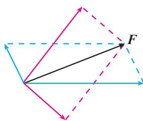  
图 6.3-1

## 探究

如图6.3-2（1），设 $\ e _ { 1 } , \ e _ { 2 }$ 是同一平面内两个不共线的向量，ɑ是这一平面内与$\ e _ { 1 } , \ e _ { 2 }$ 都不共线的向量．如图6.3-2（2)，在平面内任取一点O，作 $\overrightarrow { O A } = e _ { 1 } , \overrightarrow { O B } =$ $e _ { 2 } , { \overrightarrow { O C } } = { \mathbf { a } }$ .将a按 $\ e _ { 1 } , \ e _ { 2 }$ 的方向分解，你有什么发现？

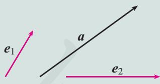  
(1)

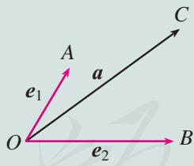  
图6.3-2  
(2)

如图6.3-3，过点C作平行于直线OB的直线，与直线OA交于点M；过点C作平行于直线OA的直线，与直线OB交于点N，则 $\overrightarrow { O C } = \overrightarrow { O M } + \overrightarrow { O N }$ ．由 $\overrightarrow { O M }$ 与 $e _ { 1 }$ 共线， $\overrightarrow { O N }$ 与 $\boldsymbol { e } _ { 2 }$ 共线可得，存在实数 $\lambda _ { 1 } , ~ \lambda _ { 2 }$ ，使得 $\overrightarrow { O M } = \lambda _ { 1 } \thinspace e _ { 1 } , \thinspace \overrightarrow { O N } = \lambda _ { 2 } \thinspace e _ { 2 }$ ，所以 $\pmb { a } = \lambda _ { 1 } \pmb { e } _ { 1 } + \lambda _ { 2 } \pmb { e } _ { 2 }$ ． 也就是说，与 $\ e _ { 1 } , \ e _ { 2 }$ 都不共线的向量a都可以表示成 $\lambda_1\pmb{e}_1+\lambda_2\pmb{e}_2$ 的形式.

当a是与 $e _ { 1 }$ 或 $e _ { 2 }$ 共线的非零向量时，a也可以表示成 $\lambda_1\pmb{e}_1+\lambda_2\pmb{e}_2$ 的形式；当a是零向量时，a同样可以表示成 $\lambda_1\pmb{e}_1+\lambda_2\pmb{e}_2$ 的形式.(为什么？)

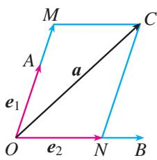  
图 6.3-3

利用信息技术工具，可以动态地展示 $\pmb{a}=\lambda_1\pmb{e}_1+\lambda_2\pmb{e}_2$

上述讨论表明，平面内任一向量a都可以按 $\ e _ { 1 } , \ e _ { 2 }$ 的方向分解，表示成 $\lambda_1\pmb{e}_1+\lambda_2\pmb{e}_2$ 的形式，而且这种表示形式是唯一的．事实上，如果a还可以表示成 $\mu_1\pmb{e}_1+\mu_2\pmb{e}_2$ 的形式，那么 $\lambda _ { 1 } \pmb { e } _ { 1 } + \lambda _ { 2 } \pmb { e } _ { 2 } = \mu _ { 1 } \pmb { e } _ { 1 } + \mu _ { 2 } \pmb { e } _ { 2 }$ ．可得 $( \lambda _ { 1 } { - } \mu _ { 1 } ) { \pmb e } _ { 1 } { + } ~ ( \lambda _ { 2 } { - } \mu _ { 2 } ) { \pmb e } _ { 2 } { = } { \pmb 0 }$ 由此式可以推出 $\lambda _ { 1 } -$ $\mu _ { 1 } , ~ \lambda _ { 2 } - \mu _ { 2 }$ 全为〇（假设 $\lambda _ { 1 } - \mu _ { 1 } , ~ \lambda _ { 2 } - \mu _ { 2 }$ 不全为0，不妨假设 $\lambda _ { 1 } - \mu _ { 1 } \neq 0$ ，则 $e _ { 1 } =$ $- \frac { \lambda _ { 2 } - \mu _ { 2 } } { \lambda _ { 1 } - \mu _ { 1 } } \pmb { e } _ { 2 }$ ．由此可得 $\ e _ { 1 } , \ e _ { 2 }$ 共线．这与已知 $\ e _ { 1 } , \ e _ { 2 }$ 不共线矛盾)，即 $\lambda _ { 1 } = \mu _ { 1 } , ~ \lambda _ { 2 } = \mu _ { 2 }$ 也就是说，有且只有一对实数 $\lambda _ { 1 } , \lambda _ { 2 }$ ，使 $\pmb { a } = \lambda _ { 1 } \pmb { e } _ { 1 } + \lambda _ { 2 } \pmb { e } _ { 2 }$

综上，我们得到如下定理：

平面向量基本定理 如果 $e _ { 1 }$ ， $e _ { 2 }$ 是同一平面内的两个不共线向量，那么对于这一平面内的任一向量a，有且只有一对实数 $\lambda _ { 1 } , \lambda _ { 2 }$ ，使

$$
a = \lambda _ { 1 } e _ { 1 } + \lambda _ { 2 } e _ { 2 } .
$$

若 $\ e _ { 1 } , \ e _ { 2 }$ 不共线，我们把 $\{ \boldsymbol { e } _ { 1 } , \ \boldsymbol { e } _ { 2 } \}$ 叫做表示这一平面内所有向量的一个基底（base）.由平面向量基本定理可知，任一向量都可以由同一个基底唯一表示，这为我们研究问题带来了极大的方便.

例1 如图 $6 . 3 - 4 , \ \overrightarrow { O A } , \ \overrightarrow { O B }$ 不共线，且 ${ \overrightarrow { A P } } = t { \overrightarrow { A B } }$ $( t \in \mathbf { R } )$ ，用 $\overrightarrow { O A }$ ，OB表 $\overrightarrow { O B }$ $\overrightarrow { \pi } \overrightarrow { O P }$

解：因为 ${ \overrightarrow { A P } } { = } t { \overrightarrow { A B } }$

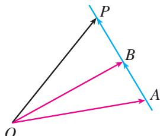

所以 $\begin{array} { r l } & { \overrightarrow { O P } = \overrightarrow { O A } + \overrightarrow { A P } } \\ & { \quad = \overrightarrow { O A } + t \overrightarrow { A B } } \\ & { \quad = \overrightarrow { O A } + t ( \overrightarrow { O B } - \overrightarrow { O A } ) } \\ & { \quad = \overrightarrow { O A } + t \overrightarrow { O B } - t \overrightarrow { O A } } \\ & { \quad = ( 1 - t ) \overrightarrow { O A } + t \overrightarrow { O B } . } \end{array}$

图 6.3-4

观察 $\overrightarrow { O P } = ( 1 - t ) \overrightarrow { O A } +$ $t \overrightarrow { O B }$ ，你有什么发现？

例 2 如图 6.3-5，CD 是 $\triangle A B C$ 的中线， $C D =$ $\frac { 1 } { 2 } A B$ ，用向量方法证明 $\triangle A B C$ 是直角三角形.

分析：由平面向量基本定理可知，任一向量都可由同一个基底表示．本题可取 $\langle \overrightarrow { C D } , \overrightarrow { D A } \rangle$ 为基底，用它表示 $\overrightarrow { C A }$ $\overrightarrow { C B } .$ 证明 ${ \overrightarrow { C A } } \cdot { \overrightarrow { C B } } = 0$ ，可得 ${ \overrightarrow { C A } } \bot { \overrightarrow { C B } }$ ，从而证得 $\triangle A B C$ 是

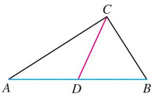  
图 6.3-5

直角三角形.

证明：如图6.3-6，设 $\overrightarrow { C D } = \pm , \overrightarrow { D A } = b$ ，则 ${ \overrightarrow { C A } } { = } a + b$ $\stackrel { \textstyle \sum } { D B } = - { \boldsymbol { b } }$ ，于是 $\stackrel { \textstyle } { C B } = a - b$

$$
\overrightarrow { C A } \cdot \overrightarrow { C B } = ( a + b ) \cdot ( a - b ) = a ^ { 2 } - b ^ { 2 } .
$$

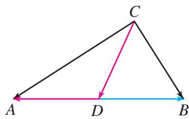  
图 6.3-6

因为 $C D { = } { \frac { 1 } { 2 } } A B$

所以 $C D { = } D A$

因为 $\pmb { a } ^ { 2 } = C D ^ { 2 } , ~ \pmb { b } ^ { 2 } = D A ^ { 2 }$

所以 ${ \overrightarrow { C A } } \cdot { \overrightarrow { C B } } = 0 .$

因此 $C A \bot C B$

于是 $\triangle A B C$ 是直角三角形.

向量的数量积是否为零，是判断相应的两条线段（或直线）是否垂直的重要方法之一.

## 练习

1. 如图，AD，BE，CF是△ABC 的三条中线， ${ \overrightarrow { C A } } = a , { \overrightarrow { C B } } = b$ .用a，b表示 $\overrightarrow { A B } , \overrightarrow { A D } , \overrightarrow { B E } , \overrightarrow { C F }$

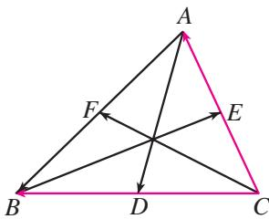  
(第1题)

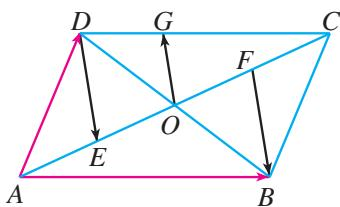  
(第2题)

2. 如图，平行四边形ABCD的两条对角线相交于点O， $\overrightarrow { A B } = \pm , \overrightarrow { A D } = b$ ，点E，F分别是OA，OC的中点，G是CD的三等分点 $( D G = \frac { 1 } { 3 } C D )$

（1)用a，b表 $\overrightarrow { \mathrm { A D E } } , \overrightarrow { F B } , \overrightarrow { O G }$

（2）能由（1）得出DE，BF的关系吗？

3. 如图，在 $\triangle A B C$ 中， $A D = { \frac { 1 } { 4 } } A B$ ，点E，F分别是AC，BC的中点.设 $\overrightarrow { A B } = a , \overrightarrow { A C } = b$

（1）用a，b表 $\overrightarrow { \mathrm { \Pi } } \overrightarrow { \mathrm { \Pi } } \overrightarrow { C D } , \overrightarrow { E F }$

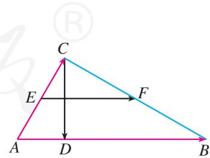

(2) 如果 $\angle A = 6 0 ^ { \circ } , \ A B = 2 A C$ ，CD，EF有什么关系？用向量方法证明你的结论.

(第3题)

## 6.3.2 平面向量的正交分解及坐标表示

给定平面内两个不共线的向量 $\ e _ { 1 } , \ e _ { 2 }$ ，由平面向量基本定理可知，平面上的任意向量a，均可分解为两个向量 $\lambda _ { 1 } e _ { 1 } , \lambda _ { 2 } e _ { 2 }$ ，即 $\pmb { a } = \lambda _ { 1 } \pmb { e } _ { 1 } + \lambda _ { 2 } \pmb { e } _ { 2 }$ ，其中向量 $\lambda _ { 1 } e _ { 1 }$ 与 $e _ { 1 }$ 共线，向

量 $\lambda _ { 2 } e _ { 2 }$ 与 $\boldsymbol { e } _ { 2 }$ 共线.

不共线的两个向量相互垂直是一种重要的情形.把一个向量分解为两个互相垂直的向量，叫做把向量作正交分解．如图6.3-7，重力G沿互相垂直的两个方向分解就是正交分解.正交分解是向量分解中常见而实用的一种情形.

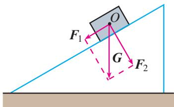  
图 6.3-7

重力G可以分解为这样两个分力：平行于斜面使木块沿斜面下滑的力$F _ { 1 }$ ，垂直于斜面的压力 $F _ { 2 }$

在平面上，如果选取互相垂直的向量作为基底时，将为我们研究问题带来方便.

## 3 思考

我们知道，在平面直角坐标系中，每一个点都可用一对有序实数（即它的坐标）表示.那么，如何表示直角坐标平面内的一个向量呢？

如图6.3-8，在平面直角坐标系中，设与x轴、y轴方向相同的两个单位向量分别为i，j，取{i，j}作为基底．对于平面内的任意一个向量a，由平面向量基本定理可知，有且只有一对实数x，y，使得

$$
\pmb { a } = x \pmb { i } + y \pmb { j } .
$$

这样，平面内的任一向量α都可由x，y唯一确定，我们把有序数对 $( x , \ y )$ 叫做向量a的坐标，记作

$$
\mathbf { \delta } \mathbf { a } = ( { \boldsymbol { x } } \in { \mathfrak { y } } ) .\tag{①}
$$

其中，x叫做a在x轴上的坐标，y叫做a在y轴上的坐标，①叫做向量a的坐标表示.

显然， $i = ( 1 , \ 0 ) , \ j = ( 0 , \ 1 ) , \ \mathbf { 0 = ( } 0 , \ 0 ) .$

如图6.3-9，在直角坐标平面中，以原点O为起点作$\overrightarrow { O A } = \mathbf { { \mathfrak { a } } }$ ，则点A的位置由向量a唯一确定.

设 $ { \overrightarrow { O A } } = x i + y j$ ，则向量 $\overrightarrow { O A }$ 的坐标 $( x , \ y )$ 就是终点A的坐标；反过来，终点A的坐标 $( x , \ y )$ 也就是向量 $\overrightarrow { O A }$ 的坐标.因为 $\overrightarrow { O A } = \mathbf { { \mathfrak { a } } }$ ，所以终点A的坐标 $( x , \ y )$ 就是向量a的坐标.这样就建立了向量的坐标与点的坐标之间的联系.

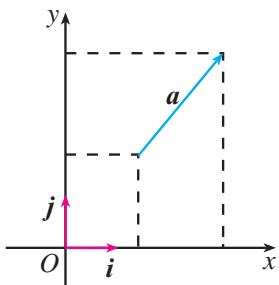  
图 6.3-8

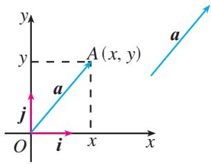  
图 6.3-9

例3 如图6.3-10，分别用基底{i，j}表示向量a，b，c，d，并求出它们的坐标.

解：由图6.3-10可知， $\pmb { a } = \overrightarrow { A A _ { 1 } } + \overrightarrow { A A _ { 2 } } = 2 \pmb { i } + 3 \pmb { j }$

所以 $\pmb { a } = ( 2 , \ 3 )$

同理，

$$
b = - 2 i + 3 j = ( - 2 , \ 3 ) ,
$$

$$
\scriptstyle { c = - 2 i - 3 j } = ( - 2 , \ - 3 ) ,
$$

$$
d = 2 i - 3 j = ( 2 , \ - 3 ) .
$$

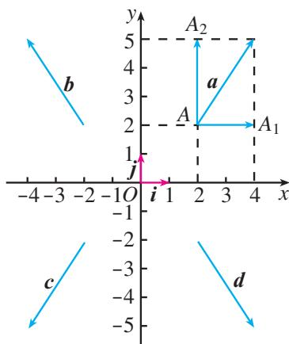  
图 6.3-10

## 6.3.3 平面向量加、减运算的坐标表示

## 思考

已知 $\pmb { a } = ( x _ { 1 } , \ y _ { 1 } ) , \ b = ( x _ { 2 } , \ y _ { 2 } )$ ，你能得出 $a + b , \ a - b$ 的坐标吗？

$$
\begin{array} { c } { { \pmb { a } + \pmb { b } = ( x _ { 1 } \pmb { i } + y _ { 1 } \pmb { j } ) + ( x _ { 2 } \pmb { i } + y _ { 2 } \pmb { j } ) } } \\ { { = x _ { 1 } \pmb { i } + x _ { 2 } \pmb { i } \ + y _ { 1 } \pmb { j } + y _ { 2 } \pmb { j } } } \\ { { = ( x _ { 1 } + x _ { 2 } ) \pmb { i } + ( y _ { 1 } + y _ { 2 } ) \pmb { j } , } } \end{array}
$$

即

$$
\pmb { { a } } + \pmb { { b } } = ( x _ { 1 } + x _ { 2 } , \ y _ { 1 } + y _ { 2 } ) .
$$

同理可得

$$
a - b = ( x _ { 1 } - x _ { 2 } , \ y _ { 1 } - y _ { 2 } ) .
$$

这就是说，两个向量和（差）的坐标分别等于这两个向量相应坐标的和（差）.

例4已知 $\pmb { a } = ( 2 , \ 1 ) , \ \pmb { b } = ( - 3 , \ 4 )$ ，求 $a + b , \ a - b$ 的坐标.

解： $a + b = ( 2 , \ 1 ) + ( - 3 , \ 4 ) = ( - 1 , \ 5 )$

$$
a - b = ( 2 , \ 1 ) - ( - 3 , \ 4 ) = ( 5 , \ - 3 ) .
$$

## 探究

如图 6.3-11，已知 $A \left( x _ { 1 } , \ y _ { 1 } \right) , \ B \left( x _ { 2 } , \ y _ { 2 } \right)$ 你能得出 $\overrightarrow { A B }$ 的坐标吗？

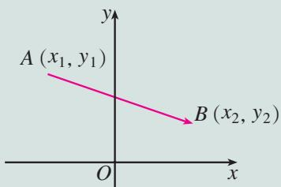  
图 6.3-11

如图6.3-12，作向量 $\overrightarrow { O A } , \overrightarrow { O B }$ ，则

$$
\begin{array} { r l } { \overrightarrow { A B } = \overrightarrow { O B } - \overrightarrow { O A } } & { { } } \\ { = ( x _ { 2 } , ~ y _ { 2 } ) - ( x _ { 1 } , ~ y _ { 1 } ) } & { { } } \\ { = ( x _ { 2 } - x _ { 1 } , ~ y _ { 2 } - y _ { 1 } ) . } & { { } } \end{array}
$$

因此，一个向量的坐标等于表示此向量的有向线段的终点的坐标减去起点的坐标

图 6.3-12  
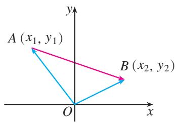

例5 如图6.3-13，已知□ABCD的三个顶点A，B，C的坐标分别是（一2，1），（一1，3)，（3，4)，求顶点D的坐标.

解法1：如图6.3-13，设顶点D的坐标为 $( x , \ y )$

因为 $\begin{array} { r l } & { \overrightarrow { A B } = \left( - 1 - \left( - 2 \right) , \ 3 - 1 \right) = \left( 1 , \ 2 \right) , } \\ & { \overrightarrow { D C } = \left( 3 - x , \ 4 - y \right) , } \end{array}$

又 $\stackrel { \textstyle - } { A B } = \stackrel { \textstyle - } { D C }$

所以 $( 1 , \ 2 ) = ( 3 - x , \ 4 - y )$

即 $\begin{array} { r } { \left\{ 1 = 3 - x , \right. } \\ { \left. 2 = 4 - y , \right. } \end{array}$ 解得 $\begin{array} { c } { { ( x = 2 ,  } } \\ { {  y = 2 . } } \end{array}$

所以顶点D的坐标为(2，2).

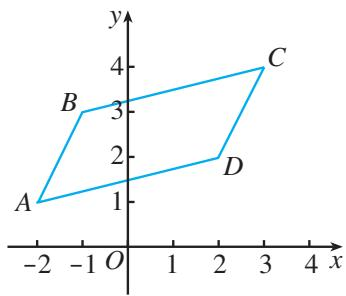

图 6.3-13  
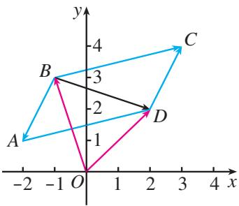

$$
\begin{array} { l } { \overrightarrow { B D } = \overrightarrow { B A } + \overrightarrow { B C } } \\ { = ( - 2 - ( - 1 ) , ~ 1 - 3 ) + ( 3 - ( - 1 ) , ~ 4 - 3 ) } \\ { = ( 3 , ~ - 1 ) , } \end{array}
$$

图 6.3-14

而

$$
\begin{array} { c } { { \overrightarrow { O D } = \overrightarrow { O B } + \overrightarrow { B D } } } \\ { { = ( - 1 , ~ 3 ) + ( 3 , ~ - 1 ) } } \\ { { = ( 2 , ~ 2 ) . } } \end{array}
$$

你能比较一下两种解法在思想方法上的异同点吗？

所以顶点D的坐标为（2，2).

## 练习

1. 在下列各小题中，已知向量a，b的坐标，分别求a+b，a—b的坐标：(1) $\pmb { a } = ( - 2 , \ 4 ) , \ \pmb { b } = ( 5 , \ 2 ) ;$ (2) $\pmb { a } = ( 4 , \ 3 ) , \ \pmb { b } = ( - 3 , \ 8 ) ;$ (3) $\pmb { a } = ( 2 , \ 3 ) , \ \pmb { b } = ( - 2 , \ - 3 )$ (4) $\pmb { a } = ( 3 , \ 0 ) , \ b = ( 0 , \ 4 ) .$

2. 在下列各小题中，已知A，B两点的坐标，分别求 $\overrightarrow { A B } , \overrightarrow { B A }$ 的坐标：(1) $A ( 3 , \ 5 ) , \ B ( 6 , \ 9 ) ;$ (2) $A ( - 3 , \ 4 ) , \ B ( 6 , \ 3 ) { \ ; }$ (3) $A ( 0 , \ 3 ) , \ B ( 0 , \ 5 ) { \ ; }$ (4) $A ( 3 , \ 0 ) , \ B ( 8 , \ 0 ) .$

3. 若点A(0，1)，B(1，0)，C(1，2)，D(2，1)，则AB与CD有什么位置关系？证明你的猜想.

## 6.3.4 平面向量数乘运算的坐标表示

## 思考

已知 $\mathbf { \boldsymbol { a } } = ( \mathcal { x } , \mathbf { \boldsymbol { \mu } } _ { y } )$ ，你能得出 λa 的坐标吗？

$$
\lambda { \pmb a } = \lambda ( x i + y j ) = \lambda x i + \lambda y j ,
$$

即

$$
\lambda \mathbf { { a } } = ( \lambda x , \ \lambda y ) .
$$

这就是说，实数与向量的积的坐标等于用这个实数乘原来向量的相应坐标

例6 已知 $\pmb { a } = ( 2 , \ 1 ) , \ \pmb { b } = ( - 3 , \ 4 )$ ，求 $3 a + 4 b$ 的坐标.

解： $\begin{array} { c } { { 3 a + 4 b = 3 ( 2 , \ 1 ) + 4 ( - 3 , \ 4 ) \ = ( 6 , \ 3 ) + ( - 1 2 , \ 1 6 ) } } \\ { { { } } } \\ { { = ( - 6 , \ 1 9 ) . } } \end{array}$

## 探究

如何用坐标表示两个向量共线的条件？

设 $\pmb { a } = ( x _ { 1 } , \ y _ { 1 } ) , \ b = ( x _ { 2 } , \ y _ { 2 } )$ ，其中 $\begin{array} { r } { \pmb { b } \mp \pmb { 0 } . } \end{array}$ 我们知道，a，b共线的充要条件是存在实数λ，使

$$
\mathbf { { \boldsymbol { a } } } = \lambda \mathbf { { \boldsymbol { b } } } .
$$

如果用坐标表示，可写为

$$
( x _ { 1 } , \ y _ { 1 } ) { = } { \lambda } ( x _ { 2 } , \ y _ { 2 } ) ,
$$

即

$$
\left\{ { \begin{array} { l } { x _ { 1 } = \lambda x _ { 2 } , } \\ { y _ { 1 } = \lambda y _ { 2 } . } \end{array} } \right.
$$

消去λ，得

$$
x _ { 1 } y _ { 2 } - x _ { 2 } y _ { 1 } = 0 .
$$

这就是说，向量a，b共线的充要条件是

$$
x _ { 1 } y _ { 2 } - x _ { 2 } y _ { 1 } = 0 .
$$

例7 已知 $\pmb { a } = ( 4 , \ 2 ) , \ \pmb { b } = ( 6 , \ y )$ ，且 ${ \pmb a } \operatorname { \mathcal { / } } / \operatorname { \mathcal { b } }$ ，求 $y$

解：因为 ${ \pmb a } \operatorname { \mathcal { / } } / \operatorname { \mathcal { b } }$

所以 $4 y - 2 \times 6 = 0$

解得 $y = 3 .$

例8 已知A(—1，—1)，B(1，3)，C(2，5)，判断A，B，C三点之间的位置关系.

解：在平面直角坐标系中作出A，B，C三点（图6.3-15）.观察图形，我们猜想A，B，C三点共线.下面来证明.

因为 $\overrightarrow { A B } = ( 1 - ( - 1 ) , ~ 3 - ( - 1 ) ) = ( 2 , ~ 4 )$ $\overrightarrow { A C } = ( 2 - ( - 1 ) , \ 5 - ( - 1 ) ) = ( 3 , \ 6 ) ,$

又 $2 \times 6 - 4 \times 3 = 0$

所以 ${ \overrightarrow { A B } } / / { \overrightarrow { A C } } .$

又 直线AB，直线AC有公共点A，

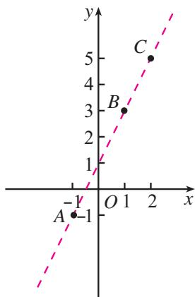  
图6.3-15

所以A，B，C三点共线.

例9 设P是线段 $P _ { 1 } P _ { 2 }$ 上的一点，点 $P _ { 1 } , \ P _ { 2 }$ 的坐标分别是 $( x _ { 1 } , ~ y _ { 1 } ) , ~ ( x _ { 2 } , ~ y _ { 2 } )$

（1）当P是线段 $P _ { 1 } P _ { 2 }$ 的中点时，求点P的坐标；

(2) 当P是线段 $P _ { 1 } P _ { 2 }$ 的一个三等分点时，求点P的坐标.

解：（1）如图6.3-16，由向量的线性运算可知

$$
\overrightarrow { O P } = \frac { 1 } { 2 } ( \overrightarrow { O P _ { 1 } } + \overrightarrow { O P _ { 2 } } ) = \Big ( \frac { x _ { 1 } + x _ { 2 } } { 2 } , ~ \frac { y _ { 1 } + y _ { 2 } } { 2 } \Big ) .
$$

所以，点P的坐标是 $\textstyle \big ( { \frac { x _ { 1 } + x _ { 2 } } { 2 } } , { \frac { y _ { 1 } + y _ { 2 } } { 2 } } \big )$

若点 $P _ { 1 } , \ P _ { 2 }$ 的坐标分别为 $( x _ { 1 } , \ y _ { 1 } ) , ( x _ { 2 } , \ x _ { 3 } ) ,$ $y _ { 2 } )$ ，线段 $P _ { 1 } P _ { 2 }$ 的中点P的坐标为 $( x , \ y )$ ，则

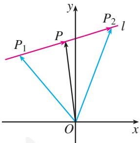  
图 6.3-16

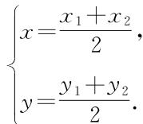

此公式为线段 $P _ { 1 } P _ { 2 }$ 的中点坐标公式.

（2） 如图6.3-17，当点P是线段 $P _ { 1 } P _ { 2 }$ 的一个三等分点时，有两种情况，即 ${ \overrightarrow { P _ { 1 } P } } =$ ${ \frac { 1 } { 2 } } \overrightarrow { P P _ { 2 } } \overrightarrow { \ " \bot } \overrightarrow { P _ { 1 } P } { = } 2 \overrightarrow { P P _ { 2 } }$

如果 $\overrightarrow { P _ { 1 } P } { = } \frac { 1 } { 2 } \overrightarrow { P P _ { 2 } }$ (图 6.3-17(1))，那么

$$
\begin{array} { r l } & { \overrightarrow { O P } = \overrightarrow { O P _ { 1 } } + \overrightarrow { P _ { 1 } P } = \overrightarrow { O P _ { 1 } } + \frac { 1 } { 3 } \overrightarrow { P _ { 1 } P _ { 2 } } } \\ & { \quad = \overrightarrow { O P _ { 1 } } + \frac { 1 } { 3 } ~ \overrightarrow { ( O P _ { 2 } } - \overrightarrow { O P _ { 1 } } ) = \frac { 2 } { 3 } \overrightarrow { O P _ { 1 } } + \frac { 1 } { 3 } \overrightarrow { O P _ { 2 } } } \\ & { \quad = ( \frac { 2 x _ { 1 } + x _ { 2 } } { 3 } , ~ \frac { 2 y _ { 1 } + y _ { 2 } } { 3 } ) , } \end{array}
$$

即点P的坐标是 $\begin{array} { r } { \big ( \frac { 2 x _ { 1 } + x _ { 2 } } { 3 } , \ \frac { 2 y _ { 1 } + y _ { 2 } } { 3 } \big ) } \end{array}$

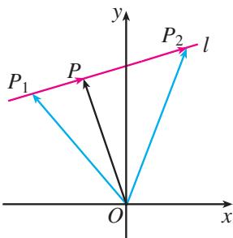  
(1)

图 6.3-17  
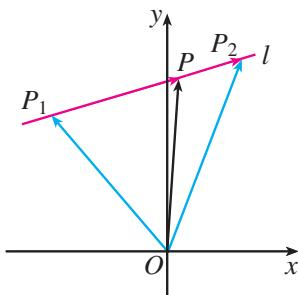  
(2)

同理，如果 $\overrightarrow { P _ { 1 } P { = } 2 } \overrightarrow { P P _ { 2 } }$ (图6.3-17(2))，那么点P的坐标是 $( { \frac { x _ { 1 } + 2 x _ { 2 } } { 3 } } , { \frac { y _ { 1 } + 2 y _ { 2 } } { 3 } } )$

## 探究

如图6.3-18，线段 $P _ { 1 } P _ { 2 }$ 的端点 $P _ { 1 } , \ P _ { 2 }$ 的坐标分别是 $( x _ { 1 } , \ _ { y _ { 1 } } ) , \ ( x _ { 2 } , \ y _ { 2 } )$ 点P是直线 $P _ { 1 } P _ { 2 }$ 上的一点．当 $\overrightarrow { P _ { 1 } P } { = } \lambda \overrightarrow { P P _ { 2 } }$ 時，点Ρ的坐标是什么？

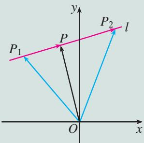  
图6.3-18

## 练习

1. 已知a=(3，2)，b=(0，—1)，求—2a+4b，4a+3b的坐标.

2. 当x为何值时，a=(2，3）与b=(x，—6）共线？

3. 若点A(—2，—3)，B(2，2)，C(—1，3)，D(—7，—4.5)，则 $\overrightarrow { A B } \bot \overrightarrow { C D }$ 是否共线?

4. 求线段 AB 的中点坐标：

(1) A(2, 1), B(4, 3); (2) A(—1， 2)， B(3, 6);

(3) $A ~ ( 5 , ~ - 4 ) , ~ B ~ ( 3 , ~ - 6 )$

5. 已知点O（0，0)，向量 $\overrightarrow { O A } = ( 2 , \ 3 ) , \ \overrightarrow { O B } = ( 6 , \ - 3 )$ ，点P是线段AB的三等分点，求点P的坐标.

## 6.3.5 平面向量数量积的坐标表示

## 探究

已知 $\pmb { a } = ( x _ { 1 } , \ y _ { 1 } ) , \ b = ( x _ { 2 } , \ y _ { 2 } )$ ，怎样用 a 与 b 的坐标表示a·b呢？

因为 ${ \pmb a } = x _ { 1 } { \pmb i } + y _ { 1 } { \pmb j } , \ { \pmb b } = x _ { 2 } { \pmb i } + y _ { 2 } { \pmb j }$

$$
a \bullet b = ( x _ { 1 } i + y _ { 1 } j ) \bullet ( x _ { 2 } i + y _ { 2 } j ) = x _ { 1 } x _ { 2 } i ^ { 2 } + x _ { 1 } y _ { 2 } i \bullet j + y _ { 1 } x _ { 2 } j \bullet i + y _ { 1 } y _ { 2 } j ^ { 2 } .
$$

又 $i \cdot i = 1 , \ j \bullet j = 1 , \ i \bullet j = j \bullet i = 0 ,$

所以 $a \cdot b = x _ { 1 } x _ { 2 } + y _ { 1 } y _ { 2 }$

这就是说，两个向量的数量积等于它们对应坐标的乘积的和

由此可得

(1) 若 $\boldsymbol{a}=(x,y)$，则 $|\boldsymbol{a}|^2=x^2+y^2$，或 $|\boldsymbol{a}|=\sqrt{x^2+y^2}$。

如果表示向量a的有向线段的起点和终点的坐标分别为 $( x _ { 1 } , ~ y _ { 1 } ) , ~ ( x _ { 2 } , ~ y _ { 2 } )$ ，那么

$$
\pmb { a } = ( x _ { 2 } - x _ { 1 } , \ y _ { 2 } - y _ { 1 } ) ,
$$

$$
| \mathbf { \Delta } a | = \surd ( x _ { 2 } - x _ { 1 } ) ^ { 2 } + ( y _ { 2 } - y _ { 1 } ) ^ { 2 } .
$$

(2) 设 $\pmb { a } = ( x _ { 1 } , \ y _ { 1 } ) , \ b = ( x _ { 2 } , \ y _ { 2 } )$ ，则

$$
a \perp b \Longleftrightarrow x _ { 1 } x _ { 2 } + y _ { 1 } y _ { 2 } = 0 .
$$

例10若点A(1，2)，B(2，3)，C(—2，5)，则 $\triangle A B C$ 是什么形状？证明你的猜想.

解：如图6.3-19，在平面直角坐标系中画出点A，B，C，我们发现 $\triangle A B C$ 是直角三角形．证明如下.

因为 $\overrightarrow { A B } = ( 2 - 1 , ~ 3 - 2 ) = ( 1 , ~ 1 )$

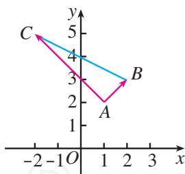

$$
\overrightarrow { A C } = ( - 2 - 1 , \ 5 - 2 ) = ( - 3 , \ 3 ) ,
$$

图6.3-19

所以 ${ \overrightarrow { A B } } \cdot { \overrightarrow { A C } } = 1 \times ( - 3 ) + 1 \times 3 = 0 .$

于是 $\overrightarrow { A B } \bot \overrightarrow { A C }$

因此， $\triangle A B C$ 是直角三角形.

设a，b都是非零向量， $\pmb { a } = ( x _ { 1 } , \ y _ { 1 } ) , \ b = ( x _ { 2 } , \ y _ { 2 } )$ ，θ是a与b的夹角，根据向量数量积的定义及坐标表示可得

$$
\cos\theta=\frac{\boldsymbol{a}\cdot\boldsymbol{b}}{|\boldsymbol{a}|\,|\boldsymbol{b}|}=\frac{x_1x_2+y_1y_2}{\sqrt{x_1^2+y_1^2}\sqrt{x_2^2+y_2^2}}.
$$

例11 设 $\pmb { a } = ( 5 , \ - 7 ) , \ b = ( - 6 , \ - 4 )$ ，求a·b及a，b的夹角 $\theta$ (精确到1°).

$$
\begin{array} { l c r } { { a \bullet b = 5 \times ( - 6 ) + ( - 7 ) \times ( - 4 ) } } \\ { { \qquad = - 3 0 + 2 8 } } \\ { { \qquad = - 2 . } } \end{array}
$$

因为 $| a | = { \sqrt { 5 ^ { 2 } + ( - 7 ) ^ { 2 } } } = { \sqrt { 7 4 } } , | b | = { \sqrt { ( - 6 ) ^ { 2 } + ( - 4 ) ^ { 2 } } } = { \sqrt { 5 2 } }$ ，所以用计算器计算可得

$$
\cos \theta { = } \frac { { \pmb a } \ { \cdot } \ { \pmb b } } { | { \pmb a } | \ | \ { \pmb b } | } { = } \frac { - 2 } { \sqrt { 7 4 } \times \sqrt { 5 2 } } { \approx } {  } { 0 . } \ 0 3 .
$$

利用计算工具可得 $\theta { \approx } 9 2 ^ { \circ }$

例12 用向量方法证明两角差的余弦公式

$$
\cos ( \alpha - \beta ) = \cos \alpha \cos \beta + \sin \alpha \sin \beta .
$$

证明：如图6.3-20，在平面直角坐标系Oxy内作单位圆O，以x轴的非负半轴为始边作角 $\alpha , \beta$ ，它们的终边与单位圆O的交点分别为A，B．则

$$
\overrightarrow { O A } = ( \cos \alpha , \ \sin \alpha ) , \ \overrightarrow { O B } = ( \cos \beta , \ \sin \beta ) .
$$

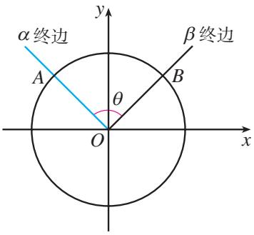  
(1)

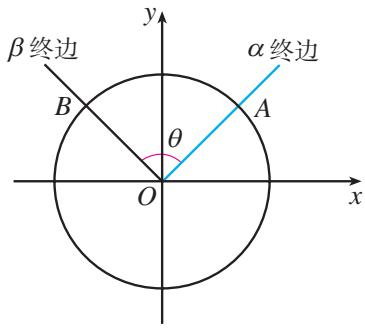  
(2)  
图 6.3-20

由向量数量积的坐标表示，有

$$
\overrightarrow { O A } \cdot \overrightarrow { O B } = \cos \alpha \cos \beta + \sin \alpha \sin \beta .
$$

设 $\overrightarrow { O A }$ 与 $\overrightarrow { O B }$ 的夹角为 $\theta _ { \pmb { \cdot } }$ 则

$$
{ \overrightarrow { O A } } \cdot { \overrightarrow { O B } } = | { \overrightarrow { O A } } | \cdot | { \overrightarrow { O B } } | \cos \theta = \cos \theta .
$$

所以

$$
\cos \theta = \cos \alpha \cos \beta + \sin \alpha \sin \beta .
$$

另一方面，由图6.3-20（1）可知， $\alpha = 2 k \pi + \beta + \theta$ ；由图6.3-20（2）可知， $\alpha =$ 2k $\pi + \beta - \theta$ 于是 $\alpha - \beta = 2 k \pi \pm \theta , k \in { \bf Z } .$ 所以

$$
\cos ( \alpha - \beta ) = \cos \theta .
$$

于是

$$
\cos ( \alpha - \beta ) = \cos \alpha \cos \beta + \sin \alpha \sin \beta .
$$

运用向量工具进行探索，过程多么简洁啊！

## 练习

1. 已知a=(—3，4)，b=(5，2)，求 $| a \ | \ , \ | b \ | \ , \ a \cdot b .$

2. 已知a=(2，3)，b =(—2，4)， $\pmb { c } = ( - 1 , \ - 2 )$ .求a·b， (a+b)·(a—b)，a·(b+c),$( a + b ) ^ { 2 }$

3. 已知a=(3，2)，b=(5，—7)，利用计算工具，求a与b的夹角θ（精确到1°).

## 习题6.3

## 复习巩固

1. 如图，在 $\triangle A B C$ 中， $A D = { \frac { 1 } { 3 } } A B$ ，点E是CD的中点.设 $\stackrel { \textstyle \longrightarrow } { A B } =$ $a \mathrm { ~ , ~ } \stackrel { \textstyle \longrightarrow } { A C } = b$ ，用a，b表 ${ \overrightarrow { \pi } } { \overrightarrow { C D } } , { \overrightarrow { A E } } .$

2. 已知作用在坐标原点的三个力分别为 $F _ { 1 } = ( 3 , \ 4 ) , \ F _ { 2 } = ( 2 , \ - 5 )$ $\pmb { F } _ { 3 } = ( 3 , \ 1 )$ ，求作用在原点的合力 $\pmb { F } _ { 1 } + \pmb { F } _ { 2 } + \pmb { F } _ { 3 }$ 的坐标.

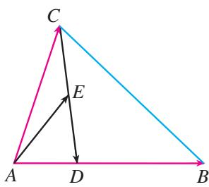

3. 在下列各小题中，已知向量a的坐标，以及表示a的有向线段AB的起点A的坐标，求终点B的坐标：(1) a=(—2, 1), A(0, 0); (2) a=(1,3), A(—1, 5);(3) a=(—2, —5), A(3, 7).

(第1题)

4. 已知□ABCD的顶点A(—1，—2)，B(3，—1)，C(5，6)，求顶点D的坐标

5. 已知点O(0，0)，A(1，2)，B(—1，3)，且 $\overrightarrow { \vert O A ^ { \prime } } = 2 \overrightarrow { O A } , \overrightarrow { O B ^ { \prime } } = 3 \overrightarrow { O B }$ ，求点 $A ^ { \prime } , B ^ { \prime }$ 及向量$\overrightarrow { A ^ { \prime } B ^ { \prime } }$ 的坐标.

6. 已知点A(1，1)，B(—1，5)，且 $\overrightarrow { A C } = \frac { 1 } { 2 } \overrightarrow { A B } , \overrightarrow { A D } = 2 \overrightarrow { A B } , \overrightarrow { A E } = - \frac { 1 } { 2 } \overrightarrow { A B }$ ，求点C，D，E的坐标.

7. 你认为下列各组点具有什么样的位置关系？证明你的猜想.4), C(2,3.5);(2) $P ( - 1 , \ 2 ) , \ Q ( 0 . 5 , \ 0 ) , \ R ( 5 , \ - 6 ) { ; }$ (3) E(9,1)， F(1, —3), G(8, 0.5).

8.分别在平面直角坐标系中作出下列各组点，猜想以A，B，C为顶点的三角形的形状，然后给出证明：(1) $A ( - 1 , \ - 4 ) , \ B ( 5 , \ 2 ) , \ C ( 3 , \ 4 ) ;$ (2) $A ( - 2 , ~ - 3 ) , ~ B ( 1 9 , ~ 4 ) , ~ C ( - 1 , ~ - 6 )$ (3) $A ( 2 , \ 5 ) , \ B ( 5 , \ 2 ) , \ C ( 1 0 , \ 7 ) .$

9. 已知 $| \textbf { em a } | = 3 , \ b { = } ( 1 , \ 2 )$ ，且a∥/b，求a的坐标.

10. 已知a=(4，2)，求与a垂直的单位向量的坐标.

11. 如图，在平行四边形ABCD中，点E是AB的中点，点F，G分别是AD，BC的三等分点 $\left( A F = { \frac { 1 } { 3 } } A D , \ B G = { \frac { 1 } { 3 } } B C \right)$ . 设$\overrightarrow { A B } = a , \overrightarrow { A D } = b$ （1）用a，b表 $\overrightarrow { \pi } \overrightarrow { E F } , \overrightarrow { E G }$ (2) 如果 $\mid \pmb { b } \mid = \frac { 3 } { 2 } \mid \pmb { a } \mid , E F$ ，EG有什么位置关系？用向量方法证明你的结论.

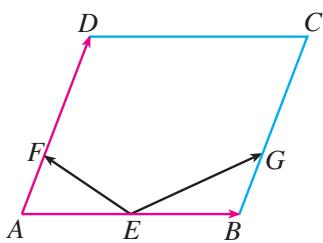  
(第11题)

12.已知点O(0，0)，A(1，2)，B(4，5)， $\overrightarrow { O P } = \overrightarrow { O A } + t \overrightarrow { A B } .$ 当 $t = 1 , \ \frac { 1 } { 2 }$ ，—2，2时，分别求点P的坐标.

13. 已知A(2，3)，B(4，—3)，点P在线段AB的延长线上，且 $| \overrightarrow { A P } | = \frac { 3 } { 2 } | \overrightarrow { P B } |$ ，求点P的坐标.

14. 求证：以A(1，0)，B(5，—2)，C(8，4)，D(4，6）为顶点的四边形是一个矩形.

## 拓广探索

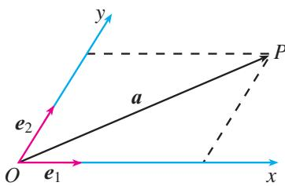

15.如图，设Ox，Oy是平面内相交成 $6 0 ^ { \circ }$ 角的两条数轴， $e _ { 1 }$ $e _ { 2 }$ 分别是与x轴、y轴正方向同向的单位向量．若向量$\stackrel { \triangledown } { \overrightarrow { O P } } = x { \pmb e } _ { 1 } + y { \pmb e } _ { 2 }$ ，则把有序数对（x，y）叫做向量 $\overrightarrow { O P }$ 在坐标系 Oxy 中的坐标. 设 $\stackrel { \triangledown } { \vec { O P } } = 3 e _ { 1 } + 2 e _ { 2 }$ (1) 计算 $\mid \overrightarrow { O P } \mid$ 的大小；（2）根据平面向量基本定理判断，本题中对向量坐标的规定是否合理.  
16.用向量方法证明：对于任意的a，b，c，d∈R，恒有不等式$( a c + b d ) ^ { 2 } { \leqslant } ( a ^ { 2 } + b ^ { 2 } ) ( c ^ { 2 } + d ^ { 2 } ) .$ 7

(第15题)

## 6.4 平面向量的应用

前面我们学习了平面向量的概念和运算，并通过平面向量基本定理，把向量的运算化归为实数的运算．本节我们将学习运用向量方法解决平面几何、物理中的问题，感受向量在解决数学和实际问题中的作用.同时我们还将借助向量的运算，探索三角形边长与角度的关系，把解直角三角形问题拓展到解任意三角形问题

## 6.4.1 平面几何中的向量方法

由于向量的线性运算和数量积运算具有鲜明的几何背景，平面几何图形的许多性质，如全等、相似、长度、夹角等都可以由向量的线性运算及数量积表示出来，因此平面几何中的许多问题都可用向量运算的方法加以解决.下面通过两个具体实例，说明向量方法在平面几何中的应用.

有了运算，向量的力量无限；没有运算，向量就只是一个路标.

例1 如图6.4-1，DE是 $\triangle A B C$ 的中位线，用向量方法证明： $D E / / B C , ~ D E { = } { \frac { 1 } { 2 } } B C$

分析：初中证明过这个结论时要加辅助线，有一定难度.如果用向量方法证明这个结论，可以取 $\langle { \overrightarrow { A B } } , { \overrightarrow { A C } } \rangle$ 为基底，用 ${ \overrightarrow { A B } } , { \overrightarrow { A C } }$ 表示 $\overrightarrow { D E } , \overrightarrow { B C }$ ，证明 ${ \overrightarrow { D E } } { = } { \frac { 1 } { 2 } } { \overrightarrow { B C } }$ 即可.

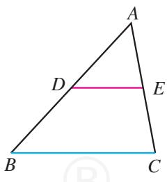  
图 6.4-1

证明：如图6.4-2，因为DE是 $\triangle A B C$ 的中位线，所以

$$
\overrightarrow { A D } = \frac { 1 } { 2 } \overrightarrow { A B } , \overrightarrow { A E } = \frac { 1 } { 2 } \overrightarrow { A C } .
$$

从而 $\overrightarrow { D E } = \overrightarrow { A E } - \overrightarrow { A D } = \frac { 1 } { 2 } \overrightarrow { A C } - \frac { 1 } { 2 } \overrightarrow { A B } = \frac { 1 } { 2 } ( \overrightarrow { A C } - \overrightarrow { A B } )$ 又 ${ \overrightarrow { B C } } { = } { \overrightarrow { A C } } { - } { \overrightarrow { A B } }$

所以 ${ \overrightarrow { D E } } { = } { \frac { 1 } { 2 } } { \overrightarrow { B C } } .$

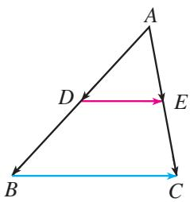  
图 6.4-2

于是 $D E / / B C , ~ D E { = } { \frac { 1 } { 2 } } B C .$

平面几何经常涉及距离（线段长度）和角度问题，而平面向量的运算，特别是数量积主要涉及向量的模以及向量之间的夹角，因此我们可以用向量方法解决某些几何问题，用向量方法解决几何问题时，通常先用向量表示相应的点、线段、夹角等几何元素，然后通过向量的运算来研究点、线段等元素之间的关系，最后再把运算结果“翻译”成几何关系，便得到几何问题的结论

用向量方法解决平面几何问题的“三步曲”：

（1）建立平面几何与向量的联系，用向量表示问题中涉及的几何元素，将平面几何问题转化为向量问题；

（2）通过向量运算，研究几何元素之间的关系，如距离、夹角等问题；

（3）把运算结果“翻译”成几何关系.

例2 如图6.4-3，已知平行四边形ABCD，你能发现对角线AC 和 BD 的长度与两条邻边AB 和AD 的长度之间的关系吗？

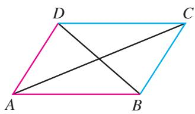

分析：平行四边形中与两条对角线对应的向量恰是与两条邻边对应的两个向量的和与差，我们可以通过向量运算来探索它们的模之间的关系.

解：第一步，建立平面几何与向量的联系，用向量表示问题中的几何元素，将平面几何问题转化为向量问题：

如图6.4-4，取 $\langle \overrightarrow { A B } , \overrightarrow { A D } \rangle$ 为基底，设 $\overrightarrow { A B } = \pmb { a } , \overrightarrow { A D } =$ b，则

图 6.4-3  
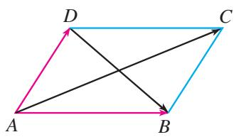  
图 6.4-4

$$
\overrightarrow { A C } = a + b , \overrightarrow { D B } = a - b .
$$

第二步，通过向量运算，研究几何元素之间的关系：

$$
\overrightarrow { A C } ^ { 2 } = ( a + b ) ^ { 2 } = a ^ { 2 } + 2 a \cdot b + b ^ { 2 } ,
$$

$$
\overrightarrow { D B ^ { 2 } } = ( { \bf { \vec { a } } } - { \bf { \vec { b } } } ) ^ { 2 } = { \bf { \vec { a } } } ^ { 2 } - 2 { \bf { \vec { a } } } \cdot { \bf { \vec { b } } } + { \bf { \vec { b } } } ^ { 2 } .
$$

上面两式相加，得 $\overrightarrow { A C ^ { 2 } } + \overrightarrow { D B ^ { 2 } } = 2 ( { \pmb a } ^ { 2 } + { \pmb b } ^ { 2 } )$

第三步，把运算结果“翻译”成几何关系：

你能用自然语言叙述这个关系式的意义吗？

$$
A C ^ { 2 } + B D ^ { 2 } = 2 ( A B ^ { 2 } + A D ^ { 2 } ) .
$$

## 练习

1. 证明：等腰三角形的两个底角相等.

2. 如下页图，正方形ABCD的边长为a，E是AB 的中点，F是BC边上靠近点B的三等分点，AF与DE交于点M，求∠EMF的余弦值.

3. 如图，在△ABC中，点O是BC的中点，过点O的直线分别交直线AB，AC于不同的两点M，N.设 $A B { = } m A M$ $A C { = } n A N$ ，求 m+n的值.

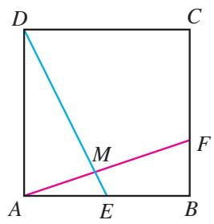  
(第2题)

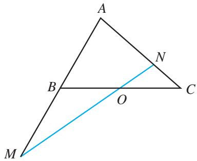  
(第3题)

## 沪教版2026：8.4 向量的应用

来源：沪教版必修第二册2026-dollar-polished.md（本地转写稿），转写稿第 4863—5161 行；截至下一指定标题前。

## 8.4 向量的应用

向量在数学、物理以及实际生活中都有着广泛的应用. 上一节末我们给出了向量在代数中的应用, 本节将继续通过例题给出更多的应用. 先考虑一些几何问题.

例 1 已知 $P$ 是直线 ${P}_{1}{P}_{2}$ 上一点,且 $\overrightarrow{{P}_{1}P} = \lambda \overrightarrow{P{P}_{2}}(\lambda$ 为实数,且 $\lambda  \neq   - 1),{P}_{1}\text{ 、 }{P}_{2}$ 的坐标分别为 $\left( {{x}_{1},{y}_{1}}\right) \text{ 、 }\left( {{x}_{2},{y}_{2}}\right)$ . 求点 $P$ 的坐标 $\left( {x, y}\right)$ .

解 由 $\overrightarrow{{P}_{1}P} = \lambda \overrightarrow{P{P}_{2}}$ ,可知

$$
\left\{  \begin{array}{l} x - {x}_{1} = \lambda \left( {{x}_{2} - x}\right) , \\  y - {y}_{1} = \lambda \left( {{y}_{2} - y}\right) . \end{array}\right.
$$

因为 $\lambda  \neq   - 1$ ,故

$$
\left\{  \begin{array}{l} x = \frac{{x}_{1} + \lambda {x}_{2}}{1 + \lambda }, \\  y = \frac{{y}_{1} + \lambda {y}_{2}}{1 + \lambda }. \end{array}\right.
$$

---

这个公式称为线段的定比分点公式.

---

特别地,当 $\lambda  = 1$ 时, $P$ 为线段 ${P}_{1}{P}_{2}$ 的中点,其坐标为

$$
\left\{  \begin{array}{l} x = \frac{{x}_{1} + {x}_{2}}{2}, \\  y = \frac{{y}_{1} + {y}_{2}}{2}. \end{array}\right.
$$

Q

---

这个公式称为线段中点公式.

---

例 2 已知 $\bigtriangleup {ABC}$ 三个顶点 $A\text{ 、 }B\text{ 、 }C$ 的坐标分别是 $\left( {{x}_{1},{y}_{1}}\right) \text{ 、 }\left( {{x}_{2},{y}_{2}}\right) \text{ 、 }\left( {{x}_{3},{y}_{3}}\right)$ ,求此三角形重心 $G$ 的坐标.

解 如图 8-4-1,由于点 $G$ 是 $\bigtriangleup {ABC}$ 的重心,因此 ${CG}$ 与 ${AB}$ 的交点 $D$ 是 ${AB}$ 的中点,于是点 $D$ 的坐标为 $\left( \frac{{x}_{1} + {x}_{2}}{2}\right.$ , $\left. \frac{{y}_{1} + {y}_{2}}{2}\right)$ .

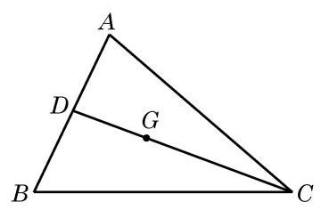

图 8-4-1

设 $G$ 的坐标为 $\left( {x, y}\right)$ ,因为 $\overrightarrow{CG} = 2\overrightarrow{GD}$ ,所以由上述定比分点公式, 得

$$
\left\{  \begin{array}{l} x = \frac{{x}_{3} + 2 \cdot  \frac{{x}_{1} + {x}_{2}}{2}}{1 + 2}, \\  y = \frac{{y}_{3} + 2 \cdot  \frac{{y}_{1} + {y}_{2}}{2}}{1 + 2}. \end{array}\right.
$$

整理, 得

$$
\left\{  \begin{array}{l} x = \frac{{x}_{1} + {x}_{2} + {x}_{3}}{3}, \\  y = \frac{{y}_{1} + {y}_{2} + {y}_{3}}{3}. \end{array}\right.
$$

这就是 $\bigtriangleup {ABC}$ 重心 $G$ 的坐标.

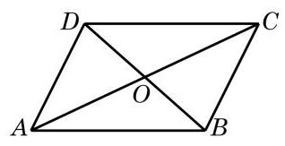

图 8-4-2

例 3 证明: 对角线互相平分的四边形是平行四边形.

已知 如图 8-4-2,设四边形 ${ABCD}$ 的对角线 ${AC}\text{ 、 }{BD}$ 交于点 $O$ ,且 ${AO} = {OC},{BO} = {OD}$ .

求证 ${ABCD}$ 是平行四边形.

证明 $\overrightarrow{AB} = \overrightarrow{AO} + \overrightarrow{OB} = \frac{1}{2}\overrightarrow{AC} + \frac{1}{2}\overrightarrow{DB}$ ,

$$
\overrightarrow{DC} = \overrightarrow{DO} + \overrightarrow{OC} = \frac{1}{2}\overrightarrow{DB} + \frac{1}{2}\overrightarrow{AC},
$$

于是有 $\overrightarrow{AB} = \overrightarrow{DC}$ ,即 ${AB} = {DC}$ 且 ${AB}//{DC}$ ,故 ${ABCD}$ 是平行四边形.

例 4 在 $\bigtriangleup {ABC}$ 中,设 $\overrightarrow{CA} = \overrightarrow{a},\overrightarrow{CB} = \overrightarrow{b}$ ,记 $\bigtriangleup {ABC}$ 的面积为 $S$ .

(1)求证: $S = \frac{1}{2}\sqrt{{\left| \overrightarrow{a}\right| }^{2}{\left| \overrightarrow{b}\right| }^{2} - {\left( \overrightarrow{a} \cdot  \overrightarrow{b}\right) }^{2}}$ ；

(2)设 $\overrightarrow{a} = \left( {{x}_{1},{y}_{1}}\right) ,\overrightarrow{b} = \left( {{x}_{2},{y}_{2}}\right)$ . 求证: $S = \; \frac{1}{2}\left| {{x}_{1}{y}_{2} - {x}_{2}{y}_{1}}\right| .$

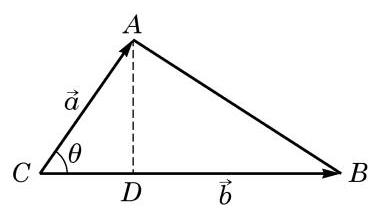

图 8-4-3

证明 (1) 如图 8-4-3,设 $\angle C = \langle \overrightarrow{a},\overrightarrow{b}\rangle  = \theta$ . 我们有 $S = \; \frac{1}{2}\left| a\right| \left| b\right| \sin \theta$ ,于是

$$
{S}^{2} = \frac{1}{4}{\left| \overrightarrow{a}\right| }^{2}{\left| \overrightarrow{b}\right| }^{2}{\sin }^{2}\theta
$$

$$
= \frac{1}{4}{\left| \overrightarrow{a}\right| }^{2}{\left| \overrightarrow{b}\right| }^{2}\left( {1 - {\cos }^{2}\theta }\right)
$$

$$
= \frac{1}{4}\left( {{\left| \overrightarrow{a}\right| }^{2}{\left| \overrightarrow{b}\right| }^{2} - {\left| \overrightarrow{a}\right| }^{2}{\left| \overrightarrow{b}\right| }^{2}{\cos }^{2}\theta }\right)
$$

$$
= \frac{1}{4}\left\lbrack  {{\left| \overrightarrow{a}\right| }^{2}{\left| \overrightarrow{b}\right| }^{2} - {\left( \overrightarrow{a} \cdot  \overrightarrow{b}\right) }^{2}}\right\rbrack  ,
$$

所以 $S = \frac{1}{2}\sqrt{{\left| \overrightarrow{a}\right| }^{2}{\left| \overrightarrow{b}\right| }^{2} - {\left( \overrightarrow{a} \cdot  \overrightarrow{b}\right) }^{2}}$ .

(2)因为

$$
{\left| \overrightarrow{a}\right| }^{2}{\left| \overrightarrow{b}\right| }^{2} - {\left( \overrightarrow{a} \cdot  \overrightarrow{b}\right) }^{2} = \left( {{x}_{1}^{2} + {y}_{1}^{2}}\right) \left( {{x}_{2}^{2} + {y}_{2}^{2}}\right)  - {\left( {x}_{1}{x}_{2} + {y}_{1}{y}_{2}\right) }^{2}
$$

$$
= {x}_{1}^{2}{y}_{2}^{2} - 2{x}_{1}{x}_{2}{y}_{1}{y}_{2} + {x}_{2}^{2}{y}_{1}^{2}
$$

$$
= {\left( {x}_{1}{y}_{2} - {x}_{2}{y}_{1}\right) }^{2}\text{ , }
$$

所以 $S = \frac{1}{2}\left| {{x}_{1}{y}_{2} - {x}_{2}{y}_{1}}\right|$ .

#### 练习 8.4(1)

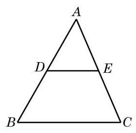

(第 2 题)

1. 已知坐标平面上三个点 $A\left( {1,1}\right) \text{ 、 }B\left( {4,2}\right)$ 与 $C\left( {-2, - 6}\right)$ ,求 $\bigtriangleup {ABC}$ 的面积.
2. 如图,已知 $\bigtriangleup {ABC}, D\text{ 、 }E$ 分别是 ${AB}\text{ 、 }{AC}$ 的中点. 求证: ${DE}//{BC}$ .
3. 已知平面上 $A\text{ 、 }B$ 两点的坐标分别是 $\left( {2,5}\right) \text{ 、 }\left( {3,0}\right) , P$ 是直线 ${AB}$ 上的一点,且 $\overrightarrow{AP} =  - \frac{2}{3}\overrightarrow{PB}$ . 求点 $P$ 的坐标.

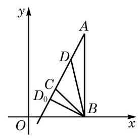

图 8-4-4

例 5 如图 8-4-4,平面上 $A\text{ 、 }B\text{ 、 }C$ 三点的坐标分别是 $\left( {2,3}\right) \text{ 、 }\left( {2,0}\right) \text{ 、 }\left( {1,1}\right)$ . 已知小明在点 $B$ 处休憩,有只小狗沿着 ${AC}$ 所在直线来回跑动. 问: 其在什么位置时,离小明最近?

解 记 $\overrightarrow{a} = \overrightarrow{CA},\overrightarrow{b} = \overrightarrow{BC}$ ,则

$$
\overrightarrow{a} = \left( {2 - 1,3 - 1}\right)  = \left( {1,2}\right) ,
$$

$$
\overrightarrow{b} = \left( {1 - 2,1 - 0}\right)  = \left( {-1,1}\right) .
$$

---

若将题中向量 $\overrightarrow{BD}$ 的模 $\left| {\overrightarrow{b} + \lambda \overrightarrow{a}}\right|$ 看作是一个 $\lambda$ 的函数,则这个例子体现了向量在函数中的应用. 同学们也不妨思考一下，如果不借助于向量方法, 那么如何求得点 ${D}_{0}$ 的坐标?

---

设 $D$ 是直线 ${CA}$ 上随着小狗跑动而动态变化的点,则 $\overrightarrow{CD}$ 可写成 $\lambda \overrightarrow{a}$ 的形式, $\lambda$ 是实数. 问题转化为: 确定 $\lambda$ 的值,使向量 $\overrightarrow{BD} = \overrightarrow{BC} + \overrightarrow{CD} = \overrightarrow{b} + \lambda \overrightarrow{a}$ 的模 $\left| {\overrightarrow{b} + \lambda \overrightarrow{a}}\right|$ 取到最小值,此时向量 $\overrightarrow{CD}$ 的终点 $D$ 即为小狗离小明最近的位置.

如果 $D$ 为 ${D}_{0}$ 使得 $\overrightarrow{B{D}_{0}} \bot  \overrightarrow{CA}$ ,即 $\overrightarrow{CA} \cdot  \overrightarrow{B{D}_{0}} = 0$ ,那么向量 $\overrightarrow{BD}$ 的模取到最小值. 于是, $\lambda$ 要满足 $\overrightarrow{a} \cdot  \left( {\overrightarrow{b} + \lambda \overrightarrow{a}}\right)  = 0$ ,即 $\lambda {\overrightarrow{a}}^{2} \; =  - \overrightarrow{a} \cdot  \overrightarrow{b}$ ,故

$$
\lambda  =  - \frac{\overrightarrow{a} \cdot  \overrightarrow{b}}{{\left| \overrightarrow{a}\right| }^{2}} =  - \frac{1 \times  \left( {-1}\right)  + 2 \times  1}{5} =  - \frac{1}{5}.
$$

从而 $\overrightarrow{B{D}_{0}} = \overrightarrow{b} - \frac{1}{5}\overrightarrow{a} = \left( {-1,1}\right)  - \frac{1}{5}\left( {1,2}\right)  = \left( {-\frac{6}{5},\frac{3}{5}}\right)$ ,最终推出 ${D}_{0}$ 的坐标是

$$
\left( {-\frac{6}{5} + 2,\frac{3}{5} + 0}\right)  = \left( {\frac{4}{5},\frac{3}{5}}\right) .
$$

因此,当其在点 $\left( {\frac{4}{5},\frac{3}{5}}\right)$ 时,离小明最近.

例 6 用向量方法证明:

$$
\cos \left( {\alpha  - \beta }\right)  = \cos \alpha \cos \beta  + \sin \alpha \sin \beta .
$$

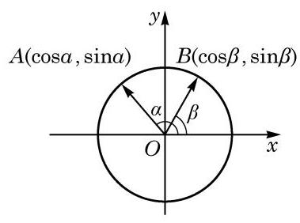

图 8-4-5

证明 如图 8-4-5,建立平面直角坐标系,并设 $A\text{ 、 }B$ 是单位圆上的任意两点,而角 $\alpha$ 与 $\beta$ 都是顶点在原点 $O$ 、始边为 $x$ 轴正半轴的角,其终边分别落在 ${OA}$ 与 ${OB}$ 上. 考虑向量

$$
\overrightarrow{a} = \overrightarrow{OA} = \left( {\cos \alpha ,\sin \alpha }\right) ,\overrightarrow{b} = \overrightarrow{OB} = \left( {\cos \beta ,\sin \beta }\right) .
$$

我们要求出 $\langle \overrightarrow{a},\overrightarrow{b}\rangle$ 的余弦). 注意到交换 $\alpha$ 与 $\beta$ 不影响要证明的公式,可以假设从 $\overrightarrow{OB}$ 旋转到 $\overrightarrow{OA}$ 的最小正角就是 $\langle \overrightarrow{a},\overrightarrow{b}\rangle$ . 这个角与角 $\alpha  - \beta$ 有相同的始边与终边,于是

$$
\cos \langle \overrightarrow{a},\overrightarrow{b}\rangle  = \cos \left( {\alpha  - \beta }\right) .
$$

又由于 $\left| \overrightarrow{a}\right|  = \left| \overrightarrow{b}\right|  = 1$ ,我们得到

$$
\overrightarrow{a} \cdot  \overrightarrow{b} = \left| \overrightarrow{a}\right| \left| \overrightarrow{b}\right| \cos \left( {\alpha  - \beta }\right)  = \cos \left( {\alpha  - \beta }\right) .
$$

另一方面, 用向量的坐标表示来计算数量积, 我们有

$$
\overrightarrow{a} \cdot  \overrightarrow{b} = \cos \alpha \cos \beta  + \sin \alpha \sin \beta .
$$

综上所述,

$$
\cos \left( {\alpha  - \beta }\right)  = \cos \alpha \cos \beta  + \sin \alpha \sin \beta .
$$

例 7 将质量为 ${20}\mathrm{\;{kg}}$ 的物体用两根绳子悬挂起来,如图 8-4-6(1)，两根绳子与铅垂线的夹角分别为 ${45}^{ \circ  }$ 与 ${30}^{ \circ  }$ . 求它们分别提供的拉力的大小. (结果精确到 ${0.1}\mathrm{\;N}$ )

解 设两根绳子的拉力分别是 ${\overrightarrow{f}}_{1}$ 与 ${\overrightarrow{f}}_{2}$ ,则它们的合力 ${\overrightarrow{f}}_{1} + {\overrightarrow{f}}_{2}$ 与物体的重力大小相等、方向相反,即 ${\overrightarrow{f}}_{1} + {\overrightarrow{f}}_{2}$ 是垂直向上、模为 ${20g}\left( \mathrm{\;N}\right)$ 的向量,这里 $g \approx  {9.8}\left( {\mathrm{\;m}/{\mathrm{s}}^{2}}\right)$ 是重力加速度.

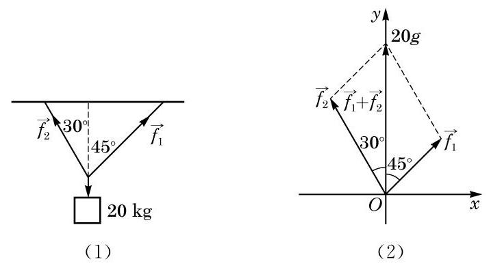

图 8-4-6

以 $\overrightarrow{{f}_{1}}$ 与 $\overrightarrow{{f}_{2}}$ 的公共作用点为原点,以 $\overrightarrow{{f}_{1}} + \overrightarrow{{f}_{2}}$ 为 $y$ 轴的正半轴, 建立平面直角坐标系, 如图 8-4-6(2) 所示.

令 $a = \left| \overrightarrow{{f}_{1}}\right| , b = \left| \overrightarrow{{f}_{2}}\right|$ ,则

$$
{\overrightarrow{f}}_{1} = a\left( {\cos {45}^{ \circ  },\sin {45}^{ \circ  }}\right)  = \left( {\frac{\sqrt{2}}{2}a,\frac{\sqrt{2}}{2}a}\right) ,
$$

$$
\overrightarrow{{f}_{2}} = b\left( {\cos {120}^{ \circ  },\sin {120}^{ \circ  }}\right)  = \left( {-\frac{1}{2}b,\frac{\sqrt{3}}{2}b}\right) .
$$

因为 $\overrightarrow{{f}_{1}} + \overrightarrow{{f}_{2}} = \left( {0,{20g}}\right)$ ,所以

$$
\left\{  \begin{array}{l} \frac{\sqrt{2}}{2}a - \frac{1}{2}b = 0, \\  \frac{\sqrt{2}}{2}a + \frac{\sqrt{3}}{2}b = {20g}. \end{array}\right.
$$

解得 $a = {10}\left( {\sqrt{6} - \sqrt{2}}\right) g \approx  {101.5}\left( \mathrm{\;N}\right) , b = {20}\left( {\sqrt{3} - 1}\right) g \approx  {143.5}\left( \mathrm{\;N}\right)$ .

综上所述,这两根绳子所提供的拉力分别约为 ${101.5}\mathrm{\;N}$ 和 143.5 N.

#### 练习 8.4(2)

1. 已知两个力 $\left( {\text{ 单位: }\mathrm{N}}\right) \overrightarrow{{f}_{1}}$ 与 $\overrightarrow{{f}_{2}}$ 的夹角为 ${60}^{ \circ  }$ ,其中 $\overrightarrow{{f}_{1}} = \left( {2,0}\right)$ . 某质点在这两个力的共同作用下,由点 $A\left( {1,1}\right)$ 移动至点 $B\left( {6,6}\right)$ (单位: $\mathrm{m}$ ).

(1)求 $\overrightarrow{{f}_{2}}$ ；

(2)求 $\overrightarrow{{f}_{1}}$ 与 $\overrightarrow{{f}_{2}}$ 的合力对质点所做的功.

2. 已知平面上三点 $A\text{ 、 }B\text{ 、 }C$ 的坐标分别是 $\left( {1,7}\right) \text{ 、 }\left( {2,2}\right) \text{ 、 }\left( {0,1}\right) , P$ 为直线 ${AC}$ 上的一动点. 问: $P$ 在什么位置时, $\left| \overrightarrow{BP}\right|$ 取到最小值?

#### 习题 8.4

##### A 组

1. 已知平面上 $A\text{ 、 }B$ 两点的坐标分别是 $\left( {3,5}\right) \text{ 、 }\left( {0,1}\right) , P$ 为直线 ${AB}$ 上一点,且 $\overrightarrow{AP} = \; \frac{1}{5}\overrightarrow{PB}$ . 求点 $P$ 的坐标.
2. 已知 $\bigtriangleup  {ABC}$ 的三个顶点 $A$ 、 $B$ 、 $C$ 的坐标分别是 $\left( {1,2}\right)$ 、 $\left( {2,3}\right)$ 、 $\left( {3,7}\right)$ ，求此三角形的面积.
3. 用向量方法证明三角形的余弦定理.

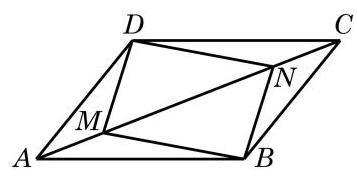

(第 5 题)

4. 菱形是四条边都相等的四边形. 用向量方法证明菱形的对角线互相垂直.
5. 如图,已知 $M\text{ 、 }N$ 是平行四边形 ${ABCD}$ 的对角线 ${AC}$ 上的两点,且 ${AM} = {CN}$ . 求证: BMDN 是平行四边形.

##### B 组

1. 证明: 三角形的三条中线相交于一点.
2. 已知平面上不共线的三点 $A\left( {{x}_{1},{y}_{1}}\right) \text{ 、 }B\left( {{x}_{2},{y}_{2}}\right)$ 与 $C\left( {{x}_{3},{y}_{3}}\right)$ ,求证: $\bigtriangleup {ABC}$ 的面积 $S = \frac{1}{2}\left| {{x}_{1}\left( {{y}_{2} - {y}_{3}}\right)  + {x}_{2}\left( {{y}_{3} - {y}_{1}}\right)  + {x}_{3}\left( {{y}_{1} - {y}_{2}}\right) }\right|$ .
3. 已知 $a\text{ 、 }b$ 均为正数,且 $a + b = 1$ . 求证: ${\left( a + 2\right) }^{2} + {\left( b + 3\right) }^{2} > {18}$ .
4. 已知 ${ABCD}$ 是正方形， $M$ 是 ${AB}$ 边的中点，点 $E$ 在对角线 ${AC}$ 上，且 ${AE} : {EC} =$ 3:1. 求证: $\angle {MED} = \frac{\pi }{2}$ .
5. 用向量方法证明: 把一个平行四边形的一个顶点和两条不过此顶点的边的中点分别连线, 则这两条连线三等分此平行四边形的一条对角线.

探究与实践

宇航员的训练

地球的重力加速度与月球以及其他星球的重力加速度是不同的. 为了使宇航员适应不同的重力环境，宇航训练部建造了训练装置:如图 8-4-7，一个可滑动的连杆与人的腰部联结, 人在一个固定的斜面上行走, 连杆与斜面始终保持平行, 适当调整这个斜面的位置, 可使人对斜面的作用力相当于人在某个星体上的重力.

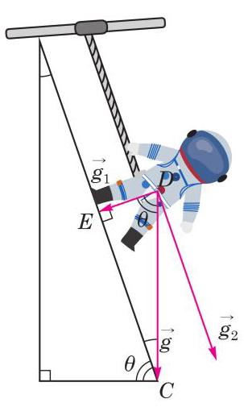

图 8-4-7

(1)已知月球重力加速度 ${g}_{1}$ 是地球重力加速度 $g$ 的 $\frac{1}{6}$ ，为模拟月球重力对宇航人员的作用，角 $\theta$ 的大小应如何选取？

(2)先查出火星重力加速度的数据，并判断当 $\theta  = {68}^{ \circ  }$ 时该装置能否训练去火星的宇航员.

课后阅读

话说向量

向量的故事可以追溯到遥远的年代. 早年的向量——物理学家称之为“矢量”，只是物理学专门用来表示力和速度等物理量的工具，并不为数学家所重视. 古希腊学者亚里士多德 (Aristotle) 已经知道两个力的合成可以用平行四边形的法则得到. 但是, 在欧几里得 (Euclid)集古希腊数学大成的《几何原本》中，却没有讨论向量. 此后 2000 年左右，不管是文艺复兴时期, 还是牛顿(I. Newton)与莱布尼茨(G. Leibniz)创立微积分之后的 17、18 世纪，人们对向量的认识并没有发生什么根本性的变化. 但进入 19 世纪，事情开始有了很大的转机. 其中，对“复数”(将在下一章学习)认识的深入起了重要的推动作用. 为了更好地理解复数, 丹麦数学家韦塞尔(C. Wessel) 于 1797 年, 瑞士数学家阿尔冈(J. Argand) 于 1806 年独立地建立起复数的几何表示, 而高斯 (J. Gauss) 的工作则使这一原理广为人知, 并被数学家们普遍接受. 在熟悉复数的几何表示之后, 数学家们逐步认识到复数可用来表示和研究平面上的向量. 平面向量与复数之间建立起一一对应, 这不但为虚数的现实化提供了可能, 也为向量的发展开辟了道路.

在现代数学中, 平面上和空间中直观的向量被形式化地推广为高维向量, 形成了抽象的向量空间的概念, 是大学数学中线性代数的主要内容.

向量连接着代数和几何, 连接着数学与物理. 在数学上, 点的直角坐标、向量的坐标分解、直角三角形中锐角的正弦与余弦、复数的实部与虚部, 这些概念形式上不同, 却又彼此相通. 因此, 向量也会是中学数学舞台上一位独具魅力的角色.
