# 复数的几何意义｜双教材原文摘录

本文件保留相关章节的讲解、例题与随堂练习，按版本分段。较宽章节含相邻知识和混合习题，尚未逐题筛选、配答或审校。原文为转写稿，请对照教材原件。

## 人教A版：7.1.2 复数的几何意义

来源：03_第七章_复数.md（本地转写稿），转写稿第 96—380 行；截至下一指定标题前。

## 7.1.2 复数的几何意义

我们知道，实数与数轴上的点一一对应，因此实数可以用数轴上的点来表示．复数有什么几何意义呢？

## 思考

根据复数相等的定义，任何一个复数 $z = a + b \mathrm { i }$ 都可以由一个有序实数对 $( a , b )$ 唯一确定；反之也对．由此你能想到复数的几何表示方法吗？

因为任何一个复数 $z = a + b \mathrm { i }$ 都可以由一个有序实数对（a，b）唯一确定，并且任给一个复数也可以唯一确定一个有序实数对，所以复数 $z = a + b \mathrm { i }$ 与有序实数对（a，b）是一一对应的.而有序实数对 $( a , b )$ 与平面直角坐标系中的点是一一对应的，所以复数集与平面直角坐标系中的点集之间可以建立一一对应关系.

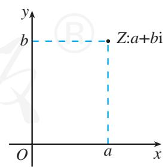

如图7.1-2，点Z的横坐标是a，纵坐标是b，复数 $z = a + b \mathrm { i }$ 可用点 $Z ( a , b )$ 表示.这个建立了直角坐标系来表示复数的平面叫做复平面，x轴叫做实轴，y轴叫做虚轴．显然，实轴上的点都表示实数；除了原点外，虚轴上的点都表示纯虚数.

图 7.1-2

例如，复平面内的原点（0，0）表示实数0，实轴上的点（2，0）表示实数2，虚轴上的点（0，一1）表示纯虚数一i，点（—2，3）表示复数 $- 2 + 3 \mathrm { i }$ 等.

按照这种表示方法，每一个复数，有复平面内唯一的一个点和它对应；反过来，复平面内的每一个点，有唯一的一个复数和它对应.由此可知，复数集C中的数与复平面内的点按如下方式建立了一一对应关系

$$
\text{复数 }z=a+b\mathrm{i}\quad\longleftrightarrow\quad\text{复平面内的点 }Z(a,b)
$$

这是复数的一种几何意义.

## 思考

在平面直角坐标系中，每一个平面向量都可以用一个有序实数对来表示，而有序实数对与复数是一一对应的．你能用平面向量来表示复数吗？

如图7.1-3，设复平面内的点Z表示复数 $z = a + b \mathrm { i }$ ，连接OZ，显然向量 $\overrightarrow { O Z }$ 由点Z唯一确定；反过来，点Z也可以由向量 $\overrightarrow { O Z }$ 唯一确定.因此，复数集C中的数与复平面内以原点为起点的向量建立了如下一一对应关系（实数0与零向量对应)，即

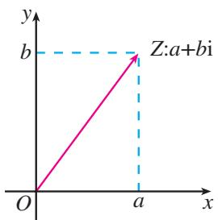  
图 7.1-3

$$
\text{复数 }z=a+b\mathrm{i}\quad\longleftrightarrow\quad\text{平面向量 }\overrightarrow{OZ}
$$

这是复数的另一种几何意义.

为方便起见，我们常把复数 $z = a + b \mathrm { i }$ 说成点Z或说成向量 $\overrightarrow { O Z }$ ，并且规定，相等的向量表示同一个复数.

在本书的第六章，我们提到复数的这种几何表示是由韦塞尔在1797年提出的．后来，阿尔冈出书对此进行讨论，并得到高斯的认同，因此这种几何表示也称阿尔冈图(Argand diagram). 正是这种直观的几何表示，揭开了复数的神秘的、不可思议的“面纱”，确立了复数在数学中的地位.

图 7.1-3 中向量 $\overrightarrow { O Z }$ 的模叫做复数 $z = a + b \mathrm { i }$ 的模（modulus of a complex number）或绝对值，记作 $| z |$ 或 $| a + b \mathrm { i } |$ ．即

$$
| z | = | a + b \mathrm { i } | = \sqrt { a ^ { 2 } + b ^ { 2 } } ,
$$

其中a, $b \in \mathbf { R } .$

如果 $b = 0$ ，那么 $z = a + b \mathrm { i }$ 是一个实数a，它的模就等于 $|a|$（a的绝对值）.

例2 设复数 $z _ { 1 } = 4 + 3 \mathrm { i } , \ z _ { 2 } = 4 - 3 \mathrm { i } .$

（1）在复平面内画出复数 $z _ { 1 } , \ z _ { 2 }$ 对应的点和向量；

(2) 求复数 $z _ { 1 } , \ z _ { 2 }$ 的模，并比较它们的模的大小.

解：（1）如图7.1-4，复数 $z _ { 1 } , \ z _ { 2 }$ 对应的点分别为 $Z _ { 1 } , Z _ { 2 }$ ，对应的向量分别为$\overrightarrow { O Z _ { 1 } } , \overrightarrow { O Z _ { 2 } }$

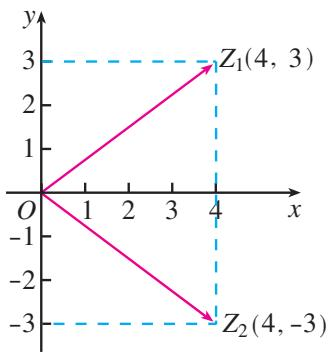  
图 7.1-4

点 Z1，Z2有怎样的关系？

(2) $| z _ { 1 } | = | 4 { + } 3 \mathrm { i } | = \sqrt { 4 ^ { 2 } + 3 ^ { 2 } } = 5$

$$
| z _ { 2 } | = | 4 { \mathrm { - } } 3 \mathrm { i } | = { \sqrt { 4 ^ { 2 } + ( - 3 ) ^ { 2 } } } = 5 .
$$

所以 $| \mathbf { \boldsymbol { z } } _ { 1 } | = | \mathbf { \boldsymbol { z } } _ { 2 } |$

一般地，当两个复数的实部相等，虚部互为相反数时，这两个复数叫做互为共轭复数(conjugate complex number). 虚部不等于0的两个共轭复数也叫做共轭虚数.复数 $z$ 的共轭复数用 $\overline{z}$ 表示，即如果 $z = a + b \mathrm { i }$ ，那么 $\overline { z } = a - b \mathrm { i }$.

## 思考

如果 $z _ { 1 } , \ z _ { 2 }$ 是共轭复数，那么在复平面内它们所对应的点有怎样的关系？

例3设 $z \in \mathbf { C }$ ，在复平面内z对应的点为Z，那么满足下列条件的点Z的集合是什么图形?

(1) $| z | = 1$ (2) $1 < | \boldsymbol { z } | < 2 .$

解：（1）由 $| z | = 1$ 得，向量 $\overrightarrow { O Z }$ 的模等于1，所以满足条件 $| z | = 1$ 的点Z的集合是以原点O为圆心，以1为半径的圆.

(2) 不等式 $1 < | \boldsymbol { z } | < 2$ 可化为不等式 $\begin{array} { r } { \left\{ \begin{array} { l l } { \displaystyle | z | < 2 , } \\ { \displaystyle | z | > 1 . } \end{array} \right. } \end{array}$

不等式 $| z | < 2$ 的解集是圆 $| z | = 2$ 的内部所有的点组成的集合，不等式 $| z | { > } 1$ 的解集是圆 $|z|=1$ 外部所有的点组成的集合，这两个集合的交集，就是上述不等式组的解集，也就是满足条件 $1 < | \boldsymbol { z } | < 2$ 的点Z的集合．容易看出，所求的集合是以原点O为圆心，以1及2为半径的两个圆所夹的圆环，但不包括圆环的边界（图7.1-5）.

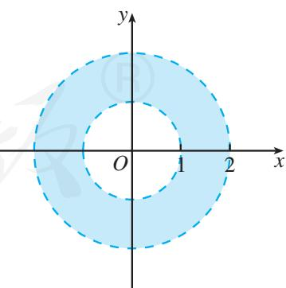  
图 7.1-5

## 练习

1. 说出图中复平面内各点所表示的复数（每个小方格的边长为1).

2. 在复平面内，描出表示下列复数的点：(1) $2 + 5 \mathrm { i } ;$ (2) $- 3 + 2 \mathrm { i } ;$ (3) 2—4i;(4) —3—i; (5) 5; (6) —3i.

3. 已知复数 $2+i$，$-2+4i$，$-2i$，$4$，$\frac{3}{2}-4i$，

（1）在复平面内画出这些复数对应的向量；

（2）求这些复数的模.

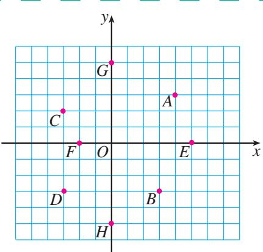  
(第1题)

## 习题7.1

## 复习巩固

1. 符合下列条件的复数一定存在吗？若存在，请举出例子；若不存在，请说明理由.

（1）实部为 $- \sqrt { 2 }$ 的虚数；

(2) 虚部为—√2的虚数；

（3）虚部为 $- \sqrt { 2 }$ 的纯虚数.

2. 当实数m取什么值时，复数 $\left( m ^ { 2 } - 5 m + 6 \right) + \left( m ^ { 2 } - 3 m \right) \mathrm { i }$ 是下列数?

(1） 实数；

(2) 虚数；

（3） 纯虚数.

3. 求适合下列方程的实数x 与y的值：(1) $( 3 x + 2 y ) + ( 5 x - y ) \mathrm { i } = 1 7 - 2 \mathrm { i } ;$ (2) $( x + y - 3 ) + ( x - 4 ) \mathop { \mathrm { i = 0 } } .$

4. 如果P 是复平面内表示复数 $a + b \mathrm { i } ( a , b \in \mathbf { R } )$ 的点，分别指出在下列条件下点P的位置.(1) $a > 0 , \ b > 0$； (2) $a < 0 , \ b > 0$； (3) $a = 0 , \ b \leqslant 0$； (4) $b < 0$.

5. 求复数 $z _ { 1 } = 3 + 4 \mathrm { i }$ 及 $z _ { 2 } = \frac { 1 } { 2 } - \sqrt { 2 } \mathrm { i }$ 的模，并比较它们的模的大小.

## 综合运用

6. 当实数m取什么值时，复平面内表示复数 $z = ( m ^ { 2 } - 8 m + 1 5 ) + ( m ^ { 2 } - 5 m - 1 4 ) \mathrm { i }$ 的点分别满足下列条件?

（1）位于第四象限；

（2）位于第一象限或第三象限；

(3) 位于直线 y =x 上.

7. 在复平面内，O是原点，向量 $\overrightarrow { O A }$ 对应的复数是2+i.

（1）如果点A关于实轴的对称点为点B，求向量 $\overrightarrow{OB}$ 对应的复数；

（2）如果（1）中点B关于虚轴的对称点为点C，求点C对应的复数.

8. 设 $z \in \mathbf { C }$ ，在复平面内z对应的点为Z，那么满足下列条件的点Z的集合是什么图形？(1) $| z | = 3 ;$ (2) $2 { \leqslant } | z | < 5 .$

9.如果复数z的实部为正数，虚部为3，那么在复平面内，复数z对应的点应位于怎样的图形上?

## 拓广探索

10. 已知复数z的虚部为 $\sqrt{3}$，在复平面内复数z对应的向量的模为2，求这个复数z.

11. 在复平面内指出与复数 $z _ { 1 } = 1 + 2 \mathrm { i } , z _ { 2 } = \sqrt { 2 } + \sqrt { 3 } \mathrm { i } , z _ { 3 } = \sqrt { 3 } - \sqrt { 2 } \mathrm { i } , z _ { 4 } = - 2 + \mathrm { i }$ 对应的点Z1，$Z _ { 2 } , Z _ { 3 } , Z _ { 4 }$ ．判断这4个点是否在同一个圆上，并证明你的结论.

## 7.2 复数的四则运算

在上一节，我们把实数集扩充到了复数集．引入新数集后，就要研究其中的数之间的运算．下面就来讨论复数集中的运算问题.

## 7.2.1 复数的加、减运算及其几何意义

我们规定，复数的加法法则如下：

设 $z _ { 1 } = a + b \mathrm { i } , \ z _ { 2 } = c + d \mathrm { i } \ \left( a , \ b , \ c , \ d \in \bf { R } \right)$ 是任意两个复数，那么它们的和

$$
( a + b \mathrm { i } ) + ( c + d \mathrm { i } ) = ( a + c ) + ( b + d ) \mathrm { i } .
$$

很明显，两个复数的和仍然是一个确定的复数.特别地，当 $z _ { 1 } , \ z _ { 2 }$ 都是实数时，把它们看作复数时的和就是这两个实数的和

可以看出，两个复数相加，类似于两个多项式相加，

## 思考

复数的加法满足交换律、结合律吗？

容易得到，对任意 $z _ { 1 } , z _ { 2 } , z _ { 3 } \in \mathbf { C }$ ，有

$$
z _ { 1 } + z _ { 2 } = z _ { 2 } + z _ { 1 },\qquad (z_1+z_2)+z_3=z_1+(z_2+z_3).
$$

## 探究

我们知道，复数与复平面内以原点为起点的向量一一对应．而我们讨论过向量加法的几何意义，你能由此出发讨论复数加法的几何意义吗？

设 $\overrightarrow { O Z _ { 1 } } , \overrightarrow { O Z _ { 2 } }$ 分别与复数 $a + b \mathrm { i } , \ c + d \mathrm { i }$ 对应，则 $\overrightarrow { O Z _ { 1 } } = ( a , \ b ) , \ \overrightarrow { O Z _ { 2 } } = ( c , \ d )$ ．由平 面向量的坐标运算法则，得

$$
\overrightarrow { O Z _ { 1 } } + \overrightarrow { O Z _ { 2 } } = ( a + c , \ b + d ) .
$$

这说明两个向量 $\overrightarrow { O Z _ { 1 } }$ 与 $\overrightarrow { O Z _ { 2 } }$ 的和就是与复数 $( a + c ) + ( b + d ) \mathrm { i }$ 对应的向量.因此，复数的加法可以按照向量的加法来进行（图7.2-1），这就是复数加法的几何意义.

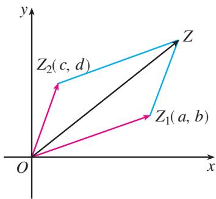  
图 7.2-1

## 思考

我们知道，实数的减法是加法的逆运算．类比实数减法的意义，你认为该如何定义复数的减法？

我们规定，复数的减法是加法的逆运算，即把满足

$$
( c + d \mathrm { i } ) + ( x + y \mathrm { i } ) = a + b \mathrm { i }
$$

的复数 $x + y \mathrm { i } ( x , \ y \in \mathbf { R } )$ 叫做复数 $a + b \mathrm { i } ( a , b \in \mathbf { R } )$ 减去复数 $c + d \mathrm { i } ( c , d \in \mathbf { R } )$ 的差，记作 $( a + b \mathrm { i } ) - ( c + d \mathrm { i } )$.

根据复数相等的含义，

$$
c + x = a , d + y = b ,
$$

因此

$$
x = a - c , \mathrm { } \ y = b - d , 
$$

所以

$$
x + y \mathrm { i } = ( a - c ) + ( b - d ) \mathrm { i } ,
$$

即

$$
( a + b \mathrm { i } ) - ( c + d \mathrm { i } ) = ( a - c ) + ( b - d ) \mathrm { i } .
$$

这就是复数的减法法则.由此可见，两个复数的差是一个确定的复数.可以看出，两个复数相减，类似于两个多项式相减.

## 探究

类比复数加法的几何意义，你能得出复数减法的几何意义吗？

例1 计算 $( 5 - 6 \mathrm { i } ) + ( - 2 - \mathrm { i } ) - ( 3 + 4 \mathrm { i } ) .$

解：$(5-6\mathrm{i})+(-2-\mathrm{i})-(3+4\mathrm{i})=(5-2-3)+(-6-1-4)\mathrm{i}=-11\mathrm{i}$.

例2 根据复数及其运算的几何意义，求复平面内的两点 $Z _ { 1 } ( x _ { 1 } , \ y _ { 1 } ) , \ Z _ { 2 } ( x _ { 2 } , \ y _ { 2 } )$ 之间的距离.

分析：由于复平面内的点 $Z_1(x_1,y_1), Z_2(x_2,y_2)$ 对应的复数分别为 $z_1=x_1+y_1\mathrm{i}, z_2=x_2+y_2\mathrm{i}$，由复数减法的几何意义知，复数 $z_2-z_1$ 对应的向量为 $\overrightarrow{Z_1Z_2}$，从而点 $Z_1,Z_2$ 之间的距离为 $|\overrightarrow{Z_1Z_2}|=|z_2-z_1|$．

解：因为复平面内的点 $Z_1(x_1,y_1), Z_2(x_2,y_2)$ 对应的复数分别为 $z_1=x_1+y_1\mathrm{i}, z_2=x_2+y_2\mathrm{i}$，所以点 $Z_1,Z_2$ 之间的距离为

$$
\begin{aligned}
|Z_1Z_2|&=|\overrightarrow{Z_1Z_2}|=|z_2-z_1|=|(x_2+y_2\mathrm{i})-(x_1+y_1\mathrm{i})|\\
&=|(x_2-x_1)+(y_2-y_1)\mathrm{i}|\\
&=\sqrt{(x_2-x_1)^2+(y_2-y_1)^2}.
\end{aligned}
$$

## 练习

1. 计算： (1)(2+4i)+(3—4i); (2) $5 - ( 3 { + } 2 \mathrm { i } ) ;$ (3) $( - 3 - 4 \mathrm { i } ) + ( 2 + \mathrm { i } ) - ( 1 - 5 \mathrm { i } )$ (4) $( 2 - \mathrm { i } ) - ( 2 + 3 \mathrm { i } ) + 4 \mathrm { i } .$

2. 如图，向量 $\overrightarrow { O Z }$ 对应的复数是z，分别作出下列运算的结果对应的向量：(1) z+1; (2) z—i; (3) $z + ( - 2 { + } \mathrm { i } )$

3. 证明复数的加法满足交换律、结合律.

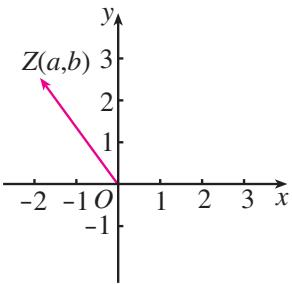

4. 求复平面内下列两个复数对应的两点之间的距离：(1) $z _ { 1 } = 2 + \mathrm { i } , \ z _ { 2 } = 3 - \mathrm { i }$ (2) $z _ { 3 } = 8 + 5 \mathrm { i } , \ z _ { 4 } = 4 + 2 \mathrm { i } .$

(第2题)

## 人教A版：7.3.2 复数乘、除运算的三角表示及其几何意义

来源：03_第七章_复数.md（本地转写稿），转写稿第 774—894 行；截至下一指定标题前。

## 7.3.2 复数乘、除运算的三角表示及其几何意义

前面，我们研究了复数代数形式的乘、除运算，下面我们利用复数的三角表示研究复数的乘、除运算及其几何意义.

## 思考

如果把复数 $z_1,z_2$ 分别写成三角形式 $z_1=r_1(\cos\theta_1+\mathrm{i}\sin\theta_1)$，$z_2=r_2(\cos\theta_2+\mathrm{i}\sin\theta_2)$，你能计算 $z_1z_2$ 并将结果表示成三角形式吗？

根据复数的乘法法则以及两角和的正弦、余弦公式，可以得到

$$
\begin{array} { r l } & { z _ { 1 } z _ { 2 } = r _ { 1 } ( \cos \theta _ { 1 } + \mathrm { i } \sin \theta _ { 1 } ) \bullet r _ { 2 } ( \cos \theta _ { 2 } + \mathrm { i } \sin \theta _ { 2 } ) } \\ & { \qquad = r _ { 1 } r _ { 2 } ( \cos \theta _ { 1 } + \mathrm { i } \sin \theta _ { 1 } ) ( \cos \theta _ { 2 } + \mathrm { i } \sin \theta _ { 2 } ) } \\ & { \qquad = r _ { 1 } r _ { 2 } \big [ ( \cos \theta _ { 1 } \cos \theta _ { 2 } - \sin \theta _ { 1 } \sin \theta _ { 2 } ) + \mathrm { i } ( \sin \theta _ { 1 } \cos \theta _ { 2 } + \cos \theta _ { 1 } \sin \theta _ { 2 } ) \big ] } \\ & { \qquad = r _ { 1 } r _ { 2 } \big [ \cos ( \theta _ { 1 } + \theta _ { 2 } ) + \mathrm { i } \sin ( \theta _ { 1 } + \theta _ { 2 } ) \big ] , } \end{array}
$$

即

$$
\begin{array} { r l } & { ~ r _ { 1 } ( \cos \theta _ { 1 } { + } \mathrm { i } \sin \theta _ { 1 } ) \bullet r _ { 2 } ( \cos \theta _ { 2 } { + } \mathrm { i } \sin \theta _ { 2 } ) } \\ & { = r _ { 1 } r _ { 2 } \big [ \cos ( \theta _ { 1 } { + } \theta _ { 2 } ) { + } \mathrm { i } \sin ( \theta _ { 1 } { + } \theta _ { 2 } ) \big ] . } \end{array}
$$

这就是说，两个复数相乘，积的模等于各复数的模的积，积的辐角等于各复数的辐角的和.

## 探究

由复数乘法运算的三角表示，你能得到复数乘法的几何意义吗？

两个复数 $z _ { 1 } , \ z _ { 2 }$ 相乘时，可以像图7.3-6那样，先分别画出与 $z _ { 1 } , \ z _ { 2 }$ 对应的向量$\overrightarrow { O Z _ { 1 } } , \overrightarrow { O Z _ { 2 } }$ ，然后把向量 $\overrightarrow { O Z _ { 1 } }$ 绕点O按逆时针方向旋转角 $\theta _ { 2 }$ （如果 $\theta _ { 2 } < 0$ ，就要把 $\overrightarrow { O Z _ { 1 } }$ 绕点O按顺时针方向旋转角 $\mid \theta _ { 2 } \mid )$ ，再把它的模变为原来的 $r _ { 2 }$ 倍，得到向量 $\overrightarrow { O Z } , \overrightarrow { O Z }$ 表示的复数就是积 $z_1z_2$ .这是复数乘法的几何意义。

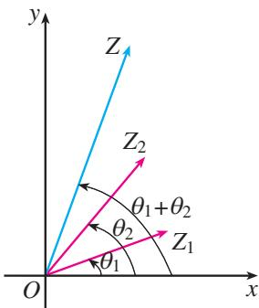  
图 7.3-6

你能解释 i²=—1 和(—1)²=1的几何意义吗？

例3 已知 $z _ { 1 } = \frac { 3 } { 2 } \big ( \cos \frac { \pi } { 6 } + \mathrm { i } \sin \frac { \pi } { 6 } \big ) , ~ z _ { 2 } = 2 \big ( \cos \frac { \pi } { 3 } + \mathrm { i } \sin \frac { \pi } { 3 } \big )$，求 $z_1z_2$，请把结果化为代数形式，并作出几何解释.

解：

$$
\begin{aligned}
z_1z_2&=\frac32\left(\cos\frac\pi6+\mathrm{i}\sin\frac\pi6\right)\times2\left(\cos\frac\pi3+\mathrm{i}\sin\frac\pi3\right)\\
&=\frac32\times2\left[\cos\left(\frac\pi6+\frac\pi3\right)+\mathrm{i}\sin\left(\frac\pi6+\frac\pi3\right)\right]\\
&=3\left(\cos\frac\pi2+\mathrm{i}\sin\frac\pi2\right)=3\mathrm{i}.
\end{aligned}
$$

当不要求把计算结果化为代数形式时，也可以用三角形式表示.

首先作与 $z_1,z_2$ 对应的向量 $\overrightarrow{OZ_1},\overrightarrow{OZ_2}$，然后把向量 $\overrightarrow{OZ_1}$ 绕点O按逆时针方向旋转 $\frac { \pi } { 3 }$，再将其长度伸长为原来的2倍，这样得到一个长度为3，辐角为 $\frac { \pi } { 2 }$ 的向量 $\overrightarrow { O Z }$ (图7.3-7). $\overrightarrow { O Z }$ 即为积 $z _ { 1 } z _ { 2 } = 3 \mathrm { i }$ 所对应的向量.

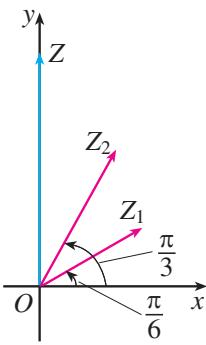  
图7.3-7

例4 如图7.3-8，向量 $\overrightarrow { O Z }$ 对应的复数为1+i，把 $\overrightarrow { O Z }$ 绕点O按逆时针方向旋转 $120^{\circ}$，得到 $\overrightarrow { O Z ^ { \prime } }$，求向量 $\overrightarrow { O Z ^ { \prime } }$ 对应的复数（用代数形式表示）.

分析：根据复数乘法的几何意义，向量 $\overrightarrow { O Z ^ { \prime } }$ 对应的复数是复数1+i与 $z_0$ 的积，其中复数 $z_0$ 的模是1，辐角的主值是 $120^{\circ}$。

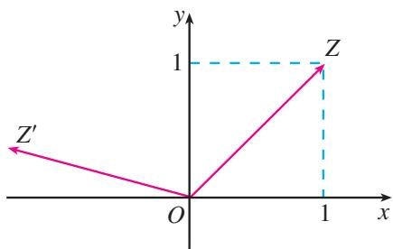  
图 7.3-8

解：向量 $\overrightarrow { O Z ^ { \prime } }$ 对应的复数为

$$
\begin{array} { c } { { ( 1 + \mathrm { i } ) ( \cos 1 2 0 ^ { \circ } + \mathrm { i } \sin 1 2 0 ^ { \circ } ) } } \\ { { { } } } \\ { { = ( 1 + \mathrm { i } ) \bigl ( - \displaystyle \frac 1 2 + \frac { \sqrt { 3 } } { 2 } \mathrm { i } \bigr ) } } \\ { { { } } } \\ { { = \displaystyle \frac { - 1 - \sqrt { 3 } } { 2 } + \frac { \sqrt { 3 } - 1 } { 2 } \mathrm { i } . } } \end{array}
$$

## 探究

复数的除法运算是乘法运算的逆运算．根据复数乘法运算的三角表示，你能得出复数除法运算的三角表示吗？

设 $z _ { 1 } = r _ { 1 } ( \cos \theta _ { 1 } + \mathrm { i } \sin \theta _ { 1 } ) , z _ { 2 } = r _ { 2 } ( \cos \theta _ { 2 } + \mathrm { i } \sin \theta _ { 2 } )$ ，且 $z _ { 2 } \neq 0$ ，因为

$$
r _ { 2 } ( \cos \theta _ { 2 } + \mathrm { i } \sin \theta _ { 2 } ) \bullet \frac { r _ { 1 } } { r _ { 2 } } \ \Bigl [ \cos ( \theta _ { 1 } - \theta _ { 2 } ) + \mathrm { i } \sin ( \theta _ { 1 } - \theta _ { 2 } ) \Bigr ] = r _ { 1 } ( \cos \theta _ { 1 } + \mathrm { i } \sin \theta _ { 1 } ) ,
$$

所以根据复数除法的定义，有

$$
\frac { r _ { 1 } ( \cos \theta _ { 1 } + \mathrm { i } \sin \theta _ { 1 } ) } { r _ { 2 } ( \cos \theta _ { 2 } + \mathrm { i } \sin \theta _ { 2 } ) } { = } \frac { r _ { 1 } } { r _ { 2 } } \big [ \cos ( \theta _ { 1 } { - } \theta _ { 2 } ) + \mathrm { i } \sin ( \theta _ { 1 } { - } \theta _ { 2 } ) \big ] .
$$

这就是说，两个复数相除，商的模等于被除数的模除以除数的模所得的商，商的辐角等于被除数的辐角减去除数的辐角所得的差

## 探究

类比复数乘法的几何意义，由复数除法运算的三角表示，你能得出复数除法的几何意义吗？

例5 计算 $4 { \Big ( } \cos { \frac { 4 \pi } { 3 } } { + } \mathrm { i } \sin { \frac { 4 \pi } { 3 } } { \Big ) } \div { \Bigg [ } 2 { \Big ( } \cos { \frac { 5 \pi } { 6 } } { + } \mathrm { i } \sin { \frac { 5 \pi } { 6 } } { \Big ) } { \Bigg ] }$ ，并把结果化为代数形式.解：原式 $= 2 \left[ \cos ( { \frac { 4 \pi } { 3 } } - { \frac { 5 \pi } { 6 } } ) + \mathrm { i } \sin ( { \frac { 4 \pi } { 3 } } - { \frac { 5 \pi } { 6 } } ) \right]$

$$
= 2 { \Big ( } \cos { \frac { \pi } { 2 } } + \mathrm { i } \sin { \frac { \pi } { 2 } } { \Big ) } = 2 ( 0 + \mathrm { i } ) = 2 \mathrm { i } .
$$

## 练习

1. 计算：

(1) $8 { \Big ( } \cos { \frac { \pi } { 6 } } + \mathrm { i } \sin { \frac { \pi } { 6 } } { \Big ) } \times 2 { \Big ( } \cos { \frac { \pi } { 4 } } + \mathrm { i } \sin { \frac { \pi } { 4 } } { \Big ) }$

(2) $2\left(\cos\frac{4\pi}{3}+\mathrm{i}\sin\frac{4\pi}{3}\right)\times4\left(\cos\frac{5\pi}{6}+\mathrm{i}\sin\frac{5\pi}{6}\right)$

(3) $\sqrt2(\cos240^\circ+\mathrm{i}\sin240^\circ)\times\frac{\sqrt3}{2}(\cos60^\circ+\mathrm{i}\sin60^\circ)$

(4) $3 ( \cos 1 8 ^ { \circ } + \mathrm { i s i n } 1 8 ^ { \circ } ) \times 2 ( \cos 5 4 ^ { \circ } + \mathrm { i s i n } 5 4 ^ { \circ } ) \times 5 ( \cos 1 0 8 ^ { \circ } + \mathrm { i s i n } 1 0 8 ^ { \circ } )$

2. 计算：

(1) $12\left(\cos\frac{7\pi}{4}+\mathrm{i}\sin\frac{7\pi}{4}\right)\div\left[6\left(\cos\frac{2\pi}{3}+\mathrm{i}\sin\frac{2\pi}{3}\right)\right]$

(2) $\sqrt { 3 } \left( \cos 1 5 0 ^ { \circ } + \mathrm { i s i n ~ } 1 5 0 ^ { \circ } \right) \div \left[ \sqrt { 2 } \left( \cos 2 2 5 ^ { \circ } + \mathrm { i s i n ~ } 2 2 5 ^ { \circ } \right) \right] ;$

(3) $2\div(\cos\frac\pi4+\mathrm{i}\sin\frac\pi4)$

$$
( 4 ) \ - \mathrm { i } \div [ 2 ( \cos 1 2 0 ^ { \circ } + \mathrm { i } \sin 1 2 0 ^ { \circ } ) ] .
$$

3. 在复平面内，把与复数 $3 - { \sqrt { 3 } } \mathrm { i }$ 对应的向量绕原点O按顺时针方向旋转 $6 0 ^ { \circ }$ ，求与所得的向量对应的复数（用代数形式表示）.

## 沪教版2026：9.2 复数的几何意义

来源：沪教版必修第二册2026-dollar-polished.md（本地转写稿），转写稿第 5727—6046 行；截至下一指定标题前。

## 9.2 复数的几何意义

### 1 复平面与复数的坐标表示

复数 $a + b\mathrm{i}\left( {a\text{ 、 }b \in  \mathbf{R}}\right)$ 一一对应于有序实数对 $\left( {a, b}\right)$ ,而有序实数对 $\left( {a, b}\right)$ 与平面直角坐标系中的点 $Z\left( {a, b}\right)$ 又是一一对应的. 因此,可以用平面直角坐标系中的点 $Z\left( {a, b}\right)$ 表示复数 $z = \; a + b\mathrm{i}$ .

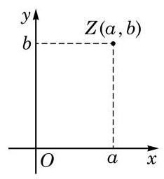

图 9-2-1

如图 9-2-1,在平面上建立直角坐标系,以坐标为 $\left( {a, b}\right)$ 的点 $Z$ 表示复数 $z = a + b\mathrm{i}$ ,就可在平面上的点的集合与复数集合之间建立一个一一对应. 这样用来表示复数的平面叫做复平面 (complex plane).

在复平面上, $x$ 轴上的点具有 $\left( {a,0}\right)$ 形式的坐标,从而对应的都是实数,所以把 $x$ 轴叫做实轴 (real axis); 同理, $y$ 轴上的点 (除坐标原点外) 都对应纯虚数,所以把 $y$ 轴叫做虚轴 (imaginary axis). 坐标原点表示实数 0 .

例 1 在复平面上有点 $A\left( {2,0}\right) \text{ 、 }B\left( {0, - 1}\right) \text{ 、 }C\left( {-2,3}\right)$ 、 $D\left( {4, - 3}\right)$ ,分别写出这四个点所对应的复数 ${z}_{A}\text{ 、 }{z}_{B}\text{ 、 }{z}_{C}\text{ 、 }{z}_{D}$ , 并求这些复数的共轭复数在复平面上所对应的点的坐标.

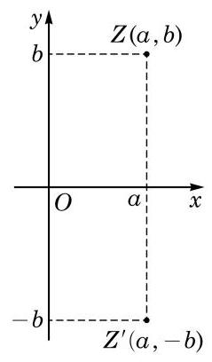

图 9-2-2

如图 9-2-2,共轭复数 $z = a + b\mathrm{i}$ 和 $\bar{z} = a - b\mathrm{i}\left( {a\text{ 、 }b \in  \mathbf{R}}\right)$ 在复平面上所对应的点 $Z\left( {a, b}\right)$ 和 ${Z}^{\prime }\left( {a, - b}\right)$ 关于 $x$ 轴对称; 反之, 如果复平面上的两个点关于 $x$ 轴对称,那么这两个点所对应的复数互为共轭. 特别地,如果 $b = 0$ ,即 $z$ 是实数,则 $z = \bar{z}$ ,此时 $z\text{ 、 }\bar{z}$ 在复平面上所对应的点是位于实轴上的同一点.

解 ${z}_{A} = 2,{z}_{B} =  - \mathrm{i},{z}_{C} =  - 2 + 3\mathrm{i},{z}_{D} = 4 - 3\mathrm{i}$ .

这些复数的共轭复数分别是 ${\bar{z}}_{A} = 2,{\bar{z}}_{B} = \mathrm{i},{\bar{z}}_{C} =  - 2 - 3\mathrm{i}$ , ${\bar{z}}_{D} = 4 + 3\mathrm{i}$ ,它们在复平面上所对应的点分别是 ${A}^{\prime }\left( {2,0}\right) \text{ 、 }{B}^{\prime }\left( {0,1}\right)$ 、 ${C}^{\prime }\left( {-2, - 3}\right) \text{ 、 }{D}^{\prime }\left( {4,3}\right) .$

2 复数的向量表示

上一章我们学过平面向量的坐标表示, 知道通过平面直角坐标系, 可在平面向量与平面上的点之间建立一一对应. 现在, 我们以平面直角坐标系为媒介, 又可以通过复数与平面上的点的一一对应, 在复数与平面向量之间建立一一对应. 如图 9-2-3, 复数 $z = a + b\mathrm{i}\left( {a\text{ 、 }b \in  \mathbf{R}}\right)$ 在复平面上对应坐标为 $\left( {a, b}\right)$ 的点 $Z$ ,而点 $Z$ 又对应于平面向量 $\overrightarrow{OZ} = \left( {a, b}\right)$ ,从而复数 $z = a + b\mathrm{i}$ 对应于平面向量 $\overrightarrow{OZ} = \left( {a, b}\right)$ . 有了这些对应,我们可以把复数 $z = a + b\mathrm{i}$ 方便地看作是复平面上的点 $Z\left( {a, b}\right)$ 或向量 $\overrightarrow{OZ}$ .

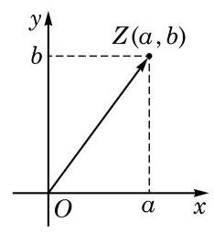

图 9-2-3

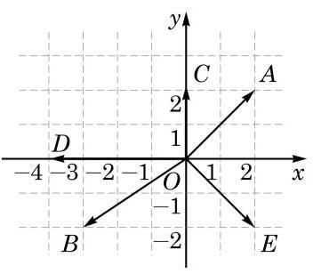

图 9-2-4

例 2 在复平面上作出表示下列复数的向量:

$$
{z}_{1} = 2 + 2\mathrm{i},{z}_{2} =  - 3 - 2\mathrm{i},{z}_{3} = 2\mathrm{i},{z}_{4} =  - 4,{z}_{5} = 2 - 2\mathrm{i}.
$$

解 在复平面上,表示复数 ${z}_{1} = 2 + 2\mathrm{i},{z}_{2} =  - 3 - 2\mathrm{i}$ , ${z}_{3} = 2\mathrm{i},{z}_{4} =  - 4,{z}_{5} = 2 - 2\mathrm{i}$ 的向量分别为图 9-2-4 中的向量 $\overrightarrow{OA}\text{ 、 }\overrightarrow{OB}\text{ 、 }\overrightarrow{OC}\text{ 、 }\overrightarrow{OD}\text{ 、 }\overrightarrow{OE}$ .

例 3 设复平面上的点 $A$ 和点 $B$ 所对应的复数分别为 ${z}_{A} = {x}_{A} + {y}_{A}\mathrm{i}\left( {{x}_{A}\text{ 、 }{y}_{A} \in  \mathbf{R}}\right)$ 和 ${z}_{B} = {x}_{B} + {y}_{B}\mathrm{i}\left( {{x}_{B}\text{ 、 }{y}_{B} \in  \mathbf{R}}\right)$ ,试用 ${z}_{A}$ 和 ${z}_{B}$ 表示复平面上的向量 $\overrightarrow{AB}$ 所对应的复数 $z$ .

解 复平面上的点 $A$ 与点 $B$ 的坐标分别为 $\left( {{x}_{A},{y}_{A}}\right)$ 与 $\left( {{x}_{B},{y}_{B}}\right)$ ,故向量 $\overrightarrow{AB} = \left( {{x}_{B} - {x}_{A},{y}_{B} - {y}_{A}}\right)$ ,它所对应的复数是 $z = \left( {{x}_{B} - {x}_{A}}\right)  + \left( {{y}_{B} - {y}_{A}}\right) \mathrm{i}$ . 再由复数减法法则,可得 $z = \; {z}_{B} - {z}_{A}$ .

注意, 平面上起点不在原点的向量所表示的复数是该向量相应的位置向量所表示的复数. 上例说明, 这个复数是向量终点对应的复数与起点对应的复数之差.

例 4 设 $z \in  \mathbf{C}$ ,复平面上的点 $Z$ 与 ${Z}^{\prime }$ 分别表示 $z$ 与 $z\mathrm{i}$ . 求证: $\overrightarrow{OZ} \bot  \overrightarrow{O{Z}^{\prime }}$ .

证明 令 $z = x + y\mathrm{i}\left( {x\text{ 、 }y \in  \mathbf{R}}\right)$ ,则 $z\mathrm{i} =  - y + x\mathrm{i}$ ,从而 $\overrightarrow{OZ} = \; \left( {x, y}\right) ,\overrightarrow{O{Z}^{\prime }} = \left( {-y, x}\right)$ ,它们的数量积是 $\overrightarrow{OZ} \cdot  \overrightarrow{O{Z}^{\prime }} = x\left( {-y}\right)  + \; {yx} = 0$ ,所以 $\overrightarrow{OZ} \bot  \overrightarrow{O{Z}^{\prime }}$ .

### 3 复数加法的平行四边形法则

我们已经知道向量的加法适用平行四边形法则, 在将复数与平面向量建立一一对应后, 两个复数的和是否与对应的向量的和一致呢? 也就是说, 在复平面上是否也可以用平行四边形法则表述复数的加法呢?

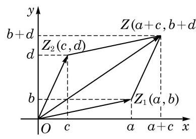

图 9-2-5

如图 9-2-5,复数 ${z}_{1} = a + b\mathrm{i}\left( {a\text{ 、 }b \in  \mathbf{R}}\right)$ 对应向量 $\overrightarrow{O{Z}_{1}} = \left( {a, b}\right)$ , 复数 ${z}_{2} = c + d\mathrm{i}\left( {c\text{ 、 }d \in  \mathbf{R}}\right)$ 对应向量 $\overrightarrow{O{Z}_{2}} = \left( {c, d}\right)$ . 由于复数 $z = {z}_{1} + {z}_{2} = \left( {a + c}\right)  + \left( {b + d}\right) \mathrm{i}$ ,因此 $z$ 对应于向量

$$
\overrightarrow{OZ} = \left( {a + c, b + d}\right)  = \overrightarrow{O{Z}_{1}} + \overrightarrow{O{Z}_{2}}.
$$

这说明, 两个复数的和所对应的向量就是原来两个复数所对应向量的和,即以 $\overrightarrow{O{Z}_{1}}$ 与 $\overrightarrow{O{Z}_{2}}$ 为邻边的平行四边形的对角线所表示的向量. 这就是复数加法的平行四边形法则. 同样, 两个复数的差 ${z}_{1} - {z}_{2}$ 所对应向量是两个向量 $\overrightarrow{O{Z}_{1}}\text{ 、 }\overrightarrow{O{Z}_{2}}$ 的差 $\overrightarrow{O{Z}_{1}} - \overrightarrow{O{Z}_{2}}$ .

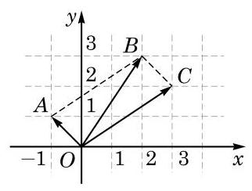

图 9-2-6

例 5 如图 9-2-6,在复平面上给定平行四边形 ${OABC}$ , 其中点 $A$ 与点 $C$ 分别对应于复数 ${z}_{A} =  - 1 + \mathrm{i}$ 与 ${z}_{C} = 3 + 2\mathrm{i}$ . 求点 $B$ 所对应的复数.

解 由平行四边形 ${ABCD}$ ,根据复数加法的平行四边形法则,点 $B$ 所对应的复数为 ${z}_{A} + {z}_{C} = 2 + 3\mathrm{i}$ .

#### 练习 9.2(1)

1. 当复数 $z$ 满足下列条件时,分别指出 $z$ 在复平面上所对应的点 $Z$ 的位置:

(1) $z$ 是正实数； (2) $z$ 是负实数；

(3) $z$ 是实部小于零、虚部大于零的虚数；(4) $z$ 是虚部小于零的纯虚数.

2. 如果复数 $z = \left( {m - 2}\right)  + \left( {{m}^{2} - {16}}\right) \mathrm{i}\left( {m \in  \mathbf{R}}\right)$ 在复平面上所对应的点在第四象限,求 $m$ 的取值范围.
3. 设复数 $3 - 4\mathrm{i}$ 与 5-6i 在复平面上所对应的向量分别为 $\overrightarrow{OA}$ 与 $\overrightarrow{OB}$ ( $O$ 为坐标原点), 求向量 $\overrightarrow{AB}$ 及 $\overrightarrow{BA}$ 所对应的复数.
4. 已知复平面上有点 $C\left( {2,4}\right)$ 和点 $D$ ,使得向量 $\overrightarrow{CD}$ 所对应的复数是 $- 3 - \mathrm{i}$ . 求点 $D$ 的坐标.

### 4 复数的模

复数 $z = a + b\mathrm{i}\left( {a\text{ 、 }b \in  \mathbf{R}}\right)$ 在复平面上所对应的点 $Z\left( {a, b}\right)$ 到原点的距离 $\sqrt{{a}^{2} + {b}^{2}}$ ,叫做复数 $z$ 的模 (modulus),记作 $\left| z\right|$ . 这样,复数 $z = a + b\mathrm{i}\left( {a\text{ 、 }b \in  \mathbf{R}}\right)$ 的模是

$$
\left| z\right|  = \left| {a + b\mathrm{i}}\right|  = \sqrt{{a}^{2} + {b}^{2}}.
$$

由于复数 $z = a + b\mathrm{i}$ 的模与该复数所对应的向量 $\overrightarrow{OZ}$ 的模是一致的, 因此复数的模也可以说成是其对应的向量的模.

例 6 求下列复数的模:

(1) ${z}_{1} = 3 + {4i}$ ；

(2) ${z}_{2} =  - \frac{1}{2} - \sqrt{2}\mathrm{i}.$

解 (1) $\left| {z}_{1}\right|  = \sqrt{{3}^{2} + {4}^{2}} = 5$ .

(2) $\left| {z}_{2}\right|  = \sqrt{{\left( -\frac{1}{2}\right) }^{2} + {\left( -\sqrt{2}\right) }^{2}} = \frac{3}{2}$ .

复数的模有如下性质:

$$
\left| z\right|  = \left| \bar{z}\right| , z\bar{z} = {\left| z\right| }^{2};
$$

$$
\left| {{z}_{1}{z}_{2}}\right|  = \left| {z}_{1}\right| \left| {z}_{2}\right|
$$

$$
\left| \frac{{z}_{1}}{{z}_{2}}\right|  = \frac{\left| {z}_{1}\right| }{\left| {z}_{2}\right| }
$$

其中, $z\text{ 、 }{z}_{1}\text{ 、 }{z}_{2} \in  \mathbf{C}$ ,并在关于除法的性质中需假设 ${z}_{2} \neq  0$ .

证明 设 $z = a + b\mathrm{i}\left( {a\text{ 、 }b \in  \mathbf{R}}\right)$ ,则

$$
\left| z\right|  = \sqrt{{a}^{2} + {b}^{2}} = \sqrt{{a}^{2} + {\left( -b\right) }^{2}} = \left| \bar{z}\right| ,
$$

$$
z\bar{z} = \left( {a + b\mathrm{i}}\right) \left( {a - b\mathrm{i}}\right)  = {a}^{2} - {\left( b\mathrm{i}\right) }^{2} = {a}^{2} + {b}^{2} = {\left| z\right| }^{2}.
$$

为证关于乘法的性质,设有两个复数 ${z}_{1} = a + b\mathrm{i}$ 与 ${z}_{2} = c + \; d\mathrm{i}\left( {a\text{ 、 }b\text{ 、 }c\text{ 、 }d \in  \mathbf{R}}\right)$ ,则

$$
\left| {{z}_{1}{z}_{2}}\right|  = \left| {\left( {a + b\mathrm{i}}\right) \left( {c + d\mathrm{i}}\right) }\right|
$$

$$
= \left| {\left( {{ac} - {bd}}\right)  + \left( {{ad} + {bc}}\right) \mathrm{i}}\right|
$$

$$
= \sqrt{{\left( ac - bd\right) }^{2} + {\left( ad + bc\right) }^{2}}
$$

$$
= \sqrt{{a}^{2}{c}^{2} - {2abcd} + {b}^{2}{d}^{2} + {a}^{2}{d}^{2} + {2abcd} + {b}^{2}{c}^{2}}
$$

$$
= \sqrt{\left( {{a}^{2} + {b}^{2}}\right) \left( {{c}^{2} + {d}^{2}}\right) }
$$

$$
= \sqrt{{a}^{2} + {b}^{2}} \cdot  \sqrt{{c}^{2} + {d}^{2}}
$$

$$
= \left| {z}_{1}\right| \left| {z}_{2}\right| \text{ . }
$$

---

复数的模也称为它的绝对值.

---

现在,进一步设 ${z}_{2} \neq  0$ ,则 ${z}_{1} = {z}_{2} \cdot  \frac{{z}_{1}}{{z}_{2}}$ ,于是 $\left| {z}_{1}\right|  = \; \left| {{z}_{2} \cdot  \frac{{z}_{1}}{{z}_{2}}}\right|  = \left| {z}_{2}\right|  \cdot  \left| \frac{{z}_{1}}{{z}_{2}}\right|$ . 两边除以 $\left| {z}_{2}\right|$ ,就得到 $\left| \frac{{z}_{1}}{{z}_{2}}\right|  = \frac{\left| {z}_{1}\right| }{\left| {z}_{2}\right| }$ .

例 7 已知复数 $z$ 满足 $\left| z\right|  = 1$ ,求证: $z + \frac{1}{z}$ 是实数.

证明 由 $\left| z\right|  = 1$ ,得 $z\bar{z} = {\left| z\right| }^{2} = 1$ ,所以 $\bar{z} = \frac{1}{z}$ ,由此得到 $z + \frac{1}{z} = z + \bar{z}$ ,从而可知 $z + \frac{1}{z}$ 是实数.

例 8 求下列复数的模:

(1) $\frac{\left( {1 - i}\right) \left( {1 + {2i}}\right) }{4 + {3i}}$ ；___

(2) $\frac{\left( {7 - {3i}}\right) \left( {5 + {4i}}\right) }{\left( {7 + {3i}}\right) \left( {-4 - {5i}}\right) }$ .

解 (1) $\left| \frac{\left( {1 - i}\right) \left( {1 + {2i}}\right) }{4 + {3i}}\right|  = \frac{\left| {1 - i}\right|  \times  \left| {1 + {2i}}\right| }{\left| 4 + 3i\right| }$

$$
= \frac{\sqrt{{1}^{2} + {\left( -1\right) }^{2}} \times  \sqrt{{1}^{2} + {2}^{2}}}{\sqrt{{4}^{2} + {3}^{2}}}
$$

$$
= \frac{\sqrt{10}}{5}\text{ . }
$$

---

第(2)小题虽可以像第(1)小题那样直接计算, 但这里的解法提供一个思路: 可以利用一些已知的性质简化计算过程.

---

(2)将原式分子分母都乘 $\mathrm{i}$ ,就得到 $\frac{\left( {7 - 3\mathrm{i}}\right) \left( {5 + 4\mathrm{i}}\right) \mathrm{i}}{\left( {7 + 3\mathrm{i}}\right) \left( {5 - 4\mathrm{i}}\right) }$ ,其中 $7 - 3\mathrm{i}$ 与 $7 + 3\mathrm{i},5 + 4\mathrm{i}$ 与 $5 - 4\mathrm{i}$ 是两对共轭复数,它们都分别有相同的模,所以 $\left| \frac{\left( {7 - 3\mathrm{i}}\right) \left( {5 + 4\mathrm{i}}\right) }{\left( {7 + 3\mathrm{i}}\right) \left( {-4 - 5\mathrm{i}}\right) }\right|  = \left| \mathrm{i}\right|  = 1$ .

复数的模还有如下性质: 对 ${z}_{1}\text{ 、 }{z}_{2} \in  \mathbf{C}$ ,

$$
\left| {z}_{1}\right|  + \left| {z}_{2}\right|  \geq  \left| {{z}_{1} + {z}_{2}}\right| .
$$

这不过是 “三角形两边之和大于第三边” 这个性质的另一种表达方式, 即必修课程第 2 章所述的 “三角不等式”. 如图 9-2-7, 若复平面上 ${Z}_{1}\text{ 、 }{Z}_{2}$ 是复数 ${z}_{1}\text{ 、 }{z}_{2}$ 所对应的点,则平行四边形 $O{Z}_{2}Z{Z}_{1}$ 的顶点 $Z$ 就是复数 ${z}_{1} + {z}_{2}$ 对应的点. 因此,有

$$
\left| {z}_{1}\right|  + \left| {z}_{2}\right|  = \left| {O{Z}_{1}}\right|  + \left| {O{Z}_{2}}\right|
$$

$$
= \left| {O{Z}_{1}}\right|  + \left| {{Z}_{1}Z}\right|
$$

$$
\geq  \left| {OZ}\right|
$$

$$
= \left| {{z}_{1} + {z}_{2}}\right| \text{ . }
$$

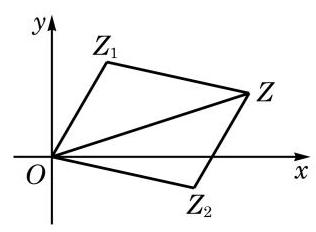

图 9-2-7

复平面上两点的距离可以简洁地用对应复数差的模表示出来: 设 ${Z}_{1}\left( {a, b}\right) \text{ 、 }{Z}_{2}\left( {c, d}\right)$ 是复平面上的两个点,其对应的复数为 ${z}_{1} = a + b\mathrm{i},{z}_{2} = c + d\mathrm{i}$ ,则由平面上两点间距离公式可知

$$
\left| {{z}_{1} - {z}_{2}}\right|  = \sqrt{{\left( a - c\right) }^{2} + {\left( b - d\right) }^{2}} = \left| {{Z}_{1}{Z}_{2}}\right|  = \left| \overrightarrow{{Z}_{1}{Z}_{2}}\right| .
$$

例 9 设复数 $- \sqrt{5} + {2\mathrm{i}}$ 和复数 $2 + \sqrt{5}\mathrm{i}$ 在复平面上分别对应点 $A$ 和点 $B$ ,求 $A\text{ 、 }B$ 两点间的距离.

解 $A\text{ 、 }B$ 两点间的距离是

$$
\left| {AB}\right|  = \sqrt{{\left( -\sqrt{5} - 2\right) }^{2} + {\left( 2 - \sqrt{5}\right) }^{2}}
$$

$$
= \sqrt{\left( {5 + 4\sqrt{5} + 4}\right)  + \left( {4 - 4\sqrt{5} + 5}\right) }
$$

$$
= 3\sqrt{2}\text{ . }
$$

练习 ${9.2}\left( 2\right)$

1. 计算下列复数的模:

(1) $\left( {4 - {3i}}\right)  + \left( {-{12} - {5i}}\right)$ ； (2) $\left( {2 - \sqrt{3}\mathrm{i}}\right) {\left( \sqrt{6} - \mathrm{i}\right) }^{2}$ ；

(3) $\frac{7 + \mathrm{i}}{{\left( 3 - 4\mathrm{i}\right) }^{2}}$ .

2. 设复数 ${z}_{1} = 6 + 8\mathrm{i}$ 与 ${z}_{2} = 9 - 4\mathrm{i}$ 在复平面上所对应的点为 ${Z}_{1}$ 与 ${Z}_{2}$ ,试指出 ${Z}_{1}\text{ 、 }{Z}_{2}$ 与以原点为圆心、 10 为半径的圆 $C$ 的位置关系.
3. 设复平面上平行四边形 ${OMNP}$ 的顶点 $O\text{ 、 }M\text{ 、 }P$ 的坐标分别为 $\left( {0,0}\right) \text{ 、 }\left( {3,4}\right)$ 、 $\left( {-2, - 3}\right)$ ,求 ${ON}$ 的长度.
4. 求复数 $8 + 5\mathrm{i}$ 与 $4 - 2\mathrm{i}$ 在复平面上所对应的点之间的距离.

#### 习题 9.2

##### A 组

1. 设复数 ${z}_{A} =  - 4\text{ 、 }{z}_{B} = 2\mathrm{i}\text{ 、 }{z}_{C} = 2 - 3\mathrm{i}\text{ 、 }{z}_{D} = 3 + 2\mathrm{i}\text{ 、 }{z}_{E} =  - 1 - \mathrm{i}$ .

(1)在复平面上分别作出这些复数所对应的点 $A$ 、 $B$ 、 $C$ 、 $D$ 、 $E$ ；

(2)在复平面上分别作出这些复数的共轭复数所对应的向量.

2. 求实数 $m$ 的值或取值范围,使得复数 $z = \left( {{m}^{2} - {8m} + {15}}\right)  + \left( {{m}^{2} - {5m} - {14}}\right) \mathrm{i}$ 在复平面上所对应的点 $Z$ 分别位于

(1)实轴上; (2)虚轴上; (3)第四象限.

3. 设在复平面上的点 $A$ 与点 $B$ 所对应的复数分别为 ${z}_{A}$ 与 ${z}_{B}$ ,对于下列各组复数,分别求向量 $\overrightarrow{AB}$ 和向量 $\overrightarrow{BA}$ 所对应的复数:

(1) ${z}_{A} = 2 - {3\mathrm{i}},{z}_{B} = 4 + {5\mathrm{i}}$ ；

(2) ${z}_{A} = \frac{1}{2} - \frac{\sqrt{3}}{2}\mathrm{i},{z}_{B} = \frac{\sqrt{3}}{2} + \frac{1}{2}\mathrm{i}.$

4. 已知复平面上有点 $A$ 和点 $B$ ,向量 $\overrightarrow{OA}$ 与向量 $\overrightarrow{AB}$ 所对应的复数分别为 $- 1 - {2\mathrm{i}}$ 与 4-i. 求点 $B$ 的坐标.
5. 设复数 $1 + 2\mathrm{i}\text{ 、 } - 2 + \mathrm{i}\text{ 、 } - 1 - 2\mathrm{i}$ 在复平面上所对应的点分别为 $A\text{ 、 }B\text{ 、 }C$ ,求 $\bigtriangleup {ABC}$ 的面积.
6. 计算:

(1) ${\left| 3 - 4\mathrm{i}\right| }^{4}$ ； (2) $\left| {\left( {1 + \mathrm{i}}\right) {\left( -2\sqrt{2} + \mathrm{i}\right) }^{3}}\right|$ ；

(3) $\left| \frac{\left( {\sqrt{5} - 2\mathrm{i}}\right) {\left( 1 + \sqrt{3}\mathrm{i}\right) }^{2}}{\sqrt{13} + \sqrt{23}\mathrm{i}}\right|$ ； (4) $\left| \frac{{\left( 1 + 3i\right) }^{3}\left( {4 - i}\right) }{{\left( 1 - 3i\right) }^{2}}\right|$ .

7. 已知 $\left| {1 - {4ki}}\right|  = 5$ ,其中 $k \in  \mathbf{R}$ . 求 $k$ 的值.
8. 设复数 $\left( {m - 1}\right)  + \left( {{2m} - 3}\right) \mathrm{i}\left( {m \in  \mathbf{R}}\right)$ 的模为 1,求 $m$ 的值.
9. 已知复数 $z = \frac{m + \left( {{3m} - 1}\right) \mathrm{i}}{2 - \mathrm{i}}\left( {m \in  \mathbf{R}}\right)$ 的实部与虚部互为相反数，求 $\left| z\right|$ .
10. 若复数 ${z}_{1} = 5 + {12}\mathrm{i}$ ，复数 ${z}_{2}$ 满足 $\left| {z}_{2}\right|  = {13}$ ，且 ${z}_{1}{z}_{2}$ 是纯虚数，求复数 ${z}_{2}$ .

##### B 组

1. 选择题:

(1)设复平面上表示 $2 - \mathrm{i}$ 和 $3 + 4\mathrm{i}$ 的点分别为点 $A$ 和点 $B$ ，则表示向量 $\overrightarrow{AB}$ 的复数在复平面上所对应的点位于 ( )

A. 第一象限; B. 第二象限; C. 第三象限; D. 第四象限.

(2)复平面上平行于虚轴的非零向量所对应的复数一定是 ( )

A. 正数; B. 负数;

C. 纯虚数; D. 实部不为零的虚数.

2. 已知复平面上平行四边形 ${ABCD}$ 的顶点 $A\text{ 、 }B\text{ 、 }C$ 的坐标分别是 $\left( {-2, - 1}\right) \text{ 、 }\left( {7,3}\right)$ 、 $\left( {{12},9}\right)$ ,求点 $D$ 的坐标和向量 $\overrightarrow{AD}$ 所对应的复数.
3. 设复数 ${z}_{1}$ 与 ${z}_{2}$ 分别对应复平面上的向量 $\overrightarrow{O{Z}_{1}}$ 与 $\overrightarrow{O{Z}_{2}}$ ,已知 $\left| \overrightarrow{O{Z}_{1}}\right|  = \left| \overrightarrow{O{Z}_{2}}\right|  = 1$ , $\overrightarrow{O{Z}_{1}} \bot  \overrightarrow{O{Z}_{2}}$ . 求 $\left| {{z}_{1} + {z}_{2}}\right|$ 与 $\left| {{z}_{1} - {z}_{2}}\right|$ .
4. 已知复数 $z$ 满足 $\left| z\right|  = 1$ ，且 $z$ 不是纯虚数. 求证: $\frac{z + \mathrm{i}}{z - \mathrm{i}}$ 是纯虚数.
5. 证明: 集合 $M = \{ z \mid  z = \cos \theta  + \mathrm{i}\sin \theta ,\theta  \in  \mathbf{R}\}$ 中的所有复数在复平面上所对应的点在同一个圆上.
6. 设 ${z}_{1}\text{ 、 }{z}_{2} \in  \mathbf{C}$ ,求证: ${\left| {z}_{1} + {z}_{2}\right| }^{2} + {\left| {z}_{1} - {z}_{2}\right| }^{2} = 2\left( {{\left| {z}_{1}\right| }^{2} + {\left| {z}_{2}\right| }^{2}}\right)$ .
7. 若复数 $z$ 满足 $\left| {z - 2}\right|  = \left| {z - 2\mathrm{i}}\right|  = 2$ ,求 $z$ .
